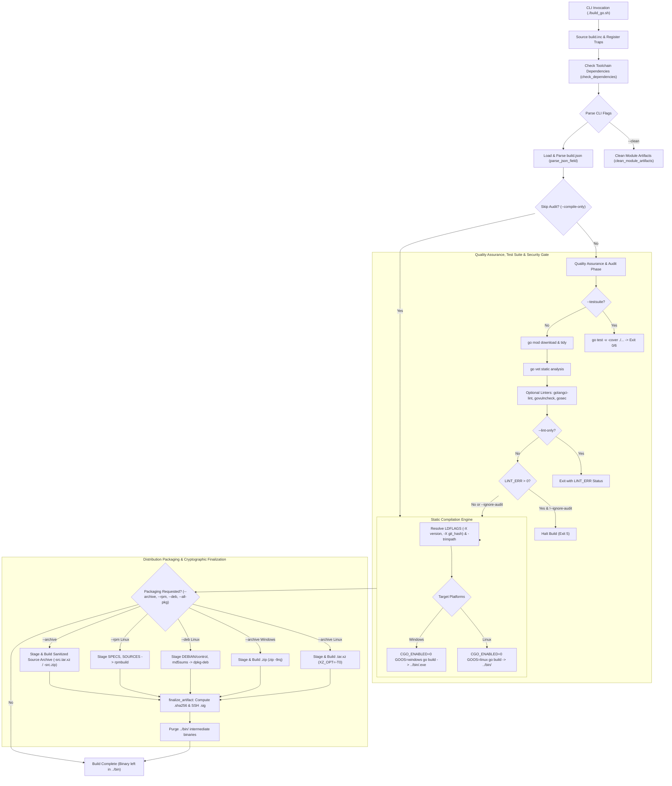

# Architecture Reference: Go Compilation & Quality Pipeline Engine (`build_go.sh`)

This document provides the architectural specification, operational sequence breakdown, and technical reference for [build_go.sh](build_go.sh), the core Go compilation, quality auditing, and packaging pipeline engine within the DevOps toolchain.

---

## 1. Application Overview and Objectives

[build_go.sh](build_go.sh) provides a hardened, module-agnostic build engine for Go applications. It enforces standardized formatting, executes multi-tier static code analysis and security vulnerability scanning, runs automated unit tests with coverage, compiles stripped static binaries (`CGO_ENABLED=0`), and packages standardized distribution artifacts (Tarball, Zipball, Debian `.deb`, and Red Hat `.rpm`) with parallel-safe `.sha256` checksums and optional OpenSSH digital signatures.

```
+---------------------------------------------------------------------------------------------------------------+
|                                                  build_go.sh                                                  |
|                                                                                                               |
|  +---------------------+   +---------------------+   +-----------------------+   +-------------------------+  |
|  | Quality & Test Gate |   | Static Compiler     |   | Multi-Format Packager |   | Integrity & Signing     |  |
|  | go test (-cover),   |-->| CGO_ENABLED=0,      |-->| .tar.xz (Linux),      |-->| <artifact>.sha256,      |  |
|  | go vet, gofumpt,    |   | -trimpath, ldflags  |   | .zip (Windows),       |   | <artifact>.sig          |  |
|  | golangci-lint,      |   | (Version, Git hash),|   | .deb (dpkg-deb),      |   | (ssh-keygen -Y sign),   |  |
|  | govulncheck, gosec  |   | output to ../bin    |   | .rpm (rpmbuild)       |   | cleanup intermediate    |  |
|  +---------------------+   +---------------------+   +-----------------------+   +-------------------------+  |
|                                                                                                               |
|  Sources: build.inc (Constants, Exit Codes, Host OS Detection, Logging, Sanitizers, Temp Trackers)            |
+---------------------------------------------------------------------------------------------------------------+
```

### Core Objectives
* **Single Static Binary Parity:** Compiles 100% static binaries (`CGO_ENABLED=0`) on Linux, eliminating external `glibc`/`musl` dependencies and reusing a single binary across Tarball archives, Debian packages, and RPM packages.
* **Cygwin / MSYS2 Windows Support:** Native Windows execution without WSL requirements; cross-compiles for Linux natively via Go (`GOOS=linux`) and builds Windows executables (`.exe`) and Zip archives using host utilities.
* **Metadata Autodetection via `build.json`:** Extracts application settings, semantic versions, entrypoints, and packaging metadata dynamically from `build.json`, backed by a robust multi-engine fallback parser.
* **Zero-Trust Quality Assurance & Testing:** Enforces automated test suites with coverage (`--testsuite`), formatting (`gofumpt`), static analysis (`go vet`, `golangci-lint`), and security vulnerability detection (`govulncheck`, `gosec`).
* **Orthogonal Platform & Packaging Controls:** Decouples platform targets (`--windows`, `--linux`, `--all-platform`) from packaging formats (`--archive`, `--rpm`, `--deb`, `--all-pkg`), allowing flexible matrix builds.
* **Parallel-Safe Integrity & Code Signing:** Generates dedicated per-archive `.sha256` checksums and optional Ed25519 OpenSSH digital signatures (`.sig`) without concurrency locking.
* **Intermediate Binary Cleanup:** Automatically cleans intermediate binaries in `../bin/` (relative to `CODE_HOME`) after packaging into `../distrib/`, preserving disk space and preventing stale binary reuse.
* **Artifact Lifecycle Management:** Supports `--clean` to cleanly wipe previously built module binaries and distribution packages.

### Related Documentation & Toolchain Links
* **[build.inc](build.inc)**: Shared library providing diagnostic exit codes, logging primitives, temporary directory tracking, OS detection, and cryptographic helpers.
* **[build_orchestrate_README.md](build_orchestrate_README.md)**: Technical reference for the multi-module orchestrator, parallel workpool scheduler, and template governance engine.
* **[build_SIGNING.md](build_SIGNING.md)**: Complete guide covering OpenSSH release artifact signing and verification workflows.

---

## 2. Architecture and Design Choices

### 2.1. Architectural Layout



### 2.2. Design Principles & Choices
1. **100% Static Binaries (`CGO_ENABLED=0`):** Linux binaries are built completely static with no libc/musl runtime links. This ensures maximum portability across CentOS, RHEL, Rocky Linux, Ubuntu, Debian, Alpine, and Amazon Linux.
2. **Metadata Architecture (`build.json`):** Replaces legacy flat files (`version.txt`, `main.txt`) with structured, declarative JSON configuration. Supported fields include semantic versioning, application entrypoints, summary/description, maintainer, license, URL, and packaging classifications.
3. **Multi-Engine Fallback JSON Parser:** [parse_json_field](build.inc#L469-L506) queries JSON fields using `jq`, falling back to `python3`, `python`, or a native `awk` stream scanner if dedicated tools are unavailable on minimal build nodes.
4. **Per-Archive Checksum Generation:** Replaces monolithic `SHA256SUMS` files with individual `<archive>.sha256` files generated concurrently alongside each package in `../distrib/`. This eliminates race conditions during parallel module orchestration.
5. **OpenSSH Cryptographic Signing:** Creates `<archive>.sig` signatures using native `ssh-keygen -Y sign -f <key> -n file <artifact>`, establishing cryptographic publisher identity verifiable without GPG/PGP dependencies.
6. **Path Trimming & Symbol Stripping:** Uses `-trimpath` to eliminate host filesystem paths from stack traces and embeds `-ldflags="-s -w"` to strip debug symbols, reducing final binary footprint by 40–60%.
7. **Intermediate Binary Cleanup:** When release packaging is requested, intermediate uncompressed binaries in `../bin/` are packed into release artifacts in `../distrib/` and then cleanly deleted, preventing stale build artifacts.

---

## 3. Metadata Specification (`build.json`)

The build engine dynamically discovers project and compiler metadata from `build.json` located in the active module root:

### JSON Schema & Field Reference

```json
{
  "name": "checkcert",
  "version": "1.0.5",
  "release": "1",
  "channel": "release",
  "entrypoint": ".",
  "version_pkg": "main.version",
  "build_pkg": "main.build",
  "summary": "SSL/TLS Certificate Expiration Checker",
  "description": "High-performance utility for auditing and validating X.509 certificates and SSL endpoints.",
  "maintainer": "Critical Systems <mis@criticalsys.net>",
  "license": "MIT",
  "url": "https://criticalsys.net",
  "section": "utils",
  "priority": "optional",
  "install_path": "/usr/local/bin",
  "cgo": false
}
```

| Field | Type | Default | Description |
| :--- | :--- | :--- | :--- |
| `name` | String | `$(basename $(pwd))` | Name of the compiled binary and base package name. |
| `version` | String | `0.1.0` | Base semantic version string (e.g. `1.0.5`). |
| `release` | String | `1` | Packaging release increment. Combined with OS ID and channel for RPM/DEB tags. |
| `channel` | String | `xg` | Distribution channel (e.g. `xg`, `release`, `stable`, `beta`). |
| `entrypoint` | String | `.` | Relative path to the Go main package (can be overridden via `--main-path=<path>`). |
| `version_pkg` | String | `main.version` | Target Go variable symbol for version injection (`-X ${version_pkg}=${version}`). |
| `build_pkg` | String | `""` (disabled) | Target Go variable symbol for Git commit hash injection (`-X ${build_pkg}=${git_hash}`). |
| `summary` | String | `<name> binary` | Single-line summary used in RPM spec and Debian control headers. |
| `description` | String | `<name> command-line application written in Go.` | Multi-line description sanitized for RFC 822 (Debian) and RPM spec macros. |
| `maintainer` | String | `Mis Center <support@criticalsys.net>` | Package maintainer name and email address. |
| `license` | String | `MIT` | Open source or proprietary software license identifier. |
| `url` | String | `https://criticalsys.net` | Corporate or project homepage URL. |
| `section` | String | `utils` | Debian package repository classification. |
| `priority` | String | `optional` | Debian package priority level. |
| `install_path` | String | `/usr/bin` | Destination directory where the binary is installed in DEB and RPM packages. |
| `cgo` | Boolean | `false` | Specifies whether CGO dynamic linking is disabled (enforcing 100% static compilation). |

### Go Code Variable Injection Example

```go
package main

import "fmt"

var (
    version = "dev"     // Populated at compile time via -X main.version=1.0.5
    build   = "unknown" // Populated at compile time via -X main.build=a1b2c3d
)

func main() {
    fmt.Printf("checkcert v%s (commit: %s)\n", version, build)
}
```

---

## 4. Quality Assurance, Test Strategy & Security Gates

[build_go.sh](build_go.sh) incorporates a multi-tier defense-in-depth quality and security inspection pipeline before compilation:

### 4.1. Automated Unit & Coverage Testing (`--testsuite`)
* Executes `go test -v -cover ./...` across all internal packages.
* Operates in isolation: upon completing tests, exits immediately with `EXIT_SUCCESS` (0) on passing tests or `EXIT_TEST` (6) on any failure.
* Prevents flawed or unverified code from progressing to compilation or packaging.

### 4.2. Static Code Analysis & Formatting
* **`gofumpt`**: Enforces strict canonical Go formatting (if installed).
* **`go vet`**: Detects structural defects, unkeyed composite literals, printf format mismatches, and unreachable code.

### 4.3. Multi-Linter Suite
* **`golangci-lint`**: Runs with `--no-config --timeout=5m` to provide an aggregated evaluation across cyclomatic complexity, dead code, error handling, and performance linters.

### 4.4. Vulnerability & Security Auditing
* **`govulncheck`**: Queries the official Go Vulnerability Database to detect known CVEs in direct and transitive dependencies.
* **`gosec`**: Runs AST security inspection (`gosec -quiet ./...`) to catch hardcoded secrets, weak cryptographic primitives, SQL injection patterns, or permissive file permissions.

### 4.5. Quality Gate Policy
* Any error during vet, linters, or security scanning sets `LINT_ERR=1`.
* In compilation mode, the build immediately halts with `EXIT_AUDIT` (5) unless explicitly overridden via `--ignore-audit` or bypassed via `--compile-only`.

---

## 5. Multi-Format Distribution Packaging

When packaging flags are supplied, artifacts are staged in isolated temporary directories created via [make_temp_dir](build.inc#L282-L300) and emitted directly to `../distrib/` (relative to `CODE_HOME`):

### 1. Linux Tarball Release Archive (`.tar.xz`)
* **Trigger:** `--linux --archive` (or `--all-pkg`)
* **Structure:** Includes static binary and documentation files (`LICENSE`, `README.md`, `CHANGELOG.md` via `DEFAULT_DOC_FILES`) staged under `doc/`.
* **Compression:** Multi-threaded XZ compression (`tar -C ${STAGE} -Jcf ${ARC_FILE} <app> doc`).

### 2. Windows Zipball Release Archive (`.zip`)
* **Trigger:** `--windows --archive` (or `--all-pkg` on Windows)
* **Structure:** Includes Windows executable (`<app>.exe`) and documentation (`LICENSE`, `README.md`, `CHANGELOG.md`) converted to CRLF line endings via `unix2dos`.
* **Compression:** Maximum zip compression (`zip -9rq ${WIN_ARC_FILE} <app>.exe doc`).

### 3. Debian Package (`.deb`)
* **Trigger:** `--linux --deb` (or `--all-pkg`)
* **Structure:** 
  - Binary installed to `${INSTALL_PATH}/${APP_NAME}` (`chmod 0755`)
  - Documentation installed to `/usr/share/doc/${APP_NAME}/`
  - Computed MD5 file hashes in `DEBIAN/md5sums`
  - RFC 822-compliant control file in `DEBIAN/control`
* **Builder:** `dpkg-deb --build --root-owner-group ${STAGE_DEB} ${DEB_FILE}`

### 4. Red Hat Package (`.rpm`)
* **Trigger:** `--linux --rpm` (or `--all-pkg`)
* **Structure:**
  - Generates standalone RPM spec file in `${RPM_TOPDIR}/SPECS/${APP_NAME}.spec`
  - Sanitizes `%` macros in summary, description, URL, and license
  - Sets `AutoReqProv: no` (100% static binary requires no dynamic glibc package dependencies)
  - Sets `%define _build_id_links none` and `%define debug_package %{nil}`
* **Builder:** `rpmbuild --define "_topdir ${RPM_TOPDIR}" -bb ${SPEC_FILE}`

### 5. Sanitized Source Archive (`-src.tar.xz` / `-src.zip`)
* **Trigger:** `--archive` (or `--all-pkg`)
* **Security Filter:** Enforces `SOURCE_EXCLUDES` denylist from [build.inc](build.inc#L168-L200) to strip `.git`, `.env*`, `*.key`, `*.pem`, `*.token`, `id_*`, binaries, and temporary files.

---

## 6. Dependencies and System Requirements

| Dependency | Classification | Optional/Required | Purpose |
| :--- | :--- | :--- | :--- |
| **Go** | Compiler | **Required** | Go build toolchain (v1.18+ recommended). |
| **Bash** | Shell Runtime | **Required** | Execution environment (Linux, Cygwin, MSYS2). |
| **[build.inc](build.inc)** | Shared Include | **Required** | Shared constants, exit codes, path normalization, JSON parser. |
| **gofumpt** | Formatter | Recommended | Strict code formatting. |
| **go vet** | Static Analyzer | **Required** | Standard Go correctness analysis (included with Go). |
| **golangci-lint** | Linter Runner | Recommended | Aggregated static analysis framework. |
| **govulncheck** | Vulnerability Scanner | Recommended | Official Go vulnerability scanner against known Go CVEs. |
| **gosec** | Security Scanner | Recommended | AST security scanner for risky coding patterns. |
| **tar / xz** | Archiver | Required for `--archive` | Multi-threaded XZ compression for Linux archives. |
| **zip** | Archiver | Required for `--archive` | Windows Zip archive packaging. |
| **dpkg-deb** | Packager | Required for `--deb` | Debian package generator (Linux only). |
| **rpmbuild** | Packager | Required for `--rpm` | Red Hat package generator (Linux only). |
| **sha256sum / shasum** | Cryptographic Hash | Required for packaging | Computes per-archive SHA256 checksums. |
| **ssh-keygen** | Code Signer | Required for `--sign` | OpenSSH digital signature generation. |

---

## 7. Diagnostic Granular Exit Codes

[build_go.sh](build_go.sh) returns granular exit codes for automated CI/CD triage and telemetry:

| Exit Code | Identifier | Description | Example Trigger |
| :---: | :--- | :--- | :--- |
| **0** | `EXIT_SUCCESS` | Success across all requested operations | Compilation, testing, or packaging passed |
| **1** | `EXIT_GENERAL` | General / unclassified runtime error | Unexpected execution failure |
| **2** | `EXIT_USAGE` | Invalid CLI arguments or syntax | Unknown or malformed flag passed |
| **3** | `EXIT_CONFIG` | `build.json` missing or SSH signing key missing | `build.json` not found in current directory |
| **4** | `EXIT_DEPENDENCY` | Missing prerequisite host tools | `go`, `tar`, `dpkg-deb`, or `rpmbuild` missing |
| **5** | `EXIT_AUDIT` | Code quality, lint, or security vulnerability failure | `govulncheck`, `gosec`, or `go vet` failed |
| **6** | `EXIT_TEST` | Automated test suite failed | `go test` unit test assertion failed |
| **7** | `EXIT_COMPILE` | Go compiler failure | Syntax error in Go code during `go build` |
| **8** | `EXIT_PACKAGE` | Packaging / archive creation failure | `tar`, `zip`, `dpkg-deb`, or `rpmbuild` failed |

---

## 8. Command Line Arguments

### Target Platform Options

| Argument | Description | Type | Default |
| :--- | :--- | :--- | :--- |
| `--windows` | Target Windows binary (`../bin/<name>.exe`). Default on Windows hosts. | Flag | Host default |
| `--linux` | Target static Linux binary (`../bin/<name>`). Default on Linux hosts. | Flag | Host default |
| `--all-platform` | Target both Windows and Linux binaries. | Flag | `false` |

### Packaging Actions

| Argument | Description | Type | Default |
| :--- | :--- | :--- | :--- |
| `--archive` | Package release archive (`.zip` on Windows, `.tar.xz` on Linux) + source archive + dedicated `.sha256`. | Flag | `false` |
| `--rpm` | Build RPM package in `../distrib/` via `rpmbuild` (Linux target only; ignored on Windows). | Flag | `false` |
| `--deb` | Build DEB package in `../distrib/` via `dpkg-deb` (Linux target only; ignored on Windows). | Flag | `false` |
| `--all-pkg` | Build all release artifacts (`--archive --rpm --deb` on Linux, `--archive` on Windows). Alias: `--all`. | Flag | `false` |
| `--sign` | Sign release archives (`<archive>.sig`) with default SSH key (`~/.ssh/signing/release_key`). | Flag | `false` |
| `--sign=<path>` | Sign release archives (`<archive>.sig`) with specified SSH private key or directory. | String | *Disabled* |
| `--genkey` | Generate Ed25519 signing key pair at `~/.ssh/signing/release_key` and exit (requires `--identity=<id>`). Alias: `--generate-key`. | Flag | *None* |
| `--genkey=<path>` | Generate a new Ed25519 SSH signing key pair at `<path>` and exit (requires `--identity=<id>`). Alias: `--generate-key=<path>`. | String | *None* |
| `--identity=<id>` | Signer identity email/name (mandatory with `--genkey`, e.g. `mis@criticalsys.net`). | String | *None* |
| `--comment=<text>` | Human-readable key comment embedded in `.pub` (optional, defaults to `Critical Systems Release Signing <<id>>`). | String | Formatted from `<id>` |

### Operational Options

| Argument | Description | Type | Default |
| :--- | :--- | :--- | :--- |
| `--clean` | Clean previously built artifacts for this module in `../bin/` and `../distrib/` (additive or standalone). | Flag | `false` |
| `--compile-only` | Compile without running tests, formatting, or static analysis linters. | Flag | `false` |
| `--lint-only` | Run linter and vulnerability analyzer processes, then exit with code status. | Flag | `false` |
| `--ignore-audit` | Do not abort compilation if quality/vulnerability checks report warnings. | Flag | `false` |
| `--testsuite` | Execute automated Go test suite with coverage (`go test -v -cover ./...`) and exit immediately. | Flag | `false` |
| `--update-modules` | Force updating all dependencies to the latest release (`go get -u -t ./...`). | Flag | `false` |
| `--vendor` | Synchronize module vendor directory (`go mod vendor`). | Flag | `false` |
| `--main-path=<path>` | Override the source code entrypoint path defined in `build.json`. | String | From `build.json` |
| `--log=<file>` | Append structured NDJSON execution logs to the specified file. | String | *Disabled* |
| `--help` | Display command line usage manual and exit. | Flag | `false` |

---

## 9. Usage Examples and Operational Workflows

> [!NOTE]
> `build_go.sh` is invoked from within a specific Go sub-project directory (e.g. `cd private/<module_name> && ../../build_go.sh [options...]`). In the examples below, commands are shown assuming the active working directory is the target module root.

### 9.1. Standard Compilation (Local Development)
Build the binary into `../bin/` with full static analysis and quality checks:
```bash
# Navigate to the target module directory
cd private/<module_name>

# Compile static binary
../../build_go.sh
```

### 9.2. Fast Iteration: Compile-Only Mode
Bypass linters, tests, and formatting to compile immediately during rapid iteration:
```bash
./build_go.sh --compile-only
```

### 9.3. Clean Module Artifacts
Wipe previously compiled binaries and distribution packages for this module:
```bash
# Standalone clean
./build_go.sh --clean

# Pristine clean rebuild
./build_go.sh --clean --linux --all-pkg
```

### 9.4. Automated Unit & Coverage Testing
Execute the unit test suite and generate code coverage metrics:
```bash
./build_go.sh --testsuite
```

### 9.5. Static Code Analysis & Security Audit Gate
Execute formatting, static checks, and vulnerability scanning inside CI/CD:
```bash
./build_go.sh --lint-only
```

### 9.6. Full Release Artifact Suite (Tarballs, DEBs, RPMs, Checksums)
Compile static binary, build all Linux packages in `../distrib/`, generate per-archive `.sha256` files, and clean intermediate binaries:
```bash
./build_go.sh --linux --all-pkg
```
Verify generated archive checksums:
```bash
cd ../distrib
sha256sum -c <module_name>-1.0.5-linux_amd64.tar.xz.sha256
```

### 9.7. Cryptographic Release Signing with OpenSSH
Compile, package, and sign all release archives with an isolated Ed25519 signing key:
```bash
# 1. Generate dedicated release signing key pair (run once)
./build_go.sh --genkey --identity=mis@criticalsys.net

# 2. Build and sign release artifacts
./build_go.sh --linux --all-pkg --sign
```
Verify artifact signature:
```bash
cd ../distrib

# Add publisher key to allowed_signers:
echo "mis@criticalsys.net namespaces=\"file\" $(cat ~/.ssh/signing/release_key.pub)" > allowed_signers

# Verify SSH signature on the archive:
ssh-keygen -Y verify -f allowed_signers -I mis@criticalsys.net -n file \
  -s <module_name>-1.0.5-linux_amd64.tar.xz.sig \
  < <module_name>-1.0.5-linux_amd64.tar.xz
```
*(For comprehensive security guidelines and CI/CD signing workflows, see [build_SIGNING.md](build_SIGNING.md).)*

### 9.8. Dependency Updates (`--update-modules`)
Force-update dependencies to their latest upstream releases while packaging or compiling:

```bash
# Update module dependencies and build full release packages (.tar.xz, .deb, .rpm)
../../build_go.sh --linux --all-pkg --update-modules

# Compile static binary only with updated dependencies
../../build_go.sh --compile-only --update-modules
```

---

## 10. References & Related Documentation

* **[build.inc](build.inc)**: Shared library providing diagnostic exit codes, logging primitives, temporary directory tracking, OS detection, and cryptographic helpers.
* **[build_orchestrate_README.md](build_orchestrate_README.md)**: Technical reference for the multi-module orchestrator, parallel workpool scheduler, and template governance engine.
* **[build_SIGNING.md](build_SIGNING.md)**: Complete guide covering OpenSSH release artifact signing and verification workflows.
