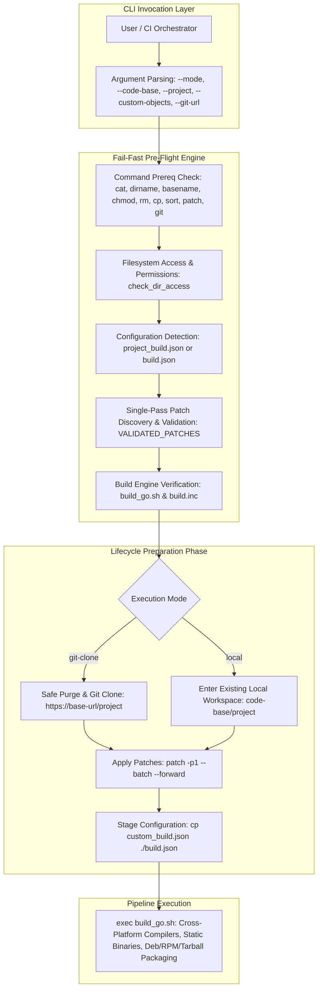
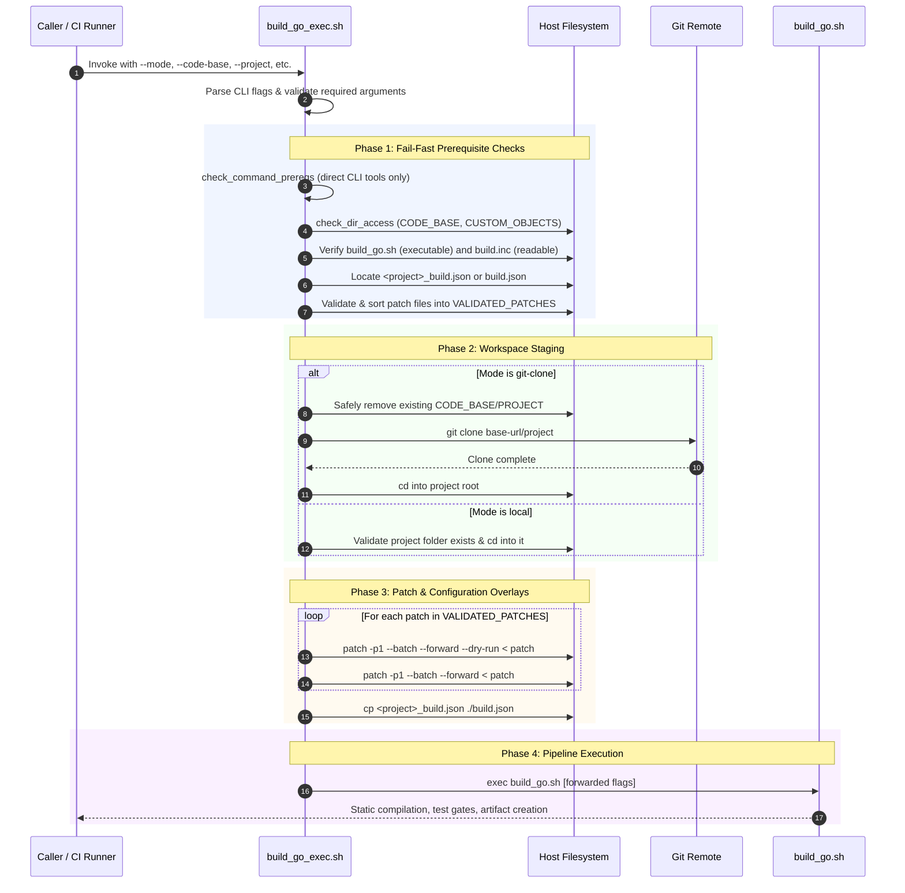
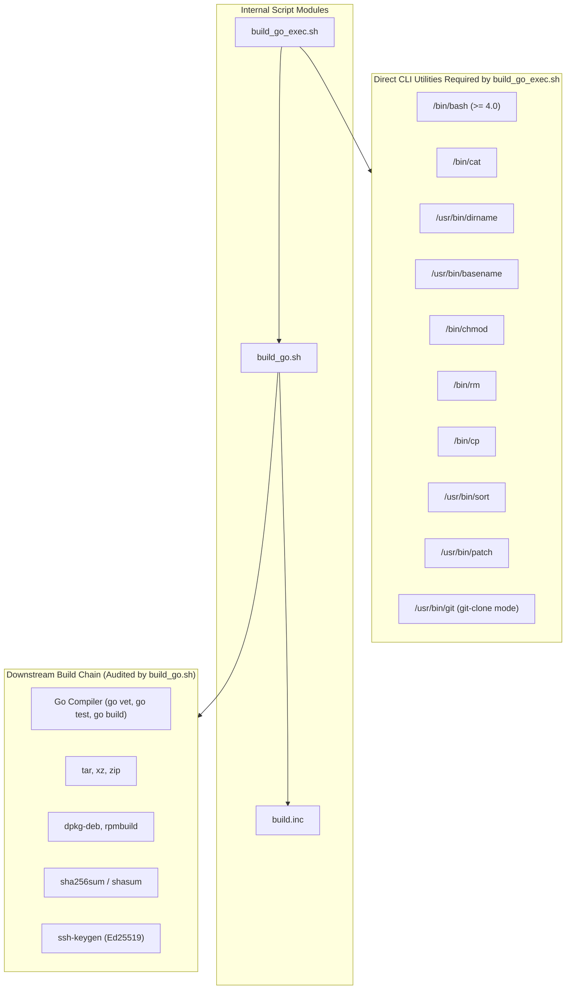
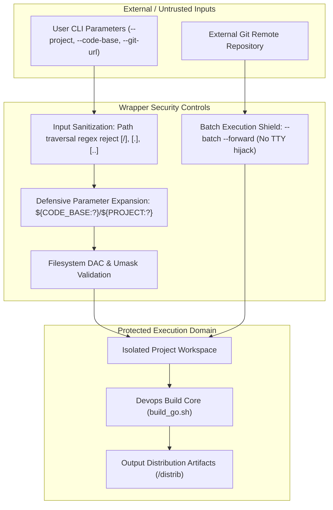

# Build Go Execution Engine (`build_go_exec.sh`)

## 1. Application Overview and Objectives

`build_go_exec.sh` is an automated, hardened orchestration wrapper engineered for enterprise-grade Go projects across the Critical Systems Devops pipeline. It acts as the pre-flight controller and execution lifecycle bridge between pristine upstream source repositories, customized patch/configuration overlays, and the central build and packaging engine ([`build_go.sh`](./build_go.sh)).

### Primary Objectives
- **Automated Lifecycle Orchestration**: Seamlessly manage both pristine upstream checkouts (`git-clone` mode) and iterative in-tree development workflows (`local` mode).
- **Fail-Fast Prerequisite Enforcement**: Intercept missing CLI tools, inaccessible paths, or malformed metadata before performing any mutating operations or triggering long compilation cycles.
- **Deterministic Overlay & Compatibility**: Enforce non-interactive, dry-run pre-validated patching (`--batch --forward`) and automated configuration staging (`<project>_build.json` $\to$ `build.json`).
- **Defensive File Operations**: Prevent accidental directory damage through sanitized parameter validation and guarded removals (`${CODE_BASE:?}/${PROJECT:?}`).
- **Granular Diagnostic Exit Telemetry**: Implement strict error code partitioning aligned with the core [`build.inc`](./build.inc) specification to support automated CI/CD failure triage.

---

## 2. Architecture and Design Choices

### High-Level Architecture Diagram



### Design Choices
1. **Delegation of Responsibility**: `build_go_exec.sh` only validates the utilities it *directly* invokes (e.g., `patch`, `git`, `sort`). Downstream compilation tools (`go`, `gcc`, `dpkg-deb`, `rpmbuild`, `tar`, `xz`) are handled by `build_go.sh`'s internal dependency auditor.
2. **Single-Pass Discovery (DRY)**: Patch files are globbed, readability-checked, size-verified, and deterministically sorted once during the pre-flight phase, preventing redundant filesystem scans.
3. **Execution Handoff via `exec`**: Replacing the wrapper shell process with `build_go.sh` guarantees zero memory overhead, preserves process hierarchy, and transparently propagates `build_go.sh`'s exit code to the caller.

### Assumptions
- Upstream repositories adhere to standard Go module structures (`go.mod` in root or specified entrypoint).
- Patch files in `CUSTOM_OBJECTS` adhere to standard unified diff formats (`-p1` stripping).
- The host system provides Bash version 4 or higher (supporting `readarray` and associative arrays).

### Edge Cases Handled
- **Traversal Injection**: Rejecting any `--project` parameter containing `/`, `.`, or `..` stops directory traversal attempts.
- **Interrupted Git Operations**: A `SIGINT`/`SIGTERM` trap handler (`cleanup_on_interrupt`) detects ongoing clone operations and purges partial checkouts upon cancellation.
- **Reversed or Stale Patches**: Non-interactive `--forward` flags prevent `patch` from hanging on interactive questions (`Assume -R?`), immediately failing with `EXIT_COMPILE` (7).
- **Configuration Clashing**: If `build.json` in the working directory matches the source configuration file, file copying is bypassed to prevent identical file clobbering.

---

## 3. Data Flow and Control Logic

### Operational Sequence Diagram



---

## 4. Performance and Scalability

### Efficiency Profile
- **Sub-Millisecond Pre-Flight Validations**: Direct path checks and command evaluations utilize native Bash builtins (`[[ ... ]]`, `command -v`), executing in $< 15\text{ ms}$.
- **Single Subprocess Invocation for Array Sorting**: Instead of invoking multiple subshells or line-by-line loops, patch sorting relies on `readarray -t` with a single piped `sort` process:
  ```bash
  readarray -t SORTED_PATCHES < <(printf '%s\n' "${RAW_PATCHES[@]}" | sort)
  ```
- **In-Memory Patch Dry-Run**: Patch integrity is verified via memory simulation (`--dry-run`) before filesystem writes occur, preventing disk thrashing and dirty working trees on failure.
- **Process Replacement**: Because the script ends with `exec "${BUILD_GO_SCRIPT}"`, the wrapper process does not remain resident in memory during compilation and distribution packaging.

---

## 5. Dependencies and Package Hierarchy

### Package Dependency Mermaid Chart



---

## 6. Security Architecture

### Security Layers & Trust Boundaries



### Security Controls & Mitigation Matrix

| Attack Vector / Failure Mode | Threat Mechanism | Implemented Mitigation |
| :--- | :--- | :--- |
| **Path Traversal / Wipe** | Injection in `--project` (e.g. `../../etc`) | Explicit regex check `[[ "${PROJECT}" =~ [/] \|\| "${PROJECT}" =~ ^\.\.?$ ]]` halts with `EXIT_CONFIG` (3). |
| **Unbounded Deletion** | Null/empty parameter expansion in `rm -rf` | Defensive bash expansion `${CODE_BASE:?}/${PROJECT:?}` guarantees non-empty paths. |
| **Terminal Hijacking / TTY Hang** | Patch prompting on `/dev/tty` for reversed patches | Enforced `--batch --forward` suppresses all interactive queries, rejecting hunks immediately. |
| **Partial Workspace Pollution** | Aborting `git clone` midway leaving dirty files | `trap cleanup_on_interrupt INT TERM` cleans up `${CODE_BASE}/${PROJECT}` automatically. |

---

## 7. Security Assessment

- **Encryption in Transit**: Git repository operations support standard secure transport protocols (`https://`, `ssh://`, `git@`). Insecure plaintext channels can be intercepted or enforced at the network proxy layer.
- **Secret Management**: No secrets, access tokens, SSH private keys, or credentials are hardcoded or accepted as command-line arguments. SSH signing keys, if used, are managed via standard paths in `build_go.sh` (`~/.ssh/signing/release_key`).
- **Access Control & RBAC**: Operates entirely within the discretionary access control (DAC) context of the running Linux user (`builder`). Requires write permissions only to `${CODE_BASE}`, `${CUSTOM_OBJECTS}`, and standard output directories (`../bin`, `../distrib`).
- **Unprivileged Execution**: Designed strictly for unprivileged non-root users. Does not invoke `sudo`, setuid binaries, or modify system-level paths.
- **Zero Third-Party Script Dependencies**: Runs on standard Linux Coreutils and POSIX shell utilities without external npm, python, or third-party packages.

---

## 8. Code Quality Assessment & Best Practices

- **ShellCheck Compliance**: Audited with ShellCheck with **0 warnings and 0 errors**.
- **Shell Hygiene**: Enforces `set -euo pipefail` at line 9 to guarantee immediate termination on unset variables, unexpected command errors, and pipe failures.
- **Granular Exit Codes**: Fully synchronized with [`build.inc`](./build.inc):
  - `0`: `EXIT_SUCCESS`
  - `1`: `EXIT_GENERAL`
  - `2`: `EXIT_USAGE`
  - `3`: `EXIT_CONFIG`
  - `4`: `EXIT_DEPENDENCY`
  - `7`: `EXIT_COMPILE`
- **DRY Implementation**: Unified path checking via `check_dir_access` and error handling via `abort`. Single-pass patch gathering into `VALIDATED_PATCHES`.

---

## 9. Command Line Arguments

| Argument | Type | Default | Mandatory | Description |
| :--- | :---: | :---: | :---: | :--- |
| `--mode` | String | *None* | **Yes** | Execution mode. Allowed values: `git-clone` (fresh clone) or `local` (existing folder). |
| `--code-base` | Path | *None* | **Yes** | Absolute or relative root folder containing projects (e.g. `/u01/data/devel/build/code/public`). |
| `--project` | String | *None* | **Yes** | Project/module name without slashes (e.g. `godap`). |
| `--custom-objects` | Path | *None* | **Yes** | Directory containing `<project>_build.json` (or `build.json`) and patches. |
| `--git-url` | URL | *None* | **Conditional** | Base Git repository URL (e.g. `https://github.com/Macmod`). Mandatory if `--mode git-clone`. |
| `--help`, `-h` | Flag | `false` | No | Displays usage manual and exit code definitions. |
| *Additional Flags* | Flags | *Default Pipeline* | No | Any unknown flags are forwarded directly to `build_go.sh` (defaults: `--all-platform --all-pkg --update-modules --ignore-audit`). |

---

## 10. Detailed Usage Examples and Output Samples

### Example 1: Fresh Git Clone Build (`git-clone` Mode)

Clones `https://github.com/Macmod/godap`, applies compatibility patches, copies `godap_build.json`, and triggers the complete distribution build.

```bash
/u01/data/devel/build/code/private/devops/build_tasks/build_go_exec.sh \
  --mode git-clone \
  --code-base /u01/data/devel/build/code/public \
  --project godap \
  --custom-objects /u01/data/devel/build/code/public \
  --git-url https://github.com/Macmod
```

#### Output Sample
```text
==============================================================================
>> Build Go Exec Wrapper
>> Mode           : git-clone
>> Code Base      : /u01/data/devel/build/code/public
>> Project        : godap
>> Custom Objects : /u01/data/devel/build/code/public
>> Git Base URL   : https://github.com/Macmod
>> Clone URL      : https://github.com/Macmod/godap
>> Build Engine   : /u01/data/devel/build/code/private/devops/build_tasks/build_go.sh
==============================================================================
>> Removing existing godap directory in /u01/data/devel/build/code/public...
>> Cloning https://github.com/Macmod/godap into /u01/data/devel/build/code/public/godap...
Cloning into 'godap'...
remote: Enumerating objects: 1056, done.
remote: Counting objects: 100% (322/322), done.
remote: Compressing objects: 100% (101/101), done.
remote: Total 1056 (delta 229), reused 221 (delta 221), pack-reused 734 (from 2)
Receiving objects: 100% (1056/1056), 3.61 MiB | 10.97 MiB/s, done.
Resolving deltas: 100% (712/712), done.
>> Testing and applying patch: godap-compat.patch...
checking file pkg/adidns/types.go
checking file pkg/ldaputils/actions.go
checking file tui/dnsmodify.go
checking file tui/main.go
patching file pkg/adidns/types.go
patching file pkg/ldaputils/actions.go
patching file tui/dnsmodify.go
patching file tui/main.go
>> Copying godap_build.json to ./build.json...
>> Executing: /u01/data/devel/build/code/private/devops/build_tasks/build_go.sh --all-platform --all-pkg --update-modules --ignore-audit
>> Compiling Static Linux Binary: godap (Version: 2.12.2, Entrypoint: .)
   [OK] Compiled: /u01/data/devel/build/bin/godap
>> Compiling Static Windows Binary: godap.exe (Version: 2.12.2, Entrypoint: .)
   [OK] Compiled: /u01/data/devel/build/bin/godap.exe
>> Packaging Linux Tarball Archive
   [OK] Created: /u01/data/devel/build/distrib/godap-2.12.2-linux_amd64.tar.xz
   [OK] Checksum created: /u01/data/devel/build/distrib/godap-2.12.2-linux_amd64.tar.xz.sha256
>> Packaging Windows Zip Archive
   [OK] Created: /u01/data/devel/build/distrib/godap-2.12.2-windows_amd64.zip
   [OK] Checksum created: /u01/data/devel/build/distrib/godap-2.12.2-windows_amd64.zip.sha256
>> Packaging Debian Package (.deb)
   [OK] Created: /u01/data/devel/build/distrib/godap-2.12.2-linux_amd64.deb
   [OK] Checksum created: /u01/data/devel/build/distrib/godap-2.12.2-linux_amd64.deb.sha256
>> Packaging RPM Package (.rpm)
   [OK] Created: /u01/data/devel/build/distrib/godap-2.12.2-linux_amd64.rpm
   [OK] Checksum created: /u01/data/devel/build/distrib/godap-2.12.2-linux_amd64.rpm.sha256
>> Packaging Source Archive
   [OK] Created: /u01/data/devel/build/distrib/godap-2.12.2-src.tar.xz
   [OK] Checksum created: /u01/data/devel/build/distrib/godap-2.12.2-src.tar.xz.sha256
================================================================================
   [OK] Build and packaging completed successfully for godap
================================================================================
```

---

### Example 2: In-Tree Local Verification (`local` Mode with Flag Override)

Builds an existing local tree without cloning, forwarding `--compile-only --linux` to bypass packaging:

```bash
/u01/data/devel/build/code/private/devops/build_tasks/build_go_exec.sh \
  --mode local \
  --code-base /u01/data/devel/build/code/public \
  --project godap \
  --custom-objects /u01/data/devel/build/code/public \
  --compile-only --linux
```

#### Output Sample
```text
==============================================================================
>> Build Go Exec Wrapper
>> Mode           : local
>> Code Base      : /u01/data/devel/build/code/public
>> Project        : godap
>> Custom Objects : /u01/data/devel/build/code/public
>> Project Folder : /u01/data/devel/build/code/public/godap
>> Build Engine   : /u01/data/devel/build/code/private/devops/build_tasks/build_go.sh
==============================================================================
>> Testing and applying patch: godap-compat.patch...
checking file pkg/adidns/types.go
checking file pkg/ldaputils/actions.go
checking file tui/dnsmodify.go
checking file tui/main.go
patching file pkg/adidns/types.go
patching file pkg/ldaputils/actions.go
patching file tui/dnsmodify.go
patching file tui/main.go
>> Copying godap_build.json to ./build.json...
>> Executing: /u01/data/devel/build/code/private/devops/build_tasks/build_go.sh --all-platform --all-pkg --update-modules --ignore-audit --compile-only --linux
>> Compiling Static Linux Binary: godap (Version: 2.12.2, Entrypoint: .)
   [OK] Compiled: /u01/data/devel/build/bin/godap
================================================================================
   [OK] Build completed successfully for godap
================================================================================
```

---

### Example 3: Diagnostic Triage on Prerequisite Abort

Executing with an invalid project name:

```bash
/u01/data/devel/build/code/private/devops/build_tasks/build_go_exec.sh \
  --mode local \
  --code-base /u01/data/devel/build/code/public \
  --project "godap/submodule" \
  --custom-objects /u01/data/devel/build/code/public
echo "Exit Code: $?"
```

#### Output Sample
```text
ERROR: Invalid project name 'godap/submodule'. Must be a simple folder name without path separators.
Exit Code: 3
```
