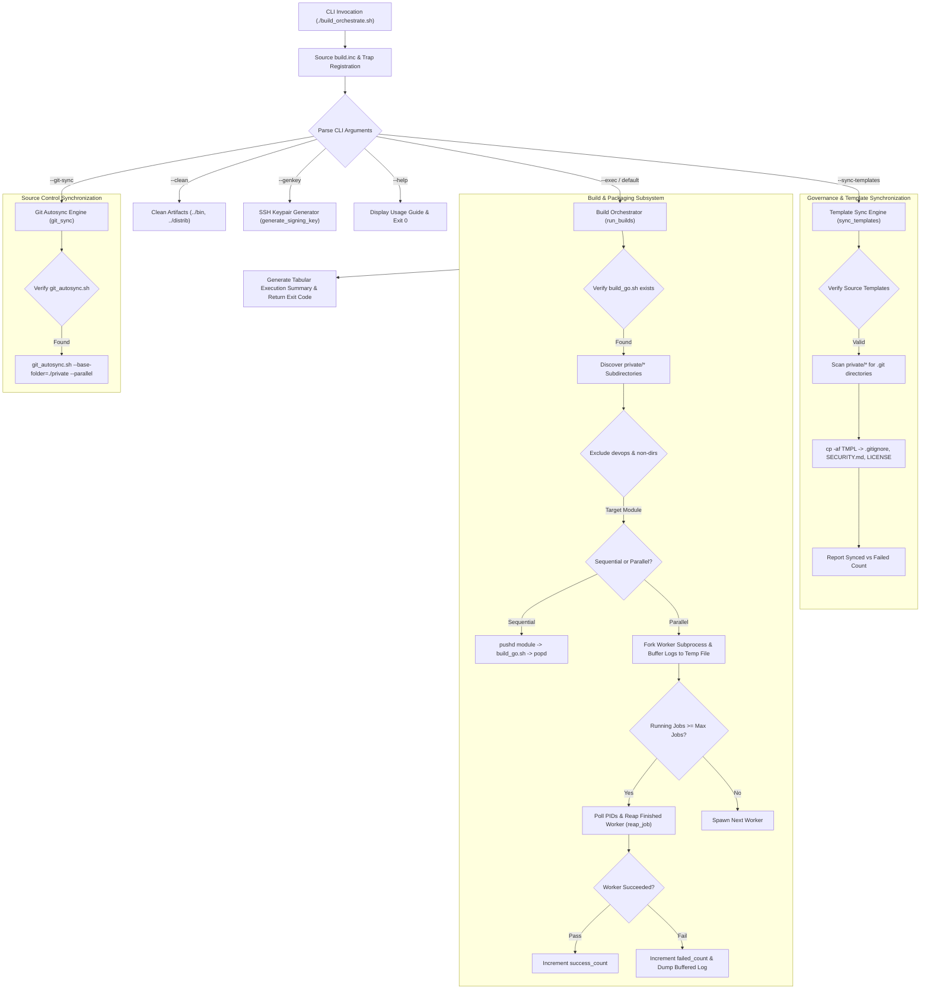
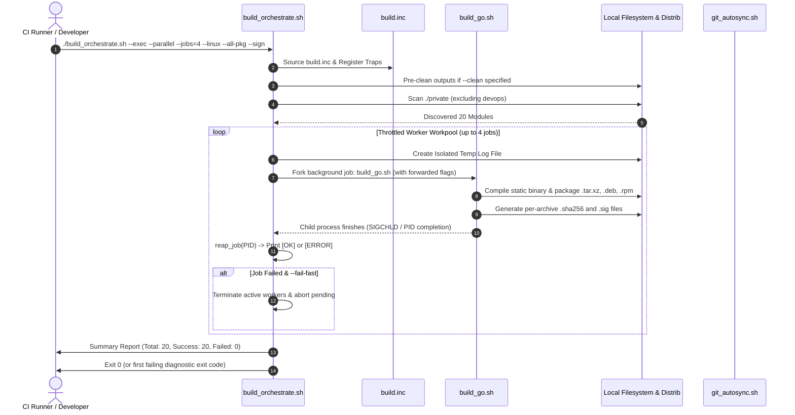
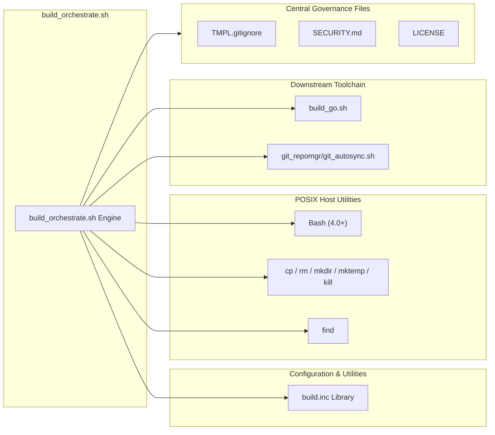

# Architecture Reference: Multi-Module Build Orchestrator (`build_orchestrate.sh`)

This document provides the architectural specification, operational flow analysis, and technical reference for [build_orchestrate.sh](build_orchestrate.sh), the multi-module build orchestrator, parallel job scheduler, and governance automation engine within this workspace.

---

## 1. Application Overview and Objectives

[build_orchestrate.sh](build_orchestrate.sh) serves as the top-level orchestration controller across all private Go sub-projects and service modules residing in the workspace repository structure (primarily targeting the `private/` directory). It standardizes module iteration, automated compilation, parallel execution, template governance, release code signing, and Git synchronizations.

```
+---------------------------------------------------------------------------------------------------+
|                                       build_orchestrate.sh                                        |
|                                                                                                   |
|  +--------------------+   +-----------------------+   +--------------------+   +----------------+  |
|  | Template Sync      |   | Parallel Workpool     |   | Compiler Dispatch  |   | Git Autosync   |  |
|  | (.gitignore,       |   | (--parallel, --jobs=N,|-->| (Forward flags to  |   | (Delegates to  |  |
|  |  SECURITY.md,      |   |  log buffering,       |   |  build_go.sh)      |   |  git_autosync) |  |
|  |  LICENSE)          |   |  signal reaping)      |   |                    |   |                |  |
|  +--------------------+   +-----------------------+   +--------------------+   +----------------+  |
|                                                                                                   |
|  Sources: build.inc (Constants, Exit Codes, Host OS Detection, Logging, Temp Trackers)            |
+---------------------------------------------------------------------------------------------------+
```

### Core Components
1. **Execution Router:** Parses CLI arguments and routes execution across operational modes (`--exec`, `--clean`, `--sync-templates`, `--git-sync`, `--genkey`).
2. **Sub-Project Discovery Engine:** Automatically discovers active Git repositories within `CODE_BASE` (default: `private/`, configurable via `--code-base=<path>`), enforcing exclusion filters (`CODE_EXCLUDES="devops"`).
3. **Process Orchestrator & Workpool:** Dispatches jobs sequentially or manages concurrent background workers up to maximum capacity (`--parallel`, `--jobs=N`).
4. **Log Multiplexer & Buffer:** In parallel mode, isolates per-module `stdout` and `stderr` into dedicated temporary log files, eliminating terminal output interleaving while flushing error traces immediately on failure.
5. **Template Synchronizer:** Broadcasts centralized legal, security, and repository cleanliness templates (`TMPL.gitignore`, `SECURITY.md`, `LICENSE`) across all private sub-projects (`--sync-templates`).
6. **Git AutoSync Manager:** Interfaces with the centralized repository synchronizer (`git_autosync.sh`) to perform multi-module commits and pushes (`--git-sync`).
7. **Signal & Process Reaper Trap:** Guarantees orderly termination of background workers and safe purging of temporary directories upon receiving `EXIT`, `INT`, or `TERM` signals.

### Central Templates and Files
* **[LICENSE](LICENSE)**: Organization's standard MIT License applied across private sub-projects.
* **[SECURITY.md](SECURITY.md)**: Standard vulnerability reporting policies and response procedures.
* **[TMPL.gitignore](TMPL.gitignore)**: Master `.gitignore` template detailing default build outputs, credentials, secrets, transient files, and editor caches.
* **[build.inc](build.inc)**: Shared library providing diagnostic exit codes, logging primitives, temporary directory tracking, OS detection, and cryptographic helpers.
* **[build_go_README.md](build_go_README.md)**: Technical reference for the underlying Go compilation, quality auditing, and packaging engine.
* **[build_SIGNING.md](build_SIGNING.md)**: Master reference guide detailing OpenSSH release artifact signing architecture, keypair lifecycle management, hardened permissions, allowed signers configuration, and cryptographic verification workflows.

---

## 2. Architecture and Design Choices

### 2.1. Architectural Layout



### 2.2. Design Principles & Choices
1. **Dynamic Path Independence:** Resolves root workspace paths dynamically using `${BASH_SOURCE[0]}` (`SCRIPT_DIR`), allowing reliable execution from root, subdirectories, or external CI/CD wrappers.
2. **Directory Stack Sandboxing:** Uses `pushd` and `popd` inside sequential module loops to guarantee environment path shifts and current working directory states remain isolated to each module.
3. **Selective Exclusion Matrix:** Maintains a declarative `CODE_EXCLUDES="devops"` filter to prevent recursive build loops or attempting compilation on infrastructure-only repositories.
4. **Log Multiplexing & Isolation:** During parallel execution (`--parallel`, `--jobs=N`), standard output and error streams are captured into isolated per-module temporary files (`LOG_FILE=$(make_temp_dir "orch_log_${MODULE_NAME}")/build.log`). On success, a clean one-line status is printed; on failure, the trailing error log is flushed to `stderr` without corrupting terminal output.
5. **Signal & Process Reaper Trap:** Traps `EXIT`, `INT`, and `TERM` signals to terminate any active background worker PIDs (`kill -TERM "${pids[@]}"`) and wipe tracked temporary log directories (`cleanup_tracked_temp_dirs`).
6. **Pre-Clean & Standalone Clean:** Supports `--clean` to cleanly purge built artifacts across `../bin/` and `../distrib/` (relative to `CODE_HOME`). Operates standalone (wiping outputs and exiting) or additively prior to running `--exec`.
7. **Flag Forwarding:** Seamlessly forwards target platform (`--windows`, `--linux`, `--all-platform`), packaging (`--archive`, `--rpm`, `--deb`, `--all-pkg`), code quality (`--compile-only`, `--lint-only`, `--ignore-audit`, `--testsuite`), signing (`--sign`, `--identity`), and logging (`--log=<file>`) options directly to the underlying [build_go.sh](build_go.sh) compiler engine.

---

## 3. Data Flow and Control Logic

### 3.1. Operational Flow and Code Relations



### 3.2. Data Sequences
1. **Parameter Routing:** CLI arguments are ingested by the router loop. Operational flags (`--clean`, `--parallel`, `--jobs=N`, `--fail-fast`) are consumed locally; build, test, and packaging flags are aggregated into `BUILD_ARGS` for forwarding.
2. **Directory Enumeration:** Validates that `CODE_BASE` exists and enumerates candidate directory paths under `private/*`.
3. **Execution Context Dispatch:** Enters each module directory and executes [build_go.sh](build_go.sh) with all forwarded arguments.
4. **Log & Process Monitoring:** In parallel mode, manages worker PIDs in a FIFO workpool, polling active jobs and reaping completed ones via `reap_job`.
5. **Output Validation & Metric Aggregation:** Tracks module completion counters, flushes error traces if builds fail, and exits with a standardized diagnostic code.

---

## 4. Performance and Scalability

### 4.1. Concurrency Model
* **Parallel Orchestration (`--parallel`, `--jobs=N`):** Enables multi-core compilation by maintaining a pool of concurrent worker processes. Defaults to all available host CPU cores via `DEFAULT_PARALLEL_JOBS="$(nproc 2>/dev/null || echo 4)"`, or custom throttled limits (e.g. `--jobs=4`).
* **Fail-Fast Error Mitigation (`--fail-fast`):** When active, the orchestrator immediately halts submission of new jobs upon encountering any failure and sends `SIGTERM` to active workers, preventing wasted CPU cycles in CI environments.
* **Network-Bound Git Concurrency (`--git-sync`):** Bridges to `git_autosync.sh --parallel` to execute concurrent Git fetch, commit, and push operations across all sub-projects.

### 4.2. Resource Management
* **Zero Output Interleaving:** Parallel worker stdout and stderr streams are isolated in temporary log files, guaranteeing clean terminal output.
* **Leak-Free Temp Trapping:** Temporary files and directories are registered in `TRACKED_TEMP_DIRS` and safely unlinked via `cleanup_orchestrator` on both successful exits and early terminations.

---

## 5. Dependencies and System Requirements



| Dependency | Classification | Minimum Version | Purpose |
| :--- | :--- | :--- | :--- |
| **Bash** | System Shell | `4.0+` | Shell runtime supporting arrays, parameter expansion, and process tracking. |
| **GNU Coreutils** | System Utilities | POSIX | `cp -af`, `mkdir`, `rm -rf`, `mktemp`, `kill`, `date`. |
| **[build.inc](build.inc)** | Shared Include | `2.0.0+` | Central exit codes, host detection, logging, and keygen helpers. |
| **[build_go.sh](build_go.sh)** | Compiler Engine | `2.2.0+` | Module compiler, linter runner, test harness, and distribution packager. |
| **[git_autosync.sh](private/devops/git_repomgr/git_autosync.sh)** | Internal Script | `1.0.0+` | Multi-repository Git sync manager. |
| **OpenSSH (ssh-keygen)** | Cryptographic Tool | `8.0+` | Ed25519 signing keypair generation and release artifact verification (see [build_SIGNING.md](build_SIGNING.md)). |
| **Governance Templates** | Config Assets | Latest | `TMPL.gitignore`, `SECURITY.md`, `LICENSE`. |

---

## 6. Diagnostic Granular Exit Codes

[build_orchestrate.sh](build_orchestrate.sh) adheres to the centralized diagnostic exit code standard defined in [build.inc](build.inc) for automated CI/CD triage and telemetry:

| Exit Code | Identifier | Description | Example Trigger |
| :---: | :--- | :--- | :--- |
| **0** | `EXIT_SUCCESS` | Success across all requested operations | All sub-modules built, audited, or packaged cleanly |
| **1** | `EXIT_GENERAL` | General / unclassified runtime error | Unexpected system error during batch orchestration |
| **2** | `EXIT_USAGE` | Invalid CLI arguments or syntax | Unknown or malformed flag passed |
| **3** | `EXIT_CONFIG` | Missing required directory or configuration | `private/` codebase directory missing |
| **4** | `EXIT_DEPENDENCY` | Missing prerequisite host tools | `build_go.sh` not found or not executable |
| **5** | `EXIT_AUDIT` | Code quality, lint, or security vulnerability failure | `govulncheck`, `gosec`, or `go vet` failed in a sub-module |
| **6** | `EXIT_TEST` | Automated test suite failed | `go test` unit test failure in a sub-module |
| **7** | `EXIT_COMPILE` | Go compiler failure | Syntax error in Go source code |
| **8** | `EXIT_PACKAGE` | Packaging / archive creation failure | `tar`, `zip`, `dpkg-deb`, or `rpmbuild` failed |
| **9** | `EXIT_SYNC` | Template synchronization or Git autosync failure | Template file missing or `git_autosync.sh` failure |

---

## 7. Command Line Arguments

### Operational & Codebase Modes

| Argument | Description | Type | Default |
| :--- | :--- | :--- | :--- |
| `--exec` | Run the module compiler engine across all sub-projects (default action). | Flag | Active |
| `--code-base=<path>` | Specify sub-project codebase directory path containing applications to build. | String | `private` |
| `--clean` | Clean built artifacts in `../bin/` and `../distrib/` (additive or standalone). | Flag | `false` |
| `--sync-templates` | Distribute master files (`TMPL.gitignore`, `SECURITY.md`, `LICENSE`) to all repositories in target codebase. | Flag | `false` |
| `--git-sync` | Synchronize all codebase repositories with Git using the central auto-sync manager. | Flag | `false` |
| `--help` | Display command line usage manual and exit. | Flag | `false` |

### Parallel Execution Options

| Argument | Description | Type | Default |
| :--- | :--- | :--- | :--- |
| `--parallel` | Enable parallel multi-job compilation across sub-projects. | Flag | `false` |
| `--jobs=N` | Specify maximum parallel worker jobs (e.g. `--jobs=4`). | Integer | `$(nproc 2>/dev/null \|\| echo 4)` |
| `--fail-fast` | Immediately abort remaining jobs and terminate active workers upon first failure. | Flag | `false` |

### Platform & Packaging Flags (Forwarded to `build_go.sh`)

| Argument | Description | Type | Default |
| :--- | :--- | :--- | :--- |
| `--windows` | Target Windows builds across all sub-projects (builds `../bin/<name>.exe`). | Flag | Host default on Windows |
| `--linux` | Target Linux builds across all sub-projects (builds static `../bin/<name>`). | Flag | Host default on Linux |
| `--all-platform` | Target both Windows and Linux builds across all sub-projects. | Flag | `false` |
| `--archive` | Package release archives inside `../distrib/` across all sub-projects. | Flag | Active |
| `--rpm` | Build RPM packages in `../distrib/` across all sub-projects (Linux only). | Flag | `false` |
| `--deb` | Build DEB packages in `../distrib/` across all sub-projects (Linux only). | Flag | `false` |
| `--all-pkg` | Build all release artifacts (`--archive --rpm --deb`) across all sub-projects. Alias: `--all`. | Flag | `false` |
| `--sign` | Sign release archives (`<archive>.sig`) with default SSH key (`~/.ssh/signing/release_key`). See [build_SIGNING.md](build_SIGNING.md). | Flag | `false` |
| `--sign=<path>` | Sign release archives (`<archive>.sig`) with specified SSH private key or directory. See [build_SIGNING.md](build_SIGNING.md). | String | *Disabled* |
| `--genkey` | Generate Ed25519 signing key pair at `~/.ssh/signing/release_key` and exit (requires `--identity=<id>`). Alias: `--generate-key`. See [build_SIGNING.md](build_SIGNING.md). | Flag | *None* |
| `--genkey=<path>` | Generate a new Ed25519 SSH signing key pair at `<path>` and exit (requires `--identity=<id>`). Alias: `--generate-key=<path>`. See [build_SIGNING.md](build_SIGNING.md). | String | *None* |
| `--identity=<id>` | Signer identity email/name (mandatory with `--genkey`, e.g. `mis@criticalsys.net`). | String | *None* |
| `--comment=<text>` | Human-readable key comment embedded in `.pub` (optional, defaults to `Critical Systems Release Signing <<id>>`). | String | Formatted from `<id>` |

### Quality Assurance & Operational Flags (Forwarded to `build_go.sh`)

| Argument | Description | Type | Default |
| :--- | :--- | :--- | :--- |
| `--compile-only` | Compile without running tests, formatting, or static analysis linters. | Flag | `false` |
| `--lint-only` | Run linters/audits only across all modules, then exit. | Flag | `false` |
| `--ignore-audit` | Continue compilation even if linters report warnings. | Flag | `false` |
| `--testsuite` | Execute automated Go test suite with coverage (`go test -v -cover ./...`) across all modules. | Flag | `false` |
| `--update-modules` | Force updating all dependencies to the latest release (`go get -u`). | Flag | `false` |
| `--vendor` | Synchronize module vendor directories (`go mod vendor`). | Flag | `false` |
| `--log=<file>` | Append structured NDJSON execution logs to the specified file. | String | *Disabled* |

---

## 8. Usage Examples and Operational Workflows

### 8.1. Clean Workspace & Pristine Rebuilds
```bash
# Standalone clean: wipes all built artifacts in ../bin/ and ../distrib/ and exits
./build_orchestrate.sh --clean

# Pristine clean rebuild: wipes outputs first, then compiles and packages all artifacts
./build_orchestrate.sh --clean --exec --all-pkg
```

### 8.2. Parallel Multi-Module Build
```bash
# Compile and package release archives across all modules with 4 concurrent jobs
./build_orchestrate.sh --exec --parallel --jobs=4 --linux --archive
```

### 8.3. Full Release Artifact Suite (Tarballs, DEBs, RPMs, Checksums)
```bash
# Builds complete distribution artifacts across all modules
./build_orchestrate.sh --exec --all-pkg

# Builds complete distribution artifacts across all modules for both platforms
./build_orchestrate.sh --exec --all-platform --all-pkg
```

### 8.4. Automated Test Suite Execution Across All Modules
```bash
# Runs unit tests and coverage across all modules in parallel with fail-fast gating
./build_orchestrate.sh --exec --parallel --jobs=4 --fail-fast --testsuite
```

### 8.5. Template Synchronization
```bash
# Propagates central TMPL.gitignore, SECURITY.md, and LICENSE to all sub-repositories
./build_orchestrate.sh --sync-templates
```

### 8.6. Batch Git Autosync
```bash
# Triggers parallel git commit and push across all sub-repositories
./build_orchestrate.sh --git-sync
```

### 8.7. SSH Release Signing & Key Management
The orchestration suite provides native integration with OpenSSH Ed25519 digital signatures, enabling end-to-end supply-chain integrity verification for all compiled archives, DEBs, and RPMs.

```bash
# 1. Generate a dedicated Ed25519 signing keypair with mandatory identity binding
./build_orchestrate.sh --genkey=/home/users/builder/.ssh/signing/release_key \
  --identity=mis@criticalsys.net \
  --comment="Critical Systems Orchestrated Release Signing"

# 2. Compile, package, and cryptographically sign release artifacts across all modules in parallel
./build_orchestrate.sh --exec --parallel --jobs=4 --linux --all-pkg --sign=/home/users/builder/.ssh/signing/release_key

# 3. Verify signatures against an allowed_signers trust anchor (example on checkcert archive)
ssh-keygen -Y verify -f /home/users/builder/.ssh/signing/allowed_signers \
  -I mis@criticalsys.net \
  -n file \
  -s ../distrib/checkcert-0.2.1-linux_amd64.tar.xz.sig < ../distrib/checkcert-0.2.1-linux_amd64.tar.xz
```

> [!NOTE]
> For in-depth cryptographic specifications, key rotation policies, automated CI/CD signing workflows, and verification scripts, consult **[build_SIGNING.md](build_SIGNING.md)**.

### 8.8. Configurable Codebase Tree
```bash
# Compile sub-projects located in a custom or alternative directory tree (e.g. public/)
./build_orchestrate.sh --code-base=public --exec --compile-only
```

### 8.9. Dependency Updates Across All Modules
Force-update dependencies to their latest upstream releases across all sub-projects while packaging or compiling:

```bash
# Update modules and package full release suite (.tar.xz, .deb, .rpm) across all projects in parallel
./build_orchestrate.sh --exec --parallel --jobs=4 --all-pkg --update-modules

# Sequential dependency update and full release build
./build_orchestrate.sh --exec --all-pkg --update-modules

# Update modules and compile static binaries only in parallel (skipping packaging)
./build_orchestrate.sh --exec --parallel --jobs=4 --update-modules

# Update modules and package while ignoring non-fatal linter/vulnerability audit warnings
./build_orchestrate.sh --exec --parallel --jobs=4 --all-pkg --update-modules --ignore-audit

# Update modules, build full release packages, and cryptographically sign in parallel
./build_orchestrate.sh --exec --parallel --jobs=4 --all-pkg --update-modules --sign
```

---

## 9. References & Related Documentation

* **[build_SIGNING.md](build_SIGNING.md)**: Master architectural guide and reference manual for OpenSSH Ed25519 release artifact signing, key generation, trust anchors (`allowed_signers`), automated verification scripts, and CI/CD security policies.
* **[build_go_README.md](build_go_README.md)**: In-depth documentation for the module compilation engine (`build_go.sh`), covering `build.json` schema specifications, multi-stage static analysis, dependency vendoring, and packaging mechanics.
* **[build.inc](build.inc)**: Core include library providing standardized exit codes, host detection, NDJSON audit logging, directory lifecycle tracking, and cryptographic helper routines.
