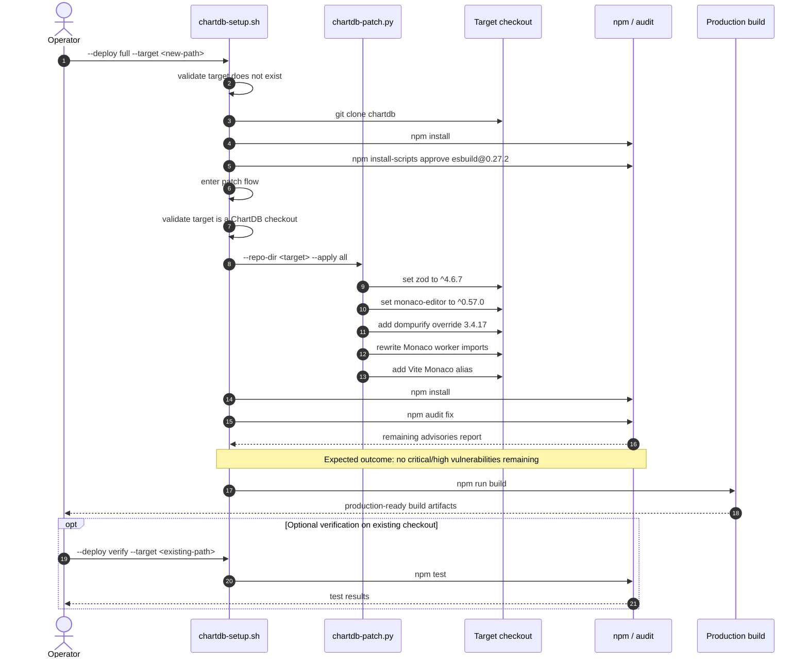

# ChartDB Deployment Scripts

## Purpose

This repository includes two helper scripts for repeatable local deployment and remediation workflows:

- [chartdb-setup.sh](chartdb-setup.sh)
- [chartdb-patch.py](chartdb-patch.py)

The goal is to support a consistent workflow for:

1. pulling fresh ChartDB source code
2. installing dependencies
3. applying required local patching
4. building or running the application
5. remediating patchable dependency vulnerabilities

These scripts are especially useful when you want a reproducible operational process instead of manually repeating npm and file-edit steps.

---

## Prerequisites

Before running the deployment scripts, ensure the following tools are installed and accessible in your system `PATH`:

| Tool | Minimum Version | Purpose |
| :--- | :--- | :--- |
| **Bash** | 4.0+ | Shell environment executing `chartdb-setup.sh` |
| **Git** | 2.25+ | Repository cloning and upstream update tracking |
| **Node.js** | 20.0+ | Modern JavaScript runtime (enforced by setup script) |
| **npm** | 11.0+ | Dependency resolution and `npm install-scripts` security commands |
| **npx** | Bundled with npm | On-demand execution of `serve` during `--deploy serve` |
| **Python** | 3.8+ | AST and regex-safe file mutations in `chartdb-patch.py` (`python3` or `python`) |

---

## Architecture

### 1. `chartdb-setup.sh`

This is the main CLI entrypoint.

It is responsible for:

- parsing CLI flags
- validating targets
- deciding whether a command expects:
  - a new target directory
  - or an existing ChartDB checkout
- orchestrating npm, git, and patch operations
- printing the remaining advisory report after patching

Think of it as the workflow controller.

### 2. `chartdb-patch.py`

This is the patch helper used by `chartdb-setup.sh`.

It is responsible for deterministic repository mutations needed by the patch workflow.

Currently it applies:

- package dependency updates in `<target>/package.json`
- Monaco worker import rewrites in `<target>/src/components/code-snippet/config.ts`
- Vite alias updates in `<target>/vite.config.ts`

Think of it as the file mutation engine.

### 3. Why both scripts exist

The split is intentional:

- **bash** is good for workflow orchestration
  - clone
  - install
  - audit
  - build
  - run
- **python** is better for structured file mutation
  - JSON editing
  - required text replacement
  - patch validation

This keeps the shell script smaller and avoids embedding large mutation fragments inline.

---

## Recommended Workflow

### For a brand new environment

```bash
./chartdb-setup.sh --deploy full --target D:/temp/tests/chartdb
```

This is the recommended end-to-end command for a fresh production-oriented deployment with the current patch flow.

### For an existing clone you want to refresh and patch

```bash
./chartdb-setup.sh --deploy update --target D:/temp/tests/chartdb
./chartdb-setup.sh --deploy patch --target D:/temp/tests/chartdb
./chartdb-setup.sh --deploy build --target D:/temp/tests/chartdb
```

> [!IMPORTANT]
> Running `--deploy update` executes `git pull --ff-only origin main`. If the target repository has already been modified by `--deploy patch`, ensure local modifications are stashed or reset (`git checkout -- .`) before pulling upstream updates to prevent fast-forward merge conflicts.

### For development only

```bash
./chartdb-setup.sh --deploy dev --target D:/temp/tests/chartdb --host 127.0.0.1
```

---

## Production-ready deployment flow

The following sequence shows the end-to-end workflow for a fresh production-oriented deployment with the current remediation path:



---

## CLI Interface

The main interface is:

```bash
./chartdb-setup.sh --deploy <cmd> --target <path> [--host HOST]
```

### Command Quick Reference

| Deploy Command | Target Requirement | Accepts `--host`? | Default Port | Mutates Target? | Primary Purpose |
| :--- | :--- | :---: | :---: | :---: | :--- |
| `install` | New directory (must not exist) | No | N/A | Yes | Clones ChartDB and runs initial `npm install`. |
| `update` | Existing ChartDB checkout | No | N/A | Yes | Pulls latest upstream `main` via `git pull --ff-only`. |
| `patch` | Existing ChartDB checkout | No | N/A | Yes | Applies security patches, dependency overrides, and audit fixes. |
| `verify` | Existing ChartDB checkout | No | N/A | No | Runs automated test suite (`npm test`). |
| `build` | Existing ChartDB checkout | No | N/A | Yes (`dist/`) | Builds production artifacts (`npm run build`). |
| `serve` | Built ChartDB checkout (`dist/`) | **Yes** | `8080` | No | Serves production build locally via `npx --yes serve`. |
| `dev` | Existing ChartDB checkout | **Yes** | `5173` | No | Starts Vite live development server (`npm run dev`). |
| `full` | New directory (must not exist) | No | N/A | Yes | End-to-end orchestration: `install` → `patch` → `build`. |

### Flags

#### `--deploy <cmd>`
Selects the operation to run.

Supported commands:

- `install`
- `update`
- `patch`
- `verify`
- `build`
- `serve`
- `dev`
- `full`

#### `--target <path>`
Specifies the directory the command should operate on.

Behavior depends on the command:

- `install` and `full` require a **new target** (fails if directory already exists)
- `update`, `patch`, `verify`, `build`, `serve`, and `dev` require an **existing ChartDB checkout**

#### `--host HOST`
Specifies the listening host interface. Supported by both the `serve` and `dev` commands (default: `localhost`).

- For local browser testing: `--host 127.0.0.1` or `--host localhost`
- For binding to all interfaces (e.g. Docker, WSL2, or remote VM): `--host 0.0.0.0`

Examples:

```bash
# Start local Vite development server on port 5173
./chartdb-setup.sh --deploy dev --target . --host 127.0.0.1

# Serve production build on port 8080
./chartdb-setup.sh --deploy serve --target . --host 0.0.0.0
```

---

## Command Behavior

### `install`

```bash
./chartdb-setup.sh --deploy install --target D:/temp/tests/chartdb
```

What it does:

- clones `https://github.com/chartdb/chartdb`
- runs `npm install`
- approves the required install script for `esbuild@0.27.2`

Use this when you want a new local checkout.

Fails if the target already exists.

---

### `update`

```bash
./chartdb-setup.sh --deploy update --target D:/temp/tests/chartdb
```

What it does:

- validates the target is an existing ChartDB checkout
- runs `git pull --ff-only origin main`
- runs `npm install`
- re-approves the required install script if needed

Use this for an existing local clone.

> [!WARNING]
> Because `git pull --ff-only` requires a clean git working tree, running `update` on a checkout that has previously been modified by `patch` will fail. Reset or stash local changes (`git checkout -- .` or `git stash`) before running `update`.

---

### `patch`

```bash
./chartdb-setup.sh --deploy patch --target D:/temp/tests/chartdb
```

What it does:

1. applies repository patch configuration through [chartdb-patch.py](chartdb-patch.py)
2. runs `npm install`
3. runs `npm audit fix`
4. prints the remaining advisories grouped into:
   - remaining primary advisories
   - transitively affected packages

This command currently includes the serious-vulnerability remediation workflow for:

- `zod`
- `monaco-editor`
- `dompurify` override handling
- Monaco/Vite compatibility fixes

Use this when you want dependency remediation and code/config patching applied to an existing checkout.

This command intentionally mutates the checkout.

---

### `verify`

```bash
./chartdb-setup.sh --deploy verify --target D:/temp/tests/chartdb
```

What it does:

- validates the target checkout
- runs `npm test`

Use this to validate the patched or installed repo.

---

### `build`

```bash
./chartdb-setup.sh --deploy build --target D:/temp/tests/chartdb
```

What it does:

- validates the target checkout
- runs `npm run build`

Use this to verify production build output.

---

### `serve`

```bash
./chartdb-setup.sh --deploy serve --target F:/temp/tests/chartdb --host 127.0.0.1
```

What it does:

- validates the target checkout
- validates that `dist/` exists
- runs `npx --yes serve -s` (single-page application mode) against the built `dist` folder on port `8080` (`tcp://$host:8080`)

Use this to serve the production build locally with `npx --yes serve`.

---

### `dev`

```bash
./chartdb-setup.sh --deploy dev --target D:/temp/tests/chartdb --host 127.0.0.1
```

What it does:

- validates the target checkout
- runs `npm run dev -- --host <host>` (defaults to Vite's local dev port `5173`)

Use this to run the local dev server.

---

### `full`

```bash
./chartdb-setup.sh --deploy full --target D:/temp/tests/chartdb
```

What it does:

1. `install`
2. `patch`
3. `build`

Use this when you want a full fresh-source workflow on a brand new target directory.

Fails if the target already exists.

---

## `build` vs `dev`

These two commands serve different purposes:

### `--deploy build`

This runs a production build:

```bash
npm run build
```

In this repository, that means:

- linting
- TypeScript build steps
- Vite production bundling

Use `build` when you want to:

- validate production readiness
- generate deployable output
- confirm that the application compiles successfully for release

### `--deploy serve`

This serves the built `dist` directory with `npx serve` in single-page application non-interactive mode:

```bash
npx --yes serve -s -l tcp://<host>:8080 .
```

Use `serve` when you want to:

- test the production build locally
- serve the generated `dist` output in a browser

### `--deploy dev`

This runs the local development server:

```bash
npm run dev -- --host <host>
```

Use `dev` when you want to:

- start the app locally
- develop interactively
- test changes manually in a browser

Short version:

- `build` = compile for production
- `serve` = serve the built production output
- `dev` = run the development server

---

## Error Handling Rules

### Commands requiring a new target

These fail if the target already exists:

- `install`
- `full`

### Commands requiring an existing ChartDB checkout

These fail if the target:

- does not exist
- does not contain ChartDB-specific files
- is not a valid ChartDB checkout

Commands in this category:

- `update`
- `patch`
- `verify`
- `build`
- `serve`
- `dev`

---

## Current Patch Scope

The current patch flow is intentionally focused on the serious dependency issues already identified during remediation work.

It currently handles:

- **Zod Upgrade (`CVE-2023-54404`)**: Upgrades `zod` to `^4.6.7` (satisfying `>= 4.6.6` to mitigate Regular Expression Denial of Service).
- **Monaco Editor Upgrade (`^0.57.0`)**: Brings the editor core to the fixed `0.57.x` branch.
- **DOMPurify Override (`3.4.17`)**: Injects an explicit npm override for `dompurify: 3.4.17` under `monaco-editor` dependencies to patch mutation XSS (mXSS) vulnerabilities.
- **Monaco Worker Import Rewrites**: Appends explicit `.js` extensions to worker imports in `<target>/src/components/code-snippet/config.ts` (e.g. `editor.worker.js?worker`).
- **Vite Alias Configuration**: Adds a path alias in `<target>/vite.config.ts` mapping `'monaco-editor/esm/vs'` directly to `'./node_modules/monaco-editor/esm/vs'`, preventing Vite bundling failures and runtime worker 404s.

Remaining advisories after patching are currently moderate-severity tooling issues.

The intended outcome of the patch flow is a deployment state with no critical or high vulnerabilities remaining in the current audit report.

---

## Patch Helper CLI

The patch helper can also be called directly if needed:

```bash
python chartdb-patch.py --repo-dir D:/temp/tests/chartdb --apply all
```

### Supported `--apply` values

- `package-json`
- `monaco-workers`
- `vite-alias`
- `all`

Typical use should still go through `chartdb-setup.sh`.

---

## Examples

### Example 1: Fresh install only

```bash
./chartdb-setup.sh --deploy install --target D:/temp/tests/chartdb001
```

### Example 2: Full fresh-source patch and build flow

```bash
./chartdb-setup.sh --deploy full --target D:/temp/tests/chartdb002
```

### Example 3: Patch an existing checkout

```bash
./chartdb-setup.sh --deploy patch --target D:/temp/tests/chartdb002
```

### Example 4: Run tests on an existing checkout

```bash
./chartdb-setup.sh --deploy verify --target D:/temp/tests/chartdb002
```

### Example 5: Serve the built production output

```bash
./chartdb-setup.sh --deploy serve --target D:/temp/tests/chartdb002 --host 127.0.0.1
```

### Example 6: Start local dev server

```bash
./chartdb-setup.sh --deploy dev --target D:/temp/tests/chartdb002 --host 127.0.0.1
```
