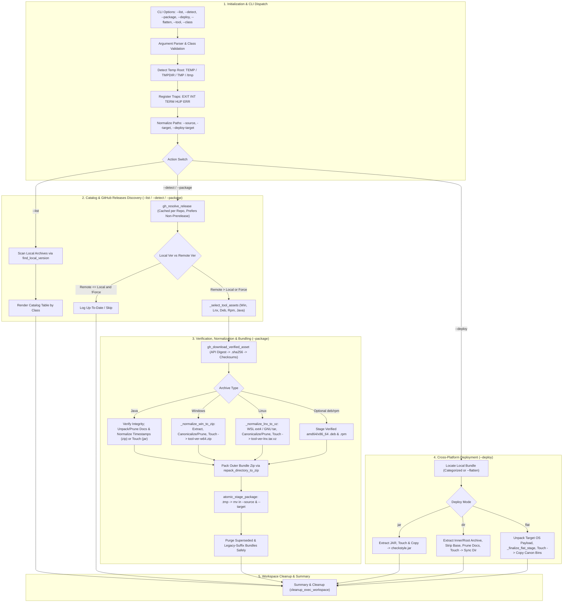

# CI / DevSecOps Tools Packaging & Deployment Utility (`citools_package.sh`)

A cross-platform, automated release discovery, normalized bundling, and local deployment pipeline compatible with **Cygwin**, **MSYS2 / Git Bash**, **Windows Subsystem for Linux (WSL)**, and **Native Linux**. This utility tracks 20 CI/DevSecOps CLI tools and Java code analyzers across 19 GitHub repositories, normalizes Windows x86_64 `.zip` and Linux x86_64 `.tar.xz` archives (plus upstream `.deb` / `.rpm` packages when published), prunes documentation bloat, refreshes epoch timestamps, atomically updates structured or flat software libraries, and deploys tools cleanly to a unified target folder.

---

## 1. Application Overview and Objectives

### 1.1 Executive Summary
The **CI / DevSecOps Tools Packaging & Deployment Utility** ([`citools_package.sh`](citools_package.sh)) automates the end-to-end lifecycle for **20 tools** organized into **7 functional classes**:
1. **Python Tooling (`python`)**: `uv`, `ruff`
2. **JS / Web Linters & Formatters (`js`)**: `biome`, `oxfmt`, `oxlint`, `dart-sass`
3. **Code Search & Static Sites (`devtools`)**: `astgrep`, `hugo`
4. **Build Systems & SCM (`build_scm`)**: `bazel`, `gh`
5. **Java Code Analyzers (`java`)**: `checkstyle`, `pmd-codeanalyzer`, `spotbugs`
6. **Containers & Kubernetes (`containers`)**: `docker-compose`, `kompose`
7. **Security, Signing & Vulnerability Scanners (`security`)**: `cosign`, `grype`, `syft`, `trivy`, `trufflehog`

Four primary CLI actions drive all workflows:
- **`--list` / `--list-tools`**: Offline inspection of configured tools, classes, local packaged versions, and target deploy layouts.
- **`--detect`**: Queries GitHub Releases API vs. local archives and prints status (`UP TO DATE`, `UPGRADE AVAILABLE`, `MISSING LOCAL`, `ERROR`) plus a pending-upgrades summary.
- **`--package`**: Downloads verified release assets, normalizes inner archives, prunes documentation bloat, refreshes timestamps, bundles `<tool>-<ver>-win-lnx.zip` or `<tool>-<ver>-java.zip`, and atomically stages updates to `--source` and `--target`.
- **`--deploy`**: Installs packaged tools from `--source` into a common local folder (`d:/dev/ci-tools` on Windows, `/u01/tools` on Linux) using canonical binary names and clean directory layouts.

### 1.2 Core Packaging & Deployment Objectives
- **Standardized Dual-Platform Bundles**: Consolidate multi-architecture upstream releases into uniform repository bundles:
  - Non-Java tools $\rightarrow$ `<tool>-<ver>-win-lnx.zip` containing normalized `<tool>-<ver>-w64.zip`, `<tool>-<ver>-lnx.tar.xz` (compressed with `xz -9 -T0`), and upstream `amd64` / `x86_64` `.deb` and `.rpm` packages when available.
  - Java analyzers $\rightarrow$ `<tool>-<ver>-java.zip` containing either the fat `.jar` (`checkstyle`) or a doc-pruned, timestamp-normalized distribution `.zip` (`pmd-codeanalyzer`, `spotbugs`).
- **Canonical Binary Naming & De-Bloating**:
  - Single-binary flat tools extract only the binary executable at the archive root with a clean canonical name (e.g. `ruff.exe` / `ruff`, `biome.exe` / `biome`, `gh.exe` / `gh`), removing wrapper directories, `LICENSE*`, `README*`, `CHANGELOG*`, manpages (`*.1`, `share/man`), and shell completions.
  - Multi-binary flat tools (`uv`/`uvx`/`uvw`, `ast-grep`/`sg`) preserve their runtime executables flat at the archive root.
  - Directory-based tools (`dart-sass`, `pmd-codeanalyzer`, `spotbugs`) retain their required runtime directories (`src/`, `bin/`, `lib/`, `conf/`, `plugin/`, `sbom/`) while pruning `LICENSE*`, `README*`, `CHANGELOG*`, `*.txt`, and `*.md` clutter.
- **Timestamp Normalization**: Recursively applies `touch` (`normalize_directory_timestamps`) before repacking `.zip` / `.tar.xz` archives and before deploying to `--deploy-target`, eliminating broken DOS/Unix epoch timestamps such as `1980-02-01` (seen in upstream Java bundles like `spotbugs-4.10.5.zip`).
- **High-Ratio Linux Packaging with Permission Preservation**: On Windows hosts, Linux `.tar.gz` and staged Linux directories are repacked on ext4 via `wsl.exe` (`--owner=0 --group=0 --numeric-owner`, `xz -9 -T0`) so executable (`0755`) permissions and non-executable data files (such as `src/sass.snapshot` at `0644`) remain intact, with a GNU `tar` fallback when WSL is unavailable.
- **Stage-Before-Purge Transactional Integrity**: Temporary build workspaces are isolated per tool in `$TEMP` -> `$TMPDIR` -> `$TMP` -> `/tmp`. New archives are staged atomically via `.tmp` + `mv -f` into `--source` and `--target` **before** obsolete or legacy bundles are purged, while intentionally preserving custom `docker-compose-*-lnx.zip` and `kompose-*-lnx.zip` RPM/spec bundles.
- **Flexible Structured or Flat Sources (`--flatten`)**: Works identically against structured category trees (e.g. `n:/softlib/software/public/<rel_dir>`) or single-directory bundles (`--source <dir> --flatten`), deduplicating writes when `--source` and `--target` point to the same directory.

---

## 2. Architecture and Data Flow

### 2.1 Architecture Diagram



---

## 3. Tool Catalog & Transformation Rules

### 3.1 Catalog Matrix

| Class (`--class`) | Tool Key (`--tool`) | Category Relative Path (`--source` Subdir) | GitHub Repo (`Tag Prefix`) | Outer Bundle Naming | Linux `.deb` / `.rpm` Included Upstream | Deploy Layout (`--deploy-target`) |
| :--- | :--- | :--- | :--- | :--- | :--- | :--- |
| `python` | **`uv`** | `devel/python/tools` | `astral-sh/uv` | `uv-<ver>-win-lnx.zip` | *(None)* | `uv`, `uvx`, `uvw` (`flat`, `.exe` on Win) |
| `python` | **`ruff`** | `devel/python/tools` | `astral-sh/ruff` | `ruff-<ver>-win-lnx.zip` | *(None)* | `ruff` (`flat`, `.exe` on Win) |
| `js` | **`biome`** | `devel/nodejs/linters` | `biomejs/biome` (`@biomejs/biome@`) | `biome-<ver>-win-lnx.zip` | *(None)* | `biome` (`flat`, `.exe` on Win) |
| `js` | **`oxfmt`** | `devel/nodejs/linters` | `oxc-project/oxc` (`oxfmt_v`) | `oxfmt-<ver>-win-lnx.zip` | *(None)* | `oxfmt` (`flat`, `.exe` on Win) |
| `js` | **`oxlint`** | `devel/nodejs/linters` | `oxc-project/oxc` (`oxlint_v`) | `oxlint-<ver>-win-lnx.zip` | *(None)* | `oxlint` (`flat`, `.exe` on Win) |
| `js` | **`dart-sass`** | `devel/js` | `sass/dart-sass` | `dart-sass-<ver>-win-lnx.zip` | *(None)* | `dart-sass/` (`dir`: wrapper + `src/`) |
| `devtools` | **`astgrep`** | `devel/regexp` | `ast-grep/ast-grep` | `astgrep-<ver>-win-lnx.zip` | *(None)* | `ast-grep`, `sg` (`flat`, `.exe` on Win) |
| `devtools` | **`hugo`** | `devel/html/generators` | `gohugoio/hugo` | `hugo-<ver>-win-lnx.zip` | `.deb` | `hugo` (`flat`, `.exe` on Win) |
| `build_scm` | **`bazel`** | `devel/setup/build` | `bazelbuild/bazel` | `bazel-<ver>-win-lnx.zip` | `.deb` | `bazel` (`flat`, `.exe` on Win) |
| `build_scm` | **`gh`** | `devel/setup/scm/git` | `cli/cli` | `gh-<ver>-win-lnx.zip` | `.deb`, `.rpm` | `gh` (`flat`, `.exe` on Win) |
| `java` | **`checkstyle`** | `devel/java/profiler` | `checkstyle/checkstyle` (`checkstyle-`) | `checkstyle-<ver>-java.zip` | N/A | `checkstyle.jar` (`jar`) |
| `java` | **`pmd-codeanalyzer`** | `devel/java/profiler` | `pmd/pmd` (`pmd_releases/`) | `pmd-codeanalyzer-<ver>-java.zip` | N/A | `pmd/` (`dir`) |
| `java` | **`spotbugs`** | `devel/java/profiler` | `spotbugs/spotbugs` | `spotbugs-<ver>-java.zip` | N/A | `spotbugs/` (`dir`) |
| `containers` | **`docker-compose`** | `system/admin/virtualization/docker-lxc` | `docker/compose` | `docker-compose-<ver>-win-lnx.zip` | *(None)* | `docker-compose` (`flat`, `.exe` on Win) |
| `containers` | **`kompose`** | `system/admin/virtualization/docker-lxc` | `kubernetes/kompose` | `kompose-<ver>-win-lnx.zip` | *(None)* | `kompose` (`flat`, `.exe` on Win) |
| `security` | **`cosign`** | `system/secure/crypto/codesign` | `sigstore/cosign` | `cosign-<ver>-win-lnx.zip` | `.deb`, `.rpm` | `cosign` (`flat`, `.exe` on Win) |
| `security` | **`grype`** | `net/netadmin/security/penetration` | `anchore/grype` | `grype-<ver>-win-lnx.zip` | `.deb`, `.rpm` | `grype` (`flat`, `.exe` on Win) |
| `security` | **`syft`** | `net/netadmin/security/penetration` | `anchore/syft` | `syft-<ver>-win-lnx.zip` | `.deb`, `.rpm` | `syft` (`flat`, `.exe` on Win) |
| `security` | **`trivy`** | `system/secure/vulnscan` | `aquasecurity/trivy` | `trivy-<ver>-win-lnx.zip` | `.deb`, `.rpm` | `trivy` (`flat`, `.exe` on Win) |
| `security` | **`trufflehog`** | `system/secure/vulnscan` | `trufflesecurity/trufflehog` | `trufflehog-<ver>-win-lnx.zip` | *(None)* | `trufflehog` (`flat`, `.exe` on Win) |

*Note on custom RPM/spec archives: `docker-compose` and `kompose` accept `win-lnx|bin|lnx-win` suffixes when locating/purging local bundles so custom `*-lnx.zip` packages remain untouched.*

---

### 3.2 Upstream Discovery, Integrity Verification & Transformation Rules

1. **GitHub Releases API & Authentication**:
   - Releases are fetched via `gh_resolve_release` with per-repo response caching (`_GH_RELEASE_CACHE`, so shared repos like `oxc-project/oxc` are queried cleanly). Draft releases are skipped; non-prereleases are preferred with prerelease fallback if none match.
   - Authentication uses `--token <pat>`, the `GITHUB_TOKEN` environment variable, or automatically falls back to `gh auth token` when the GitHub CLI is signed in (`5,000 req/hr` vs `60 req/hr` anonymous). Rate-limit responses halt remaining iterations gracefully cleanly (`exit code 2` from resolver).

2. **SHA-256 Checksum Resolution Hierarchy**:
   - Before trusting any downloaded asset, `gh_lookup_asset_sha256` resolves the expected SHA-256 digest in priority order:
     1. GitHub Releases API `.assets[].digest` (`sha256:...`).
     2. Per-asset `<asset_name>.sha256` sidecar file.
     3. Aggregate release checksum manifest (`checksums.txt`, `SHA256SUMS`, `sha256.sum`, etc.), matching the exact filename column (`$2`).

3. **Platform Normalization Pipelines**:
   - **Windows (`<tool>-<ver>-w64.zip`)**: Raw `.exe` binaries (`biome`, `bazel` fallback, `docker-compose`, `kompose`, `cosign`) or extracted archives are stripped of single top-level wrapper folders, processed via `_finalize_stage_dir` (clean flat binary naming for `flat` tools, `prune_doc_clutter` for `dart-sass`), timestamp-normalized, and repacked via `repack_directory_to_zip` + `unzip -tq` verification.
   - **Linux (`<tool>-<ver>-lnx.tar.xz`)**:
     - For `.tar.gz` / `.tgz` upstream archives, `_normalize_lnx_to_xz` injects `prune_doc_clutter` and `_select_flat_bins_in_dir` via `declare -f` into WSL ext4 (`repack_tar_gz_to_xz_preserving_perms`) so upstream POSIX permissions (`0755` binaries / `0644` data files) and root/root ownership (`--owner=0 --group=0 --numeric-owner`) are preserved cleanly before compressing with `xz -9 -T0`.
     - For raw Linux binaries, `.zip`, and `.tar.xz` assets, `repack_directory_to_tar_xz_preserving_perms` normalizes binaries/docs/timestamps and verifies with `tar --force-local -tJf`.
   - **Java Analyzers (`<tool>-<ver>-java.zip`)**:
     - `.zip` distributions (`pmd-dist-*-bin.zip`, `spotbugs-*.zip`) are integrity-checked, unpacked, pruned via `prune_doc_clutter` (removing `README.txt`, `LICENSE*`, `plugin/README`), timestamp-normalized (eliminating `1980-02-01` entries), and repacked into the outer `-java.zip` bundle.
     - Single `.jar` releases (`checkstyle-*-all.jar`) are timestamp-updated (`touch`) and bundled directly.

4. **Deployment Rules (`--deploy`)**:
   - Locates normalized (`-w64.zip` / `-lnx.tar.xz`) or legacy inner payloads inside local bundles (`_find_inner_payloads`), skipping `.deb`/`.rpm` installers and `src/`.
   - Installs target-OS binaries in one of three layouts under `--deploy-target`:
     - **`jar`**: Extracts `.jar`, updates timestamp, installs to `--deploy-target/checkstyle.jar` (`chmod 644`).
     - **`dir`**: Extracts archive, strips wrapper directory, prunes doc clutter, normalizes timestamps, validates non-empty staging, and swaps `--deploy-target/<subdir>/` atomically via `.tmp.$$`.
     - **`flat`**: Finalizes canonical binary names (`_finalize_flat_stage`), normalizes timestamps, copies binaries to `--deploy-target/` (`chmod 755`), and fails cleanly if any destination binary copy fails (e.g., locked `.exe`).

---

## 4. Command Line Arguments

| Option Flag | Argument Type | Default Value | Description |
| :--- | :--- | :--- | :--- |
| `--detect` | Action (Flag) | *(None)* | Queries upstream GitHub releases vs. local library and prints upgrades and current versions by class. |
| `--package` | Action (Flag) | *(None)* | Downloads updates (or `--force` targets), verifies SHA-256, normalizes inner archives, and stages to `--source` / `--target`. |
| `--deploy` | Action (Flag) | *(None)* | Deploys packaged tools from `--source` into `--deploy-target`. |
| `--list`, `--list-tools` | Action (Flag) | *(None)* | Displays configured tool catalog, local versions, and deploy layouts offline. |
| `--action <name>` | String | *(None)* | Alternate action syntax: `detect`, `package`, `deploy`, or `list`. |
| `--app`, `--name`, `--tool <name>` | String | *(All)* | Restricts execution to one tool by tool key, GitHub `owner/repo`, or repo name (e.g. `ruff`, `ast-grep`, `oxfmt`). |
| `--class <id>` | String | *(All)* | Filters by class ID: `python`, `js`, `devtools`, `build_scm`, `java`, `containers`, or `security`. |
| `--source <path>` | String (Path) | `n:/softlib/software/public` | Root path of the software library (auto-resolves `/mnt/n/...` or `/media/n/...` on Linux/WSL when mounted). |
| `--target <path>` | String (Path) | `f:/stage/upload/pending` | Pending upload directory where bundles are atomically staged. |
| `--deploy-target <path>` | String (Path) | `d:/dev/ci-tools` (Win) / `/u01/tools` (Linux) | Common destination folder for `--deploy`. |
| `--flatten` | Boolean (Flag) | `false` | Reads/writes bundles directly in `--source` without category subdirectories across all actions. |
| `--token <pat>` | String | `$GITHUB_TOKEN` or `gh auth token` | GitHub Personal Access Token for authenticated API requests. |
| `--force` | Boolean (Flag) | `false` | Forces download and repackaging in `--package` mode even when the local version equals the remote version. |
| `--no-update-source` | Boolean (Flag) | `false` | In `--package` mode, stages packages to `--target` without modifying or purging `--source`. |
| `--dry-run` | Boolean (Flag) | `false` | Previews discovery, normalization, purge/staging, or deployment actions without modifying files on disk. |
| `--log <file>` | String (Path) | *(None)* | Appends stdout and stderr to the specified log file. |
| `--verbose` | Boolean (Flag) | `false` | Prints full upstream asset URLs and diagnostic messages during `--package`. |
| `-h`, `--help` | Boolean (Flag) | `false` | Displays usage help and exits (`0`). |

---

## 5. Prerequisites and Dependencies

The utility relies on the shared foundation library [`client_package_common.sh`](client_package_common.sh) for platform detection, dual-layer path translation, defensive deletion bounds, workspace lifecycle traps, SHA-256 verification, GitHub release discovery, and transactional `.tmp` staging. Module APIs and compatibility details are documented in [`client_package_common_README.md`](client_package_common_README.md).

Tool requirements are validated per action upfront:

| Action(s) | Required CLI Tools | Optional Enhancements |
| :--- | :--- | :--- |
| `--list` | *(Built-in bash/coreutils only)* | — |
| `--detect` | `curl`, `jq` | `gh` CLI (automatic API token) |
| `--package` | `curl`, `zip`, `unzip`, `jq`, `tar`, `gzip`, `xz` | `gh` CLI (auth token), `wsl.exe` (on Windows, for native Linux `.tar.gz` perm preservation), `file` (ELF fallback) |
| `--deploy` | `unzip`, `tar`, `xz`, `gzip` | `file` (ELF fallback detection on un-normalized binaries) |

Verify package-mode dependencies are present in `$PATH`:
```bash
which curl zip unzip jq tar gzip xz
```

---

## 6. Usage Examples and Output Samples

### Example 1: Release Detection (`--detect`)
Checks upstream GitHub releases for all 20 tools grouped by class against `n:/softlib/software/public`:

```bash
$ ./citools_package.sh --detect
```

**Output:**
```text
============================================================================================================
 CI Tools Release Detection (--source: n:/softlib/software/public)
============================================================================================================
[INFO] GitHub API authentication: active (5,000 req/hr)

 TOOL               LOCAL VER    REMOTE VER   STATUS                 PACKAGED ARCHIVE
------------------------------------------------------------------------------------------------------------

 [Python Tooling]
 uv                 0.13.9       0.13.9       UP TO DATE             uv-0.13.9-win-lnx.zip
 ruff               0.17.6       0.17.6       UP TO DATE             ruff-0.17.6-win-lnx.zip

 [JS / Web Linters & Formatters]
 biome              2.6.8        2.6.8        UP TO DATE             biome-2.6.8-win-lnx.zip
 oxfmt              0.80.0       0.80.0       UP TO DATE             oxfmt-0.80.0-win-lnx.zip
 oxlint             1.95.0       1.95.0       UP TO DATE             oxlint-1.95.0-win-lnx.zip
 dart-sass          1.108.2      1.108.2      UP TO DATE             dart-sass-1.108.2-win-lnx.zip

 [Code Search & Static Sites]
 astgrep            0.51.3       0.51.3       UP TO DATE             astgrep-0.51.3-win-lnx.zip
 hugo               0.170.1      0.170.1      UP TO DATE             hugo-0.170.1-win-lnx.zip

 [Build Systems & SCM]
 bazel              9.3.3        9.3.3        UP TO DATE             bazel-9.3.3-win-lnx.zip
 gh                 2.105.0      2.105.0      UP TO DATE             gh-2.105.0-win-lnx.zip

 [Java Code Analyzers]
 checkstyle         14.4.0       14.4.0       UP TO DATE             checkstyle-14.4.0-java.zip
 pmd-codeanalyzer   7.29.0       7.29.0       UP TO DATE             pmd-codeanalyzer-7.29.0-java.zip
 spotbugs           4.10.5       4.10.5       UP TO DATE             spotbugs-4.10.5-java.zip

 [Containers & Kubernetes]
 docker-compose     5.8.0        5.8.0        UP TO DATE             docker-compose-5.8.0-win-lnx.zip
 kompose            1.38.0       1.38.0       UP TO DATE             kompose-1.38.0-win-lnx.zip

 [Security, Signing & Vulnerability Scanners]
 cosign             3.1.4        3.1.4        UP TO DATE             cosign-3.1.4-win-lnx.zip
 grype              0.122.1      0.122.1      UP TO DATE             grype-0.122.1-win-lnx.zip
 syft               1.57.2       1.57.2       UP TO DATE             syft-1.57.2-win-lnx.zip
 trivy              0.76.2       0.76.2       UP TO DATE             trivy-0.76.2-win-lnx.zip
 trufflehog         3.100.0      3.100.1      UPGRADE AVAILABLE      trufflehog-3.100.0-win-lnx.zip

======================================================================================================
 Detection Summary
======================================================================================================
 Total checked     : 20
 Upgrades available: 1
 Missing locally   : 0
 Up to date        : 19
 Errors            : 0
======================================================================================================

 Pending Additions / Upgrades (1):
   - trufflehog         3.100.0 -> 3.100.1 [UPGRADE AVAILABLE] (Security, Signing & Vulnerability Scanners)

 Run 'citools_package.sh --package' to download and package pending updates.
```

---

### Example 2: Packaging Upgrades (`--package --dry-run` / Single Tool)
Preview pending updates without downloading or modifying files on disk:

```bash
$ ./citools_package.sh --package --dry-run
```

Force repackage a single tool (`spotbugs`) or filter by class (`security`):

```bash
$ ./citools_package.sh --package --tool spotbugs --force
$ ./citools_package.sh --package --class security --verbose
```

---

### Example 3: Deploying to the Local Common Folder (`--deploy`)
Install all packaged tools for the host OS (`d:/dev/ci-tools` on Windows, `/u01/tools` on Linux):

```bash
$ ./citools_package.sh --deploy
```

Or deploy straight from a flat download/staging directory using **`--flatten`** (no category subdirectories searched):

```bash
$ ./citools_package.sh --deploy --source f:/stage/upload/pending --flatten
```

Or preview deployment on any custom target directory first:

```bash
$ ./citools_package.sh --deploy --dry-run --deploy-target d:/dev/ci-tools
```

---

### Example 4: Offline Catalog Inspection (`--list`)
Inspect configured tools, local archive versions, and target deploy layout without hitting GitHub:

```bash
$ ./citools_package.sh --list
$ ./citools_package.sh --list --source f:/stage/upload/pending --flatten
```

---

### Example 5: Automated Scheduled Execution (Cron / Windows Task Scheduler)

**Using Linux / Cygwin Cron (`crontab -e`)**:
```cron
0 3 * * * /bin/bash /cygdrive/e/data/devel/build/code/private/devops/build_tasks/citools_package.sh --package --log /cygdrive/f/stage/upload/pending/citools_package.log
```

**Using Windows Task Scheduler (MSYS2 Git Bash)**:
- **Program/script**: `D:\dev\git\bin\bash.exe`
- **Add arguments**: `--login -c "/e/data/devel/build/code/private/devops/build_tasks/citools_package.sh --package --log /f/stage/upload/pending/citools_package.log"`
- **Start in**: `D:\dev\git\bin`
