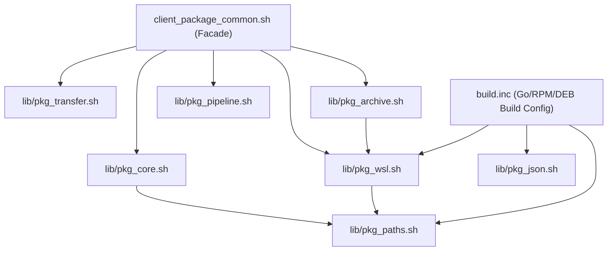
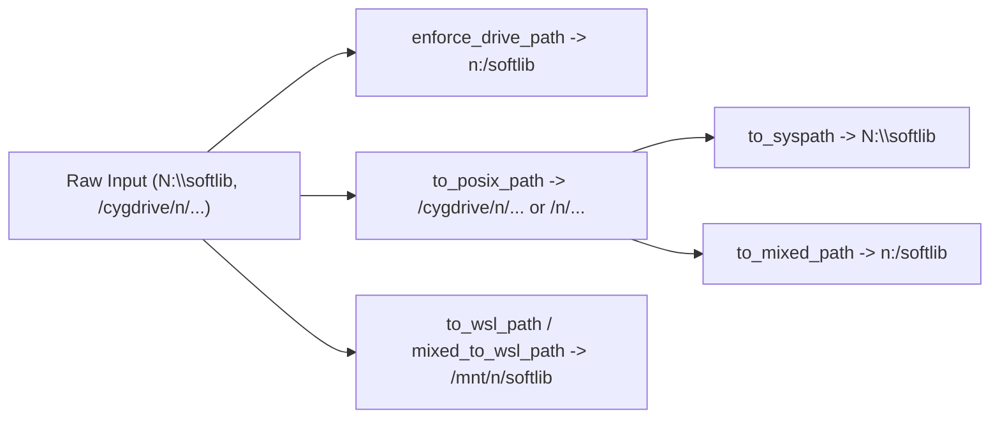

# Client Packaging & Build Foundation Library (`client_package_common.sh` + `lib/`)

A modular POSIX/Bash shell library suite providing shared primitives for cross-platform path translation, defensive filesystem safety, workspace locking, resilient HTTP/GitHub transfers, archive integrity/recompression, and atomic release publishing across **Cygwin**, **MSYS2 / Git Bash**, **WSL**, and **Native Linux**.

---

## 1. Library Architecture & Consumers

```text
build_tasks/
├── client_package_common.sh   # 29-line facade sourcing core, wsl, transfer, archive, pipeline
├── build.inc                  # Go/RPM/DEB defaults & NDJSON logging (sources pkg_{paths,json,wsl})
└── lib/
    ├── pkg_paths.sh           # Stateless OS/platform detection & Windows/POSIX/WSL path engine
    ├── pkg_json.sh            # Portable 4-tier JSON parser (jq/python/awk), json_escape, log_ndjson
    ├── pkg_wsl.sh             # Shared WSL binary discovery & command execution bridge
    ├── pkg_core.sh            # Logging, path safety, safe_rm_*, locks, traps, workspaces, CLI helpers
    ├── pkg_transfer.sh        # URL guard, SHA-256/512 verification, curl fetch/download, gh_* API
    ├── pkg_archive.sh         # Integrity checks, extraction, WSL repacking, semver, atomic staging
    └── pkg_pipeline.sh        # High-level dual-platform packaging pipeline
```

### Consumers
* **Via [`client_package_common.sh`](client_package_common.sh):** [`antigravity_package.sh`](antigravity_package.sh), [`build_python_win.sh`](build_python_win.sh), [`bun_upgrade.sh`](bun_upgrade.sh), [`chromium_upgrade.sh`](chromium_upgrade.sh), [`citools_package.sh`](citools_package.sh), [`craftapps_package.sh`](craftapps_package.sh), [`dotnet_packaging.sh`](dotnet_packaging.sh), [`rust_upgrade_win.sh`](rust_upgrade_win.sh), [`vscode_package.sh`](vscode_package.sh).
* **Via direct selective `lib/pkg_*.sh` sourcing:** [`jdk_packaging.sh`](jdk_packaging.sh) (`pkg_core`, `pkg_archive`), [`rust_cachemgr.sh`](rust_cachemgr.sh) (`pkg_core`), [`rust_upgrade.sh`](rust_upgrade.sh) (`pkg_core`, `pkg_transfer`), [`tomcat_packaging.sh`](tomcat_packaging.sh) (`pkg_core`, `pkg_archive`).
* **Via [`build.inc`](build.inc) (`lib/pkg_{paths,json,wsl}.sh`):** [`build_go.sh`](build_go.sh), [`build_go_exec.sh`](build_go_exec.sh), [`build_orchestrate.sh`](build_orchestrate.sh), [`shellcheck_build.sh`](shellcheck_build.sh).

### Sourcing & Idempotency
Every module guards against double-sourcing (`_PKG_*_SH_LOADED`, `_CLIENT_PACKAGE_COMMON_SH_LOADED`):
* [`pkg_paths.sh`](lib/pkg_paths.sh), [`pkg_json.sh`](lib/pkg_json.sh), and [`pkg_wsl.sh`](lib/pkg_wsl.sh) are stateless (no traps or logging side effects) and safe to source anywhere.
* [`pkg_core.sh`](lib/pkg_core.sh) automatically sources `pkg_paths.sh`, initializes terminal colors (`LOG_INFO_TO_STDERR` supported cleanly), registers `INT`/`TERM`/`HUP`/`EXIT` (`cleanup_workspace`) traps, and installs an `ERR` diagnostic trap when `set -e` is active.



---

## 2. Module API Reference

### 2.1 [`lib/pkg_paths.sh`](lib/pkg_paths.sh) — Platform Detection & Path Engine
* **`detect_platform` / `PLATFORM`:** Prepends `/usr/bin:/bin` on MSYS2/Cygwin when needed and detects `cygwin`, `msys2`, `wsl`, or `linux`.
* **`is_windows_platform` / `get_target_os` / `detect_host_os`:** Returns `0`/`1` on Windows POSIX shells (`cygwin`|`msys2`), `"windows"`/`"linux"`, or coarse `"WIN"`/`"LINUX"`.
* **`enforce_drive_path <path>`:** Normalizes POSIX mounts (`/cygdrive/c/...`, `/c/...`, `/mnt/c/...` on WSL/mounted Linux) and backslash paths into canonical lowercase `drive:/path`.
* **`to_posix_path <path>`:** Converts Windows/drive paths into native POSIX mount paths via `cygpath -u` (with pure-bash fallback).
* **`to_syspath <path>` / `to_mixed_path <path>`:** Converts POSIX paths to Windows backslash (`cygpath -w`) or Windows forward-slash (`cygpath -m`) format for native Windows executables (`7z.exe`, `cmd.exe`, etc.).
* **`normalize_to_mixed_path <path>` / `normalize_to_posix_path <path>`:** Host-gated Windows-only converters (no-op on native Linux hosts).
* **`resolve_default_path <drive> <rel_path>`:** Resolves `<drive>:/<rel_path>` or `/mnt/<drive>/<rel_path>` / `/media/<drive>/<rel_path>` on Linux/WSL.
* **`mixed_to_wsl_path <path>` / `to_wsl_path <path>`:** `mixed_to_wsl_path` converts drive/mount paths purely in bash (`/mnt/<drive>/...`); `to_wsl_path` invokes `${RESOLVED_WSL_BIN:-wsl.exe} -e wslpath -u` and falls back to `mixed_to_wsl_path`.
* **`normalize_and_add_to_path <dir>`:** Converts an existing directory to POSIX form and prepends it to `$PATH`.



---

### 2.2 [`lib/pkg_json.sh`](lib/pkg_json.sh) — Portable JSON & NDJSON
* **`json_escape <string>`:** Escapes backslashes/double quotes and flattens newlines/CR/tabs for JSON embedding.
* **`log_ndjson <level> <event> <message> [extra_json]`:** Appends structured NDJSON audit lines when `$NDJSON_LOG_FILE` is set.
* **`parse_json_field <json_file> <key> [default]`:** Extracts top-level scalar keys (`--arg k` in `jq` -> `python3`/`python` -> anchored `awk` fallback).
* **`parse_json_history <json_file>`:** Extracts `.history` arrays or multi-line strings via the same 4-tier fallback chain.

---

### 2.3 [`lib/pkg_wsl.sh`](lib/pkg_wsl.sh) — WSL Execution Bridge
* **`resolve_wsl_binary` / `check_wsl_available`:** Locates `${RESOLVED_WSL_BIN:-}`, `wsl.exe`/`wsl`, or `/c/Windows/System32/wsl.exe`.
* **`run_in_wsl <target_dir> <cmd...>`:** Converts `<target_dir>` via `mixed_to_wsl_path` and executes `<cmd...>` inside the default WSL distro via `bash -lc`.

---

### 2.4 [`lib/pkg_core.sh`](lib/pkg_core.sh) — Logging, Safety, Locks, Workspaces & CLI
* **Logging (`log_info`, `log_ok`, `log_step`, `log_warn`, `log_error`, `log_debug`):** Dynamically disables ANSI colors when non-TTY or after `init_log_file <path>`; `LOG_INFO_TO_STDERR=1` keeps stdout clean for JSON/data output; `VERBOSE=1|true` enables `log_debug`.
* **Path Safety & Deletion (`validate_safe_dir`, `safe_rm_rf [--fast-win]`, `safe_rm_f`):** Rejects empty strings, `..` traversal, relative paths, drive roots (`/c`, `/cygdrive/c`, `/mnt/c`), `C:\Windows`, and OS system directories (`/`, `/bin`, `/usr`, `/etc`, `/tmp`, `/var/tmp`, etc.) using `realpath -m` canonicalization. `--fast-win` renames and removes huge NTFS directory trees via background `cmd.exe /c rmdir /s /q`.
* **Workspaces & Atomic Locks (`detect_temp_root`, `create_temp_workdir`, `init_exec_workspace`, `acquire_lock`, `release_lock`, `cleanup_workspace`):**
  * `create_temp_workdir` probes `TEMP -> TMPDIR -> TMP -> /tmp`, prunes stale dirs older than 1 day, and allocates `mktemp -d`.
  * `acquire_lock <name> [scope_key]` creates atomic `.lock.d` directories with PID files and crash-safe `.reap` stale-lock recovery (returns `1` on live lock contention so callers choose exit codes).
  * `cleanup_workspace` cleans `$CURRENT_BUILD_DIR`, `$_CURRENT_TMP_FILE`, `$CURRENT_TARGET_TMP`, `$EXEC_WORKSPACE`, and active locks on `EXIT`.
* **CLI & UI Helpers:** `require_opt_arg`, `require_opt_value`, `verify_required_tools [--exit-code <n>]`, `csv_contains`, `print_action_banner`, `print_packaging_summary`.

---

### 2.5 [`lib/pkg_transfer.sh`](lib/pkg_transfer.sh) — Downloads, Checksums & GitHub Releases
* **`validate_download_url <url> [allow_file]`:** Enforces `https://` unless `allow_file=true` allows local `file://` fixtures.
* **`verify_file_checksum <file> <expected_hex> [sha256|sha512]` / `write_sha256_manifest`:** Verifies hashes using `sha*sum` with `shasum -a` fallback and writes atomic `SHA256SUMS` manifests.
* **`fetch_text` / `download_asset`:** Unified `curl -fsSL` wrappers with timeouts/retries, subshell-safe `RETURN` trap stderr cleanup, `${BASHPID:-$$}` `.part` staging, optional checksum verification, and atomic `mv -f`.
* **GitHub Releases API (`gh_fetch_releases_json`, `gh_resolve_release`, `gh_find_asset`, `gh_fetch_release_checksums`, `gh_lookup_asset_sha256`, `gh_download_verified_asset`):** Caches API responses per session, supports `GITHUB_TOKEN` and `gh auth token` fallback, filters drafts/prereleases, and verifies digests/sidecars/`.sha256`/checksum manifests when present.

---

### 2.6 [`lib/pkg_archive.sh`](lib/pkg_archive.sh) — Archives, WSL Repacking & Atomic Staging
* **Verification & Extraction:** `verify_zip_integrity`, `verify_zip_has_entry`, `verify_tar_xz_integrity`, `verify_archive_integrity` (`.zip`, `.tar.xz`, `.tar.gz`/`.tgz`, `.tar`, `.7z`), and `extract_archive`.
* **Normalization, Pruning & Atomic Repacking:** `strip_base_directory`, `normalize_directory_timestamps`, `prune_electron_locales`, `prune_doc_clutter`, `prune_root_licenses`, `repack_directory_to_zip`, `repack_directory_to_tar_xz`, `recompress_folder_to_tar_xz`, `repack_tar_gz_to_xz_preserving_perms`, and `repack_directory_to_tar_xz_preserving_perms`. All archive rebuilds stage into `.tmp.${BASHPID:-$$}`, normalize root/root ownership (`--owner=0 --group=0 --numeric-owner`) and `pipefail` streams, verify archive integrity, and promote atomically.
* **Versioning & Delivery:** `is_version_newer` (`sort -V`), `find_local_version`, `purge_obsolete_packages`, `purge_legacy_suffix_packages`, `atomic_publish_file`, and `atomic_stage_package` (`--source` + `--target` with `chmod 644`, pre-rename integrity check, and rollback safety).

---

### 2.7 [`lib/pkg_pipeline.sh`](lib/pkg_pipeline.sh) — Dual-Platform Orchestration
* **`run_dual_platform_package`:** Drives local version lookup, up-to-date pruning, dry-run simulation, parallel asset download -> transform callback -> integrity check -> `atomic_stage_package` across Windows (`.zip`) and Linux (`.tar.xz`) targets.

---

## 3. Verification

```bash
cd build_tasks
for f in *.sh build.inc lib/*.sh; do bash -n "$f"; done
shellcheck -x lib/*.sh client_package_common.sh build.inc build_go*.sh build_orchestrate.sh shellcheck_build.sh \
  antigravity_package.sh bun_upgrade.sh build_python_win.sh chromium_upgrade.sh citools_package.sh \
  craftapps_package.sh dotnet_packaging.sh jdk_packaging.sh rust_cachemgr.sh rust_upgrade*.sh \
  tomcat_packaging.sh vscode_package.sh
```

See [`MODULES.md`](MODULES.md) for the migration history, invariants, and E2E verification gates.
