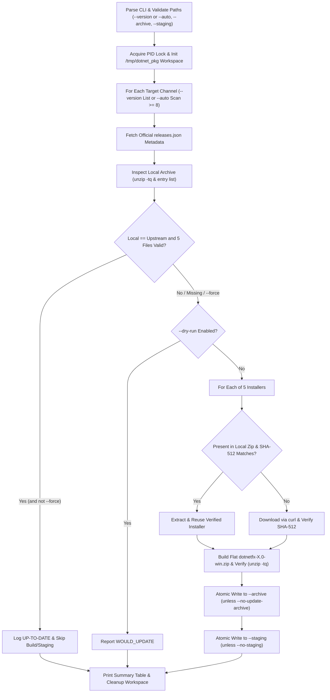

# .NET Windows Packaging & Synchronization Tool (`dotnet_packaging.sh`)

## Overview & Objectives

`dotnet_packaging.sh` is an automated synchronization and packaging utility for Windows `.NET` installer bundles stored in the local software library (`dotnetfx-<channel>-win.zip`). For one or more target `.NET` channels (`--version <list>`, major `>= 8`) or automatically discovered local archives (`--auto`, matching `dotnetfx-<major>.0-win.zip` with `major >= 8`), the script:

1. Queries Microsoft's official `.NET` release metadata JSON feed (`releases.json`) to resolve the latest `latest-release` and `latest-sdk` versions, download URLs, and authoritative `SHA-512` checksums.
2. Inspects each existing `dotnetfx-<channel>-win.zip` archive in the archive repository (`--archive`), extracting the packaged Runtime and SDK versions and verifying structural integrity (`unzip -tq`).
3. When an archive is missing, corrupt, incomplete, or behind the official Microsoft release (or when `--force` is specified):
   - Reuses unchanged `.exe` components from the local archive when their `SHA-512` digest matches upstream.
   - Downloads missing or updated `.exe` installers directly from Microsoft (`https://`) and validates every download against Microsoft's `SHA-512` digest.
   - Packages the 5 installers into a flat ZIP bundle (`dotnetfx-<channel>-win.zip`) and verifies archive integrity.
   - Atomically writes the archive (`*.tmp.$$` + `mv -f`) to `--archive` and stages a verified copy in `--staging`.

---

## Archive Structure (`dotnetfx-<X>.0-win.zip`)

Each archive contains 5 Windows installer executables stored flat at the root of the ZIP archive (no top-level wrapper folder):

| Component | Filename Pattern | Source Field in `releases.json` |
| :--- | :--- | :--- |
| ASP.NET Core Runtime | `aspnetcore-runtime-<rel>-win-x64.exe` | `.releases[]."aspnetcore-runtime".files[]` (`aspnetcore-runtime-win-x64.exe`) |
| .NET Hosting Bundle | `dotnet-hosting-<rel>-win.exe` | `.releases[]."aspnetcore-runtime".files[]` (`dotnet-hosting-win.exe`) |
| .NET Runtime | `dotnet-runtime-<rel>-win-x64.exe` | `.releases[].runtime.files[]` (`dotnet-runtime-win-x64.exe`) |
| .NET SDK | `dotnet-sdk-<sdk>-win-x64.exe` | `.releases[].sdks[]` / `.sdk.files[]` (`dotnet-sdk-win-x64.exe`) |
| Windows Desktop Runtime | `windowsdesktop-runtime-<rel>-win-x64.exe` | `.releases[].windowsdesktop.files[]` (`windowsdesktop-runtime-win-x64.exe`) |

---

## Architecture & Workflow



### Design Highlights

- **Cross-Platform Path Mapping**: Supports Cygwin (`n:/...` -> `/cygdrive/n/...` via `cygpath -u`), MSYS2/Git-Bash (`n:/...` -> `/n/...`), and Linux/WSL (`/mnt/n/...` or `/media/n/...`), prioritizing the active runtime's `/usr/bin:/bin` and refusing relative traversal (`..`), root/system directories, or bare drive roots.
- **Cross-Binary Path Isolation**: Passes JSON payloads into `jq` over `stdin` and invokes `curl`, `zip`, and `sha512sum` from relative working directories to prevent MSYS2 vs. Cygwin vs. UCRT64 path translation mismatches on Windows.
- **Transactional Integrity**: Never leaves partial downloads or half-written ZIP files in `--archive` or `--staging`. An `EXIT INT TERM HUP` trap removes partial `.tmp.$$` files, the `/tmp/dotnet_pkg.*` scratch workspace, and `/tmp/dotnet_packaging.lock`.

---

## Dependencies

| Tool | Purpose |
| :--- | :--- |
| `bash` (4.0+) | Associative arrays and lowercase parameter expansion (`,,`) |
| `curl` | Fetching `releases.json` metadata and installer `.exe` binaries |
| `jq` | Parsing `latest-release`, `latest-sdk`, URLs, and SHA-512 hashes |
| `zip` / `unzip` | Inspecting, building, and integrity-testing (`-tq`) archives |
| `sha512sum` (or `shasum`) | Verifying downloaded and reused installer checksums |
| `mktemp`, `realpath` | Temporary workspace creation and path canonicalization |

---

## Command-Line Arguments & Environment

| Option | Required | Default | Description |
| :--- | :--- | :--- | :--- |
| `--version <list>` | One of `--version` or `--auto` | *(none)* | Target `.NET` channel (`>= 8`, e.g., `11`, `10`, `8`, or `11.0`, `10.0`, `8.0`) or comma-separated list (`11,10,8`). Mutually exclusive with `--auto`. |
| `--auto` | One of `--version` or `--auto` | `false` | Scan `--archive` for existing `dotnetfx-<major>.0-win.zip` archives with `major >= 8` (ignoring legacy `.NET Framework 4.x`, `*-w32.zip`, and `mono-*`) and update as needed. Mutually exclusive with `--version`. |
| `--archive <path>` | No | `n:/softlib/software/public/devel/dotnet` | Local repository directory holding `dotnetfx-<X>.0-win.zip`. |
| `--staging <path>` | No | `f:/stage/upload/pending` | Staging destination directory for updated bundles. |
| `--dry-run` | No | `false` | Compare local vs. upstream versions and print planned actions without downloading or writing files. |
| `--force` | No | `false` | Re-download all 5 components, rebuild ZIP, update archive, and re-stage even when up to date. |
| `--no-staging` | No | `false` | Update `--archive` without copying to `--staging`. |
| `--no-update-archive` | No | `false` | Build and write to `--staging` without modifying `--archive`. |
| `--verbose` | No | `false` | Emit detailed diagnostic logs (`[DEBUG]`). |
| `-h`, `--help` | No | — | Display usage information and exit. |

- **`DOTNET_METADATA_BASE_URL`**: Optional environment variable overriding `https://builds.dotnet.microsoft.com/dotnet/release-metadata` (primarily for mirrors or hermetic testing).

---

## Usage Examples

```bash
# Auto-discover all existing >= 8 archives in --archive and check without modifying files
./build_tasks/dotnet_packaging.sh --auto --dry-run

# Auto-update all existing >= 8 archives in default archive/staging directories
./build_tasks/dotnet_packaging.sh --auto

# Check status of explicit channels against Microsoft without making changes
./build_tasks/dotnet_packaging.sh --version 11,10,8 --dry-run

# Synchronize only .NET 11 (creates initial archive if missing) and stage for upload
./build_tasks/dotnet_packaging.sh --version 11

# Update all three channels with custom archive/staging paths and verbose logging
./build_tasks/dotnet_packaging.sh \
  --version 11,10,8 \
  --archive d:/test/dotnet_archive \
  --staging d:/test/staging \
  --verbose

# Force full rebuild and re-stage of .NET 10
./build_tasks/dotnet_packaging.sh --version 10 --force
```

