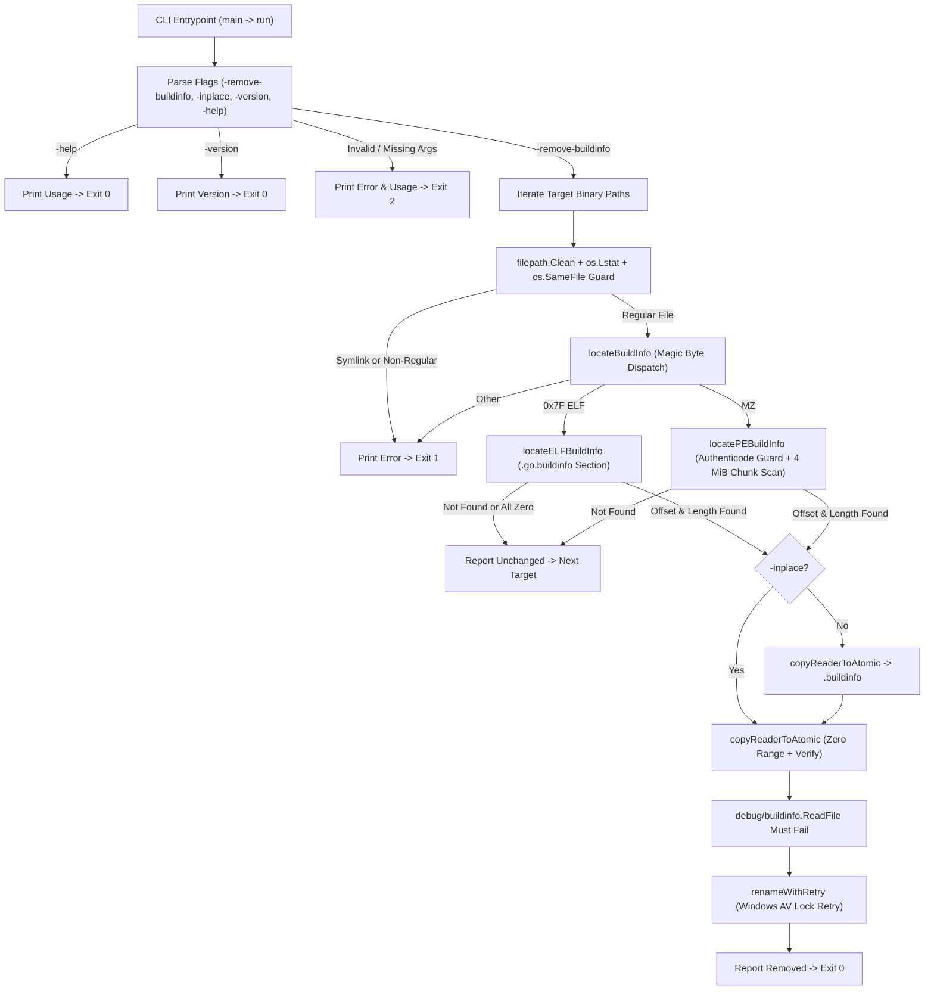
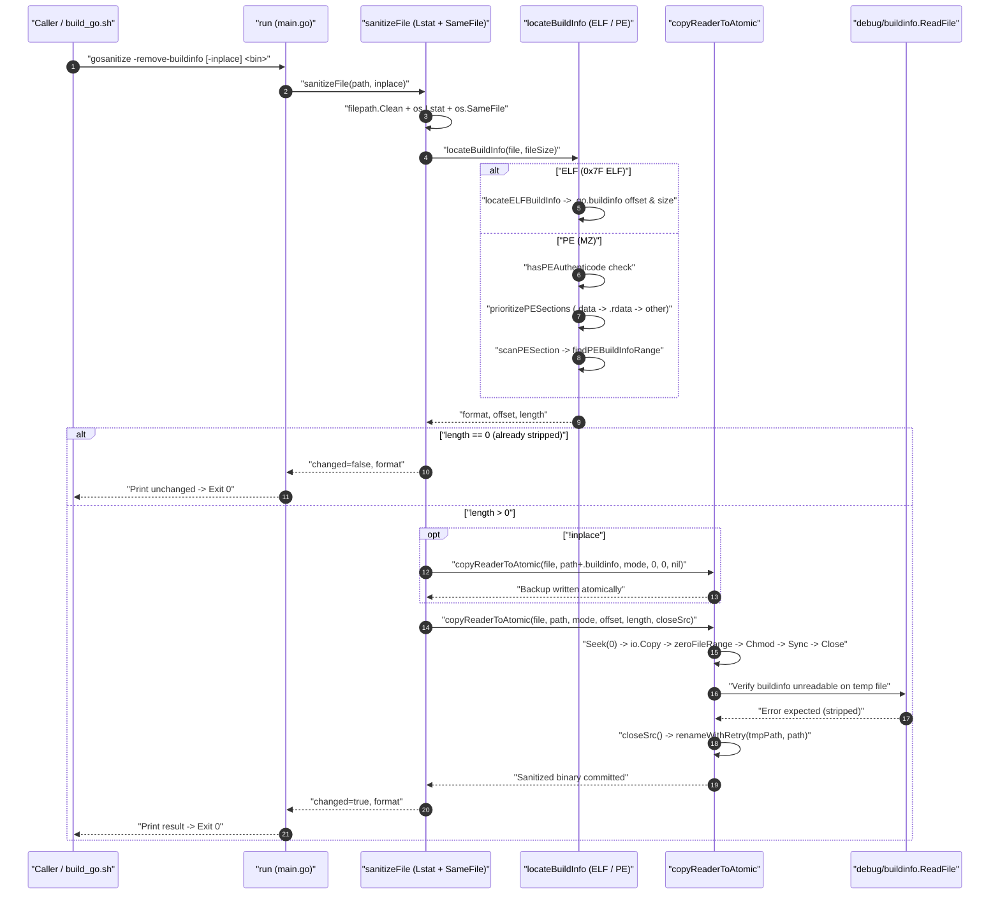
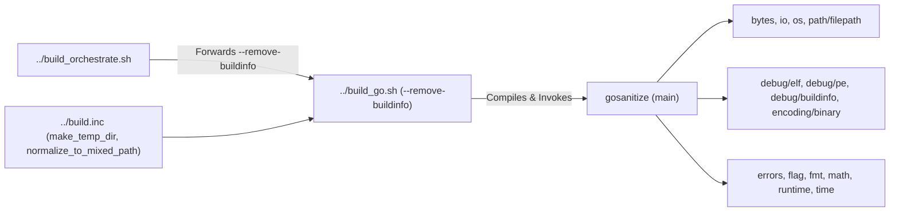
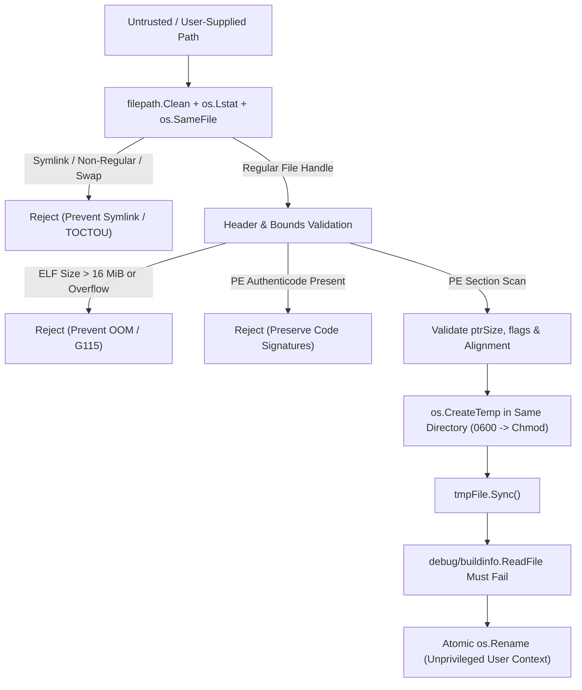

# Architecture Reference: Go Binary Buildinfo Sanitizer (`gosanitize`)

This document provides the architectural specification, operational data flow, security posture, CLI reference, and deployment examples for [`gosanitize`](main.go), a cross-platform Go utility that autodetects Linux (`ELF`) and Windows (`PE`) executables and strips embedded Go `buildinfo` metadata.

---

## 1. Application Overview and Objectives

`gosanitize` removes Go toolchain version, module path, and compiler/build flag metadata (`go version -m` / `debug/buildinfo`) from compiled Go binaries across both Linux and Windows without requiring external binutils (`objcopy`, `llvm-objcopy`) or Python.

While Linux ELF binaries place Go build metadata in a dedicated `.go.buildinfo` section, Windows PE binaries (`.exe`) embed the `"\xff Go buildinf:"` header and varint payload directly inside `.data`—meaning `objcopy --remove-section .go.buildinfo` leaves Windows PE buildinfo intact. `gosanitize` handles both formats uniformly through Go's standard-library binary parsers (`debug/elf` and `debug/pe`).

### Core Objectives
* **Zero External Tool Dependencies:** Built strictly from the Go standard library (`go 1.21`), eliminating `objcopy`, `llvm-objcopy`, or Python runtime dependencies across Windows, MSYS2/Cygwin, WSL, and Linux.
* **Automatic Format Detection:** Identifies Linux ELF (`\x7fELF`) and Windows PE (`MZ`) binaries via magic bytes and section parsing.
* **Safe In-Place Zeroing & Backup Preservation:** Zeroes only the buildinfo byte range in-place via atomic temp-file writes (`io.Copy` + `Seek`/`Write` + `Sync` + `Rename`), preserving PE/ELF section layouts, RVAs, relocations, and code. Creates a `<binary>.buildinfo` backup by default unless `-inplace` is passed.
* **Idempotency & Non-Clobbering Backups:** Detects already-stripped binaries and exits cleanly without rewriting the binary or overwriting an existing `<binary>.buildinfo` backup.
* **Defense-in-Depth Safety Guards:** Rejects symlinks (`os.Lstat`), refuses Authenticode-signed Windows PE binaries (`IMAGE_DIRECTORY_ENTRY_SECURITY`), caps ELF section reads at 16 MiB, and verifies `debug/buildinfo.ReadFile` fails on the staged binary before atomic rename.
* **Pipeline Integration:** Integrates directly with [`../build_go.sh`](../build_go.sh) (`--remove-buildinfo`) and [`../build_orchestrate.sh`](../build_orchestrate.sh) via `prepare_gosanitize` and `compile_target_binary`.

### Related Documentation
* **[`main.go`](main.go):** Primary CLI and binary sanitization engine.
* **[`main_test.go`](main_test.go):** Automated unit and integration tests for Windows PE, Linux ELF, decoy handling, CLI flags, and security guards.
* **[`../build_go_README.md`](../build_go_README.md):** Architecture reference for `build_go.sh`, which compiles and invokes `gosanitize` when `--remove-buildinfo` is passed.

---

## 2. Architecture and Design Choices

### 2.1. Architectural Layout



### 2.2. Key Design Choices

| Decision | Rationale |
| --- | --- |
| **In-place zeroing vs. ELF section removal** | Zeroing `.go.buildinfo` (ELF) and the `"\xff Go buildinf:"` block (PE) via `io.ReaderAt` + bounded `Write` preserves all ELF `PT_LOAD` segments and PE RVAs/relocations, allowing one pure-Go mechanism for both formats. |
| **`.data` prioritized before `.rdata` on PE** | Go's PE linker places `runtime.buildinfo` in `.data`. Tools like `gosanitize` itself embed `"\xff Go buildinf:"` as a string literal in `.rdata`; scanning `.data` first and validating header flags/alignment prevents decoy matches. |
| **Streaming `O(1)`-memory atomic file replacement** | `copyReaderToAtomic` streams from the validated handle through a temporary file in the target's directory (`32 KiB` zero buffer) instead of `os.ReadFile` + `2x` byte slices, keeping peak RAM bounded regardless of binary size. |
| **Own `go.mod` subpackage** | Keeping `gosanitize` isolated in [`go.mod`](go.mod) allows [`../build_go.sh`](../build_go.sh) to build it with `GOWORK=off -mod=readonly` from any target Go project directory without colliding with that project's `go.mod` or `vendor/`. |

### 2.3. Assumptions, Edge Cases, Performance & Efficiency

* **Assumptions:**
  * Target binaries are standard Linux ELF or Windows PE Go executables (`go 1.18+` inline varint format or legacy pointer-header format).
  * The destination directory permits creating temporary files (`os.CreateTemp`) and atomic same-directory `os.Rename`.
* **Edge Cases Handled:**
  * **Decoy magic bytes in `.rdata`:** `findPEBuildInfoRange` checks `ptrSize` (`4` or `8`), `flags &^ 0x03 == 0`, alignment (`idx % ptrSize == 0`), and valid uvarint payload bounds (`advanceUvarintPayload`), skipping false matches rather than aborting.
  * **Already stripped binaries:** `isAllZero` (ELF) and missing magic (PE) return `length == 0`, leaving both the binary and any existing `<binary>.buildinfo` backup untouched.
  * **Authenticode-signed PE binaries:** `hasPEAuthenticode` checks `IMAGE_DIRECTORY_ENTRY_SECURITY` (`OptionalHeader32` / `OptionalHeader64`) and refuses modification so signatures are never silently invalidated.
  * **Symlinks & special files:** `os.Lstat` rejects symlinks, directories, and device nodes.
  * **Windows antivirus file locks:** `renameWithRetry` retries `os.Rename` up to 5 times (`50 ms` backoff) on Windows to ride out transient Defender locks on newly compiled `.exe` files.
  * **Oversized/malformed ELF headers:** `maxELFBuildInfoSize` (`16 MiB`) and `math.MaxInt64` overflow checks prevent unbounded allocations or integer truncation (`G115`).
  * **Scope of removal:** Like `objcopy --remove-section .go.buildinfo` on Linux, `gosanitize` strips the `.go.buildinfo` / `"\xff Go buildinf:"` metadata read by `go version -m` and `debug/buildinfo.ReadFile`. If a Go program explicitly imports `runtime/debug`, Go's linker also retains a separate `runtime.modinfo` copy in `.rodata`/`.rdata` for `debug.ReadBuildInfo()`, which `gosanitize` intentionally leaves intact so runtime callers do not break.
* **Performance & Efficiency:**
  * **Inspection:** Reads only the 4-byte file magic, ELF/PE headers, and (on PE) bounded `<= 4 MiB` section chunks (`1 MiB` overlap in `scanPESection`) via `io.ReaderAt`—never allocating an entire large PE section or whole binary.
  * **Sanitization:** Streams the file in OS/standard-library buffered chunks (`io.Copy`) plus a fixed `32 KiB` stack buffer in `zeroFileRange`, using `O(1)` memory for writes and single-pass section scanning.

---

## 3. Data Flow and Control Logic

### 3.1. Operational Sequence



### 3.2. Function Relationships

* **`main` → `run`**: Parses flags cleanly via an isolated `flag.NewFlagSet` and returns process exit codes (`0` success, `1` runtime/I/O/format error, `2` CLI usage error).
* **`sanitizeFile`**: Enforces `filepath.Clean` + `os.Lstat`, opens the target read-only and checks `os.SameFile` to prevent TOCTOU swaps, calls `locateBuildInfo`, optionally writes `<binary>.buildinfo`, and delegates atomic zeroing to `copyReaderToAtomic`.
* **`locateBuildInfo`**: Dispatches on header bytes (`\x7fELF` → `locateELFBuildInfo`, `MZ` → `locatePEBuildInfo`).
* **`locateELFBuildInfo`**: Reads `.go.buildinfo` bounds, checks `sec.Size <= maxELFBuildInfoSize` and `math.MaxInt64` limits, and checks `isAllZero`.
* **`locatePEBuildInfo` → `hasPEAuthenticode` → `prioritizePESections` → `scanPESection` → `findPEBuildInfoRange` → `advanceUvarintPayload`**: Verifies unsigned PE status, scans `.data` then `.rdata` then remaining sections in bounded `<= 4 MiB` (`1 MiB` overlap) chunks, parses Go 1.18+ inline uvarint payloads or legacy pointer headers, and returns the exact byte span.
* **`copyReaderToAtomic` → `zeroFileRange` + `renameWithRetry`**: Creates a temporary file in `filepath.Dir(dstPath)`, rewinds and copies from the verified `*os.File`, zeroes `[offset, offset+length)`, syncs, verifies via `buildinfo.ReadFile`, invokes `beforeRename` (closing the source handle before replacing `path` on Windows), and atomically renames over `dstPath`.

---

## 4. Dependencies

`gosanitize` has **zero third-party module dependencies** (`go.mod` contains only `module gosanitize` and `go 1.21`). All parsing, verification, and atomic file operations rely exclusively on the Go standard library.



| Category | Dependency | Purpose |
| --- | --- | --- |
| **Go Toolchain** | Go `1.21+` | Compiles `gosanitize` (tested with `go1.27.4`). |
| **Go Standard Library** | `debug/elf`, `debug/pe`, `debug/buildinfo` | Binary section parsing and post-scrub buildinfo verification. |
| **Go Standard Library** | `encoding/binary`, `bytes`, `math` | Safe uvarint decoding and overflow-guarded bounds math. |
| **Go Standard Library** | `os`, `io`, `path/filepath`, `flag`, `runtime`, `time` | Symlink/file validation, streaming atomic writes, CLI parsing, Windows rename retry. |
| **Pipeline Scripts (Optional)** | [`../build_go.sh`](../build_go.sh), [`../build.inc`](../build.inc), [`../build_orchestrate.sh`](../build_orchestrate.sh) | Builds `gosanitize` on demand into a tracked temp directory when `--remove-buildinfo` is enabled. |

---

## 5. Security Architecture and Assessment

### 5.1. Security Architecture



### 5.2. Security Assessment

* **Libraries & Vulnerability Status:**
  * **Zero third-party dependencies:** Only Go standard library packages are imported in [`go.mod`](go.mod).
  * **`govulncheck ./...`:** `No vulnerabilities found.`
  * **`gosec ./...` (v2.30.0):** `0` issues (`1` documented `#nosec G304` annotation for opening the `Lstat`/`SameFile`-validated CLI target path).
  * **`golangci-lint run ./... --no-config`:** `0` issues (`errcheck` and default linters clean).
  * **`go vet ./...`:** Passed with `0` warnings.
* **Execution Privilege Context:**
  * `gosanitize` is a **non-system user-space utility** requiring no administrator/root privileges—only normal read/write permissions on the target binary and its parent directory (for temp-file creation and atomic rename).
  * Compile with hardened flags (`-trimpath -buildmode=pie -buildvcs=false -ldflags="-s -w"` and `CGO_ENABLED=0`) for ASLR and static isolation.

---

## 6. Command Line Arguments

### 6.1. `gosanitize` CLI Flags

| Flag | Type | Default | Description |
| --- | --- | --- | --- |
| `-remove-buildinfo` | `bool` | `false` | Action flag enabling Go buildinfo stripping on one or more `<binary>` positional arguments. |
| `-inplace` | `bool` | `false` | Modify the binary in place without creating or overwriting a `<binary>.buildinfo` backup. |
| `-version` | `bool` | `false` | Print `gosanitize <version>` (default `"dev"`, injectable via `-X main.version=...`) and exit `0`. |
| `-help` / `-h` | `bool` | `false` | Print CLI usage and flag defaults to stdout and exit `0`. |

### 6.2. Exit Codes

| Code | Meaning |
| --- | --- |
| `0` | Success (buildinfo removed, already absent, `-version`, or `-help`). |
| `1` | Runtime error (I/O failure, symlink, Authenticode-signed PE, corrupt ELF/PE, unsupported format, or post-scrub check failure). |
| `2` | CLI usage error (unknown flag, missing action flag, or missing `<binary>` argument). |

### 6.3. Pipeline Integration Flags

* **[`../build_go.sh`](../build_go.sh):** `--remove-buildinfo` builds `gosanitize` once per run into a tracked temporary directory (`GOWORK=off CGO_ENABLED=0 -mod=readonly`) and executes `gosanitize -remove-buildinfo -inplace <tmp_bin>` inside `compile_target_binary` before packaging and SSH artifact signing (`--sign`). Forwarded automatically during WSL delegation.
* **[`../build_orchestrate.sh`](../build_orchestrate.sh):** Forwards `--remove-buildinfo` to every module build.

---

## 7. Usage and Deployment Examples

### 7.1. Building and Deploying `gosanitize`

```bash
# Linux / macOS / MSYS2
cd private/devops/build_tasks/gosanitize
CGO_ENABLED=0 go build -mod=readonly -trimpath -buildmode=pie -buildvcs=false \
  -ldflags="-s -w -X main.version=v1.0.0-$(date +%Y%m%d)" \
  -o /usr/local/bin/gosanitize .
```

```pwsh
# Windows (PowerShell)
Set-Location e:\data\devel\build\code\private\devops\build_tasks\gosanitize
$env:CGO_ENABLED = "0"
go build -mod=readonly -trimpath -buildmode=pie -buildvcs=false `
  -ldflags="-s -w -X main.version=v1.0.0-$(Get-Date -Format yyyyMMdd)" `
  -o "$env:LOCALAPPDATA\bin\gosanitize.exe" .
```

### 7.2. Checking Version and Help

```text
$ gosanitize.exe -version
gosanitize v1.0.0-20261112

$ gosanitize.exe -help
Usage: gosanitize [options] <binary>...

Autodetects Linux (ELF) and Windows (PE) Go binaries and strips Go buildinfo metadata.

Options:
  -help
    	Show this help message and exit
  -inplace
    	Modify the binary in place without creating or overwriting a <binary>.buildinfo backup
  -remove-buildinfo
    	Remove Go buildinfo metadata from the target binary
  -version
    	Print version information and exit
```

### 7.3. Stripping a Windows PE Binary (Default Backup Mode & Idempotency)

```text
$ gosanitize.exe -remove-buildinfo .\bin\myapp.exe
Removed Go buildinfo from .\bin\myapp.exe (PE, backup: .\bin\myapp.exe.buildinfo)

$ gosanitize.exe -remove-buildinfo .\bin\myapp.exe
No Go buildinfo found in .\bin\myapp.exe (PE); left unchanged

$ go version -m .\bin\myapp.exe
.\bin\myapp.exe: could not read Go build info from .\bin\myapp.exe: not a Go executable
```

### 7.4. Stripping a Linux ELF Binary In-Place

```text
$ gosanitize -remove-buildinfo -inplace ./bin/myapp
Removed Go buildinfo from ./bin/myapp (ELF, in-place)
```

### 7.5. Using `--remove-buildinfo` in the Build Pipeline

```bash
# Build and package Windows + Linux artifacts with buildinfo stripped prior to packaging/signing
./build_go.sh --all-platform --all-pkg --remove-buildinfo --sign

# Multi-module orchestration across all private repositories
./build_orchestrate.sh --exec --parallel --all-platform --all-pkg --remove-buildinfo
```
