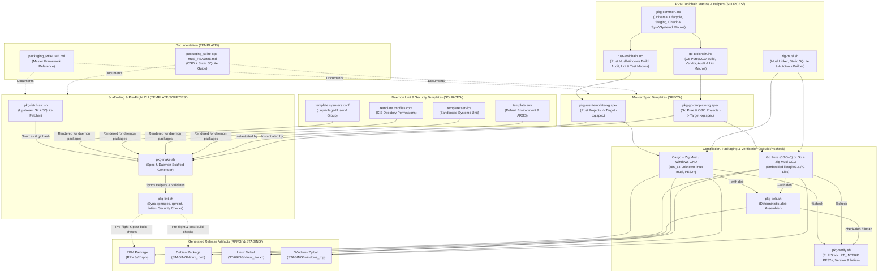
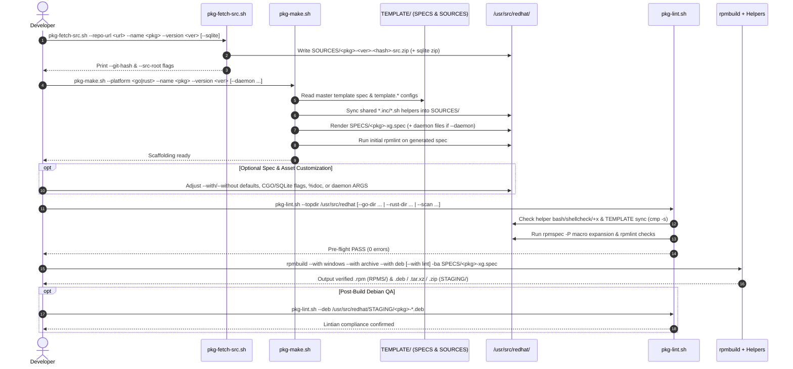
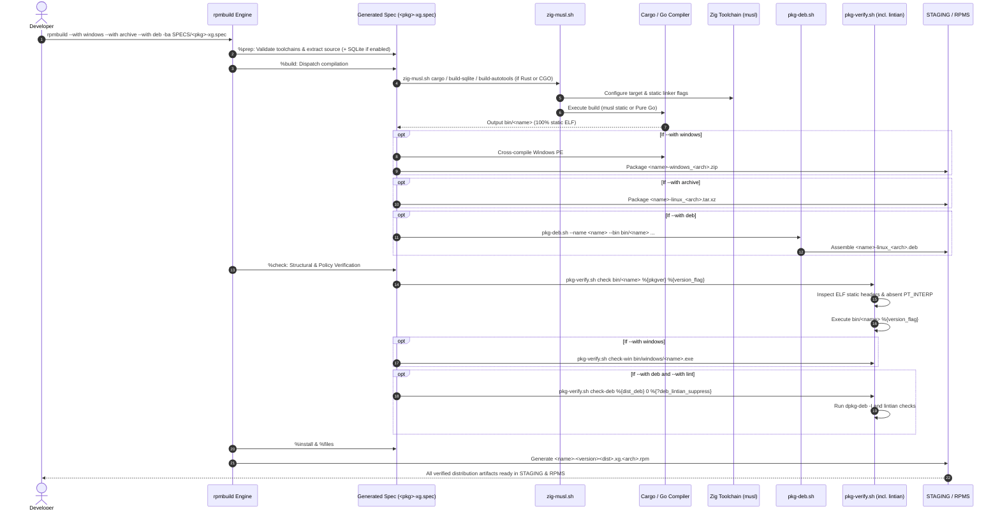
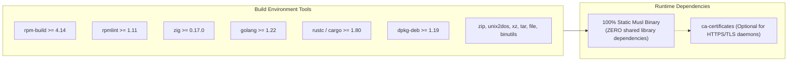
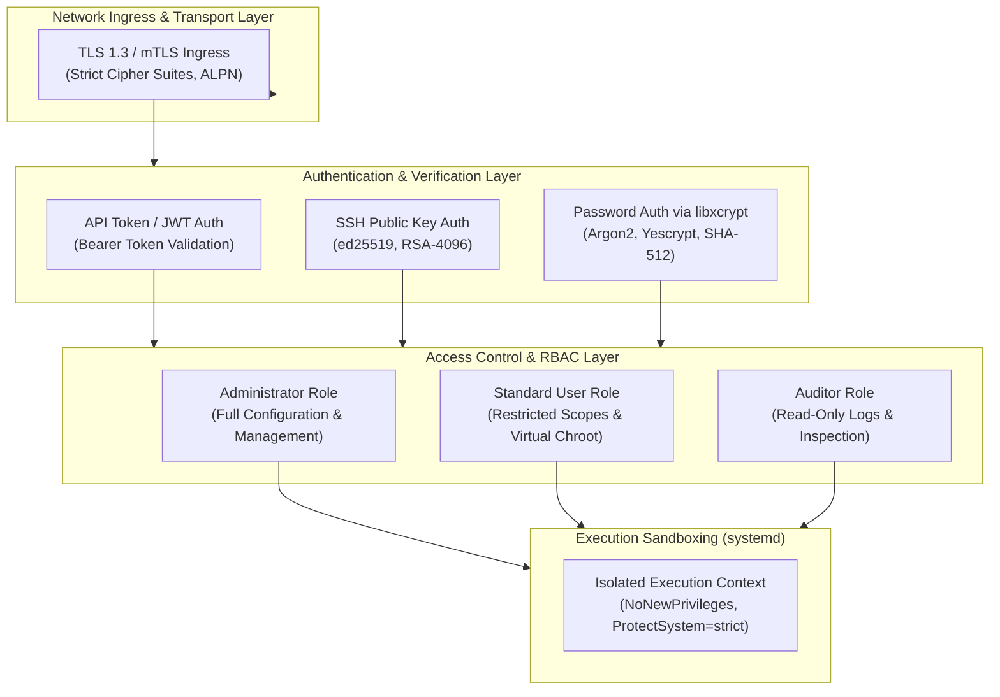
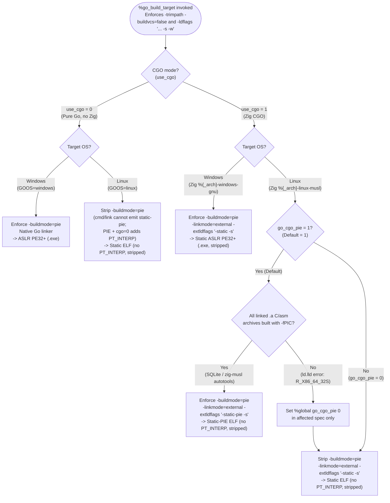
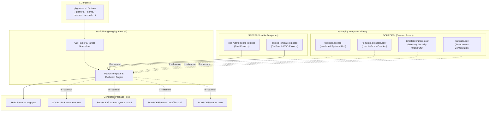

# Enterprise Multi-Distribution Packaging Framework Guide
### Universal Rust & Go Packaging via Static Musl, Zig, RPM, and Debian Pipelines

This guide provides a comprehensive technical manual for building, packaging, and deploying high-performance, statically linked **Rust** and **Go** applications across enterprise Linux distributions (**RHEL 8/9/10**, **CentOS Stream**, **Fedora**, **Debian 11/12**, **Ubuntu 20.04/22.04/24.04**, **Alpine**) and **Windows** using a unified RPM build root.

---

## Table of Contents
1. [Application Overview and Objectives](#1-application-overview-and-objectives)
2. [Architecture and Design Choices](#2-architecture-and-design-choices)
   - [Architectural Design Choices](#architectural-design-choices)
   - [Assumptions & System Prerequisites](#assumptions--system-prerequisites)
   - [Edge Cases Handled](#edge-cases-handled)
   - [Architecture Diagram](#architecture-diagram)
3. [Data Flow and Control Logic](#3-data-flow-and-control-logic)
   - [Operational Flow](#operational-flow)
   - [Complete `TEMPLATE` Objects Catalog](#complete-template-objects-catalog)
   - [New RPM Implementation Flow (Sequence Diagram)](#new-rpm-implementation-flow-sequence-diagram)
   - [Build & Verification Sequence Diagram](#build--verification-sequence-diagram)
4. [Performance and Scalability](#4-performance-and-scalability)
   - [Concurrency Model](#concurrency-model)
   - [Channel Structures & Application Concurrency](#channel-structures--application-concurrency)
   - [Package Distribution Release Channels](#package-distribution-release-channels)
   - [Compiler & Linker Optimizations](#compiler--linker-optimizations)
   - [Artifact Compression Pipeline](#artifact-compression-pipeline)
5. [Dependencies](#5-dependencies)
   - [Core Toolchain & Utilities](#core-toolchain--utilities)
   - [Package Dependency Chart](#package-dependency-chart)
6. [Security Architecture](#6-security-architecture)
   - [Authentication Layers & Supported Methods](#authentication-layers--supported-methods)
   - [Access Control & Role-Based Access Control (RBAC)](#access-control--role-based-access-control-rbac)
   - [Sandboxing & Hardening Baseline](#sandboxing--hardening-baseline)
   - [Security Architecture Diagram](#security-architecture-diagram)
7. [Security Assessment](#7-security-assessment)
   - [Encryption in Transit](#encryption-in-transit)
   - [Secret Management & Storage Security](#secret-management--storage-security)
   - [Authentication Configuration & Password Hashing](#authentication-configuration--password-hashing)
   - [Role-Based Access Control Implementation](#role-based-access-control-implementation)
   - [Attack Surface Reduction via Musl Hermeticity](#attack-surface-reduction-via-musl-hermeticity)
   - [Unprivileged Context & Non-System Application Isolation](#unprivileged-context--non-system-application-isolation)
   - [Supply Chain Auditing & Non-Vulnerable Libraries](#supply-chain-auditing--non-vulnerable-libraries)
8. [Code Quality & Best Practices Review](#8-code-quality--best-practices-review)
9. [Command Line Arguments & Configuration Toggles](#9-command-line-arguments--configuration-toggles)
   - [RPM Spec Build Condition Flags](#rpm-spec-build-condition-flags)
   - [Go Spec Configuration Toggles](#go-spec-configuration-toggles)
   - [`pkg-verify.sh` Subcommands](#pkg-verifysh-subcommands)
   - [`zig-musl.sh` Subcommands](#zig-muslsh-subcommands)
   - [`pkg-deb.sh` Options Manual](#pkg-debsh-options-manual)
   - [`pkg-make.sh` Scaffold Generator Options](#pkg-makesh-scaffold-generator-options)
     - [Template Architecture Tree](#template-architecture-tree)
     - [Template Files & Operational Roles](#template-files--operational-roles)
     - [Scaffold Generation Workflow Diagram](#scaffold-generation-workflow-diagram)
     - [`pkg-make.sh` Command-Line Options Table](#pkg-makesh-command-line-options-table)
10. [Step-by-Step Packaging & Deployment Examples](#10-step-by-step-packaging--deployment-examples)
    - [Quick Start: Automated Generation via `pkg-make.sh`](#quick-start-automated-generation-via-pkg-makesh)
    - [Scenario A: Packaging a Rust CLI Tool](#scenario-a-packaging-a-rust-cli-tool)
    - [Scenario B: Packaging a Pure Go Web Server Daemon](#scenario-b-packaging-a-pure-go-web-server-daemon)
    - [Scenario C: Packaging a CGO Daemon with SQLite & Bundled C Libs](#scenario-c-packaging-a-cgo-daemon-with-sqlite--bundled-c-libs)
    - [Deployment & Verification Guide](#deployment--verification-guide)

---

## 1. Application Overview and Objectives

Traditional Linux packaging requires maintaining separate build manifests for RPM-based (RHEL, Fedora, openSUSE) and Debian-based (Debian, Ubuntu) distributions. Furthermore, dynamically linked binaries compiled against modern `glibc` versions (e.g. `glibc 2.38+`) fail to run on older enterprise platforms like RHEL 8 or Debian 11 due to symbol versioning conflicts (`GLIBC_X.XX not found`).

This packaging framework resolves this challenge by providing a **single-workspace, multi-target build system** centered on:

1. **Zero Runtime Dependencies via 100% Static Musl Linking**:
   Produces self-contained ELF executables that run seamlessly across **any Linux distribution** without requiring `glibc`, external shared libraries, or containers.
2. **Unified Single-Invocation Multi-Target Artifacts**:
   A single execution of `rpmbuild` can simultaneously generate:
   - Native Enterprise Linux RPM package (`.rpm`)
   - Native Debian/Ubuntu package (`.deb`)
   - Generic standalone Linux release tarball (`.tar.xz`)
   - Standalone Windows 64-bit release zipball (`.zip`)
3. **Cross-Compilation Simplicity via Zig**:
   Leverages Zig 0.17+ as a lightweight, self-contained static C/C++ cross-compiler and linker for Rust and for Go builds requiring CGO or C libraries, eliminating the need for bulky cross-toolchains (`gcc-aarch64-linux-gnu`, `musl-gcc`, etc.). Pure Go builds do not invoke or require Zig.
4. **DRY (Don't Repeat Yourself) Modular Core**:
   Common RPM directives, architecture mappers, completion paths, toolchain validation, Debian packagers, and systemd service templates are extracted into reusable include files and scripts.
5. **Production-Ready Systemd Daemon Suite**:
   Provides out-of-the-box systemd service units, sysusers user provisioning, and tmpfiles directory provisioning adhering to the **Center for Internet Security (CIS)** benchmarks for both RHEL and Debian.

---

## 2. Architecture and Design Choices

### Architectural Design Choices

* **Musl Libc over Glibc for Linux Binaries**:
  `glibc` is designed specifically for dynamic linking; statically linking `glibc` still relies on dynamic `libnss` loading for hostname/user resolution. `musl-libc` is engineered for static linking, creating truly portable, fully isolated binaries.
* **Zig as Universal Static C/C++ Compiler**:
  Zig embeds `musl` headers and compiler-rt for all major architectures. Invoking `zig cc -target <arch>-linux-musl` replaces complex cross-compilers with a single binary. In the Go packaging framework, Zig is strictly used when `CGO_ENABLED=1` and/or when compiling embedded C source amalgamations (like SQLite) or dependent C libraries. Pure Go applications (`CGO_ENABLED=0`) bypass Zig entirely.
* **Native Debian Packager (`pkg-deb.sh`) vs Alien**:
  Converting RPMs with `alien` produces broken Debian control metadata and non-functional init scripts. [`pkg-deb.sh`](./SOURCES/pkg-deb.sh) natively constructs compliant Debian staging directories with authentic `DEBIAN/control`, `conffiles`, `md5sums`, and maintainer hooks (`postinst`, `prerm`).
* **RPM `%include` Preprocessor Integration**:
  Shared macros are included via `%include %{_sourcedir}/pkg-common.inc`. This allows specfiles to be concise while ensuring global policy changes take effect across all packages instantly.

### Assumptions & System Prerequisites

* **Operating System**: Linux build host with standard RPM build tools (`rpm-build`, `rpmlint`, `tar`, `xz`, `file`, `binutils`).
* **Zig Compiler**: Zig 0.17+ installed and accessible in `$PATH` (or symlinked to `/var/opt/zig` / `/u01/zig`). Required for all Rust static musl builds and for Go builds with `use_cgo 1` (or embedded C amalgamations / dependent C libraries). Pure Go builds (`use_cgo 0`) do not require Zig.
* **Rust Toolchain**: Rust 1.80+ with the musl standard library (`rustup target add <arch>-unknown-linux-musl`) and optional Windows target (`x86_64-pc-windows-gnu`).
* **Go Toolchain**: Go 1.22+ compiler in `$PATH`.
* **Debian Tools**: `dpkg` / `dpkg-deb` installed for `--with deb` builds, plus `lintian` for Debian Policy checks (advisory by default when installed; enforced when combined with `--with lint`).
* **Windows Cross-Tools**: `zip` and `unix2dos` installed for `--with windows` builds.

### Edge Cases Handled

1. **Sandboxed & Read-Only `/tmp`**:
   The Debian packager dynamically resolves temporary workspaces via `mktemp -d -t "deb_staging_${NAME}_XXXXXX"`, respecting `$TMPDIR` and preventing read-only filesystem failures.
2. **Debian Directory & File Permissions**:
   Ensures directories never leak `0777` permissions; explicitly enforces `0755` for directories, `0644` for configs/payloads, and `0755` for executables and maintainer scripts.
3. **Reproducible MD5Sums**:
   Calculates MD5 hashes across all payload trees (`usr/`, `etc/`, `var/`, `lib/`), strictly pruning the `DEBIAN/` metadata control directory and sorting file paths.
4. **RPM Comment Macro Expansion**:
   All macro symbols inside comments (`# %%{_arch}`, `# %%install`) are properly escaped with `%%` to prevent RPM parser corruption.
5. **Cross-Distribution Shell Compatibility**:
   System users provisioned in [`template.sysusers.conf`](./SOURCES/template.sysusers.conf) specify `-` for the shell field, allowing systemd to automatically map to `/sbin/nologin` on RHEL and `/usr/sbin/nologin` on Debian/Ubuntu.

### Architecture Diagram



---

## 3. Data Flow and Control Logic

### Operational Flow

1. **Initialization (`%prep`)**:
   - RPM preprocessor ingests [`pkg-common.inc`](./SOURCES/pkg-common.inc) and the language toolchain include (`rust-toolchain.inc` or `go-toolchain.inc`).
   - Validates that the necessary compilers (Go, Rust, Zig) and standard libraries are available.
   - Extracts upstream source zip/tarball into the build tree.
   - For Go packages with C dependencies (`use_sqlite 1` or `use_bundled_c_lib 1`), extracts SQLite amalgamation and C library sources into the parent directory.
2. **Compilation (`%build`)**:
   - **Rust**: [`zig-musl.sh cargo build`](./SOURCES/zig-musl.sh) exports environment variables (`CC_<target>`, `AR_<target>`, `CARGO_TARGET_<KEY>_RUSTFLAGS`) pointing rustc's linker to Zig.
   - **Pure Go**: Executes `CGO_ENABLED=0 GOOS=linux go build -trimpath -ldflags "-s -w ..."`.
   - **CGO Go**: Executes `zig cc` to compile `sqlite3.c` → `libsqlite3.a` and autotools `./configure --host=...` for `libxcrypt`, then builds Go with `CGO_ENABLED=1 CC="zig cc -target ..."`.
3. **Cross-Compilation & Multi-Target Packaging (`%build` stage)**:
   - If `--with windows`: Compiles Windows executable and stages `staging_windows/` → `.zip`.
   - If `--with archive`: Stages Linux standalone tree → `.tar.xz`.
   - If `--with deb`: Invokes [`pkg-deb.sh`](./SOURCES/pkg-deb.sh) to assemble the `.deb` package (and optionally runs `pkg-verify.sh check-deb` when `--lintian` is passed).
4. **Inspection (`%check`)**:
   - Runs `pkg-verify.sh check bin/<name> %{pkgver} %{version_flag}`:
     - Confirms ELF 64-bit or 32-bit statically linked or static-pie binary.
     - Confirms absence of dynamic linker `PT_INTERP` segment via `readelf -l`.
     - Unless `%{version_flag}` is `none`, executes `<binary> %{version_flag}` (default `--version`) and verifies expected version string match.
   - If `--with windows`: Runs `pkg-verify.sh check-win bin/windows/<name>.exe`.
   - If `--with deb` and `--with lint`: Runs `pkg-verify.sh check-deb %{dist_deb} 0 %{?deb_lintian_suppress}` via `lintian`.
5. **Installation & Packaging (`%install` & `%files`)**:
   - Copies Linux binary to `%{buildroot}%{_bindir}/%{name}`.
   - If packaging a daemon: installs `.service` to `%{_unitdir}`, `.conf` to `%{_sysusersdir}` and `%{_tmpfilesdir}`.
   - Assembles final `.rpm` file.

### Complete `TEMPLATE` Objects Catalog

Every file under `/usr/src/packages/TEMPLATE/` has a distinct role across documentation, specification manifests, RPM toolchain includes, build/validation CLI scripts, and systemd daemon templates:

| Object | Category | Purpose | Description |
| :--- | :--- | :--- | :--- |
| [`packaging_README.md`](./packaging_README.md) | Documentation | Master framework engineering reference | Documents design rationale, system prerequisites, Mermaid architecture and sequence workflows, complete object catalog, CLI flags, macro internals, and troubleshooting. |
| [`packaging_sqlite-cgo-musl_README.md`](./packaging_sqlite-cgo-musl_README.md) | Documentation | Static SQLite + CGO methodology guide | Details `CGO_ENABLED=1` static musl compilation using Zig and official SQLite amalgamation (`sqlite3.c`/`sqlite3.h`) with enterprise extensions (`FTS5`, `RTREE`, `Session`, `GeoPoly`). |
| [`SPECS/pkg-go-template-xg.spec`](./SPECS/pkg-go-template-xg.spec) | Spec Template | Master RPM spec template for Go packages | Parameterized `.spec` supporting Pure Go (`CGO_ENABLED=0`) and Static CGO (`use_cgo 1`, `use_sqlite 1`, `use_bundled_c_lib 1`), shell completions, systemd daemon mode, and `%pkg_*` lifecycle macros. |
| [`SPECS/pkg-rust-template-xg.spec`](./SPECS/pkg-rust-template-xg.spec) | Spec Template | Master RPM spec template for Rust packages | Parameterized `.spec` targeting `x86_64-unknown-linux-musl` and `x86_64-pc-windows-gnu` via `zig-musl.sh`, with reproducible `%{rustflags_core}`, optional SQLite amalgamation, tests/lint/audit toggles, and `%pkg_*` macros. |
| [`SOURCES/pkg-common.inc`](./SOURCES/pkg-common.inc) | RPM Macro Include | Shared language-agnostic RPM lifecycle macros | Sets `_build_id_links none`, `__strip /bin/true`, toggles (`is_daemon`, `version_flag`, `check_version`, `deb_lintian_suppress`), `%pkg_common_buildrequires`, `%pkg_stage_*`, `%pkg_build_deb`, `%pkg_check_bins`, `%pkg_install_*`, `%pkg_files_*`, and `%pkg_systemd_scriptlets`. |
| [`SOURCES/go-toolchain.inc`](./SOURCES/go-toolchain.inc) | RPM Macro Include | Go toolchain setup, build, test, vendor & QA macros | Includes `pkg-common.inc`, enforces `go_min_ver`, detects Go QA tools (`golangci-lint`, `staticcheck`, `gofumpt`, `gosec`, `govulncheck`), and provides `%go_build_target` (routing CGO through `zig-musl.sh`), `%go_run_tests`, `%go_vendor_local_mod`, `%go_lint_checks`, and `%go_security_audit`. |
| [`SOURCES/rust-toolchain.inc`](./SOURCES/rust-toolchain.inc) | RPM Macro Include | Rust/Zig toolchain setup, build & QA macros | Includes `pkg-common.inc`, checks `cargo`, `rustc`, `zig`, musl/Windows stdlibs, and Cargo tools (`clippy`, `fmt`, `audit`, `deny`, `machete`, `nextest`, `bloat`), providing `%rust_build_target`, `%rust_lint_checks`, `%rust_security_audit`, and `%rust_run_tests`. |
| [`SOURCES/pkg-fetch-src.sh`](./SOURCES/pkg-fetch-src.sh) | CLI Helper Script | Upstream source snapshot & SQLite fetcher | Shallow-clones a tagged git ref into `SOURCES/<name>-<ver>-<hash>-src.zip`, optionally downloads `sqlite-amalgamation-<sqlitever>.zip` (`--sqlite`, configurable `--sqlite-year` / `sqliteyear`), and prints exact `--git-hash` and `--src-root` flags for `pkg-make.sh`. |
| [`SOURCES/pkg-make.sh`](./SOURCES/pkg-make.sh) | CLI Helper Script | Interactive/automated spec & daemon scaffolder | Copies and customizes `pkg-{rust,go}-template-xg.spec` into `SPECS/<pkg>-xg.spec` (including `--bin-name`, `--license-file`, `--completion-cmd`, and `--exclude`), syncs shared helpers into `$TOPDIR/SOURCES/`, optionally instantiates daemon unit/env configs, and runs `rpmlint`. |
| [`SOURCES/pkg-lint.sh`](./SOURCES/pkg-lint.sh) | CLI Helper Script | Repo pre-flight & post-build validator | Checks helper scripts (`bash -n`, `shellcheck -S warning`, `+x`), `TEMPLATE` sync (`cmp -s`), `rpmspec -P` expansion, `rpmlint`, `lintian` on `.deb` artifacts (`--deb` / `STAGING/*.deb`), `--go-dir`, `--rust-dir`, and `--scan` (`trivy`/`trufflehog`). |
| [`SOURCES/zig-musl.sh`](./SOURCES/zig-musl.sh) | Build Wrapper Script | Multi-call Zig musl cross-compiler wrapper | Configures Cargo musl/Windows env (`cargo`), compiles static SQLite (`build-sqlite`) and static C autotools libs (`build-autotools`), and wraps `cc`/`c++`/`ar` with Zig (plus legacy `check`/`check-win` aliases). |
| [`SOURCES/pkg-deb.sh`](./SOURCES/pkg-deb.sh) | Packaging Script | Deterministic native Debian (`.deb`) builder | Assembles binaries, conffiles, directories, docs, man pages, completions, and systemd hooks (`systemctl preset`) into reproducible `.deb` archives with optional `--lintian` / `--lintian-suppress` checking. |
| [`SOURCES/pkg-verify.sh`](./SOURCES/pkg-verify.sh) | Verification Script | Toolchain-agnostic binary & `.deb` verifier | Validates Linux static/static-pie ELF linkage and absent `PT_INTERP` (`check`), optional CLI `--version` execution, Windows PE32+ binaries (`check-win`), and `.deb` policy compliance via `dpkg-deb -I` + `lintian` (`check-deb`). |
| [`SOURCES/template.service`](./SOURCES/template.service) | Daemon Template | Hardened systemd service unit template | Installs to `%{_unitdir}/<name>.service`; loads `/etc/default/<name>`, `/etc/sysconfig/<name>`, and `/etc/<name>/<name>.env`, executes `/usr/bin/<name> $ARGS`, and enforces CIS sandboxing (`ProtectSystem=strict`, `NoNewPrivileges=true`). |
| [`SOURCES/template.sysusers.conf`](./SOURCES/template.sysusers.conf) | Daemon Template | Declarative systemd unprivileged user/group config | Installs to `%{_sysusersdir}/<name>.conf`; provisions system user and group `<name>` with non-login shell (`-`) prior to file installation. |
| [`SOURCES/template.tmpfiles.conf`](./SOURCES/template.tmpfiles.conf) | Daemon Template | Runtime directory & permission policy template | Installs to `%{_tmpfilesdir}/<name>.conf`; ensures persistent/runtime directories exist with `0750` ownership and `/etc/<name>/<name>.env` stays `0640`. |
| [`SOURCES/template.env`](./SOURCES/template.env) | Daemon Template | Default service runtime environment config | Installs to `/etc/<name>/<name>.env` (`%config(noreplace)`, `0640` root:`<name>`); holds environment variables and `$ARGS` daemon flags. |

### New RPM Implementation Flow (Sequence Diagram)

The sequence below illustrates the end-to-end developer workflow for onboarding and releasing a new RPM package from the `TEMPLATE` stack:



### Build & Verification Sequence Diagram



---

## 4. Performance and Scalability

### Concurrency Model

* **Parallel Compilation**: All compilation scripts leverage all available host CPU cores automatically (`-j$(nproc)` in autotools make, Go native goroutine concurrency in `go build`, and Cargo thread pools in `cargo build`).
* **Independent Staging Trees**: Staging directories (`staging_archive/`, `staging_windows/`, `deb_staging_*`) are strictly partitioned and cleaned up immediately after archive generation, avoiding disk footprint explosion.

### Channel Structures & Application Concurrency

Modern network applications packaged with this framework (such as Caddy and SFTPGo) employ goroutine-and-channel architectures that run at peak throughput under static musl:

* **Non-Blocking Channel Multiplexing**: Daemons use buffered Go channels for worker task pools and event-driven architectures (e.g. log emitters, connection accept loops) without encountering glibc thread-local storage (`TLS`) overhead.
* **Elimination of CGO Locking**: In Pure Go mode (`use_cgo 0`), the Go runtime manages thousands of concurrent goroutines per OS thread using cooperative user-space scheduling (`M:N` scheduler) with zero CGO boundary context-switch penalties.
* **Hermetic CGO Threading**: When CGO is active (`use_cgo 1`), Zig compiles embedded C dependencies against musl's clean, lightweight POSIX pthread implementation, avoiding glibc's dynamic symbol resolution locks.

### Package Distribution Release Channels

The framework incorporates release channel taxonomies directly into package releases via `%{pkg_rel_suffix}` (`%{__os_nodigits}.%{__channel}`, stripping numeric distro version suffixes from `%{?dist}` such as `.el9` → `.el`):

```spec
%global __channel       xg
Release:        <release_num>%{pkg_rel_suffix}
```

* **`xg` Channel**: Production enterprise channel, optimized for rock-solid stability and forward compatibility.
* **Multi-Distribution Repositories**: The resulting naming convention (e.g. `caddy-2.11.7-10.el.xg.x86_64.rpm`) guarantees unambiguous package ordering across automated Enterprise Linux 8/9/10 mirrors (YUM/DNF) while `.deb` packages receive `%{pkg_deb_version}`.

### Compiler & Linker Optimizations

| Flag | Language | Effect |
| :--- | :---: | :--- |
| `-C link-self-contained=no` | Rust | Uses external Zig musl startup routines (`crt1.o`, `crti.o`) instead of bundling incompatible toolchain crt files. |
| `-C linker=zig-musl.sh` | Rust | Routes linking through Zig musl ELF linker. |
| `-trimpath` | Go | Removes all host filesystem paths from the compiled binary, ensuring deterministic, reproducible builds. |
| `-buildvcs=false` | Go | Disables host git metadata inspection during build. |
| `-s -w` | Go / C | Strips symbol tables (`-s`) and DWARF debug info (`-w`), reducing binary size by 40%–60%. |
| `--enable-hashes=all` | C (`libxcrypt`) | Includes standard plus modern password hashing algorithms (SHA-512, bcrypt, Yescrypt). |

### Artifact Compression Pipeline

* **Generic Linux Tarball**: Compressed with `tar -Jcvf` (XZ compression, level 6) for optimal size-to-decompression-speed ratio.
* **Windows Zipball**: Compressed with `zip -9r` (maximum Deflate compression); all documentation passed through `unix2dos` to ensure native CRLF line endings on Windows.
* **Debian Archive**: Packaged via `dpkg-deb --build --root-owner-group`, compressing data members with XZ/Zstandard and forcing UID/GID to 0 (`root:root`).

---

## 5. Dependencies

### Core Toolchain & Utilities

The build host requires the compilers and utilities listed below. No runtime dynamic dependencies exist for the compiled packages.

### Package Dependency Chart



* **No Shared Object Dependencies**:
  Executing `ldd bin/<name>` outputs:
  ```text
  not a dynamic executable
  ```
  The binary operates without `ld-linux.so`, `libc.so.6`, `libpthread.so`, or any distribution-packaged shared libraries.

---

## 6. Security Architecture

### Authentication Layers & Supported Methods

Enterprise daemons packaged with this framework support layered authentication architectures:

### Security Architecture Diagram



* **Transport Layer Security**: Strict TLS 1.3 default with support for Mutual TLS (mTLS) client certificate verification.
* **Authentication Methods**:
  - **API Tokens / JWT**: Header-based authentication for automation and REST management.
  - **SSH Public Key Authentication**: Hardware key and agent-backed authentication (e.g. in SFTPGo).
  - **Modern Password Hashing**: Utilizes the statically bundled `libxcrypt` to verify cryptographically modern hashes (Yescrypt, Argon2, bcrypt, SHA-512) without relying on host glibc `crypt()`.

### Access Control & Role-Based Access Control (RBAC)

* **Role Separation**: Distinguishes administrative operations from tenant data access, ensuring unprivileged users cannot reconfigure daemon sockets or modify TLS policies.
* **Virtual Chroot & Directory Sandboxing**: Each authenticated session is confined to its assigned data root (e.g. `/var/lib/<name>/users/<username>`), preventing directory traversal attacks (`../`).

### Sandboxing & Hardening Baseline

Daemons packaged via [`template.service`](./SOURCES/template.service) implement defense-in-depth security sandboxing:

* **Privilege De-escalation (`NoNewPrivileges=true`)**:
  Prevents the process or child processes from acquiring new privileges via `setuid`/`setgid` binaries.
* **Filesystem Lockdown (`ProtectSystem=strict`, `ProtectHome=true`)**:
  Mounts the entire OS filesystem hierarchy (`/usr`, `/boot`, `/etc`) read-only for the process. `/home`, `/root`, and `/run/user` are completely inaccessible.
* **Dynamic Directory Isolation (systemd v235+)**:
  Using `StateDirectory=`, `LogsDirectory=`, and `RuntimeDirectory=`, systemd provisions:
  - `/var/lib/<name>` (Mode `0750`)
  - `/var/log/<name>` (Mode `0750`)
  - `/run/<name>` (Mode `0750`)
  with ownership automatically set to `<name>:<name>` and writable bind mounts automatically granted under `ProtectSystem=strict` (making redundant `ReadWritePaths=` unnecessary). `/etc/<name>` (`0750 root:<name>`) is intentionally excluded from `ConfigurationDirectory=` so it remains root-administered and read-only under `ProtectSystem=strict`.
* **Service Argument & Socket Hardening**:
  - `ExecStart=/usr/bin/<name> $ARGS` allows optional daemon CLI arguments to be configured cleanly via environment files (`/etc/default/<name>`, `/etc/sysconfig/<name>`, or `/etc/<name>/<name>.env`).
  - `RestrictAddressFamilies=AF_INET AF_INET6 AF_UNIX AF_NETLINK` permits standard IPv4/IPv6, Unix domain, and Netlink sockets (required by Go's `net` runtime for interface lookups).
* **Network Capability Delegation**:
  For web servers or services binding to privileged low ports (< 1024) without root:
  ```ini
  CapabilityBoundingSet=CAP_NET_BIND_SERVICE
  AmbientCapabilities=CAP_NET_BIND_SERVICE
  ```

---

## 7. Security Assessment

### Encryption in Transit

* **Modern Cryptography**: Applications compiled via this framework use native Go `crypto/tls` or Rust `rustls` engines, prioritizing TLS 1.3 with Curve25519 key exchange and AES-GCM / ChaCha20-Poly1305 ciphers.
* **Secure Defaults**: Automatic HTTP-to-HTTPS redirection, strict HTTP Strict Transport Security (`HSTS`), and automatic ACME certificate enrollment (in Caddy).

### Secret Management & Storage Security

* **Protected Configuration Directory**: Handled by [`template.tmpfiles.conf`](./SOURCES/template.tmpfiles.conf) and `%pkg_files_daemon`:
  - Daemon configuration directory `/etc/<name>` is restricted to `0750` mode owned by `root:<name>`, preventing `systemd-tmpfiles` unsafe path transitions while letting root administer configs and the daemon read them.
  - Sensitive files such as `/etc/<name>/<name>.env` (explicitly managed via `z /etc/<name>/<name>.env 0640 root <name>` and `%config(noreplace)` / `DEBIAN/conffiles`) are restricted to `0640` mode, completely unreadable by non-system users, and preserved untouched across package updates.
  - System user creation (`%pre` via `%sysusers_create_compat` on RPM, `systemd-sysusers` on `.deb`) and lifecycle scriptlets (`$1 -eq 1` vs `$1 -ge 2` on RPM; `-z "$2"` vs `-n "$2"` on `.deb`) strictly distinguish new installs from upgrades and never overwrite configuration or persistent runtime data (`/var/lib/<name>`, `/var/log/<name>`). Admin overrides to vendor units (`/usr/lib/systemd/system/<name>.service`) and tmpfiles (`/usr/lib/tmpfiles.d/<name>.conf`) belong in `/etc/systemd/system/<name>.service.d/` and `/etc/tmpfiles.d/<name>.conf`.
* **Process Environment Isolation**: Environment files (`/etc/default/<name>`, `/etc/sysconfig/<name>`, and `/etc/<name>/<name>.env`) are read by systemd before dropping privileges and never exposed to unprivileged users.

### Authentication Configuration & Password Hashing

* **Statically Bundled `libxcrypt`**: By bundling `libxcrypt 4.5.2` compiled statically via Zig, applications can verify and generate modern password hashes (Yescrypt, Argon2id) even on legacy distributions (RHEL 8) whose native glibc only supports older algorithms.

### Role-Based Access Control Implementation

* Administrative and operational interfaces are partitioned. For services exposing management APIs (e.g. Caddy API on port 2019, SFTPGo WebAdmin on port 8080), access is bound to localhost by default or secured with scoped JWT tokens.

### Attack Surface Reduction via Musl Hermeticity

* **Memory Safety & Simplicity**:
  Musl's codebase is orders of magnitude smaller and simpler than glibc, eliminating entire classes of historical glibc vulnerabilities (such as dynamic loader buffer overflows, iconv vulnerabilities, and complex NSS resolution exploits).
* **Static Hermeticity**:
  Because the binary contains zero `DT_NEEDED` dynamic tags and no dynamic interpreter (`PT_INTERP`), it is completely immune to `LD_PRELOAD`, `LD_LIBRARY_PATH`, and rpath injection attacks.

### Unprivileged Context & Non-System Application Isolation

* **Dedicated System Account**: Services run strictly under an unprivileged system UID/GID (< 1000) created dynamically by `systemd-sysusers` via [`template.sysusers.conf`](./SOURCES/template.sysusers.conf).
* **No Interactive Shell**: Account shell is set to `-` (resolves to `/sbin/nologin` or `/usr/sbin/nologin`), preventing any interactive login.
* **Kernel Attack Mitigation**: `ProtectKernelTunables=true`, `ProtectKernelModules=true`, `ProtectControlGroups=true`, and `RestrictRealtime=true` prevent daemon compromises from escalating to kernel tampering.

### Supply Chain Auditing & Non-Vulnerable Libraries

* Both templates support opt-in dependency synchronization via `--with update_deps` (disabled by default so offline/hermetic RPM builds preserve pinned upstream `Cargo.lock` / `go.sum` lockfiles reproducibly):
  - Rust (`%prep`): `cargo update --recursive` (`%{cargo_update}`)
  - Go (`%build`): `go get -u ./...` and `go mod tidy` via `%{go_update_tree}` (or `%{go_update_tree_tests}` when `--with testsuite` is active)
  Enabling `--with update_deps` incorporates security patches within semver boundaries at packaging time.

---

## 8. Code Quality & Best Practices Review

All packaging assets adhere to enterprise standards:

1. **SPDX Compliance**: Every spec file declares standard SPDX identifiers (e.g. `Apache-2.0`, `MIT`, `AGPL-3.0-only`).
2. **Rpmlint Clean**: All templates and resulting spec files achieve **0 errors** under `rpmlint`.
3. **POSIX Shell Standards**: All shell scripts use strict error trapping (`set -eo pipefail`), contain zero unquoted variable expansions in path lookups, and use non-forking parameter expansion.
4. **Idempotent Cleanup**: Temporary staging trees register `trap 'rm -rf ...' EXIT` handlers, guaranteeing zero orphaned directories in `/tmp` or `$TMPDIR`.
5. **No Host Hardcoding**: Macro paths use RPM dynamic variables (`%{_bindir}`, `%{_sysconfdir}`, `%{_unitdir}`).

---

## 9. Command Line Arguments & Configuration Toggles

### RPM Spec Build Condition Flags

Pass build condition flags to `rpmbuild` using `--with <flag>` or `--without <flag>`:

| Flag | Default | Description |
| :--- | :---: | :--- |
| `--with archive` | Disabled | Generates generic Linux release tarball (`STAGING/<name>-<version>-linux_<arch>.tar.xz`). |
| `--with windows` | Disabled | Cross-compiles Windows 64-bit binary and packages zipball (`STAGING/<name>-<version>-windows_<arch>.zip`). |
| `--with deb` | Disabled | Generates native Debian/Ubuntu binary package (`STAGING/<name>-<version>-linux_<arch>.deb`). |
| `--without rpm` | Enabled | Skips RPM package generation when only tarballs/debs are desired. |
| `--without check` | Enabled | Disables the `%check` binary structural verification phase. |
| `--with testsuite` | Disabled | Runs upstream unit testsuite (`%go_run_tests` honoring CGO/SQLite/build tags, or `%rust_run_tests`); disabled by default in favor of binary wellness verification. |
| `--with lint` | Disabled | Runs installed Rust (`cargo fmt --check`, `cargo clippy`, `cargo machete`, `cargo bloat`) or Go (`go vet`, `gofumpt -l`, `golangci-lint`, `staticcheck`) checks plus strict `lintian` on `.deb` artifacts during `%check`. |
| `--with audit` | Disabled | Runs dependency/security audits (`cargo audit`, `cargo deny` for Rust; `govulncheck`, `gosec` for Go). |
| `--with update_deps` | Disabled | Runs lockfile dependency updates (`go get -u && go mod tidy` / `cargo update --recursive`); off by default for hermetic reproducible builds. |

### Go & Shared Spec Configuration Toggles

Located near lines 44–95 in [`pkg-go-template-xg.spec`](./SPECS/pkg-go-template-xg.spec) (with `bin_name`, `license_file`, `completion_cmd`, and `enable_*` shared via [`pkg-common.inc`](./SOURCES/pkg-common.inc)):

```spec
%global is_daemon          0   # 1 = Enable systemd unit, sysusers, tmpfiles, .env & deb hooks
%global use_cgo            0   # 0 = Pure Go (default, Caddy-style), 1 = Static CGO (SFTPGo-style)
%global go_cgo_pie         1   # 1 = Static-PIE (-buildmode=pie + -static-pie -s) for Linux CGO; set 0 only if non-PIC C/asm archives fail linking
%global use_sqlite         0   # 1 = Build embedded SQLite amalgamation via Zig (requires use_cgo 1)
%global use_bundled_c_lib  0   # 1 = Compile static autotools C library (libxcrypt) via Zig (requires use_cgo 1)
%global bin_name           %{name}   # Override compiled binary basename if different from RPM Name
%global go_test_pkgs       ./...     # Package pattern passed to %go_run_tests (e.g. ./cmd/...)
%global license_file       LICENSE   # Override license filename (e.g. LICENSE.txt, COPYING)
%global completion_cmd     %{nil}    # Optional CLI completion subcommand (e.g. completion; populates completions.files dynamically)
%global deb_lintian_suppress %{nil}  # Optional comma-separated intentional lintian tags (e.g. statically-linked-binary,maintainer-script-calls-systemctl,non-standard-dir-perm,non-standard-file-perm,no-manual-page)
%global enable_archive     1         # 0 = Disable tarball target even if --with archive is passed
%global enable_deb         1         # 0 = Disable Debian target even if --with deb is passed
%global enable_windows     1         # 0 = Disable Windows target even if --with windows is passed
```

> [!IMPORTANT]
> **Explicit Rule: When is Zig Used in Go Builds?**
> - **Pure Go (`use_cgo 0`)**: Zig is **NEVER** used, invoked, or required. Pure Go compiles directly via native `CGO_ENABLED=0 go build` with zero external C toolchain dependencies.
> - **Static CGO (`use_cgo 1`)**: Zig is strictly engaged **only** when `CGO_ENABLED=1` is active (e.g. packages linking to hardware security modules like PKCS#11/HSM, or requiring C libraries) and/or when compiling embedded C source amalgamations (such as SQLite `sqlite3.c` → `libsqlite3.a`) or bundled autotools C libraries (`libxcrypt`).

### Go `-buildmode=pie` & Toolchain Flag Matrix

`go-toolchain.inc` (`%go_build_target` and `%go_run_tests`) always enforces `-trimpath -buildvcs=false` and `-ldflags "... -s -w"` across all Linux and Windows targets. `-buildmode=pie` is applied per target according to static-linking compatibility:

| OS | CGO | Type / Toolchain | `-buildmode=pie` | Enforced Flags & External Linker | Resulting Binary & Rationale |
| :--- | :---: | :--- | :---: | :--- | :--- |
| **Linux** | `0` | Pure Go native (`go build`, no Zig) | **Stripped (Off)** | `-trimpath -buildvcs=false` <br> `-ldflags "-s -w ..."` | **Static ELF, stripped (no `PT_INTERP`).** Go's internal linker cannot emit `static-pie` without CGO external linking; enabling `-buildmode=pie` produces a dynamically linked ELF (`/lib64/ld-linux-x86-64.so.2`) that fails `pkg-verify.sh check`. |
| **Windows** | `0` | Pure Go native (`go build`, no Zig) | **Enforced (On)** | `-buildmode=pie -trimpath -buildvcs=false` <br> `-ldflags "-s -w ..."` | **Windows `PE32+` executable.** Go generates ASLR-enabled PE binaries natively without external linking. |
| **Windows** | `1` | Static CGO via Zig (`%{_arch}-windows-gnu`) | **Enforced (On)** | `-buildmode=pie -trimpath -buildvcs=false` <br> `-ldflags "-linkmode=external -extldflags '-static -s' -s -w ..."` | **Static Windows `PE32+` executable.** Zig links C/SQLite archives statically while preserving PE ASLR/PIE support. |
| **Linux** | `1` (`go_cgo_pie 1`, default) | Zig musl static binary (`%{_arch}-linux-musl`, **mandatory static**) | **Enforced (On)** | `-buildmode=pie -trimpath -buildvcs=false` <br> `-ldflags "-linkmode=external -extldflags '-static-pie -s' -s -w ..."` | **`static-pie linked, stripped` ELF (no `PT_INTERP`).** Passes `pkg-verify.sh check`. Requires all linked C/assembly `.a` archives to be compiled with `-fPIC` (`pkg-common.inc` SQLite flags and `zig-musl.sh build-autotools` enable `-fPIC` by default). |
| **Linux** | `1` (`go_cgo_pie 0`, fallback) | Zig musl static binary (`%{_arch}-linux-musl`, **mandatory static**) | **Opt-Out (Off)** | `-trimpath -buildvcs=false` <br> `-ldflags "-linkmode=external -extldflags '-static -s' -s -w ..."` | **`statically linked, stripped` ELF (no `PT_INTERP`).** Set `%global go_cgo_pie 0` per spec only if linking prebuilt/non-PIC C or assembly archives triggers `ld.lld: error: relocation R_X86_64_32S ... recompile with -fPIC`. |

#### Decision Tree: `-buildmode=pie` & Linker Flag Selection



#### Verified Conclusions & Maintainer Rules (`-buildmode=pie`, Stripping & Reproducibility)

1. **Pure Go Linux (`use_cgo 0`) — NEVER use `-buildmode=pie` for static RPM builds:**
   Go's internal linker (`cmd/link`) does not support `static-pie` on Linux without an external C startup object (`rcrt1.o`). Passing `-buildmode=pie` under `CGO_ENABLED=0 GOOS=linux` silently switches output to a **dynamically linked ELF** requiring `/lib64/ld-linux-x86-64.so.2` (`PT_INTERP`), violating our static binary guarantee and failing `%check` (`pkg-verify.sh check`). `%go_build_target` therefore automatically strips `-buildmode=pie` on `use_cgo 0` Linux builds—even if a spec manually passes it in `go_opts`.
2. **Windows (`use_cgo 0` and `use_cgo 1`) — ALWAYS enforce `-buildmode=pie`:**
   Both native `CGO_ENABLED=0` and Zig `CGO_ENABLED=1` (`%{_arch}-windows-gnu` with `-extldflags '-static -s'`) cleanly produce ASLR-enabled `PE32+` Windows executables with `-buildmode=pie`. `%go_build_target` enforces it unconditionally on Windows.
3. **Linux CGO with Zig musl (`use_cgo 1`) — Enable `static-pie` by default (`go_cgo_pie 1`), keep per-spec fallback (`go_cgo_pie 0`):**
   - When linked C/assembly static archives (`.a`) are compiled with `-fPIC` (default for `pkg-common.inc` SQLite builds and `zig-musl.sh build-autotools`), `-buildmode=pie` + `-linkmode=external -extldflags '-static-pie -s'` emits a **100% static-pie, stripped ELF with zero `PT_INTERP`** that passes `pkg-verify.sh check`.
   - If a package links prebuilt or hand-written non-PIC C/assembly archives, Zig's `ld.lld` aborts with:
     `ld.lld: error: relocation R_X86_64_32S cannot be used against local symbol; recompile with -fPIC`.
     **Recommended action:** Do **not** remove `-buildmode=pie` globally. Keep `go_cgo_pie 1` as the fleet default, and add **`%global go_cgo_pie 0`** solely to the affected spec so it drops `-buildmode=pie` cleanly to `-linkmode=external -extldflags '-static -s'` (still 100% static musl, still stripped, still zero `PT_INTERP`).
4. **Guaranteed Flag & Symbol Stripping Across All Targets:**
   - `-trimpath -buildvcs=false` and `-ldflags "... -s -w"` are always injected in `%go_build_target` (and `%go_run_tests`), even when a spec overrides `go_opts`, `go_ldflags_core`, or `go_ldflags`.
   - Under `CGO_ENABLED=1` external linking (`-linkmode=external`), Go's `-s -w` flags do **not** strip C/musl CRT startup objects (`crt`/`musl` symbols remain `not stripped`). Therefore all CGO external linker macros (`%{go_cgo_ldflags_linux}`, `%{go_cgo_ldflags_linux_nopie}`, `%{go_cgo_ldflags_win}`) include `-s` inside `-extldflags` alongside Go's `-s -w`.

> [!WARNING]
> **Mandatory Static Rule on Linux:**
> Pure Go (`use_cgo 0`) Linux builds automatically strip `-buildmode=pie` even if explicitly passed in `go_opts`, preventing accidental `PT_INTERP` dynamic binaries. Static CGO (`use_cgo 1`) Linux builds always enforce static musl linking via Zig (`-static-pie -s` when `go_cgo_pie 1`, or `-static -s` when `go_cgo_pie 0`) and never emit glibc-dependent binaries.

### `pkg-verify.sh` Subcommands

| Subcommand | Syntax | Description |
| :--- | :--- | :--- |
| `check` | `pkg-verify.sh check <bin> [ver] [version_flag]` | Toolchain-agnostic ELF verifier: checks static/static-pie linking, confirms no `PT_INTERP`, and runs `<bin> <version_flag>` (default `--version`; skipped if `none`). |
| `check-win` | `pkg-verify.sh check-win <bin.exe>` | Verifies 64-bit Windows PE executable header. |
| `check-deb` | `pkg-verify.sh check-deb <deb> [strict] [suppress]` | Validates archive metadata (`dpkg-deb -I`) and runs `lintian` when installed (`strict=1` fails on policy findings or missing `lintian`; `suppress` takes comma-separated tag names). |

### `zig-musl.sh` Subcommands

| Subcommand | Syntax | Description |
| :--- | :--- | :--- |
| `cargo` | `zig-musl.sh cargo <args...>` | Injects musl toolchain variables and invokes Cargo. |
| `build-sqlite` | `zig-musl.sh build-sqlite <triple> <src_dir> <out_dir> [cflags...]` | Compiles `sqlite3.c` and archives `libsqlite3.a` via Zig for Linux musl or Windows PE targets. |
| `build-autotools` | `zig-musl.sh build-autotools <triple> <src_dir> <inst_dir> [flags...]` | Cross-compiles an autotools C project statically via Zig and installs into `<inst_dir>`. |
| `ar` | `zig-musl.sh ar <args...>` | Invokes `zig ar "$@"` (or `$AR` fallback if Zig is unavailable). |
| `c++` | `zig-musl.sh c++ <args...>` | Invokes `zig c++ -target <arch>-<os> "$@"` (or `$CXX` fallback). |
| `cc` | `zig-musl.sh cc <args...>` | Invokes `zig cc -target <arch>-<os> "$@"` (or `$CC` fallback; default dispatch). |
| `check` / `check-win` | `zig-musl.sh <check\|check-win> ...` | Legacy wrapper aliases delegating to `pkg-verify.sh`. |

### `pkg-deb.sh` Options Manual

| Option | Argument Type | Default | Description |
| :--- | :---: | :---: | :--- |
| `--name` | String | *(Required)* | Package name (lowercase, e.g. `sftpgo`). |
| `--version` | String | *(Required)* | Full semantic package version and release string. |
| `--arch` | String | *(Required)* | Target architecture (auto-normalizes `x86_64` → `amd64`). |
| `--out` | Path | *(Required)* | Destination file path for generated `.deb`. |
| `--maintainer` | String | `Mis Center <support@criticalsys.net>` | Maintainer contact string in RFC 822 format. |
| `--summary` | String | `""` | Single-line package summary. |
| `--desc` | String | `""` | Multi-line description (indents and strips backslashes automatically). |
| `--homepage` | URL | `""` | Upstream project homepage URL. |
| `--section` | String | `utils` | Debian package archive section (`utils`, `net`, `httpd`). |
| `--priority` | String | `optional` | Package priority (`optional`, `standard`, `extra`). |
| `--depends` | String | `""` | Package dependencies (e.g. `ca-certificates`). |
| `--recommends` | String | `""` | Recommended packages for Debian control. |
| `--suggests` | String | `""` | Suggested packages for Debian control. |
| `--provides` | String | `""` | Virtual packages provided by this package. |
| `--conflicts` | String | `""` | Packages conflicting with this package. |
| `--replaces` | String | `""` | Packages replaced by this package. |
| `--bin` | Path or `src:dest` | `""` | Installs binary or directory of binaries (default destination: `/usr/bin/`, mode `0755`). |
| `--conffile` | `src[:dest[:mode]]` | `""` | Configuration file (registered in `DEBIAN/conffiles`, supports custom permissions, default: `0644`). |
| `--dir` | `path[:mode]` | `""` | Creates empty directory with explicit permissions (e.g. `/var/lib/pkg:0750`, default: `0755`). |
| `--doc` | File list | `""` | Documentation files (supports unquoted lists like `%{doclist}`). |
| `--changelog` | Path | `""` | Upstream changelog (compressed to `changelog.gz`). |
| `--data` | `src:dest` | `""` | Installs arbitrary file or directory tree recursively with proper modes (preserves `+x`). |
| `--service` | Path | `""` | Installs systemd service to `/usr/lib/systemd/system/`. |
| `--sysusers` | Path | `""` | Installs sysusers config to `/usr/lib/sysusers.d/`. |
| `--tmpfiles` | Path | `""` | Installs tmpfiles config to `/usr/lib/tmpfiles.d/`. |
| `--completion-bash`| Path | `""` | Installs bash completion script to completion directory. |
| `--completion-zsh` | Path | `""` | Installs zsh completion script to vendor-completions directory. |
| `--completion-fish`| Path | `""` | Installs fish completion script to vendor_completions.d directory. |
| `--man` | Path list | `""` | Installs man pages into `/usr/share/man/man<N>/` (auto-compresses uncompressed pages, preserves `.gz`). |
| `--preinst` | Path | `""` | Custom pre-installation hook script (mode `0755`). |
| `--postinst` | Path | Auto | Custom post-installation script (auto-generates sysusers, tmpfiles, and daemon-reload if omitted). |
| `--prerm` | Path | Auto | Custom pre-removal script (auto-generates systemctl disable if omitted). |
| `--postrm` | Path | `""` | Custom post-removal hook script (mode `0755`). |
| `--lintian` | Flag | `auto` | Fail if `lintian` reports policy violations or is missing (default: advisory `auto` mode when installed). |
| `--no-lintian` | Flag | `auto` | Skip automatic post-build `lintian` execution. |
| `--lintian-suppress`| String | `""` | Comma-separated `lintian` tags to suppress during `pkg-verify.sh check-deb`. |

### `pkg-make.sh` Scaffold Generator Options

Located at [`pkg-make.sh`](./SOURCES/pkg-make.sh), this utility automates package scaffolding by ingesting command-line parameters, resolving templates (checking `$TOPDIR/{SPECS,SOURCES}` first with automatic fallback to `TEMPLATE/{SPECS,SOURCES}`), auto-syncing shared helper scripts into `$TOPDIR/SOURCES/`, optionally generating hardened systemd daemon configurations (with `:0640` conffile permissions for `.env`), and validating the final manifest via `rpmlint`.

#### Template Architecture Tree

The canonical packaging framework lives under `/usr/src/packages/TEMPLATE/` (and its `SOURCES/` helpers are synced into `/usr/src/redhat/SOURCES/`):

```text
/usr/src/packages/TEMPLATE/
├── packaging_README.md               # Master engineering architecture, objects catalog & reference manual
├── packaging_sqlite-cgo-musl_README.md # Static SQLite amalgamation + CGO musl compilation guide
├── SPECS/
│   ├── pkg-rust-template-xg.spec     # Master template for Rust static/musl RPM & multi-target packaging
│   └── pkg-go-template-xg.spec       # Master template for Go (Pure Go & Static CGO) packaging
└── SOURCES/
    ├── template.service              # Hardened systemd unit file template for background services
    ├── template.sysusers.conf        # systemd-sysusers template for unprivileged user/group creation
    ├── template.tmpfiles.conf        # systemd-tmpfiles template enforcing CIS directory permissions (0750/0640)
    ├── template.env                  # Environment configuration template (/etc/<name>/<name>.env)
    ├── pkg-common.inc                # Universal shared macros, lifecycle helpers (%pkg_*), and arch mappings
    ├── rust-toolchain.inc            # Rust/Cargo toolchain validation and target library checks
    ├── go-toolchain.inc              # Go validation, %go_build_target, %go_vendor_local_mod, and update macros
    ├── zig-musl.sh                   # Multi-call Zig musl wrapper, SQLite, and autotools static builder
    ├── pkg-verify.sh                 # Toolchain-agnostic static ELF, Windows PE, & Debian lintian verifier
    ├── pkg-deb.sh                    # Native Debian (.deb) packager generating control, md5sums, and hooks
    ├── pkg-make.sh                   # Interactive/automated package & daemon scaffold generator
    ├── pkg-lint.sh                   # Pre-flight bash/sync/rpmspec/rpmlint/lintian validator
    └── pkg-fetch-src.sh              # Upstream git snapshot + SQLite amalgamation downloader
```

#### Template Files & Operational Roles

##### 0. Framework Documentation (Root)
* **[`packaging_README.md`](./packaging_README.md)**:
  Master architectural blueprint, complete `TEMPLATE` objects catalog, Mermaid architecture/implementation/build diagrams, macro reference, CLI flag manuals, and operational troubleshooting guide.
* **[`packaging_sqlite-cgo-musl_README.md`](./packaging_sqlite-cgo-musl_README.md)**:
  Dedicated engineering methodology guide covering `CGO_ENABLED=1` static compilation via Zig and the official SQLite amalgamation (`sqlite3.c`/`sqlite3.h`) with enterprise extensions (`FTS5`, `RTREE`, `Session`, `GeoPoly`).

##### 1. Master Spec Manifest Templates (`SPECS/`)
* **[`pkg-rust-template-xg.spec`](./SPECS/pkg-rust-template-xg.spec)**:
  Master RPM specification template for Rust applications. Delegates Linux (`x86_64-unknown-linux-musl`) and Windows (`x86_64-pc-windows-gnu`) compilation to `%rust_build_target` via Zig (`zig-musl.sh`), with bit-for-bit reproducible build flags (`%{rustflags_core}`), optional embedded SQLite amalgamation compilation (`use_sqlite 1`), optional `cargo_features` pass-through, opt-in `%rust_security_audit` (`--with audit`), `%rust_lint_checks` (`--with lint`), `%rust_run_tests` (`--with testsuite`), toggle-driven daemon mode (`is_daemon`), and unified `%pkg_*` lifecycle macros.
* **[`pkg-go-template-xg.spec`](./SPECS/pkg-go-template-xg.spec)**:
  Master RPM specification template for Go applications. Delegates compilation cleanly via `%go_build_target` for both Pure Go (`CGO_ENABLED=0`, without requiring Zig) and Static CGO (`use_cgo 1`) with embedded SQLite (`zig-musl.sh build-sqlite`) and bundled autotools C libs (`zig-musl.sh build-autotools`), plus `%go_vendor_local_mod` for local module patching, opt-in `%go_security_audit` (`--with audit`), `%go_lint_checks` (`--with lint`), and all `%pkg_*` lifecycle/daemon macros.

##### 2. Daemon & Service Templates (`SOURCES/`)
* **[`template.service`](./SOURCES/template.service)**:
  Production-hardened systemd unit file template. Configured with multi-distro environment file loading (`/etc/default/<name>`, `/etc/sysconfig/<name>`, `/etc/<name>/<name>.env`) feeding `ExecStart=/usr/bin/<name> $ARGS`, dynamic directory isolation (`StateDirectory`, `LogsDirectory`, `RuntimeDirectory` with `0750` mode), and CIS sandboxing (`NoNewPrivileges=true`, `ProtectSystem=strict`, `ProtectHome=true`, `RestrictAddressFamilies=AF_INET AF_INET6 AF_UNIX AF_NETLINK`).
* **[`template.sysusers.conf`](./SOURCES/template.sysusers.conf)**:
  `systemd-sysusers` declaration defining a dedicated unprivileged system user and group `<name>:<name>` with dynamic system UID allocation (`< 1000`) and non-login shell (`-` resolving portably across RHEL and Debian).
* **[`template.tmpfiles.conf`](./SOURCES/template.tmpfiles.conf)**:
  `systemd-tmpfiles` configuration creating runtime and persistent directories with strict permissions (`0750` for directories, `0640` for `/etc/<name>/<name>.env`).
* **[`template.env`](./SOURCES/template.env)**:
  Default daemon environment configuration file installed to `/etc/<name>/<name>.env` (`0640` `root:<name>`), defining common operational variables for logging, network addresses, and runtime `ARGS`.

##### 3. Shared Toolchain & Build Helpers (`SOURCES/`)
* **[`pkg-common.inc`](./SOURCES/pkg-common.inc)**:
  Language-agnostic RPM preprocessor include. Sets `_build_id_links none`, `__strip /bin/true`, default `doclist` (`README.md`), embedded SQLite version helpers (`sqlitever`, `sqlitedir`, `sqlitedotver`), canonical Debian architecture mapping (`plat_arch`), maintainer metadata, unified shell completion paths, `has_zig` toolchain detection, standardized staging artifact paths (`dist_archive`, `dist_zip`, `dist_deb`), `%generate_changelog` macro, and standardized `%{sqlite_amalgamation_cflags}` for embedded SQLite compilation.
* **[`rust-toolchain.inc`](./SOURCES/rust-toolchain.inc)**:
  Rust preprocessor include validating `cargo`, `rustc`, `zig` (checking PATH and enterprise directories), and musl/windows target standard libraries, plus build-time detection of installed Cargo tools (`cargo-clippy`, `cargo-fmt`, `cargo-audit`, `cargo-deny`, `cargo-machete`, `cargo-nextest`, `cargo-bloat`). Centralizes `%{rustflags_core}`, standard target triples (`%{rust_target_linux}`, `%{rust_target_win}`), `%{cargo_update}`, `%rust_build_target`, `%rust_security_audit`, `%rust_lint_checks`, and `%rust_run_tests`.
* **[`go-toolchain.inc`](./SOURCES/go-toolchain.inc)**:
  Go preprocessor include validating Go compiler availability in `$PATH`, detecting installed Go quality/security tools (`golangci-lint`, `staticcheck`, `gofumpt`, `gosec`, `govulncheck` across `$PATH` and `/var/opt/tools`), exporting standard compiler flags (`%{go_opts}`, `%{go_ldflags_core}`, `%{go_cgo_pie}`), `%{go_proxy}`, `%{go_update_tree}` / `%{go_update_tree_tests}`, CGO external linker flags (`%{go_cgo_ldflags_linux}`, `%{go_cgo_ldflags_linux_nopie}`, `%{go_cgo_ldflags_win}`), `%go_build_target`, `%go_vendor_local_mod`, `%go_security_audit`, `%go_lint_checks`, and `%go_run_tests`.
* **[`zig-musl.sh`](./SOURCES/zig-musl.sh)**:
  Multi-call executable wrapper. Injects musl/windows linker and compiler flags for Cargo (`zig-musl.sh cargo`), compiles static SQLite archives (`zig-musl.sh build-sqlite`), and handles C/C++ compilation via Zig (or `$CC`/`$CXX`/`$AR` fallbacks). Also retains legacy `check`/`check-win` aliases delegating to `pkg-verify.sh`.
* **[`pkg-verify.sh`](./SOURCES/pkg-verify.sh)**:
  Toolchain-agnostic verification utility invoked during `%check` (zero Zig dependency). Validates static/static-pie ELF linkage, confirms absence of dynamic linker `PT_INTERP`, optionally runs `<binary> <version_flag>` (default `--version`; skipped if `none`), verifies 64-bit Windows PE executables (`check-win`), and validates Debian archives via `dpkg-deb -I` + `lintian` (`check-deb`).
* **[`pkg-deb.sh`](./SOURCES/pkg-deb.sh)**:
  Standalone native Debian packager (reading default `MAINTAINER` from `pkg-common.inc`). Assembles binaries, configuration files, and documentation into deterministic `.deb` archives (`SOURCE_DATE_EPOCH` timestamps in `changelog.Debian` and `.deb` members, null-delimited `md5sum` excluding `conffiles`, umask-safe `0755` dir normalization, `LICENSE` → `copyright` mapping, and `<name>.conf` sysusers/tmpfiles normalization) with RFC 822 control headers, `systemctl preset` / `try-restart` / `reset-failed` lifecycle hooks, and post-build `lintian` support (`--lintian`, `--no-lintian`, `--lintian-suppress`).
* **[`pkg-make.sh`](./SOURCES/pkg-make.sh)**:
  Interactive and CLI-driven scaffold generator for new Rust and Go packages. Copies `pkg-{rust,go}-template-xg.spec`, renders metadata/build/daemon toggles into `SPECS/<pkg>-xg.spec`, syncs shared helpers into `$TOPDIR/SOURCES/`, optionally generates hardened systemd service/sysusers/tmpfiles/env configs, and runs `rpmlint`.
* **[`pkg-lint.sh`](./SOURCES/pkg-lint.sh)**:
  Pre-flight validation utility verifying helper script syntax (`bash -n`, `shellcheck -S warning`, `+x`), template-to-`TOPDIR` file sync (`cmp -s`), `rpmspec -P` expansion (across concrete specs and `pkg-make.sh` smoke tests, including `--with testsuite --with lint --with audit`), `rpmlint`, `lintian` across `--deb <file.deb>` or `${TOPDIR}/STAGING/*.deb`, repeatable `--go-dir <path>` module checks (`go vet`, `gofumpt -l`, `golangci-lint`, `staticcheck`, `gosec`, `govulncheck`), repeatable `--rust-dir <path>` workspace checks, and repeatable `--scan <path>` filesystem checks (`trivy`, `trufflehog`).
* **[`pkg-fetch-src.sh`](./SOURCES/pkg-fetch-src.sh)**:
  Source snapshot utility cloning a target tag/ref into `<name>-<ver>-<hash>-src.zip` (and optional `sqlite-amalgamation-<sqlitever>.zip`) inside `$TOPDIR/SOURCES/` and printing the exact `--git-hash` and `--src-root` flags for `pkg-make.sh`.

#### Scaffold Generation Workflow Diagram



#### `pkg-make.sh` Command-Line Options Table

| Option | Argument Type | Default | Description |
| :--- | :---: | :---: | :--- |
| `--platform` | `rust` or `go` | *(Required)* | Target compilation ecosystem. |
| `--name` | String | *(Required)* | Package name (lowercase, e.g. `fzf`, `bat`). |
| `--version` | String | *(Required)* | Upstream semantic version (e.g. `0.52.0`). |
| `--release` | Number | `1` | Internal package release revision number. |
| `--repo-url` | URL | `""` | Upstream repository URL (e.g. `https://github.com/junegunn/fzf`). |
| `--source-arch` | Path | `""` | Path to upstream source archive (`.zip`, `.tar.gz`, `.tar.xz`). |
| `--git-hash` | String | Auto | 7-character commit hash (auto-detected if omitted). |
| `--summary` | String | `Static <Platform> service and utility` | Single-line package summary. |
| `--description` | String or `@file` | Auto | Multi-line description or `@path/to/desc.txt`. |
| `--license` | SPDX String | `Apache-2.0` | SPDX license identifier (e.g. `MIT`, `Apache-2.0`). |
| `--group` | String | `Applications/System` | RPM package group category. |
| `--buildrequires` | Package names | `""` | Additional `BuildRequires` (repeatable or space-separated list). |
| `--requires` | Package names | `""` | Additional runtime `Requires` (repeatable or space-separated list). |
| `--deb-depends` | String | Auto | Explicit Debian runtime dependencies (e.g. `"systemd (>= 239), passwd"`). |
| `--deb-section` | String | `utils` | Debian package section metadata (`%global deb_section`, e.g. `net`, `httpd`). |
| `--exclude` | List | `""` | Exclude packaging targets (comma-separated: `windows`, `deb`, `rpm`, `archive`). |
| `--daemon` | Flag | Disabled | Scaffolds `.service`, `.sysusers.conf`, `.tmpfiles.conf`, `.env` and sets `%global is_daemon 1`. |
| `--cgo` | Flag | Disabled | Enables static CGO musl compilation (`use_cgo 1`). |
| `--sqlite` | Flag | Disabled | Enables embedded SQLite amalgamation compilation (`use_sqlite 1`, Rust & Go). |
| `--bundled-c-lib` | Flag | Disabled | Enables bundled static C library compilation (`libxcrypt`). |
| `--goipath` | String | Auto | Go import path (derived from `--repo-url` if omitted). |
| `--cmd-path` | Path | `.` | Relative path to main Go package. |
| `--tags` | String | `""` | Go compilation build tags (e.g. `"libsqlite3"`). |
| `--features` | String | `""` | Cargo feature flags (e.g. `"clipboard,pcre2"`). |
| `--version-flag` | String | `--version` | Version flag passed to `pkg-verify.sh check` in `%check` (or `none` to skip runtime execution). |
| `--check-version` | String | `%{version}` | Expected version substring verified by `%pkg_check_bins` (e.g. `%{pkgver}`). |
| `--version-ldflags` | String | `""` | Extra Go `-ldflags` version injection appended to `go_ldflags_core` (e.g. `"-X 'main.version=%{pkgver}'"`). |
| `--src-root` | Dir name | `<name>-main` | Top-level directory name extracted from the source archive (`%global src_root`). |
| `--bin-name` | String | `%{name}` | Compiled executable basename when different from `--name` (`%global bin_name`). |
| `--license-file` | Filename | `LICENSE` | License filename in source tree (`%global license_file`, e.g. `COPYING`). |
| `--completion-cmd`| String | `%{nil}` | Subcommand to generate shell completions during `%build` (`%global completion_cmd`, e.g. `completion`). |
| `--doclist` | File list | `README.md` | Space-separated documentation files installed for `%doc` and archives. |

---

## 10. Step-by-Step Packaging & Deployment Examples

### Quick Start: Automated Generation via `pkg-make.sh`

The fastest way to scaffold and validate any new package is using the interactive CLI generator:

```bash
# Example 1: Scaffold a Rust CLI tool
/usr/src/redhat/SOURCES/pkg-make.sh \
  --platform rust \
  --name ripgrep \
  --version 14.1.0 \
  --release 1 \
  --repo-url https://github.com/BurntSushi/ripgrep \
  --summary "Fast line-oriented search tool" \
  --description "ripgrep is a line-oriented search tool that recursively searches directories for regex patterns." \
  --license "MIT OR Unlicense" \
  --features "pcre2"

# Example 2: Scaffold a Go Daemon with SQLite & Systemd Services
/usr/src/redhat/SOURCES/pkg-make.sh \
  --platform go \
  --name mydaemon \
  --version 2.0.0 \
  --release 1 \
  --repo-url https://github.com/example/mydaemon \
  --summary "High performance Go daemon" \
  --description "Sample Go daemon service with embedded SQLite database." \
  --license Apache-2.0 \
  --daemon \
  --sqlite

# Example 3: Scaffold a Linux-only package excluding Windows & Debian packaging
/usr/src/redhat/SOURCES/pkg-make.sh \
  --platform rust \
  --name myinternal \
  --version 1.0.0 \
  --exclude windows,deb
```

---

### Scenario A: Packaging a Rust CLI Tool

Let's package a Rust utility (e.g. `myripgrep`, version `14.1.0`):

1. **Copy the Rust Template**:
   ```bash
   cp /usr/src/redhat/SPECS/pkg-rust-template-xg.spec /usr/src/redhat/SPECS/myripgrep-xg.spec
   ```
2. **Edit Variables in `SPECS/myripgrep-xg.spec`**:
   ```spec
   %global pkg_summary     Fast line-oriented search tool
   %global pkg_desc        ripgrep is a line-oriented search tool that recursively\
   searches the current directory for a regex pattern.

   Name:           myripgrep
   Version:        14.1.0
   Release:        1%{pkg_rel_suffix}
   Summary:        %{pkg_summary}
   License:        MIT OR Unlicense
   URL:            https://github.com/BurntSushi/ripgrep
   Provides:       myripgrep = %{version}-%{release}

   %global gh_tag          a1b2c3d
   %global bin_name        rg
   ```
3. **Place Source Archive**:
   Ensure `SOURCES/myripgrep-14.1.0-a1b2c3d-src.zip` is present.
4. **Execute Build**:
   ```bash
   rpmbuild --with windows --with archive --with deb -ba /usr/src/redhat/SPECS/myripgrep-xg.spec
   ```
5. **Output**:
   ```text
   ==> Compiling static myripgrep binary with Zig + musl (x86_64-unknown-linux-musl)...
   ==> Cross-compiling myripgrep for Windows PE (x86_64-pc-windows-gnu)...
   ==> Verifying Linux binary structure (bin/myripgrep)...
   ==> Verifying binary execution (bin/myripgrep --version)...
   ==> Binary verification passed for bin/myripgrep
   ==> Verifying Windows binary structure (bin/windows/myripgrep.exe)...
   ==> Windows binary verification passed for bin/windows/myripgrep.exe
   ==> Successfully created Debian package: /usr/src/redhat/STAGING/myripgrep-14.1.0-a1b2c3d-linux_amd64.deb
   Wrote: /usr/src/redhat/RPMS/x86_64/myripgrep-14.1.0-1.el.xg.x86_64.rpm
   ```

---

### Scenario B: Packaging a Pure Go Web Server Daemon

Let's package a pure Go HTTP service (e.g. `myweb`, version `1.5.0`):

> **Toolchain Note**: Because this is a pure Go application (`use_cgo 0`), **Zig is NOT required, NOT checked, and NOT invoked**. The package builds 100% statically via native Go (`CGO_ENABLED=0`).

1. **Copy the Go Template**:
   ```bash
   cp /usr/src/redhat/SPECS/pkg-go-template-xg.spec /usr/src/redhat/SPECS/myweb-xg.spec
   ```
2. **Leave CGO Disabled**:
   ```spec
   %global use_cgo            0
   %global use_sqlite         0
   %global use_bundled_c_lib  0
   ```
3. **Configure Systemd Service & User**:
   ```bash
   cp /usr/src/redhat/SOURCES/template.service /usr/src/redhat/SOURCES/myweb.service
   cp /usr/src/redhat/SOURCES/template.sysusers.conf /usr/src/redhat/SOURCES/myweb.sysusers.conf
   cp /usr/src/redhat/SOURCES/template.tmpfiles.conf /usr/src/redhat/SOURCES/myweb.tmpfiles.conf
   cp /usr/src/redhat/SOURCES/template.env /usr/src/redhat/SOURCES/myweb.env
   ```
   Replace `<name>` with `myweb` across all four files.
4. **Enable Daemon Mode in `myweb-xg.spec`**:
   Set `%global is_daemon 1`. Shared macros automatically activate `Source20`–`Source23`, `%pkg_install_daemon`, `%pkg_files_daemon`, `%pkg_systemd_scriptlets`, and Debian systemd hooks in `%pkg_build_deb`.
5. **Build All Artifacts**:
   ```bash
   rpmbuild --with deb --with archive -ba /usr/src/redhat/SPECS/myweb-xg.spec
   ```

---

### Scenario C: Packaging a CGO Daemon with SQLite & Bundled C Libs

When a Go package requires CGO (`use_cgo 1`), embedded SQLite amalgamations, or static C libraries (e.g. `libxcrypt`, PKCS#11/HSM):

> **Toolchain Note**: This is the scenario where **Zig is strictly engaged** as the static musl C cross-compiler (`zig cc -target %{_arch}-linux-musl`), because CGO = 1 and embedded C libraries/amalgamations are compiled directly into the binary.

1. **Enable CGO and Library Toggles in `SPECS/<name>-xg.spec`**:
   ```spec
   %global use_cgo            1
   %global use_sqlite         1
   %global use_bundled_c_lib  1
   ```
2. **Ensure Sources are in `SOURCES/`**:
   - `sqlite-amalgamation-3540100.zip`
   - `libxcrypt-4.5.2.tar.xz`
3. **Build Execution**:
   ```bash
   rpmbuild --with deb -ba /usr/src/redhat/SPECS/<name>-xg.spec
   ```
4. **Compilation Output Sample**:
   ```text
   ==> [linux] Compiling static SQLite 3.54.1 via Zig (target: x86_64-linux-musl)...
   ==> [linux] Compiling static libxcrypt 4.5.2 via Zig (target: x86_64-linux-musl)...
   ==> [linux] Compiling static CGO binary with Zig (target: x86_64-linux-musl)...
   ==> Verifying Linux binary structure (bin/<name>)...
   ==> Binary verification passed for bin/<name>
   ==> Successfully created Debian package: /usr/src/redhat/STAGING/<name>-2.7.6-linux_amd64.deb
   Wrote: /usr/src/redhat/RPMS/x86_64/<name>-2.7.6-10.el.xg.x86_64.rpm
   ```

---

### Deployment & Verification Guide

#### Deploying on Enterprise Linux (RHEL 8/9/10, Rocky, Alma)
```bash
# Install RPM package
sudo dnf install -y /usr/src/redhat/RPMS/x86_64/<name>-<version>.el.xg.x86_64.rpm

# Enable and start daemon (if service included)
sudo systemctl enable --now <name>.service
sudo systemctl status <name>.service
```

#### Deploying on Debian / Ubuntu (20.04, 22.04, 24.04)
```bash
# Install Debian package
sudo dpkg -i /usr/src/redhat/STAGING/<name>-<version>-linux_amd64.deb

# Verify installed contents & md5sums
dpkg -c /usr/src/redhat/STAGING/<name>-<version>-linux_amd64.deb
dpkg -V <name>
```

#### Binary Structural Verification
Verify that the installed binary has zero dynamic dependencies:
```bash
file /usr/bin/<name>
# Output: /usr/bin/<name>: ELF 64-bit LSB executable, x86-64, version 1 (SYSV), statically linked, stripped

readelf -l /usr/bin/<name> | grep INTERP
# Output: (Empty - confirms zero dynamic interpreter)

ldd /usr/bin/<name>
# Output: not a dynamic executable
```
