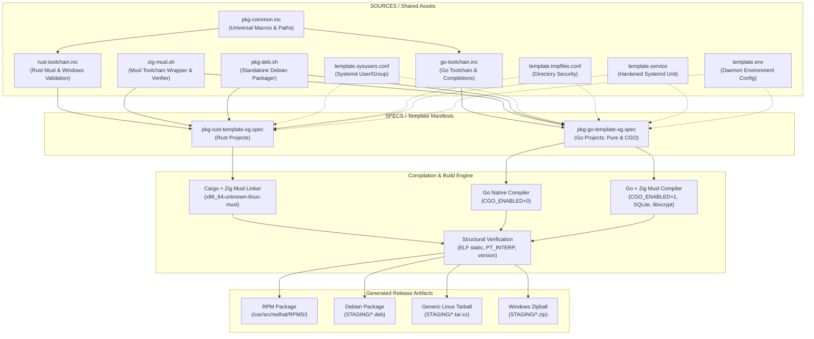
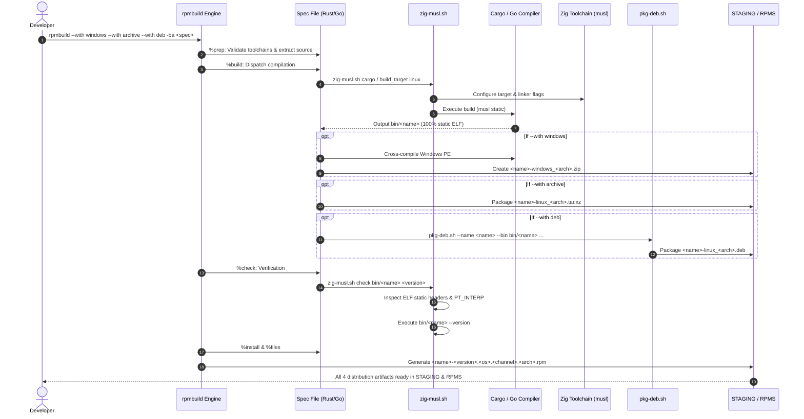
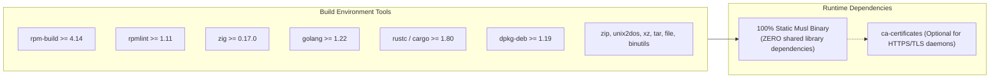
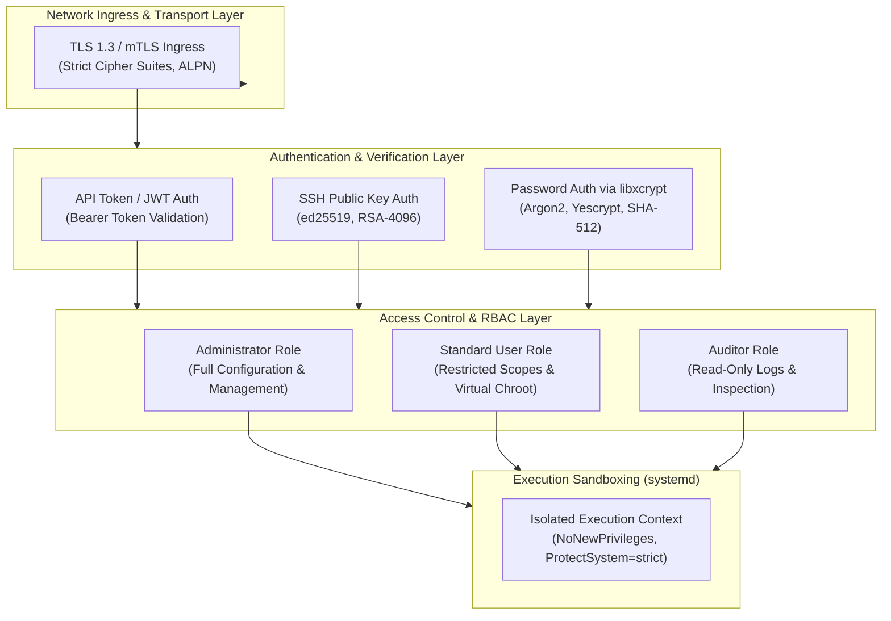
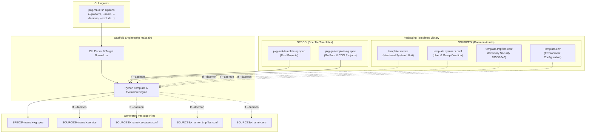

# Enterprise Multi-Distribution Packaging Framework Guide
### Universal Rust & Go Packaging via Static Musl, Zig, RPM, and Debian Pipelines

This guide provides a comprehensive technical manual for building, packaging, and deploying high-performance, statically linked **Rust** and **Go** applications across enterprise Linux distributions (**RHEL 8/9/10**, **CentOS Stream**, **Fedora**, **Debian 11/12**, **Ubuntu 20.04/22.04/24.04**, **Alpine**) and **Windows** using a unified RPM build root.

---

## Table of Contents
1. [Application Overview and Objectives](#1-application-overview-and-objectives)
2. [Architecture and Design Choices](#2-architecture-and-design-choices)
   - [Architectural Design Choices](#architectural-design-choices)
   - [Assumptions & System Prerequisites](#assumptions--system-prerequisites)
   - [Edge Cases Handled](#edge-cases-handled)
   - [Architecture Diagram](#architecture-diagram)
3. [Data Flow and Control Logic](#3-data-flow-and-control-logic)
   - [Operational Flow](#operational-flow)
   - [Code Relations](#code-relations)
   - [Sequence Diagram](#sequence-diagram)
4. [Performance and Scalability](#4-performance-and-scalability)
   - [Concurrency Model](#concurrency-model)
   - [Channel Structures & Application Concurrency](#channel-structures--application-concurrency)
   - [Package Distribution Release Channels](#package-distribution-release-channels)
   - [Compiler & Linker Optimizations](#compiler--linker-optimizations)
   - [Artifact Compression Pipeline](#artifact-compression-pipeline)
5. [Dependencies](#5-dependencies)
   - [Core Toolchain & Utilities](#core-toolchain--utilities)
   - [Package Dependency Chart](#package-dependency-chart)
6. [Security Architecture](#6-security-architecture)
   - [Authentication Layers & Supported Methods](#authentication-layers--supported-methods)
   - [Access Control & Role-Based Access Control (RBAC)](#access-control--role-based-access-control-rbac)
   - [Sandboxing & Hardening Baseline](#sandboxing--hardening-baseline)
   - [Security Architecture Diagram](#security-architecture-diagram)
7. [Security Assessment](#7-security-assessment)
   - [Encryption in Transit](#encryption-in-transit)
   - [Secret Management & Storage Security](#secret-management--storage-security)
   - [Authentication Configuration & Password Hashing](#authentication-configuration--password-hashing)
   - [Role-Based Access Control Implementation](#role-based-access-control-implementation)
   - [Attack Surface Reduction via Musl Hermeticity](#attack-surface-reduction-via-musl-hermeticity)
   - [Unprivileged Context & Non-System Application Isolation](#unprivileged-context--non-system-application-isolation)
   - [Supply Chain Auditing & Non-Vulnerable Libraries](#supply-chain-auditing--non-vulnerable-libraries)
8. [Code Quality & Best Practices Review](#8-code-quality--best-practices-review)
9. [Command Line Arguments & Configuration Toggles](#9-command-line-arguments--configuration-toggles)
   - [RPM Spec Build Condition Flags](#rpm-spec-build-condition-flags)
   - [Go Spec Configuration Toggles](#go-spec-configuration-toggles)
   - [`zig-musl.sh` Subcommands](#zig-muslsh-subcommands)
   - [`pkg-deb.sh` Options Manual](#pkg-debsh-options-manual)
   - [`pkg-make.sh` Scaffold Generator Options](#pkg-makesh-scaffold-generator-options)
     - [Template Architecture Tree](#template-architecture-tree)
     - [Template Files & Operational Roles](#template-files--operational-roles)
     - [Scaffold Generation Workflow Diagram](#scaffold-generation-workflow-diagram)
     - [`pkg-make.sh` Command-Line Options Table](#pkg-makesh-command-line-options-table)
10. [Step-by-Step Packaging & Deployment Examples](#10-step-by-step-packaging--deployment-examples)
    - [Quick Start: Automated Generation via `pkg-make.sh`](#quick-start-automated-generation-via-pkg-makesh)
    - [Scenario A: Packaging a Rust CLI Tool](#scenario-a-packaging-a-rust-cli-tool)
    - [Scenario B: Packaging a Pure Go Web Server Daemon](#scenario-b-packaging-a-pure-go-web-server-daemon)
    - [Scenario C: Packaging a CGO Daemon with SQLite & Bundled C Libs](#scenario-c-packaging-a-cgo-daemon-with-sqlite--bundled-c-libs)
    - [Deployment & Verification Guide](#deployment--verification-guide)

---

## 1. Application Overview and Objectives

Traditional Linux packaging requires maintaining separate build manifests for RPM-based (RHEL, Fedora, openSUSE) and Debian-based (Debian, Ubuntu) distributions. Furthermore, dynamically linked binaries compiled against modern `glibc` versions (e.g. `glibc 2.38+`) fail to run on older enterprise platforms like RHEL 8 or Debian 11 due to symbol versioning conflicts (`GLIBC_X.XX not found`).

This packaging framework resolves this challenge by providing a **single-workspace, multi-target build system** centered on:

1. **Zero Runtime Dependencies via 100% Static Musl Linking**:
   Produces self-contained ELF executables that run seamlessly across **any Linux distribution** without requiring `glibc`, external shared libraries, or containers.
2. **Unified Single-Invocation Multi-Target Artifacts**:
   A single execution of `rpmbuild` can simultaneously generate:
   - Native Enterprise Linux RPM package (`.rpm`)
   - Native Debian/Ubuntu package (`.deb`)
   - Generic standalone Linux release tarball (`.tar.xz`)
   - Standalone Windows 64-bit release zipball (`.zip`)
3. **Cross-Compilation Simplicity via Zig**:
   Leverages Zig 0.17+ as a lightweight, self-contained static C/C++ cross-compiler and linker, eliminating the need for bulky cross-toolchains (`gcc-aarch64-linux-gnu`, `musl-gcc`, etc.).
4. **DRY (Don't Repeat Yourself) Modular Core**:
   Common RPM directives, architecture mappers, completion paths, toolchain validation, Debian packagers, and systemd service templates are extracted into reusable include files and scripts.
5. **Production-Ready Systemd Daemon Suite**:
   Provides out-of-the-box systemd service units, sysusers user provisioning, and tmpfiles directory provisioning adhering to the **Center for Internet Security (CIS)** benchmarks for both RHEL and Debian.

---

## 2. Architecture and Design Choices

### Architectural Design Choices

* **Musl Libc over Glibc for Linux Binaries**:
  `glibc` is designed specifically for dynamic linking; statically linking `glibc` still relies on dynamic `libnss` loading for hostname/user resolution. `musl-libc` is engineered for static linking, creating truly portable, fully isolated binaries.
* **Zig as Universal Static C/C++ Compiler**:
  Zig embeds `musl` headers and compiler-rt for all major architectures. Invoking `zig cc -target <arch>-linux-musl` replaces complex cross-compilers with a single binary.
* **Native Debian Packager (`pkg-deb.sh`) vs Alien**:
  Converting RPMs with `alien` produces broken Debian control metadata and non-functional init scripts. [`pkg-deb.sh`](./SOURCES/pkg-deb.sh) natively constructs compliant Debian staging directories with authentic `DEBIAN/control`, `conffiles`, `md5sums`, and maintainer hooks (`postinst`, `prerm`).
* **RPM `%include` Preprocessor Integration**:
  Shared macros are included via `%include %{_sourcedir}/pkg-common.inc`. This allows specfiles to be concise while ensuring global policy changes take effect across all packages instantly.

### Assumptions & System Prerequisites

* **Operating System**: Linux build host with standard RPM build tools (`rpm-build`, `rpmlint`, `tar`, `xz`, `file`, `binutils`).
* **Zig Compiler**: Zig 0.17+ installed and accessible in `$PATH` (or symlinked to `/var/opt/zig` / `/u01/zig`).
* **Rust Toolchain**: Rust 1.80+ with the musl standard library (`rustup target add <arch>-unknown-linux-musl`) and optional Windows target (`x86_64-pc-windows-gnu`).
* **Go Toolchain**: Go 1.22+ compiler in `$PATH`.
* **Debian Tools**: `dpkg` / `dpkg-deb` installed for `--with deb` builds.
* **Windows Cross-Tools**: `zip` and `unix2dos` installed for `--with windows` builds.

### Edge Cases Handled

1. **Sandboxed & Read-Only `/tmp`**:
   The Debian packager dynamically resolves temporary workspaces via `mktemp -d -t "deb_staging_${NAME}_XXXXXX"`, respecting `$TMPDIR` and preventing read-only filesystem failures.
2. **Debian Directory & File Permissions**:
   Ensures directories never leak `0777` permissions; explicitly enforces `0755` for directories, `0644` for configs/payloads, and `0755` for executables and maintainer scripts.
3. **Reproducible MD5Sums**:
   Calculates MD5 hashes across all payload trees (`usr/`, `etc/`, `var/`, `lib/`), strictly pruning the `DEBIAN/` metadata control directory and sorting file paths.
4. **RPM Comment Macro Expansion**:
   All macro symbols inside comments (`# %%{_arch}`, `# %%install`) are properly escaped with `%%` to prevent RPM parser corruption.
5. **Cross-Distribution Shell Compatibility**:
   System users provisioned in [`template.sysusers.conf`](./SOURCES/template.sysusers.conf) specify `-` for the shell field, allowing systemd to automatically map to `/sbin/nologin` on RHEL and `/usr/sbin/nologin` on Debian/Ubuntu.

### Architecture Diagram



---

## 3. Data Flow and Control Logic

### Operational Flow

1. **Initialization (`%prep`)**:
   - RPM preprocessor ingests [`pkg-common.inc`](./SOURCES/pkg-common.inc) and the language toolchain include (`rust-toolchain.inc` or `go-toolchain.inc`).
   - Validates that the necessary compilers (Go, Rust, Zig) and standard libraries are available.
   - Extracts upstream source zip/tarball into the build tree.
   - For Go packages with C dependencies (`use_sqlite 1` or `use_bundled_c_lib 1`), extracts SQLite amalgamation and C library sources into the parent directory.
2. **Compilation (`%build`)**:
   - **Rust**: [`zig-musl.sh cargo build`](./SOURCES/zig-musl.sh) exports environment variables (`CC_<target>`, `AR_<target>`, `CARGO_TARGET_<KEY>_RUSTFLAGS`) pointing rustc's linker to Zig.
   - **Pure Go**: Executes `CGO_ENABLED=0 GOOS=linux go build -trimpath -ldflags "-s -w ..."`.
   - **CGO Go**: Executes `zig cc` to compile `sqlite3.c` → `libsqlite3.a` and autotools `./configure --host=...` for `libxcrypt`, then builds Go with `CGO_ENABLED=1 CC="zig cc -target ..."`.
3. **Cross-Compilation & Multi-Target Packaging (`%build` stage)**:
   - If `--with windows`: Compiles Windows executable and stages `staging_windows/` → `.zip`.
   - If `--with archive`: Stages Linux standalone tree → `.tar.xz`.
   - If `--with deb`: Invokes [`pkg-deb.sh`](./SOURCES/pkg-deb.sh) to assemble `.deb` package.
4. **Inspection (`%check`)**:
   - Runs `zig-musl.sh check bin/<name> <version>`:
     - Confirms ELF 64-bit or 32-bit statically linked binary.
     - Confirms absence of dynamic linker `PT_INTERP` segment via `readelf -l`.
     - Executes `<binary> --version` and verifies expected version string match.
   - If `--with windows`: Runs `zig-musl.sh check-win bin/windows/<name>.exe`.
5. **Installation & Packaging (`%install` & `%files`)**:
   - Copies Linux binary to `%{buildroot}%{_bindir}/%{name}`.
   - If packaging a daemon: installs `.service` to `%{_unitdir}`, `.conf` to `%{_sysusersdir}` and `%{_tmpfilesdir}`.
   - Assembles final `.rpm` file.

### Code Relations

The following matrix documents the interaction and consumption hierarchy across all components:

| Component | Path | Role in Packaging Lifecycle | Ingested By |
|---|---|---|---|
| **Common Macros** | [`pkg-common.inc`](./SOURCES/pkg-common.inc) | Base flags (`_build_id_links`, `__strip`, `plat_arch`, completions, `has_zig`, `dist_archive`, `dist_zip`, `dist_deb`, `%generate_changelog`, `%{sqlite_amalgamation_cflags}`) | Included by `rust-toolchain.inc` and `go-toolchain.inc` |
| **Rust Toolchain** | [`rust-toolchain.inc`](./SOURCES/rust-toolchain.inc) | Validates cargo, rustc, zig, stdlibs; defines `%{rustflags_core}`, `%{rust_target_linux}`, `%{rust_target_win}`, `%{cargo_update}` | Included by Rust spec files |
| **Go Toolchain** | [`go-toolchain.inc`](./SOURCES/go-toolchain.inc) | Validates Go in `$PATH`; defines standard `%{go_opts}` (`-buildmode=pie -trimpath -buildvcs=false`), `%{go_ldflags_core}` (`-s -w`), `%{go_proxy}`, `%{go_update_tree}`, and CGO linker flags | Included by Go spec files |
| **Musl Toolchain Wrapper** | [`zig-musl.sh`](./SOURCES/zig-musl.sh) | Sets linker/C/C++ env for cargo; executes `%check` binary validation | Invoked in `%build` and `%check` |
| **Debian Packager** | [`pkg-deb.sh`](./SOURCES/pkg-deb.sh) | Generates native `.deb` with control, conffiles, md5sums, and hooks | Invoked in `%build` (`--with deb`) |
| **User Provisioning** | [`template.sysusers.conf`](./SOURCES/template.sysusers.conf) | Declares dedicated unprivileged system user and group | Installed to `%{_sysusersdir}` |
| **Security Paths** | [`template.tmpfiles.conf`](./SOURCES/template.tmpfiles.conf) | Creates directories and enforces CIS permission modes (`0750`/`0640`) | Installed to `%{_tmpfilesdir}` |
| **Service Unit** | [`template.service`](./SOURCES/template.service) | Sandboxed systemd daemon definition with dual environment file loading | Installed to `%{_unitdir}` |
| **Environment Config** | [`template.env`](./SOURCES/template.env) | Default daemon configuration and runtime environment variable template | Installed to `%{_sysconfdir}/%{name}/%{name}.env` |

### Sequence Diagram



---

## 4. Performance and Scalability

### Concurrency Model

* **Parallel Compilation**: All compilation scripts leverage all available host CPU cores automatically (`-j$(nproc)` in autotools make, Go native goroutine concurrency in `go build`, and Cargo thread pools in `cargo build`).
* **Independent Staging Trees**: Staging directories (`staging_archive/`, `staging_windows/`, `deb_staging_*`) are strictly partitioned and cleaned up immediately after archive generation, avoiding disk footprint explosion.

### Channel Structures & Application Concurrency

Modern network applications packaged with this framework (such as Caddy and SFTPGo) employ goroutine-and-channel architectures that run at peak throughput under static musl:

* **Non-Blocking Channel Multiplexing**: Daemons use buffered Go channels for worker task pools and event-driven architectures (e.g. log emitters, connection accept loops) without encountering glibc thread-local storage (`TLS`) overhead.
* **Elimination of CGO Locking**: In Pure Go mode (`use_cgo 0`), the Go runtime manages thousands of concurrent goroutines per OS thread using cooperative user-space scheduling (`M:N` scheduler) with zero CGO boundary context-switch penalties.
* **Hermetic CGO Threading**: When CGO is active (`use_cgo 1`), Zig compiles embedded C dependencies against musl's clean, lightweight POSIX pthread implementation, avoiding glibc's dynamic symbol resolution locks.

### Package Distribution Release Channels

The framework incorporates release channel taxonomies directly into package releases via the `__channel` macro:

```spec
%global __channel       xg
Release:        <release_num>.%{__osver}.%{__channel}
```

* **`xg` Channel**: Production enterprise channel, optimized for rock-solid stability and forward compatibility.
* **Multi-Distribution Repositories**: The resulting naming convention (e.g. `caddy-2.11.7-10.el.xg.x86_64.rpm`) guarantees unambiguous package ordering across automated repository mirrors (YUM/DNF/APT).

### Compiler & Linker Optimizations

| Flag | Language | Effect |
| :--- | :---: | :--- |
| `-C link-self-contained=no` | Rust | Uses external Zig musl startup routines (`crt1.o`, `crti.o`) instead of bundling incompatible toolchain crt files. |
| `-C linker=zig-musl.sh` | Rust | Routes linking through Zig musl ELF linker. |
| `-trimpath` | Go | Removes all host filesystem paths from the compiled binary, ensuring deterministic, reproducible builds. |
| `-buildvcs=false` | Go | Disables host git metadata inspection during build. |
| `-s -w` | Go / C | Strips symbol tables (`-s`) and DWARF debug info (`-w`), reducing binary size by 40%–60%. |
| `--enable-hashes=all` | C (`libxcrypt`) | Includes standard plus modern password hashing algorithms (SHA-512, bcrypt, Yescrypt). |

### Artifact Compression Pipeline

* **Generic Linux Tarball**: Compressed with `tar -Jcvf` (XZ compression, level 6) for optimal size-to-decompression-speed ratio.
* **Windows Zipball**: Compressed with `zip -9r` (maximum Deflate compression); all documentation passed through `unix2dos` to ensure native CRLF line endings on Windows.
* **Debian Archive**: Packaged via `dpkg-deb --build --root-owner-group`, compressing data members with XZ/Zstandard and forcing UID/GID to 0 (`root:root`).

---

## 5. Dependencies

### Core Toolchain & Utilities

The build host requires the compilers and utilities listed below. No runtime dynamic dependencies exist for the compiled packages.

### Package Dependency Chart



* **No Shared Object Dependencies**:
  Executing `ldd bin/<name>` outputs:
  ```text
  not a dynamic executable
  ```
  The binary operates without `ld-linux.so`, `libc.so.6`, `libpthread.so`, or any distribution-packaged shared libraries.

---

## 6. Security Architecture

### Authentication Layers & Supported Methods

Enterprise daemons packaged with this framework support layered authentication architectures:

### Security Architecture Diagram



* **Transport Layer Security**: Strict TLS 1.3 default with support for Mutual TLS (mTLS) client certificate verification.
* **Authentication Methods**:
  - **API Tokens / JWT**: Header-based authentication for automation and REST management.
  - **SSH Public Key Authentication**: Hardware key and agent-backed authentication (e.g. in SFTPGo).
  - **Modern Password Hashing**: Utilizes the statically bundled `libxcrypt` to verify cryptographically modern hashes (Yescrypt, Argon2, bcrypt, SHA-512) without relying on host glibc `crypt()`.

### Access Control & Role-Based Access Control (RBAC)

* **Role Separation**: Distinguishes administrative operations from tenant data access, ensuring unprivileged users cannot reconfigure daemon sockets or modify TLS policies.
* **Virtual Chroot & Directory Sandboxing**: Each authenticated session is confined to its assigned data root (e.g. `/var/lib/<name>/users/<username>`), preventing directory traversal attacks (`../`).

### Sandboxing & Hardening Baseline

Daemons packaged via [`template.service`](./SOURCES/template.service) implement defense-in-depth security sandboxing:

* **Privilege De-escalation (`NoNewPrivileges=true`)**:
  Prevents the process or child processes from acquiring new privileges via `setuid`/`setgid` binaries.
* **Filesystem Lockdown (`ProtectSystem=strict`, `ProtectHome=true`)**:
  Mounts the entire OS filesystem hierarchy (`/usr`, `/boot`, `/etc`) read-only for the process. `/home`, `/root`, and `/run/user` are completely inaccessible.
* **Dynamic Directory Isolation (systemd v235+)**:
  Using `StateDirectory=`, `LogsDirectory=`, `ConfigurationDirectory=`, and `RuntimeDirectory=`, systemd provisions:
  - `/var/lib/<name>` (Mode `0750`)
  - `/var/log/<name>` (Mode `0750`)
  - `/etc/<name>` (Mode `0750`)
  - `/run/<name>` (Mode `0750`)
  with ownership automatically set to `<name>:<name>` on service start.
* **Network Capability Delegation**:
  For web servers or services binding to privileged low ports (< 1024) without root:
  ```ini
  CapabilityBoundingSet=CAP_NET_BIND_SERVICE
  AmbientCapabilities=CAP_NET_BIND_SERVICE
  ```

---

## 7. Security Assessment

### Encryption in Transit

* **Modern Cryptography**: Applications compiled via this framework use native Go `crypto/tls` or Rust `rustls` engines, prioritizing TLS 1.3 with Curve25519 key exchange and AES-GCM / ChaCha20-Poly1305 ciphers.
* **Secure Defaults**: Automatic HTTP-to-HTTPS redirection, strict HTTP Strict Transport Security (`HSTS`), and automatic ACME certificate enrollment (in Caddy).

### Secret Management & Storage Security

* **Protected Configuration Directory**: Handled by [`template.tmpfiles.conf`](./SOURCES/template.tmpfiles.conf):
  - Daemon configuration directory `/etc/<name>` is restricted to `0750` mode owned by `<name>:<name>`.
  - Sensitive files containing credentials (`/etc/<name>/*.json`, `/etc/<name>/*.env`) are restricted to `0640` mode, completely unreadable by non-system users.
* **Process Environment Isolation**: Environment files (`/etc/default/<name>` and `/etc/sysconfig/<name>`) are read by systemd before dropping privileges and never exposed to unprivileged users.

### Authentication Configuration & Password Hashing

* **Statically Bundled `libxcrypt`**: By bundling `libxcrypt 4.5.2` compiled statically via Zig, applications can verify and generate modern password hashes (Yescrypt, Argon2id) even on legacy distributions (RHEL 8) whose native glibc only supports older algorithms.

### Role-Based Access Control Implementation

* Administrative and operational interfaces are partitioned. For services exposing management APIs (e.g. Caddy API on port 2019, SFTPGo WebAdmin on port 8080), access is bound to localhost by default or secured with scoped JWT tokens.

### Attack Surface Reduction via Musl Hermeticity

* **Memory Safety & Simplicity**:
  Musl's codebase is orders of magnitude smaller and simpler than glibc, eliminating entire classes of historical glibc vulnerabilities (such as dynamic loader buffer overflows, iconv vulnerabilities, and complex NSS resolution exploits).
* **Static Hermeticity**:
  Because the binary contains zero `DT_NEEDED` dynamic tags and no dynamic interpreter (`PT_INTERP`), it is completely immune to `LD_PRELOAD`, `LD_LIBRARY_PATH`, and rpath injection attacks.

### Unprivileged Context & Non-System Application Isolation

* **Dedicated System Account**: Services run strictly under an unprivileged system UID/GID (< 1000) created dynamically by `systemd-sysusers` via [`template.sysusers.conf`](./SOURCES/template.sysusers.conf).
* **No Interactive Shell**: Account shell is set to `-` (resolves to `/sbin/nologin` or `/usr/sbin/nologin`), preventing any interactive login.
* **Kernel Attack Mitigation**: `ProtectKernelTunables=true`, `ProtectKernelModules=true`, `ProtectControlGroups=true`, and `RestrictRealtime=true` prevent daemon compromises from escalating to kernel tampering.

### Supply Chain Auditing & Non-Vulnerable Libraries

* Both templates include automated module synchronization in `%prep`:
  - Rust: `cargo update --recursive`
  - Go: `go get -u -t ./...` and `go mod tidy`
  This ensures security patches within semver boundaries are incorporated at packaging time.

---

## 8. Code Quality & Best Practices Review

All packaging assets adhere to enterprise standards:

1. **SPDX Compliance**: Every spec file declares standard SPDX identifiers (e.g. `Apache-2.0`, `MIT`, `AGPL-3.0-only`).
2. **Rpmlint Clean**: All templates and resulting spec files achieve **0 errors** under `rpmlint`.
3. **POSIX Shell Standards**: All shell scripts use strict error trapping (`set -eo pipefail`), contain zero unquoted variable expansions in path lookups, and use non-forking parameter expansion.
4. **Idempotent Cleanup**: Temporary staging trees register `trap 'rm -rf ...' EXIT` handlers, guaranteeing zero orphaned directories in `/tmp` or `$TMPDIR`.
5. **No Host Hardcoding**: Macro paths use RPM dynamic variables (`%{_bindir}`, `%{_sysconfdir}`, `%{_unitdir}`).

---

## 9. Command Line Arguments & Configuration Toggles

### RPM Spec Build Condition Flags

Pass build condition flags to `rpmbuild` using `--with <flag>` or `--without <flag>`:

| Flag | Default | Description |
| :--- | :---: | :--- |
| `--with archive` | Disabled | Generates generic Linux release tarball (`STAGING/<name>-<version>-linux_<arch>.tar.xz`). |
| `--with windows` | Disabled | Cross-compiles Windows 64-bit binary and packages zipball (`STAGING/<name>-<version>-windows_<arch>.zip`). |
| `--with deb` | Disabled | Generates native Debian/Ubuntu binary package (`STAGING/<name>-<version>-linux_<arch>.deb`). |
| `--without rpm` | Enabled | Skips RPM package generation when only tarballs/debs are desired. |
| `--without check` | Enabled | Disables the `%check` binary structural verification phase. |
| `--with testsuite` | Disabled | Runs upstream unit testsuite (`go test` / `cargo test`); disabled by default in favor of binary wellness verification. |

### Go Spec Configuration Toggles

Located at lines 69–72 in [`pkg-go-template-xg.spec`](./SPECS/pkg-go-template-xg.spec):

```spec
%global use_cgo            0   # 0 = Pure Go (default, Caddy-style), 1 = Static CGO (SFTPGo-style)
%global use_sqlite         0   # 1 = Build embedded SQLite amalgamation via Zig
%global use_bundled_c_lib  0   # 1 = Compile static autotools C library (libxcrypt) via Zig
```

### `zig-musl.sh` Subcommands

| Subcommand | Syntax | Description |
| :--- | :--- | :--- |
| `cargo` | `zig-musl.sh cargo <args...>` | Injects musl toolchain variables and invokes Cargo. |
| `check` | `zig-musl.sh check <bin> [ver]` | Verifies static ELF structure, confirms no `PT_INTERP`, and tests `<bin> --version`. |
| `check-win` | `zig-musl.sh check-win <bin.exe>` | Verifies 64-bit Windows PE executable header. |
| `ar` | `zig-musl.sh ar <args...>` | Invokes `zig ar "$@"` (or `$AR` fallback if Zig is unavailable). |
| `c++` | `zig-musl.sh c++ <args...>` | Invokes `zig c++ -target <arch>-<os> "$@"` (or `$CXX` fallback). |
| `cc` | `zig-musl.sh cc <args...>` | Invokes `zig cc -target <arch>-<os> "$@"` (or `$CC` fallback; default dispatch). |

### `pkg-deb.sh` Options Manual

| Option | Argument Type | Default | Description |
| :--- | :---: | :---: | :--- |
| `--name` | String | *(Required)* | Package name (lowercase, e.g. `sftpgo`). |
| `--version` | String | *(Required)* | Full semantic package version and release string. |
| `--arch` | String | *(Required)* | Target architecture (auto-normalizes `x86_64` → `amd64`). |
| `--out` | Path | *(Required)* | Destination file path for generated `.deb`. |
| `--maintainer` | String | `Mis Center <support@criticalsys.net>` | Maintainer contact string in RFC 822 format. |
| `--summary` | String | `""` | Single-line package summary. |
| `--desc` | String | `""` | Multi-line description (indents and strips backslashes automatically). |
| `--homepage` | URL | `""` | Upstream project homepage URL. |
| `--section` | String | `utils` | Debian package archive section (`utils`, `net`, `httpd`). |
| `--priority` | String | `optional` | Package priority (`optional`, `standard`, `extra`). |
| `--depends` | String | `""` | Package dependencies (e.g. `ca-certificates`). |
| `--recommends` | String | `""` | Recommended packages for Debian control. |
| `--suggests` | String | `""` | Suggested packages for Debian control. |
| `--provides` | String | `""` | Virtual packages provided by this package. |
| `--conflicts` | String | `""` | Packages conflicting with this package. |
| `--replaces` | String | `""` | Packages replaced by this package. |
| `--bin` | Path or `src:dest` | `""` | Installs binary or directory of binaries (default destination: `/usr/bin/`, mode `0755`). |
| `--conffile` | `src[:dest[:mode]]` | `""` | Configuration file (registered in `DEBIAN/conffiles`, supports custom permissions, default: `0644`). |
| `--dir` | `path[:mode]` | `""` | Creates empty directory with explicit permissions (e.g. `/var/lib/pkg:0750`, default: `0755`). |
| `--doc` | File list | `""` | Documentation files (supports unquoted lists like `%{doclist}`). |
| `--changelog` | Path | `""` | Upstream changelog (compressed to `changelog.gz`). |
| `--data` | `src:dest` | `""` | Installs arbitrary file or directory tree recursively with proper modes (preserves `+x`). |
| `--service` | Path | `""` | Installs systemd service to `/usr/lib/systemd/system/`. |
| `--sysusers` | Path | `""` | Installs sysusers config to `/usr/lib/sysusers.d/`. |
| `--tmpfiles` | Path | `""` | Installs tmpfiles config to `/usr/lib/tmpfiles.d/`. |
| `--completion-bash`| Path | `""` | Installs bash completion script to completion directory. |
| `--completion-zsh` | Path | `""` | Installs zsh completion script to vendor-completions directory. |
| `--completion-fish`| Path | `""` | Installs fish completion script to vendor_completions.d directory. |
| `--man` | Path list | `""` | Installs man pages into `/usr/share/man/man<N>/` (auto-compresses uncompressed pages, preserves `.gz`). |
| `--preinst` | Path | `""` | Custom pre-installation hook script (mode `0755`). |
| `--postinst` | Path | Auto | Custom post-installation script (auto-generates sysusers, tmpfiles, and daemon-reload if omitted). |
| `--prerm` | Path | Auto | Custom pre-removal script (auto-generates systemctl disable if omitted). |
| `--postrm` | Path | `""` | Custom post-removal hook script (mode `0755`). |

### `pkg-make.sh` Scaffold Generator Options

Located at [`pkg-make.sh`](./SOURCES/pkg-make.sh), this utility automates package scaffolding by ingesting command-line parameters, rendering the underlying spec templates, optionally generating hardened systemd daemon configurations, and validating the final manifest via `rpmlint`.

#### Template Architecture Tree

The packaging framework is built around a modular hierarchy of canonical templates and shared includes:

```text
/usr/src/redhat/
├── SPECS/
│   ├── pkg-rust-template-xg.spec     # Master template for Rust static/musl RPM & multi-target packaging
│   └── pkg-go-template-xg.spec       # Master template for Go (Pure Go & Static CGO) packaging
└── SOURCES/
    ├── template.service              # Hardened systemd unit file template for background services
    ├── template.sysusers.conf        # systemd-sysusers template for unprivileged user/group creation
    ├── template.tmpfiles.conf        # systemd-tmpfiles template enforcing CIS directory permissions (0750/0640)
    ├── template.env                  # Environment configuration template (/etc/<name>/<name>.env)
    ├── pkg-common.inc                # Universal shared macros, strip override, and architecture mappings
    ├── rust-toolchain.inc            # Rust/Cargo toolchain validation and target library checks
    ├── go-toolchain.inc              # Go compiler validation and shell completion paths
    ├── zig-musl.sh                   # Multi-call Zig musl compiler/linker wrapper and binary verifier
    └── pkg-deb.sh                    # Native Debian (.deb) packager generating control, md5sums, and hooks
```

#### Template Files & Operational Roles

##### 1. Master Spec Manifest Templates (`SPECS/`)
* **[`pkg-rust-template-xg.spec`](./SPECS/pkg-rust-template-xg.spec)**:
  Master RPM specification template for Rust applications. Features automated 100% static musl builds via Zig (`x86_64-unknown-linux-musl`), bit-for-bit reproducible build flags (`RUSTFLAGS="-C strip=symbols --remap-path-prefix ${PWD}=."`), optional embedded SQLite amalgamation compilation (`use_sqlite 1`) via `%{sqlite_amalgamation_cflags}`, optional Windows PE cross-compilation (`x86_64-pc-windows-gnu`), and unified multi-target dispatch (RPM, Debian `.deb`, Linux `.tar.xz`, Windows `.zip`).
* **[`pkg-go-template-xg.spec`](./SPECS/pkg-go-template-xg.spec)**:
  Master RPM specification template for Go applications. Supports dual compilation paths: Pure Go (`CGO_ENABLED=0`, static ELF on Linux, PIE on Windows) and Static CGO (`use_cgo 1`) with on-the-fly embedded SQLite amalgamation compilation and bundled static C libraries (`libxcrypt`) via Zig musl with `-buildmode=pie` and `-extldflags '-static-pie'`.

##### 2. Daemon & Service Templates (`SOURCES/`)
* **[`template.service`](./SOURCES/template.service)**:
  Production-hardened systemd unit file template. Configured with dual environment file loading (`/etc/default/<name>`, `/etc/sysconfig/<name>`, `/etc/<name>/<name>.env`), dynamic directory isolation (`StateDirectory`, `LogsDirectory`, `ConfigurationDirectory`, `RuntimeDirectory` with `0750` mode), and CIS sandboxing (`NoNewPrivileges=true`, `ProtectSystem=strict`, `ProtectHome=true`).
* **[`template.sysusers.conf`](./SOURCES/template.sysusers.conf)**:
  `systemd-sysusers` declaration defining a dedicated unprivileged system user and group `<name>:<name>` with dynamic system UID allocation (`< 1000`) and non-login shell (`-` resolving portably across RHEL and Debian).
* **[`template.tmpfiles.conf`](./SOURCES/template.tmpfiles.conf)**:
  `systemd-tmpfiles` configuration creating runtime and persistent directories with strict permissions (`0750` for directories, `0640` for credentials and configuration files).
* **[`template.env`](./SOURCES/template.env)**:
  Default daemon environment configuration file installed to `/etc/<name>/<name>.env` (`0640` `<name>:<name>`), defining common operational variables for logging, network addresses, and runtime arguments.

##### 3. Shared Toolchain & Build Helpers (`SOURCES/`)
* **[`pkg-common.inc`](./SOURCES/pkg-common.inc)**:
  Language-agnostic RPM preprocessor include. Sets `_build_id_links none`, `__strip /bin/true`, canonical Debian architecture mapping (`plat_arch`), maintainer metadata, unified shell completion paths, `has_zig` toolchain detection, standardized staging artifact paths (`dist_archive`, `dist_zip`, `dist_deb`), `%generate_changelog` macro, and standardized `%{sqlite_amalgamation_cflags}` for embedded SQLite compilation.
* **[`rust-toolchain.inc`](./SOURCES/rust-toolchain.inc)**:
  Rust preprocessor include validating `cargo`, `rustc`, `zig` (checking PATH and enterprise directories), and musl/windows target standard libraries. Centralizes reproducible `%{rustflags_core}`, standard target triples (`%{rust_target_linux}`, `%{rust_target_win}`), and `%{cargo_update}`.
* **[`go-toolchain.inc`](./SOURCES/go-toolchain.inc)**:
  Go preprocessor include validating Go compiler availability in `$PATH`, exporting standard compiler flags (`%{go_opts}` with `-buildmode=pie -trimpath -buildvcs=false` and `%{go_ldflags_core}` with `-s -w`), `%{go_proxy}`, `%{go_update_tree}`, and CGO external linker flags (`%{go_cgo_ldflags_linux}`, `%{go_cgo_ldflags_win}`).
* **[`zig-musl.sh`](./SOURCES/zig-musl.sh)**:
  Multi-call executable wrapper. Injects musl/windows linker and compiler flags for Cargo (`zig-musl.sh cargo`), handles C/C++ compilation via Zig, and executes structural ELF/PE binary verification (`check` and `check-win`).
* **[`pkg-deb.sh`](./SOURCES/pkg-deb.sh)**:
  Standalone native Debian packager. Assembles binaries, configuration files, and documentation into compliant `.deb` archives with RFC 822 control headers, `conffiles`, `md5sums`, and automatic service lifecycle hooks.

#### Scaffold Generation Workflow Diagram



#### `pkg-make.sh` Command-Line Options Table

| Option | Argument Type | Default | Description |
| :--- | :---: | :---: | :--- |
| `--platform` | `rust` or `go` | *(Required)* | Target compilation ecosystem. |
| `--name` | String | *(Required)* | Package name (lowercase, e.g. `fzf`, `bat`). |
| `--version` | String | *(Required)* | Upstream semantic version (e.g. `0.52.0`). |
| `--release` | Number | `1` | Internal package release revision number. |
| `--repo-url` | URL | `""` | Upstream repository URL (e.g. `https://github.com/junegunn/fzf`). |
| `--source-arch` | Path | `""` | Path to upstream source archive (`.zip`, `.tar.gz`, `.tar.xz`). |
| `--git-hash` | String | Auto | 7-character commit hash (auto-detected if omitted). |
| `--summary` | String | `<name> app` | Single-line package summary. |
| `--description` | String or `@file` | Auto | Multi-line description or `@path/to/desc.txt`. |
| `--license` | SPDX String | `Apache-2.0` | SPDX license identifier (e.g. `MIT`, `Apache-2.0`). |
| `--group` | String | `Applications/System` | RPM package group category. |
| `--buildrequires` | Package names | `""` | Additional `BuildRequires` (repeatable or space-separated list). |
| `--requires` | Package names | `""` | Additional runtime `Requires` (repeatable or space-separated list). |
| `--deb-depends` | String | Auto | Explicit Debian runtime dependencies (e.g. `"systemd (>= 239), passwd"`). |
| `--exclude` | List | `""` | Exclude packaging targets (comma-separated: `windows`, `deb`, `rpm`, `archive`). |
| `--daemon` | Flag | Disabled | Scaffolds `.service`, `.sysusers.conf`, `.tmpfiles.conf`, `.env` and enables systemd in spec. |
| `--cgo` | Flag | Disabled | Enables static CGO musl compilation (`use_cgo 1`). |
| `--sqlite` | Flag | Disabled | Enables embedded SQLite amalgamation compilation (`use_sqlite 1`, Rust & Go). |
| `--bundled-c-lib` | Flag | Disabled | Enables bundled static C library compilation (`libxcrypt`). |
| `--goipath` | String | Auto | Go import path (derived from `--repo-url` if omitted). |
| `--cmd-path` | Path | `.` | Relative path to main Go package. |
| `--tags` | String | `""` | Go compilation build tags (e.g. `"libsqlite3"`). |
| `--features` | String | `""` | Cargo feature flags (e.g. `"clipboard"`). |

---

## 10. Step-by-Step Packaging & Deployment Examples

### Quick Start: Automated Generation via `pkg-make.sh`

The fastest way to scaffold and validate any new package is using the interactive CLI generator:

```bash
# Example 1: Scaffold a Rust CLI tool
/usr/src/redhat/SOURCES/pkg-make.sh \
  --platform rust \
  --name ripgrep \
  --version 14.1.0 \
  --release 1 \
  --repo-url https://github.com/BurntSushi/ripgrep \
  --summary "Fast line-oriented search tool" \
  --description "ripgrep is a line-oriented search tool that recursively searches directories for regex patterns." \
  --license "MIT OR Unlicense" \
  --features "pcre2"

# Example 2: Scaffold a Go Daemon with SQLite & Systemd Services
/usr/src/redhat/SOURCES/pkg-make.sh \
  --platform go \
  --name mydaemon \
  --version 2.0.0 \
  --release 1 \
  --repo-url https://github.com/example/mydaemon \
  --summary "High performance Go daemon" \
  --description "Sample Go daemon service with embedded SQLite database." \
  --license Apache-2.0 \
  --daemon \
  --sqlite

# Example 3: Scaffold a Linux-only package excluding Windows & Debian packaging
/usr/src/redhat/SOURCES/pkg-make.sh \
  --platform rust \
  --name myinternal \
  --version 1.0.0 \
  --exclude windows,deb
```

---

### Scenario A: Packaging a Rust CLI Tool

Let's package a Rust utility (e.g. `myripgrep`, version `14.1.0`):

1. **Copy the Rust Template**:
   ```bash
   cp /usr/src/redhat/SPECS/pkg-rust-template-xg.spec /usr/src/redhat/SPECS/myripgrep-xg.spec
   ```
2. **Edit Variables in `SPECS/myripgrep-xg.spec`**:
   ```spec
   %global pkg_summary     Fast line-oriented search tool
   %global pkg_desc        ripgrep is a line-oriented search tool that recursively\
   searches the current directory for a regex pattern.

   Name:           myripgrep
   Version:        14.1.0
   Release:        1.%{__osver}.%{__channel}
   Summary:        %{pkg_summary}
   License:        MIT OR Unlicense
   URL:            https://github.com/BurntSushi/ripgrep
   Provides:       myripgrep = %{version}-%{release}

   %global git_hash        a1b2c3d
   ```
3. **Place Source Archive**:
   Ensure `SOURCES/myripgrep-14.1.0-a1b2c3d-src.zip` is present.
4. **Execute Build**:
   ```bash
   rpmbuild --with windows --with archive --with deb -ba /usr/src/redhat/SPECS/myripgrep-xg.spec
   ```
5. **Output**:
   ```text
   ==> Compiling static myripgrep binary with Zig + musl (x86_64-unknown-linux-musl)...
   ==> Cross-compiling myripgrep for Windows PE (x86_64-pc-windows-gnu)...
   ==> Verifying Linux binary structure (bin/myripgrep)...
   ==> Verifying binary execution (bin/myripgrep --version)...
   ==> Binary verification passed for bin/myripgrep
   ==> Verifying Windows binary structure (bin/windows/myripgrep.exe)...
   ==> Windows binary verification passed for bin/windows/myripgrep.exe
   ==> Successfully created Debian package: /usr/src/redhat/STAGING/myripgrep-14.1.0-a1b2c3d-linux_amd64.deb
   Wrote: /usr/src/redhat/RPMS/x86_64/myripgrep-14.1.0-1.el.xg.x86_64.rpm
   ```

---

### Scenario B: Packaging a Pure Go Web Server Daemon

Let's package a pure Go HTTP service (e.g. `myweb`, version `1.5.0`):

1. **Copy the Go Template**:
   ```bash
   cp /usr/src/redhat/SPECS/pkg-go-template-xg.spec /usr/src/redhat/SPECS/myweb-xg.spec
   ```
2. **Leave CGO Disabled**:
   ```spec
   %global use_cgo            0
   %global use_sqlite         0
   %global use_bundled_c_lib  0
   ```
3. **Configure Systemd Service & User**:
   ```bash
   cp /usr/src/redhat/SOURCES/template.service /usr/src/redhat/SOURCES/myweb.service
   cp /usr/src/redhat/SOURCES/template.sysusers.conf /usr/src/redhat/SOURCES/myweb.sysusers.conf
   cp /usr/src/redhat/SOURCES/template.tmpfiles.conf /usr/src/redhat/SOURCES/myweb.tmpfiles.conf
   ```
   Replace `<name>` with `myweb` across all three files.
4. **Uncomment Service Directives in `myweb-xg.spec`**:
   - In Sources: Uncomment `Source20: myweb.service`, `Source21: myweb.sysusers.conf`, `Source22: myweb.tmpfiles.conf`.
   - In `%install`: Uncomment the `install -D -p -m 0644 ...` lines.
   - In `%files`: Uncomment `%{_unitdir}/%{name}.service`, `%{_sysusersdir}/%{name}.conf`, `%{_tmpfilesdir}/%{name}.conf`.
   - In Scriptlets: Uncomment `%systemd_post`, `%systemd_preun`, `%systemd_postun_with_restart`.
5. **Build All Artifacts**:
   ```bash
   rpmbuild --with deb --with archive -ba /usr/src/redhat/SPECS/myweb-xg.spec
   ```

---

### Scenario C: Packaging a CGO Daemon with SQLite & Bundled C Libs

When a Go package requires embedded SQLite and static C libraries (e.g. `libxcrypt`):

1. **Enable CGO and Library Toggles in `SPECS/<name>-xg.spec`**:
   ```spec
   %global use_cgo            1
   %global use_sqlite         1
   %global use_bundled_c_lib  1
   ```
2. **Ensure Sources are in `SOURCES/`**:
   - `sqlite-amalgamation-3540100.zip`
   - `libxcrypt-4.5.2.tar.xz`
3. **Build Execution**:
   ```bash
   rpmbuild --with deb -ba /usr/src/redhat/SPECS/<name>-xg.spec
   ```
4. **Compilation Output Sample**:
   ```text
   ==> [linux] Compiling static SQLite 3.54.1 via Zig (target: x86_64-linux-musl)...
   ==> [linux] Compiling static libxcrypt 4.5.2 via Zig (target: x86_64-linux-musl)...
   ==> [linux] Compiling static CGO binary with Zig (target: x86_64-linux-musl)...
   ==> Verifying Linux binary structure (bin/<name>)...
   ==> Binary verification passed for bin/<name>
   ==> Successfully created Debian package: /usr/src/redhat/STAGING/<name>-2.7.6-linux_amd64.deb
   Wrote: /usr/src/redhat/RPMS/x86_64/<name>-2.7.6-10.el.xg.x86_64.rpm
   ```

---

### Deployment & Verification Guide

#### Deploying on Enterprise Linux (RHEL 8/9/10, Rocky, Alma)
```bash
# Install RPM package
sudo dnf install -y /usr/src/redhat/RPMS/x86_64/<name>-<version>.el.xg.x86_64.rpm

# Enable and start daemon (if service included)
sudo systemctl enable --now <name>.service
sudo systemctl status <name>.service
```

#### Deploying on Debian / Ubuntu (20.04, 22.04, 24.04)
```bash
# Install Debian package
sudo dpkg -i /usr/src/redhat/STAGING/<name>-<version>-linux_amd64.deb

# Verify installed contents & md5sums
dpkg -c /usr/src/redhat/STAGING/<name>-<version>-linux_amd64.deb
dpkg -V <name>
```

#### Binary Structural Verification
Verify that the installed binary has zero dynamic dependencies:
```bash
file /usr/bin/<name>
# Output: /usr/bin/<name>: ELF 64-bit LSB executable, x86-64, version 1 (SYSV), statically linked, stripped

readelf -l /usr/bin/<name> | grep INTERP
# Output: (Empty - confirms zero dynamic interpreter)

ldd /usr/bin/<name>
# Output: not a dynamic executable
```
