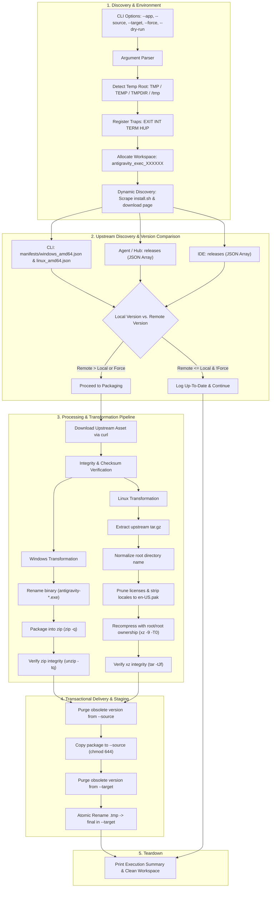

# Google Antigravity Packaging Utility (`antigravity_package.sh`)

A cross-platform, automated release synchronization and packaging pipeline compatible with **Cygwin**, **MSYS2 / Git Bash**, **Windows Subsystem for Linux (WSL)**, and **Native Linux**. This utility continuously monitors Google Antigravity release channels, retrieves 64-bit Linux and Windows binary distributions, normalizes naming conventions, strips packaging bloat (superfluous licenses and non-English locales), recompresses Linux packages into high-ratio `.tar.xz` archives, and atomically synchronizes production software libraries.

---

## 1. Application Overview and Objectives

### 1.1 Executive Summary
The **Google Antigravity Packaging Utility** (`antigravity_package.sh`) automates the release lifecycle for the three core Antigravity desktop components:
1. **Antigravity CLI (`antigravity-cli`)**: Command-line developer interface (`agy`).
2. **Antigravity Agent (`antigravity-agent`)**: Antigravity runtime service and execution hub.
3. **Antigravity IDE (`antigravity-ide`)**: Antigravity standalone development environment.

Each component is packaged into two standardized multi-platform distributions:
- **Windows x64**: Standardized `.zip` archive containing the renamed portable executable.
- **Linux x64**: High-compression `.tar.xz` tarball (compressed with `xz -9 -T0`) containing the stripped application hierarchy.

### 1.2 Core Packaging Objectives
- **Standardized Library Naming**: Unify diverse upstream download naming conventions into consistent, predictable filenames:
  - `antigravity-cli-<version>-w64.zip` / `antigravity-cli-<version>-lnx.tar.xz`
  - `antigravity-agent-<version>-w64.zip` / `antigravity-agent-<version>-lnx.tar.xz`
  - `antigravity-ide-<version>-w64.zip` / `antigravity-ide-<version>-lnx.tar.xz`
- **Packaging Artifact De-Bloating**:
  - Prune duplicate licensing files (`LICENSE*`, `LICENSES*`) from archive roots.
  - Prune unused internationalization packages from `locales/` down to `en-US.pak` only, shedding dozens of megabytes of redundant locale data.
- **High-Ratio Linux Transcoding**: Recompress upstream `.tar.gz` tarballs to `.tar.xz` using multi-threaded `xz -9 -T0`, achieving optimal bandwidth and storage efficiency.
- **Zero-Corruption Guarantee (Transactional Staging)**: All downloads, extraction, renaming, pruning, and repacking occur in an isolated temporary execution workspace. Files are moved to the library (`--source`) and staged to `--target` via atomic `.tmp` file renames.
- **Dual-Repository Synchronization**:
  1. **Primary Library (`--source`)**: Updates the persistent, organized software library (e.g. `n:/softlib/software/public/devel/ide`), purging obsolete builds upon new version discovery.
  2. **Staging Area (`--target`)**: Atomically deploys verified packages into the upload distribution directory (e.g. `f:/stage/upload/pending`) via `.tmp` file renaming with `chmod 644`.

---

## 2. Architecture and Data Flow

### 2.1 Architecture Diagram



---

## 3. Component Specifications & Transformation Rules

### 3.1 Component Matrix

| Component | Target Windows Package | Target Linux Package | Internal Windows Binary | Internal Linux Folder / Binary |
| :--- | :--- | :--- | :--- | :--- |
| **`antigravity-cli`** | `antigravity-cli-<ver>-w64.zip` | `antigravity-cli-<ver>-lnx.tar.xz` | `antigravity-cli.exe` (flat) | `antigravity-cli` (mode `755`, flat) |
| **`antigravity-agent`** | `antigravity-agent-<ver>-w64.zip` | `antigravity-agent-<ver>-lnx.tar.xz` | `antigravity-agent-<ver>-w64.exe` (flat) | `antigravity/` (root folder) |
| **`antigravity-ide`** | `antigravity-ide-<ver>-w64.zip` | `antigravity-ide-<ver>-lnx.tar.xz` | `antigravity-ide-<ver>-w64.exe` (flat) | `antigravity-ide/` (root folder) |

*All Linux `.tar.xz` archives are recompressed with `--owner=0 --group=0 --numeric-owner` to guarantee consistent `root/root` ownership.*

---

### 3.2 Dynamic Upstream Discovery & Endpoints

To maintain long-term resilience against infrastructure changes, the utility dynamically scrapes active updater endpoints from Google's canonical entrypoints before checking releases:
1. **CLI Channel**: Scraped from `https://antigravity.google/cli/install.sh` via `DOWNLOAD_BASE_URL`.
2. **Agent & IDE Channels**: Scraped from `https://antigravity.google/download` looking for active Cloud Run auto-updater hosts.
3. **Resilient Fallback**: If network scraping fails or times out, known default base URLs are utilized.

#### 1. `antigravity-cli`
- **Windows Manifest**: `<CLI_UPDATER_BASE>/manifests/windows_amd64.json`
- **Linux Manifest**: `<CLI_UPDATER_BASE>/manifests/linux_amd64.json`
- **Payload Schema**:
  ```json
  {
    "version": "1.5.5",
    "url": "https://storage.googleapis.com/antigravity-public/antigravity-cli/1.5.5-6740358537805824/windows-x64/cli_windows_x64.exe",
    "sha512": "..."
  }
  ```
- **Transformations**:
  - Windows: Renames `cli_windows_x64.exe` $\rightarrow$ `antigravity-cli.exe` and compresses with `zip -q`.
  - Linux: Extracts `cli_linux_x64.tar.gz` (contains `antigravity`), renames to `antigravity-cli` (mode `755`), and recompresses with `xz -9 -T0`.

#### 2. `antigravity-agent` (Antigravity Hub)
- **Releases API**: `<HUB_UPDATER_BASE>/releases`
- **Payload Schema**:
  ```json
  [
    { "version": "2.31.0", "execution_id": "6379060755038208" },
    { "version": "2.30.0", "execution_id": "6386428939206656" }
  ]
  ```
- **Asset URLs**:
  - Windows: `https://storage.googleapis.com/antigravity-public/antigravity-hub/<version>-<execution_id>/windows-x64/Antigravity-x64.exe`
  - Linux: `https://storage.googleapis.com/antigravity-public/antigravity-hub/<version>-<execution_id>/linux-x64/Antigravity.tar.gz`
- **Transformations**:
  - Windows: Renames `Antigravity-x64.exe` $\rightarrow$ `antigravity-agent-<ver>-w64.exe` and compresses with `zip -q`.
  - Linux: Unpacks `Antigravity.tar.gz`, renames root folder `Antigravity-x64/` $\rightarrow$ `antigravity/`, deletes root licenses, deletes all non-English `.pak` files in `locales/` leaving only `en-US.pak`, and recompresses with `xz -9 -T0`.

#### 3. `antigravity-ide`
- **Releases API**: `https://antigravity-ide-auto-updater-974169037036.us-central1.run.app/releases`
- **Payload Schema**:
  ```json
  [
    { "version": "2.6.0", "execution_id": "5526304964083712" },
    { "version": "2.5.5", "execution_id": "4923483625488384" }
  ]
  ```
- **Asset URLs**:
  - Windows: `https://edgedl.me.gvt1.com/edgedl/release2/j0qc3/antigravity/stable/<version>-<execution_id>/windows-x64/Antigravity%20IDE.exe`
  - Linux: `https://edgedl.me.gvt1.com/edgedl/release2/j0qc3/antigravity/stable/<version>-<execution_id>/linux-x64/Antigravity%20IDE.tar.gz`
- **Transformations**:
  - Windows: Renames `Antigravity IDE.exe` $\rightarrow$ `antigravity-ide-<ver>-w64.exe` and compresses with `zip -q`.
  - Linux: Unpacks `Antigravity IDE.tar.gz`, renames root folder `Antigravity IDE/` $\rightarrow$ `antigravity-ide/` (stripping spaces), deletes root licenses, deletes all non-English `.pak` files leaving only `en-US.pak`, and recompresses with `xz -9 -T0`.

---

## 4. Command Line Arguments

| Option Flag | Argument Type | Default Value | Description |
| :--- | :--- | :--- | :--- |
| `--app <name>`, `--name <name>` | String | `all` | Restricts execution to a single component: `cli`, `agent`, `ide`, or `all`. |
| `--source <path>` | String (Path) | `n:/softlib/software/public/devel/ide` | Destination path for the organized persistent software library. |
| `--target <path>` | String (Path) | `f:/stage/upload/pending` | Upload staging pending directory where packages are atomically staged. |
| `--force` | Boolean (Flag) | `false` | Forces download and repackaging even if the remote version equals the local version. |
| `--no-update-source` | Boolean (Flag) | `false` | Skips updating or deleting files in `--source` (only writes to `--target`). |
| `--dry-run` | Boolean (Flag) | `false` | Queries endpoints and simulates packaging without downloading or modifying files on disk. |
| `--log <file>` | String (Path) | *(None)* | Appends full execution output (stdout and stderr) to specified log file. |
| `--verbose` | Boolean (Flag) | `false` | Enables verbose diagnostic output. |
| `-h`, `--help` | Boolean (Flag) | `false` | Displays usage instructions and exits (`0`). |

---

## 5. Prerequisites and Dependencies

The utility relies on the shared foundation library [`client_package_common.sh`](file:///e:/data/devel/build/code/private/devops/client_tools/client_package_common.sh) for platform detection, path translation, archive manipulation, and transactional staging. Standard POSIX tool requirements (`bash`, `curl`, `zip`, `unzip`, `tar`, `gzip`, `xz`) and platform compatibility matrices are documented in detail in [`client_package_common_README.md#6-prerequisites-and-platform-compatibility`](file:///e:/data/devel/build/code/private/devops/client_tools/client_package_common_README.md#6-prerequisites-and-platform-compatibility).

In addition to the foundation library requirements, `antigravity_package.sh` requires:

| Tool | Purpose | Package Manager Command |
| :--- | :--- | :--- |
| **`jq`** | Upstream JSON manifest and Cloud Run release parsing | `pacman -S jq` / `apt-get install jq` |

Verify all tools are installed and present in `$PATH`:
```bash
which curl jq zip unzip tar gzip xz
```

---

## 6. Usage Examples and Output Samples

### Example 1: Dry-Run Assessment Across All Components
Simulates discovery across all 3 components without writing files to disk:

```bash
$ ./antigravity_package.sh --dry-run
```

**Output:**
```text
==============================================================================
 Google Antigravity Packaging Utility
==============================================================================
 Platform       : msys2
 Source Library : n:/softlib/software/public/devel/ide
 Target Pending : f:/stage/upload/pending
 Dry Run        : true
 Force Repack   : false
 Update Source  : true
 Temp Root Dir  : f:/TEMP
==============================================================================

[INFO] Discovering release channels from https://antigravity.google...
[INFO] Discovered CLI updater  : https://antigravity-cli-auto-updater-974169037036.us-central1.run.app
[INFO] Discovered Agent updater: https://antigravity-hub-auto-updater-974169037036.us-central1.run.app
[INFO] Discovered IDE updater  : https://antigravity-ide-auto-updater-974169037036.us-central1.run.app

==> Checking Antigravity CLI (antigravity-cli)...
[INFO] Remote latest version: 1.5.5
[INFO] Local Windows version: 1.5.0 (/n/softlib/software/public/devel/ide/antigravity-cli-1.5.0-w64.zip)
[INFO] Local Linux version  : 1.5.0 (/n/softlib/software/public/devel/ide/antigravity-cli-1.5.0-lnx.tar.xz)
[INFO] Processing Windows package: antigravity-cli-1.5.5-w64.zip
[OK] [DRY-RUN] Would download: https://storage.googleapis.com/antigravity-public/antigravity-cli/1.5.5-6740358537805824/windows-x64/cli_windows_x64.exe
[OK] [DRY-RUN] Would rename binary to antigravity-cli.exe
[OK] [DRY-RUN] Would create zip: antigravity-cli-1.5.5-w64.zip
[OK] [DRY-RUN] Would remove obsolete source version: antigravity-cli-1.5.0-w64.zip
[OK] [DRY-RUN] Would remove obsolete target version: antigravity-cli-1.5.0-w64.zip
[OK] [DRY-RUN] Would move antigravity-cli-1.5.5-w64.zip to source: n:/softlib/software/public/devel/ide/antigravity-cli-1.5.5-w64.zip
[OK] [DRY-RUN] Would stage antigravity-cli-1.5.5-w64.zip in target: f:/stage/upload/pending/antigravity-cli-1.5.5-w64.zip
[INFO] Processing Linux package: antigravity-cli-1.5.5-lnx.tar.xz
[OK] [DRY-RUN] Would download: https://storage.googleapis.com/antigravity-public/antigravity-cli/1.5.5-6740358537805824/linux-x64/cli_linux_x64.tar.gz
[OK] [DRY-RUN] Would extract and rename binary to antigravity-cli
[OK] [DRY-RUN] Would create xz archive: antigravity-cli-1.5.5-lnx.tar.xz
[OK] [DRY-RUN] Would remove obsolete source version: antigravity-cli-1.5.0-lnx.tar.xz
[OK] [DRY-RUN] Would remove obsolete target version: antigravity-cli-1.5.0-lnx.tar.xz
[OK] [DRY-RUN] Would move antigravity-cli-1.5.5-lnx.tar.xz to source: n:/softlib/software/public/devel/ide/antigravity-cli-1.5.5-lnx.tar.xz
[OK] [DRY-RUN] Would stage antigravity-cli-1.5.5-lnx.tar.xz in target: f:/stage/upload/pending/antigravity-cli-1.5.5-lnx.tar.xz

==> Checking Antigravity Agent (antigravity-agent)...
[INFO] Remote latest version: 2.31.0 (exec_id: 6379060755038208)
[INFO] Local Windows version: 2.29.0 (/n/softlib/software/public/devel/ide/antigravity-agent-2.29.0-w64.zip)
[INFO] Local Linux version  : 2.29.0 (/n/softlib/software/public/devel/ide/antigravity-agent-2.29.0-lnx.tar.xz)
[INFO] Processing Windows package: antigravity-agent-2.31.0-w64.zip
[OK] [DRY-RUN] Would download: https://storage.googleapis.com/antigravity-public/antigravity-hub/2.31.0-6379060755038208/windows-x64/Antigravity-x64.exe
[OK] [DRY-RUN] Would rename binary to antigravity-agent-2.31.0-w64.exe
[OK] [DRY-RUN] Would create zip: antigravity-agent-2.31.0-w64.zip
[OK] [DRY-RUN] Would remove obsolete source version: antigravity-agent-2.29.0-w64.zip
[OK] [DRY-RUN] Would remove obsolete target version: antigravity-agent-2.29.0-w64.zip
[OK] [DRY-RUN] Would move antigravity-agent-2.31.0-w64.zip to source: n:/softlib/software/public/devel/ide/antigravity-agent-2.31.0-w64.zip
[OK] [DRY-RUN] Would stage antigravity-agent-2.31.0-w64.zip in target: f:/stage/upload/pending/antigravity-agent-2.31.0-w64.zip
[INFO] Processing Linux package: antigravity-agent-2.31.0-lnx.tar.xz
[OK] [DRY-RUN] Would download: https://storage.googleapis.com/antigravity-public/antigravity-hub/2.31.0-6379060755038208/linux-x64/Antigravity.tar.gz
[OK] [DRY-RUN] Would rename top folder to antigravity/
[OK] [DRY-RUN] Would prune root licenses and unused locales
[OK] [DRY-RUN] Would recompress with xz -9 -T0: antigravity-agent-2.31.0-lnx.tar.xz
[OK] [DRY-RUN] Would remove obsolete source version: antigravity-agent-2.29.0-lnx.tar.xz
[OK] [DRY-RUN] Would remove obsolete target version: antigravity-agent-2.29.0-lnx.tar.xz
[OK] [DRY-RUN] Would move antigravity-agent-2.31.0-lnx.tar.xz to source: n:/softlib/software/public/devel/ide/antigravity-agent-2.31.0-lnx.tar.xz
[OK] [DRY-RUN] Would stage antigravity-agent-2.31.0-lnx.tar.xz in target: f:/stage/upload/pending/antigravity-agent-2.31.0-lnx.tar.xz

==> Checking Antigravity IDE (antigravity-ide)...
[INFO] Remote latest version: 2.6.0 (exec_id: 5526304964083712)
[INFO] Local Windows version: 2.6.0 (/n/softlib/software/public/devel/ide/antigravity-ide-2.6.0-w64.zip)
[INFO] Local Linux version  : 2.6.0 (/n/softlib/software/public/devel/ide/antigravity-ide-2.6.0-lnx.tar.xz)
[INFO] Antigravity IDE is up to date.

==============================================================================
 Packaging Summary
==============================================================================
 Total packages targeted: 4
 Updated & Packaged     : 4
 Up to date (Skipped)   : 2
 Errors / Warnings      : 0
==============================================================================
```

---

### Example 2: Component Filtering (`--app <cli|agent|ide>`)
Process only the Antigravity CLI:

```bash
$ ./antigravity_package.sh --app cli
```

---

### Example 3: Forced Re-Packaging (`--force`)
Forces re-download, normalization, and packaging even if local versions are current:

```bash
$ ./antigravity_package.sh --app ide --force
```

---

### Example 4: Automated Scheduled Packaging via Cron or Windows Task Scheduler

**Using Cygwin Cron (`crontab -e`)**:
```cron
0 3 * * * /bin/bash /cygdrive/f/stage/upload/pending/antigravity_package.sh --log /cygdrive/f/stage/upload/pending/antigravity_package.log
```

**Using Windows Task Scheduler**:
- **Program/script**: `C:\cygwin64\bin\bash.exe`
- **Add arguments**: `--login -c "/cygdrive/f/stage/upload/pending/antigravity_package.sh --log /cygdrive/f/stage/upload/pending/antigravity_package.log"`
- **Start in**: `C:\cygwin64\bin`

