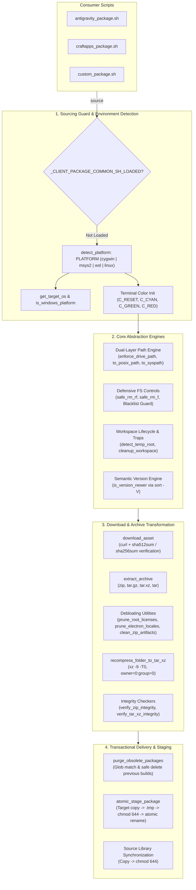
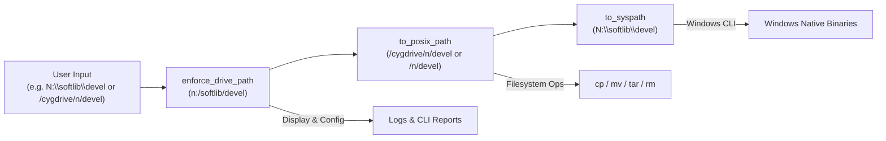
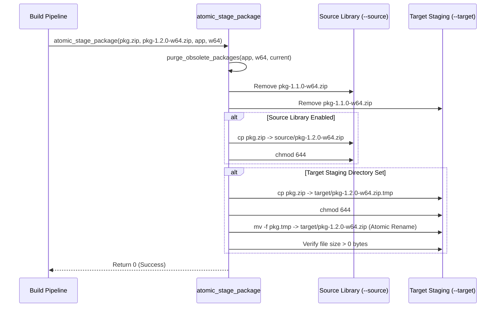

# Client Packaging Foundation Library (`client_package_common.sh`)

A shared POSIX-compliant shell library providing enterprise-grade foundational utilities for client software packaging, archive normalization, defensive filesystem manipulation, semantic versioning, and transactional release delivery. Engineered for seamless cross-platform execution across **Cygwin**, **MSYS2 / Git Bash**, **Windows Subsystem for Linux (WSL)**, and **Native Linux**.

---

## 1. Library Overview and Objectives

### 1.1 Executive Summary
The **Client Packaging Foundation Library** ([`client_package_common.sh`](file:///e:/data/devel/build/code/private/devops/client_tools/client_package_common.sh)) serves as the shared architectural substrate powering client packaging and deployment utilities, including:
1. **Google Antigravity Packaging Pipeline** ([`antigravity_package.sh`](file:///e:/data/devel/build/code/private/devops/client_tools/antigravity_package.sh))
2. **CraftApps Multi-Component Release Suite** ([`craftapps_package.sh`](file:///e:/data/devel/build/code/private/devops/client_tools/craftapps_package.sh))
3. Future standalone packaging, transcoding, and release synchronization scripts.

Consumer scripts operate in heterogeneous runtime environments ranging from Windows developer workstations (MSYS2, Cygwin) to Windows enterprise servers (WSL) and cloud CI/CD builders (Linux). This library abstracts platform differences, enforces defensive safety barriers against filesystem corruption, and guarantees transactional package publishing.

### 1.2 Core Packaging Objectives
- **DRY (Don't Repeat Yourself) Consolidation**: Centralize common boilerplate (path conversions, color formatting, trap handlers, version comparison, archive pruning, checksum validation, staging) into a single, modular source of truth.
- **Cross-Platform Path Normalization**: Seamlessly bridge Windows drive letters (`c:/dir`) and POSIX mount hierarchies (`/cygdrive/c/...`, `/c/...`, `/mnt/c/...`) across Cygwin, MSYS2, WSL, and Linux without external runtime dependencies.
- **Defensive Filesystem Safeguards**: Enforce strict path blacklists on deletion routines (`safe_rm_rf`, `safe_rm_f`) to guarantee that system roots (`/`, `/usr`, `/etc`), drive roots (`/cygdrive/c`, `/c`), and staging parents cannot be accidentally wiped.
- **Zero-Corruption Transactional Staging**: Provide atomic multi-phase distribution (`atomic_stage_package`) using intermediate `.tmp` files and `chmod 644` file permissions to ensure that interrupted transfers or partial writes never corrupt destination software libraries.
- **Archive De-Bloating & High-Ratio Transcoding**: Strip duplicate license files, prune multi-megabyte unused Electron locale packages down to `en-US.pak`, transcode upstream `.tar.gz` to high-compression `.tar.xz` (`xz -9 -T0`), and enforce standardized root/root ownership (`--owner=0 --group=0 --numeric-owner`).
- **Resilient Signal Trapping & Workspace Management**: Automatically register signal handlers (`EXIT`, `INT`, `TERM`, `HUP`) to destroy active workspace directories and in-flight temporary files on abnormal termination or script exit.

---

## 2. Architecture and Subsystem Interaction

### 2.1 Subsystem Architecture Diagram



### 2.2 Sourcing Architecture and Reentrancy Protection
The library utilizes an idempotency guard to prevent multiple evaluation side effects:

```bash
# Prevent duplicate sourcing
[[ -n "${_CLIENT_PACKAGE_COMMON_SH_LOADED:-}" ]] && return 0
_CLIENT_PACKAGE_COMMON_SH_LOADED=1
```

When sourced, the library detects the host platform, binds logging escape sequences, establishes path translation helpers, and arms the workspace cleanup trap for signals `EXIT`, `INT`, `TERM`, and `HUP`.

---

## 3. Function Catalog and API Reference

### 3.1 Section 1: Platform & Host Environment Detection

Functions that inspect the operating system kernel and runtime shell to establish environment parity.

#### `detect_platform`
- **Description**: Probes `uname -s` and `/proc/version` to determine the runtime POSIX environment.
- **Output**: Echoes one of: `cygwin`, `msys2`, `wsl`, or `linux`.
- **Global Variable Set**: Populates `PLATFORM="$(detect_platform)"`.

```bash
PLATFORM="$(detect_platform)"
# Result: "msys2", "cygwin", "wsl", or "linux"
```

#### `is_windows_platform`
- **Description**: Returns boolean status indicating whether the host environment runs atop the Windows NT kernel via MSYS2/MinGW or Cygwin.
- **Exit Code**: `0` (true) if Cygwin or MSYS2; `1` (false) if Native Linux or WSL.

```bash
if is_windows_platform; then
    log_info "Running on Windows host environment."
fi
```

#### `get_target_os`
- **Description**: Evaluates host environment and outputs the primary packaging target operating system.
- **Output**: Echoes `"windows"` or `"linux"`.

```bash
TARGET_OS="$(get_target_os)"
```

---

### 3.2 Section 2: Terminal Formatting & Colored Logging

Provides standardized, high-contrast, ANSI-colored output formatting. Detects if standard output is an interactive terminal (`[[ -t 1 ]]`); if output is redirected to a pipe or log file, ANSI color codes are automatically neutralized to keep logs clean.

| Function | Prefix / Tag | Color | Output Stream | Usage Intent |
| :--- | :--- | :--- | :--- | :--- |
| `log_info <msg>` | `[INFO]` | Cyan | `stdout` | Informational status, URL queries, progress reports. |
| `log_ok <msg>` | `[OK]` | Green | `stdout` | Successful completions, verified stages, dry-run actions. |
| `log_warn <msg>` | `[WARN]` | Yellow | `stderr` | Non-fatal warnings, missing optional tools, skipped steps. |
| `log_error <msg>` | `[ERROR]` | Red | `stderr` | Fatal errors, download failures, checksum mismatches. |
| `log_step <msg>` | `==>` | Blue (Bold) | `stdout` | Major pipeline phase transitions, component milestones. |

---

### 3.3 Section 3: Dual-Layer Path Engine

The dual-layer path engine resolves a central friction point in cross-platform DevOps: user-facing strings and configuration files should look clean and canonical (e.g. `n:/softlib/...`), while internal shell commands require the native POSIX mount (e.g. `/cygdrive/n/...` or `/n/...`).



#### `enforce_drive_path <path>`
- **Description**: Normalizes arbitrary paths (POSIX mounts, backslash paths, mixed paths) into lowercase canonical drive-letter format (`<drive>:/<path>`). Ideal for CLI logs, summaries, and configuration persistence.
- **Parameters**:
  - `$1`: Target path string.
- **Examples**:
  - `/cygdrive/f/stage/upload` $\rightarrow$ `f:/stage/upload`
  - `/n/softlib/software` $\rightarrow$ `n:/softlib/software`
  - `E:\data\devel\build` $\rightarrow$ `e:/data/devel/build`
  - `/mnt/c/Users` $\rightarrow$ `c:/Users`

#### `to_posix_path <path>`
- **Description**: Converts a Windows drive-letter path or backslash-separated path into the native POSIX filesystem mount path. Delegates to `cygpath -u` if available; otherwise applies regex fallbacks based on `$PLATFORM`.
- **Parameters**:
  - `$1`: Target path string.
- **Examples**:
  - `n:/softlib` $\rightarrow$ `/cygdrive/n/softlib` (Cygwin)
  - `n:/softlib` $\rightarrow$ `/n/softlib` (MSYS2)
  - `c:/Users` $\rightarrow$ `/mnt/c/Users` (WSL)
  - `/var/log` $\rightarrow$ `/var/log` (Linux)

#### `to_cygpath <path>`
- **Description**: Backward-compatible alias for `to_posix_path`.

#### `to_syspath <path>`
- **Description**: Converts POSIX shell paths back to native Windows backslash format (`C:\...`) for passing arguments to native Windows tools. Delegates to `cygpath -w` if present.
- **Parameters**:
  - `$1`: Target path string.
- **Examples**:
  - `/cygdrive/c/tools/app.exe` $\rightarrow$ `C:\tools\app.exe`
  - `/c/tools/app.exe` $\rightarrow$ `C:\tools\app.exe`

---

### 3.4 Section 4: Defensive Filesystem Controls

To guard against catastrophic deletion bugs when running with administrative or elevated privileges, the library wraps destructive file and directory deletions with containment checks.

#### `safe_rm_rf <target_directory>`
- **Description**: Safely removes a directory tree (`rm -rf`) with bounds checking.
- **Safety Checks**:
  1. Rejects empty, unset, or whitespace-only variables.
  2. Strips trailing slashes to prevent root matching bypasses.
  3. Evaluates normalized POSIX paths against a strict blacklist:
     - Root filesystem: `""`, `"/"`, `"."`, `".."`
     - Shared temporary directories: `"/tmp"`, `"/var/tmp"`
     - Mount hierarchies: `"/cygdrive"`, `"/mnt"`
     - Drive roots: `/cygdrive/[a-zA-Z]`, `/mnt/[a-zA-Z]`, `/[a-zA-Z]`
     - Operating system directories: `/bin`, `/usr`, `/usr/bin`, `/etc`, `/lib`, `/lib64`, `/sbin`, `/home`, `/root`, `/boot`, `/dev`, `/proc`, `/sys`, `/opt`, `/srv`
  4. Returns `1` and issues a `log_warn` message if an unsafe deletion is attempted.
- **Parameters**:
  - `$1`: Directory path to delete.

#### `safe_rm_f <target_file>`
- **Description**: Safely removes a single file (`rm -f`). Rejects empty strings and protected root directories.
- **Parameters**:
  - `$1`: File path to delete.

---

### 3.5 Section 5: Temporary Workspace Lifecycle & Signal Traps

#### `detect_temp_root`
- **Description**: Probes `$TMP`, `$TEMP`, `$TMPDIR`, and `/tmp` in priority order. Returns the first directory that exists, is writable, and is converted to native POSIX format. If none are writable, attempts to create `/tmp`.
- **Output**: Echoes normalized POSIX path to the temporary root directory.

#### `cleanup_workspace`
- **Description**: Signal handler bound to `EXIT`, `INT`, `TERM`, and `HUP`.
- **Behavior**:
  - Safely deletes `$CURRENT_BUILD_DIR` if set.
  - Safely deletes `$CURRENT_TARGET_TMP` if set.
  - Safely deletes `$EXEC_WORKSPACE` if set.
  - Preserves the original process exit code (`exit $exit_code`).

```bash
# Consumer script workspace setup:
TEMP_ROOT="$(detect_temp_root)"
EXEC_WORKSPACE="${TEMP_ROOT}/mypkg_exec_$$"
mkdir -p "$EXEC_WORKSPACE"
# Registration is automatic upon sourcing client_package_common.sh:
# trap cleanup_workspace EXIT INT TERM HUP
```

---

### 3.6 Section 6: Semantic Version Comparator

#### `is_version_newer <new_version> <existing_version>`
- **Description**: Performs robust semantic version comparison using GNU `sort -V`.
- **Parameters**:
  - `$1`: Candidate version string (e.g. `2.31.0`, `1.5.5`).
  - `$2`: Existing local version string (or `"none"`, `""`).
- **Exit Code**:
  - `0` (true): Candidate is strictly newer than existing version, or existing version is unset/`"none"`.
  - `1` (false): Existing version is equal to or newer than candidate version.

```bash
if is_version_newer "2.31.0" "2.29.0"; then
    log_info "New version detected; proceeding with update."
fi
```

---

### 3.7 Section 7: Obsolete Version Purger & Transactional Staging Engine

#### `purge_obsolete_packages <app_key> <platform_suffix> <current_pkg_name> [source_dir] [target_dir] [is_dry_run]`
- **Description**: Scans the source library and upload target staging directories for older packages belonging to the same component and platform suffix, removing obsolete builds while leaving the current build intact.
- **Unquoted Glob Expansion**: Uses unquoted glob patterns (`shopt -s nullglob`) to prevent literal asterisk matching failures.
- **Parameters**:
  - `$1`: Component application key (e.g. `antigravity-cli`, `antigravity-agent`, `sqlitebrowser`).
  - `$2`: Platform suffix (`w64`, `lnx`, `*`, or `all`).
  - `$3`: Current package filename to preserve (e.g. `antigravity-cli-1.5.5-w64.zip`).
  - `$4` *(optional)*: Source library directory (defaults to `$SOURCE_CYG`).
  - `$5` *(optional)*: Target staging directory (defaults to `$TARGET_CYG`).
  - `$6` *(optional)*: Dry-run flag (`true` or `false`, defaults to `$DRY_RUN`).

#### `atomic_stage_package <src_file> <pkg_name> <app_key> <platform_suffix> [source_dir] [target_dir] [is_dry_run]`
- **Description**: Executes a transactional 3-phase delivery pipeline:
  1. **Purge**: Invokes `purge_obsolete_packages` to eliminate outdated builds from both source and target directories.
  2. **Source Library Update**: Copies the verified package to `--source` and applies permissions (`chmod 644`).
  3. **Atomic Target Staging**: Copies package to `${target_dir}/${pkg_name}.tmp`, applies permissions (`chmod 644`), registers `$CURRENT_TARGET_TMP`, atomically renames `.tmp` $\rightarrow$ final package, clears the temporary reference, and asserts the final package size is non-zero.
- **Parameters**:
  - `$1`: Local path to completed package file in temporary workspace.
  - `$2`: Target package filename (e.g. `antigravity-cli-1.5.5-w64.zip`).
  - `$3`: Application key (e.g. `antigravity-cli`).
  - `$4`: Platform suffix (e.g. `w64`, `lnx`).
  - `$5` *(optional)*: Source library directory.
  - `$6` *(optional)*: Target staging directory.
  - `$7` *(optional)*: Dry-run flag (`true` | `false`).



---

### 3.8 Section 8: Download & Checksum Helper

#### `download_asset <url> <dest_file> [expected_hash] [hash_algo]`
- **Description**: Downloads an asset via `curl` with automated retry mechanisms and verifies cryptographic integrity against an expected hash.
- **Network Parameters**: Invokes `curl -fsSL --retry 3 --retry-delay 2`.
- **Integrity Validation**: Computes checksum using `${hash_algo}sum` (defaults to `sha512sum`, supports `sha256sum`, `md5sum`).
- **Blast-Radius Protection**: If checksum comparison fails, deletes the corrupted `$dest_file` via `safe_rm_f` and returns `1`.
- **Parameters**:
  - `$1`: Remote download URL.
  - `$2`: Local destination file path.
  - `$3` *(optional)*: Expected cryptographic hash hex string.
  - `$4` *(optional)*: Hash algorithm name (default: `sha512`).

```bash
download_asset "https://example.com/app.exe" "/tmp/app.exe" "abcdef12345..." "sha256"
```

---

### 3.9 Section 9: Archive Manipulation & Pruning Utilities

#### `extract_archive <archive_path> <dest_dir>`
- **Description**: Detects archive format by file extension and extracts content into the destination directory with `--force-local` flag enabled to handle drive letter paths on Windows.
- **Supported Formats**:
  - `.zip`: `unzip -q "$archive" -d "$dest_dir"`
  - `.tar.gz`, `.tgz`: `tar --force-local -xzf "$archive" -C "$dest_dir"`
  - `.tar.xz`: `tar --force-local -xJf "$archive" -C "$dest_dir"`
  - `.tar`: `tar --force-local -xf "$archive" -C "$dest_dir"`
- **Parameters**:
  - `$1`: Path to archive file.
  - `$2`: Destination extraction directory.

#### `is_artifact_file <filename>`
- **Description**: Evaluates if a filename matches redundant packaging files (licenses, notices, OFL font declarations, asset documentation, portable markers).
- **Matching Rules** (case-insensitive):
  - `license*`, `*licence*`, `notice*`, `attribution*`, `ofl-*.txt`, `ofl.txt`, `assets.md`, `portable.txt`
- **Exit Code**: `0` if file is an artifact to prune; `1` otherwise.

#### `clean_zip_artifacts <zip_path>`
- **Description**: Inspects table of contents of an existing `.zip` archive via `unzip -Z1` and purges matching artifact files or `licenses/` subfolders in place using `zip -q -d` or `7za d` without full extraction.
- **Parameters**:
  - `$1`: Target `.zip` file path.

#### `strip_base_directory <target_dir>`
- **Description**: Inspects an unpacked archive directory. If the directory contains exactly one top-level folder entry and no files (e.g. `pdfcraft-0.21.0-windows-x64-portable/`), it automatically moves all nested items up into `target_dir` and removes the wrapper folder.
- **Parameters**:
  - `$1`: Target unpacked directory path.

#### `prune_directory_artifacts <target_dir>`
- **Description**: Recursively scans an unpacked directory tree:
  1. Recursively finds and purges any `licenses/` or `license/` subfolders (e.g. in app root or `share/doc/<app>/licenses/`).
  2. Recursively deletes redundant packaging files: `LICENSE*`, `*LICENCE*`, `NOTICE*`, `ATTRIBUTION*`, `OFL*.txt`, `ASSETS.md`, and `portable.txt`.
- **Parameters**:
  - `$1`: Target unpacked directory path.

#### `repack_directory_to_zip <content_dir> <dest_zip>`
- **Description**: Packages the contents of `content_dir` directly into `dest_zip` without an enclosing top-level folder, and verifies zip CRC integrity.
- **Parameters**:
  - `$1`: Source content directory.
  - `$2`: Destination `.zip` archive path.

#### `repack_directory_to_tar_xz <content_dir> <dest_tar_xz>`
- **Description**: Compresses the contents of `content_dir` directly into `dest_tar_xz` without an enclosing top-level folder, applying multi-threaded `xz -9 -T0` compression and normalized root ownership (`owner=0:group=0`), and verifies tar stream integrity.
- **Parameters**:
  - `$1`: Source content directory.
  - `$2`: Destination `.tar.xz` archive path.

#### `prune_root_licenses <target_dir>`
- **Description**: Removes redundant license files (`LICENSE*`, `LICENSES*`, `NOTICE*`, `ATTRIBUTION*`, `OFL*.txt`) directly located in the root of an unpacked directory tree.
- **Parameters**:
  - `$1`: Target unpacked directory path.

#### `prune_electron_locales <locales_dir> [keep_locale]`
- **Description**: Prunes internationalization packs from an unpacked Electron application `locales/` directory, deleting all `.pak` files except the designated locale (defaults to `en-US.pak`). Typically recovers 30–60 MB of redundant assets.
- **Parameters**:
  - `$1`: Path to `locales/` directory.
  - `$2` *(optional)*: Locale pack to preserve (default: `en-US.pak`).

#### `recompress_folder_to_tar_xz <parent_dir> <folder_to_pack> <dest_tar_xz>`
- **Description**: Packs and compresses a directory tree into a high-compression `.tar.xz` archive.
- **Standardized Ownership**: Pipes through `tar --force-local --owner=0 --group=0 --numeric-owner` to standardize archive metadata across diverse builder environments.
- **Maximum Compression**: Pipes tar stream directly to `xz -9 -T0 > "$dest_tar_xz"`.
- **Post-Compression Verification**: Automatically tests archive integrity via `tar --force-local -tJf`. Deletes corrupted output if verification fails.
- **Parameters**:
  - `$1`: Parent working directory.
  - `$2`: Folder relative name to pack.
  - `$3`: Destination `.tar.xz` output path.

#### `verify_zip_integrity <zip_path>`
- **Description**: Validates zip archive CRC checksums and directory headers using `unzip -tq`.
- **Exit Code**: `0` if archive is healthy; non-zero if corrupted.

#### `verify_tar_xz_integrity <tar_xz_path>`
- **Description**: Validates `.tar.xz` archive stream and headers using `tar --force-local -tJf`.
- **Exit Code**: `0` if archive is healthy; non-zero if corrupted.

---

## 4. Security Architecture & Blast-Radius Protection

The library is designed with strict defensive principles to operate safely in shared or privileged build systems.

### 4.1 Deletion Blast-Radius Containment
All file and directory removals pass through `safe_rm_rf` and `safe_rm_f`. The deletion engine enforces the following invariants:
1. **No Blank Paths**: Traps unquoted or unset variables (e.g. `rm -rf "$TARGET_DIR/*"` when `$TARGET_DIR` is empty).
2. **System Root Immunity**: Strictly blocks removal of `/`, `/usr`, `/bin`, `/etc`, `/lib`, `/var/tmp`, `/tmp`.
3. **Mount Root Immunity**: Strictly blocks removal of `/cygdrive`, `/mnt`, and all single-letter drive roots (`/c`, `/cygdrive/c`, `/mnt/c`).

### 4.2 Atomicity & Corruption Prevention
In multi-gigabyte release packaging workflows, power interruptions or network drops can corrupt target repositories:
- Packages are assembled strictly inside an isolated execution workspace (`${TEMP_ROOT}/<app>_exec_$$`).
- Target directories are staged via `.tmp` staging followed by an atomic filesystem rename (`mv -f`).
- Archive integrity is verified *before* publishing to library destinations.

### 4.3 Permission Normalization
All published packages staged to `--source` or `--target` are explicitly assigned standard POSIX permissions (`chmod 644`) to guarantee read access across network file shares, web servers, and non-privileged consumer accounts.

---

## 5. Consumer Integration Guide & Boilerplate

### 5.1 Sourcing Convention
Consumer scripts should source [`client_package_common.sh`](file:///e:/data/devel/build/code/private/devops/client_tools/client_package_common.sh) using dynamic directory resolution based on `${BASH_SOURCE[0]}`:

```bash
#!/usr/bin/env bash
set -euo pipefail

SCRIPT_DIR="$(cd "$(dirname "${BASH_SOURCE[0]}")" && pwd)"
COMMON_LIB="${SCRIPT_DIR}/client_package_common.sh"

if [[ -f "$COMMON_LIB" ]]; then
    # shellcheck source=client_package_common.sh
    source "$COMMON_LIB"
else
    echo "ERROR: Shared foundation library not found: $COMMON_LIB" >&2
    exit 1
fi
```

### 5.2 Compliant Consumer Script Boilerplate

Below is an end-to-end, production-ready packaging script demonstrating standard integration patterns:

```bash
#!/usr/bin/env bash
# ==============================================================================
# example_package.sh - Compliant Client Packaging Utility
# ==============================================================================
set -euo pipefail

# 1. Resolve and source shared foundation library
SCRIPT_DIR="$(cd "$(dirname "${BASH_SOURCE[0]}")" && pwd)"
# shellcheck source=client_package_common.sh
source "${SCRIPT_DIR}/client_package_common.sh"

# 2. CLI Options and Default Configuration
APP_NAME="myapp"
SOURCE_DIR="n:/softlib/software/public/devel/tools"
TARGET_DIR="f:/stage/upload/pending"
DRY_RUN=false
FORCE=false

# 3. Path Normalization
SOURCE_CYG="$(to_posix_path "$SOURCE_DIR")"
TARGET_CYG="$(to_posix_path "$TARGET_DIR")"
SOURCE_DISP="$(enforce_drive_path "$SOURCE_DIR")"
TARGET_DISP="$(enforce_drive_path "$TARGET_DIR")"

# 4. Allocate Execution Workspace
TEMP_ROOT="$(detect_temp_root)"
EXEC_WORKSPACE="${TEMP_ROOT}/${APP_NAME}_exec_$$"
mkdir -p "$EXEC_WORKSPACE"

log_step "Initializing Packaging Pipeline for ${APP_NAME}"
log_info "Platform       : ${PLATFORM}"
log_info "Source Library : ${SOURCE_DISP}"
log_info "Target Pending : ${TARGET_DISP}"

# 5. Remote Version Discovery & Version Comparison
REMOTE_VERSION="2.4.0"
LOCAL_VERSION="2.3.0"

if ! is_version_newer "$REMOTE_VERSION" "$LOCAL_VERSION" && [[ "$FORCE" == false ]]; then
    log_ok "${APP_NAME} is up to date (${LOCAL_VERSION})."
    exit 0
fi

# 6. Execute Build Pipeline
PKG_NAME="${APP_NAME}-${REMOTE_VERSION}-w64.zip"
BUILD_DIR="${EXEC_WORKSPACE}/build"
mkdir -p "$BUILD_DIR"
CURRENT_BUILD_DIR="$BUILD_DIR"

log_info "Downloading upstream asset..."
ASSET_URL="https://example.com/downloads/${APP_NAME}.exe"
DOWNLOADED_BIN="${BUILD_DIR}/${APP_NAME}.exe"
download_asset "$ASSET_URL" "$DOWNLOADED_BIN"

log_info "Creating distribution archive..."
(cd "$BUILD_DIR" && zip -q "${EXEC_WORKSPACE}/${PKG_NAME}" "$(basename "$DOWNLOADED_BIN")")
verify_zip_integrity "${EXEC_WORKSPACE}/${PKG_NAME}"

# 7. Transactional Delivery
atomic_stage_package \
    "${EXEC_WORKSPACE}/${PKG_NAME}" \
    "$PKG_NAME" \
    "$APP_NAME" \
    "w64" \
    "$SOURCE_CYG" \
    "$TARGET_CYG" \
    "$DRY_RUN"

log_ok "Packaging pipeline completed successfully."
# EXEC_WORKSPACE and CURRENT_BUILD_DIR cleaned automatically by cleanup_workspace trap
```

---

## 6. Prerequisites and Platform Compatibility

The library is engineered to run in minimal shell environments without requiring heavy third-party packages or non-standard binaries.

### 6.1 Compatibility Matrix

| Environment | Host Operating System | Compatibility Status | Path Mapping Mechanism |
| :--- | :--- | :--- | :--- |
| **MSYS2 / Git Bash** | Windows 10 / 11 / Server | Full Support | `/c/...`, `/n/...` |
| **Cygwin** | Windows 10 / 11 / Server | Full Support | `/cygdrive/c/...`, `cygpath` |
| **WSL 1 / WSL 2** | Windows Subsystem for Linux | Full Support | `/mnt/c/...`, `sort -V` |
| **Native Linux** | Ubuntu, Debian, RHEL, Fedora, Arch | Full Support | Standard POSIX paths |

### 6.2 Tool Dependencies

| Command | Purpose | Essential or Optional |
| :--- | :--- | :--- |
| **`bash`** (v4.0+) | Shell runtime execution | **Essential** |
| **`curl`** | Asset download and HTTP queries | **Essential** |
| **`sort`** (GNU) | Semantic version comparison (`sort -V`) | **Essential** |
| **`tar`** | Archive extraction and high-ratio repackaging | **Essential** |
| **`xz`** | High-compression multi-threaded `.tar.xz` transcoding (`-9 -T0`) | **Essential** (Linux tarballs) |
| **`zip`** | Windows `.zip` archive creation and pruning (`-d`) | **Essential** (Windows packages) |
| **`unzip`** | Zip extraction and integrity testing (`-tq`) | **Essential** |
| **`sha512sum` / `sha256sum`** | Cryptographic payload verification | **Recommended** |
| **`cygpath`** | Windows path translation | **Optional** (used if present) |

---

## 7. Verification and Testing

To verify the library's integrity and validate all internal functions across your local environment, run the following verification checks:

```bash
# 1. Syntax Audit
bash -n client_tools/client_package_common.sh

# 2. Interactive Function Smoke Test
bash -c '
    source client_tools/client_package_common.sh
    echo "Platform detected: $PLATFORM"
    echo "Is Windows? $(is_windows_platform && echo YES || echo NO)"
    echo "Target OS: $(get_target_os)"
    echo "Temp Root: $(detect_temp_root)"
    echo "Drive Path: $(enforce_drive_path "/cygdrive/c/test/dir")"
    echo "POSIX Path: $(to_posix_path "c:/test/dir")"
    is_version_newer "2.5.0" "2.4.9" && echo "Semantic sort: OK"
'
```

