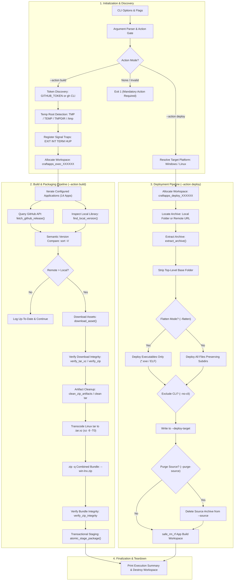
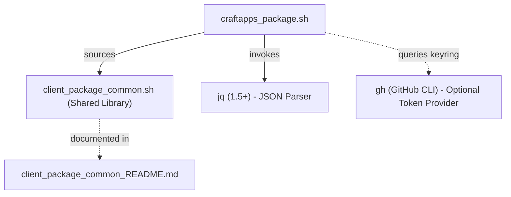
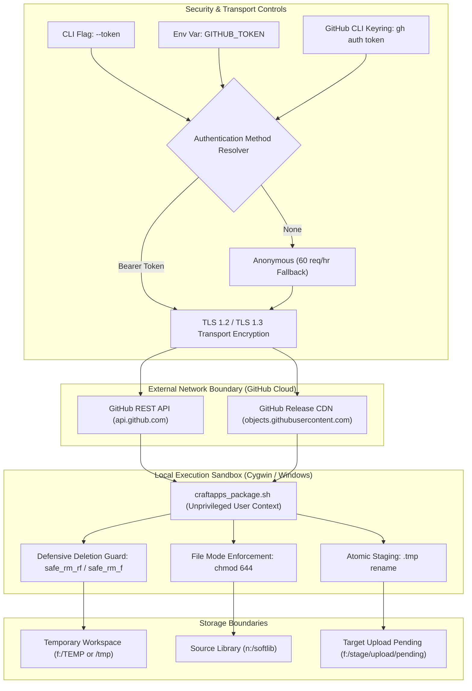

# Storytold Craft Applications Packaging & Deployment Utility (`craftapps_package.sh`)

A cross-platform, transactional release delivery and installation pipeline compatible with **Cygwin**, **MSYS2 / Git Bash**, **Windows Subsystem for Linux (WSL)**, and **Native Linux**. This utility continuously monitors GitHub releases for Storytold desktop applications, retrieves 64-bit Linux (`.tar.gz`/`.tar.xz`) and Windows (`.zip`) binary assets, strips packaging artifacts, recompresses Linux packages into `.tar.xz`, repackages them into unified multi-platform archives, and atomically synchronizes production libraries. Additionally, it provides an end-to-end installation and deployment engine to extract and install binaries into target environments.

---

## 1. Application Overview and Objectives

### 1.1 Executive Summary
The **Storytold Craft Apps Packaging & Deployment Utility** (`craftapps_package.sh`) serves as the central release delivery bridge for Storytold desktop products. Desktop users and administrators across Windows and Linux environments require synchronized, reliable access to portable binaries. This utility automates the entire lifecycle:
1. **Packaging (`--action build`)**: Discovers upstream GitHub releases, validates assets, prunes packaging and licensing artifacts, transcodes Linux archives to high-compression `.tar.xz`, and builds unified release packages.
2. **Deployment (`--action deploy`)**: Discovers archives from local folders or remote URLs, auto-detects the host platform (Windows vs Linux), and deploys binaries directly into target installation paths (with optional directory flattening, CLI exclusion, and source archive purging).

### 1.2 Core Business & Technical Objectives
- **Multi-Platform Archive Unification**: Bundle corresponding 64-bit Linux (`.tar.xz`) and Windows (`.zip`) release binaries into a single, standardized archive (`<app>-<version>-win-lnx.zip`) for distribution.
- **Base Folder Normalization**: Automatically strips redundant top-level wrapper directories (e.g. `<app>-<ver>-windows-x64-portable/` or `<app>-<ver>-linux-x86_64/`), guaranteeing all binaries, models, and assets sit directly at the root of their respective distribution archives.
- **Packaging Artifact De-Bloating**: Recursively prunes redundant license files (`LICENSE*`, `*LICENCE*`, `NOTICE*`, `ATTRIBUTION*`, `OFL-*.txt`, `ASSETS.md`, `portable.txt`) and deletes `licenses/` subfolders to minimize package bloat and unclutter runtime folders.
- **Linux XZ Transcoding**: Decompresses `.tar.gz` and recompresses using multi-threaded `xz -9 -T0` to produce high-compression `.tar.xz` tarballs with standardized `0:0` (`root/root`) ownership.
- **Zero-Corruption Guarantee (Transactional Staging)**: Protect destination directories against partial writes, download corruptions, or interrupted operations by performing all extraction, repackaging, and integrity checks within an isolated temporary workspace before touching production libraries.
- **End-to-End Portable Deployment**: Rapidly install and deploy binaries into target directories with flexible formatting options (`--flatten` for executable binaries only, or structured extraction without the versioned archive root folder).
- **Dual-Repository Synchronization**:
  1. **Primary Library (`--source`)**: Updates the persistent, organized software library (e.g. `n:/softlib/software/public/<rel_dir>/` on Windows or `/mnt/n/...` / `/opt/...` on Linux), purging obsolete builds and placing the validated archive.
  2. **Staging Area (`--target`)**: Atomically deploys the verified package into the upload distribution directory (e.g. `f:/stage/upload/pending/` or custom Linux path) via `.tmp` file renaming to ensure external upload daemons and file watchers never read incomplete archives.
- **Shared Foundation & Low Overhead**: Leverages the shared client packaging library [`client_package_common.sh`](file:///e:/data/devel/build/code/private/devops/client_tools/client_package_common.sh) and foundational POSIX shell tools (`curl`, `zip`, `unzip`, `jq`, `tar`, `gzip`, `xz`, and coreutils), eliminating heavyweight runtimes such as Python or Node.js.
- **Cross-Platform Path Harmonization**: Automatically identifies the host environment (`cygwin`, `msys2`, `wsl`, `linux`) and translates between user-facing canonical paths (`drive:/path/sub`), Cygwin mounts (`/cygdrive/x/...`), MSYS2 mounts (`/x/...`), WSL mounts (`/mnt/x/...`), and standard POSIX Linux paths.

---

## 2. Architecture and Design Choices

### 2.1 Architecture Diagram



### 2.2 Key Architectural Decisions

1. **Delegated Common Packaging Foundation**:
   - Core packaging primitives — host platform detection (`PLATFORM`), dual-layer path translation (`enforce_drive_path`, `to_posix_path`), defensive deletion containment (`safe_rm_rf`, `safe_rm_f`), signal lifecycle traps (`cleanup_workspace`), and transactional `.tmp` release staging (`atomic_stage_package`) — are delegated to [`client_package_common.sh`](file:///e:/data/devel/build/code/private/devops/client_tools/client_package_common.sh). Full architectural details and API specifications are centralized in [`client_package_common_README.md`](file:///e:/data/devel/build/code/private/devops/client_tools/client_package_common_README.md).
2. **Dual-Action Pipeline (`--action build` vs `--action deploy`)**:
   - Seamlessly pairs automated release packaging and multi-platform aggregation with direct host installation and extraction into target environments.
3. **Resilient GitHub Release Discovery**:
   - Initial application releases or interim builds are frequently published as pre-releases on GitHub. Querying `/releases/latest` for such repositories returns an HTTP 404 response. The script catches 404s and automatically queries `/releases?per_page=1`, extracting the most recent published release object using `jq`.
4. **Credential Auto-Discovery**:
   - Automatically probes the authenticated GitHub CLI (`gh auth token`) if `$GITHUB_TOKEN` is not explicitly set in the environment or passed via `--token`. This seamlessly elevates the API rate limit from 60 requests/hour to 5,000 requests/hour.
5. **Flexible Deployment Layouts**:
   - Supports binary-only flattening (`--flatten`), companion CLI filtering (`--no-cli`), and post-install source cleanup (`--purge-source`) for streamlined system installation.

### 2.3 Assumptions
- Upstream releases tag software versions using standard semantic formats (e.g., `v1.2.3` or `1.2.3`).
- Upstream release assets provide binary distributions with naming conventions matching `*linux*x86_64*.tar.gz` and `*win*x86_64*.zip`.
- The execution environment is a POSIX-compatible shell (Cygwin, MSYS2 / Git Bash, WSL, or native Linux) with standard coreutils available.

### 2.4 Edge Cases Handled
- **Pre-Release Repositories**: Transparent fallback to `/releases?per_page=1` prevents false 404 errors.
- **Corrupt Downloads**: Detected via `tar -tzf` and `unzip -tq` prior to repackaging; aborted downloads trigger automated cleanup without polluting target folders.
- **Asymmetrical Asset Availability**: Releases containing only Linux or only Windows assets are rejected with clear diagnostics before downloading, preventing incomplete packages.
- **Process Abort / Signal Interruption**: `trap cleanup_workspace EXIT INT TERM HUP` guarantees the removal of temporary build directories and in-flight `.tmp` files.
- **Legacy Package Suffixes**: Filename parser matches both `win-lnx` and historical `lnx-win` packages in the source directory, preventing duplicate packaging of already-installed software.
- **Invalid Application Selection**: Providing `--app invalidname` fails immediately with exit code `1`, displaying the full catalog of available applications rather than executing an empty pipeline.

---

## 3. Data Flow and Control Logic

### 3.1 Operational Control Flow
1. **Argument Parsing & Action Validation**: Evaluates CLI parameters and ensures the mandatory `--action <build|deploy>` flag is present (halting with an error if absent).
2. **Tool Prerequisite Verification**: Checks for foundational tools: `curl`, `zip`, `unzip`, `jq`, `tar`, `gzip`, and `xz`.
3. **Workspace Allocation**: Resolves temp root via candidate hierarchy (`$TMP` -> `$TEMP` -> `$TMPDIR` -> `/tmp`), prunes stale workspaces older than 24 hours, and allocates an isolated workspace (`craftapps_exec_XXXXXX` or `craftapps_deploy_XXXXXX`).
4. **Execution Dispatch**:
   - **`--action build`**:
     - Evaluates local version in `--source` vs. remote GitHub release tag via `sort -V`.
     - Downloads Linux (`.tar.gz`/`.tar.xz`) and Windows (`.zip`) binary assets using `download_asset()`.
     - Verifies archive integrity (`verify_tar_xz_integrity`, `verify_zip_integrity`).
     - **Artifact Cleanup**: Prunes `LICENSE*`, `*LICENCE*`, `NOTICE*`, `ATTRIBUTION*`, and `OFL-*.txt` directly from the Windows zip (`clean_zip_artifacts()`).
     - **Linux XZ Transcoding**: Decompresses `.tar.gz`, strips base directory, prunes licensing/packaging artifacts, and recompresses using multi-threaded `xz -9 -T0` to produce `.tar.xz`.
     - Packages cleaned `.tar.xz` and `.zip` into combined bundle (`<app>-<ver>-win-lnx.zip`).
     - Verifies bundle integrity (`verify_zip_integrity`).
     - Atomically updates `--source` and stages to `--target` via `atomic_stage_package()`.
   - **`--action deploy`**:
     - Resolves source archive from local directory (flat lookup) or remote URL.
     - Auto-detects host OS (`get_target_os`) and extracts platform archive via `extract_archive()`.
     - Strips top-level base directory.
     - Deploys executables only (`--flatten`) or preserves all files and subdirectories.
     - Excludes companion CLI binaries if requested (`--no-cli`).
     - Purges source archives upon successful deployment if enabled (`--purge-source`).
5. **Teardown & Metrics**: Destroys root execution workspace and prints summary metrics table.

### 3.2 Sequence Diagram

```mermaid
sequenceDiagram
    autonumber
    actor User as Operator / Cron
    participant Script as craftapps_package.sh
    participant GH as GitHub API / CDN
    participant FS_Temp as Temp Workspace (Disk)
    participant FS_Src as Source Library (n:/softlib)
    participant FS_Tgt as Target Pending (f:/stage)

    User->>Script: Run ./craftapps_package.sh --action build [OPTIONS]
    Script->>Script: Parse Args, Validate Action, Detect Auth Token & Temp Root
    Script->>FS_Temp: mktemp -d craftapps_exec_XXXXXX
    
    loop For each App in PACKAGES
        Script->>FS_Src: find_local_version(app_name)
        FS_Src-->>Script: Return local_ver (e.g., 1.4.0)
        
        Script->>GH: GET /repos/{org}/{repo}/releases/latest
        alt Release is Pre-Release / 404
            GH-->>Script: 404 Not Found
            Script->>GH: GET /repos/{org}/{repo}/releases?per_page=1
            GH-->>Script: 200 OK (Array of releases)
        else Standard Release
            GH-->>Script: 200 OK (Release JSON)
        end
        
        Script->>Script: Compare versions (remote > local?)
        alt Version Up to Date
            Script->>Script: Skip application
        else New Version Available
            Script->>FS_Temp: mktemp -d app_XXXXXX
            Script->>GH: download_asset(linux_url)
            GH-->>FS_Temp: Write linux.tar.gz
            Script->>FS_Temp: verify_tar_xz_integrity / tar -tzf (Verify)
            
            Script->>GH: download_asset(win_url)
            GH-->>FS_Temp: Write win.zip
            Script->>FS_Temp: verify_zip_integrity (Verify)

            Note over Script,FS_Temp: Artifact Cleanup & XZ Transcoding
            Script->>FS_Temp: clean_zip_artifacts win.zip (Prune artifacts)
            Script->>FS_Temp: extract_archive & strip_base_directory
            Script->>FS_Temp: prune_directory_artifacts (Prune artifacts)
            Script->>FS_Temp: repack_directory_to_tar_xz (xz -9 -T0)
            Script->>FS_Temp: verify_tar_xz_integrity & verify_zip_integrity
            
            Script->>FS_Temp: zip -q bundle.zip linux.tar.xz win.zip
            Script->>FS_Temp: verify_zip_integrity bundle.zip
            
            Note over Script,FS_Src,FS_Tgt: atomic_stage_package (Transactional Staging)
            Script->>FS_Src: purge_obsolete_packages (Safe unquoted purge)
            Script->>FS_Tgt: purge_obsolete_packages (Safe unquoted purge)
            opt UPDATE_SOURCE == true
                Script->>FS_Src: cp bundle.zip -> source_path/ (chmod 644)
            end
            Script->>FS_Tgt: cp bundle.zip -> target_path/bundle.zip.tmp
            Script->>FS_Tgt: chmod 644 bundle.zip.tmp
            Script->>FS_Tgt: mv -f bundle.zip.tmp -> bundle.zip (Atomic rename)
            Script->>FS_Tgt: test -s bundle.zip
            
            Script->>FS_Temp: safe_rm_rf app_XXXXXX (Immediate Cleanup)
        end
    end

    Script->>FS_Temp: safe_rm_rf craftapps_exec_XXXXXX
    Script->>User: Display Execution Summary Table & Exit
```

---

## 4. Performance and Scalability

### 4.1 Concurrency Model
The script utilizes a **strictly sequential batch loop**. This design choice is intentional and delivers key operational benefits:
- **Rate-Limit Preservation**: GitHub API enforces aggressive secondary rate limits against concurrent burst requests. Sequential querying with connection reuse preserves API quotas.
- **Disk I/O and Bus Stability**: Repackaging operations involve writing and decompressing multiple multi-megabyte binary archives. Sequential processing avoids saturating disk I/O channels across network shares (`n:/softlib`).
- **Deterministic Transactional Recovery**: If an error or interruption occurs, isolating execution to a single active package guarantees that error handling and rollback routines operate deterministically.

### 4.2 Storage and Memory Management
- **Immediate Disk Reclamation**: Rather than accumulating downloaded and generated archives until the script finishes, each application's temporary subfolder (`craftapps_exec_XXXXXX/<app>_XXXXXX`) is erased immediately upon completing Step 8. Maximum disk overhead never exceeds the size of a single application bundle (~50 MB–200 MB), regardless of whether 1 or 50 packages are processed.
- **Stale Workspace Pruning**: Step 10 checks the temporary root directory and prunes any stale `craftapps_exec_*` directories older than 24 hours created by prior hard-killed sessions.
- **Atomic Operations**: Staging files are written to `.tmp` files and moved using native filesystem renames, which are atomic within the same physical filesystem.

---

## 5. Dependencies and Requirements

### 5.1 Foundation & Application Prerequisites
Packaging and deployment operations rely on the shared foundation library [`client_package_common.sh`](file:///e:/data/devel/build/code/private/devops/client_tools/client_package_common.sh). All standard POSIX tools (`bash`, `curl`, `coreutils`, `tar`, `gzip`, `xz`, `zip`, `unzip`) and platform compatibility matrices are documented in [`client_package_common_README.md#6-prerequisites-and-platform-compatibility`](file:///e:/data/devel/build/code/private/devops/client_tools/client_package_common_README.md#6-prerequisites-and-platform-compatibility).

In addition to the foundation library tools, `craftapps_package.sh` requires:

| Tool / Module | Minimum Version | Category | Purpose |
| :--- | :--- | :--- | :--- |
| **`jq`** | 1.5+ | Mandatory Utility | Parsing GitHub API release payloads and asset filter expressions |
| **`gh`** | 2.0+ | Optional Provider | Automated GitHub CLI token discovery via system keyring |

### 5.2 Dependency Architecture



---

## 6. Security Architecture

### 6.1 Security Architecture Diagram



### 6.2 Authentication and Access Control Layers
- **Anonymous Mode**:
  - Unauthenticated access functions out-of-the-box for public repositories.
  - Rate-limited by GitHub to 60 requests per hour per public IP address.
- **Personal Access Token (PAT) / OAuth**:
  - Provided via `--token <token>` or the `GITHUB_TOKEN` environment variable.
  - Elevated rate limit: 5,000 requests per hour.
- **GitHub CLI Integration**:
  - If no token is explicitly supplied, the script queries `gh auth token` via the local system keyring.
  - Grants seamless authenticated access without requiring secrets stored in plain text.
- **RBAC & Least Privilege**:
  - The script requires only **read-only access** (`read:org`, `repo`) to public repositories.
  - It does not push commits, create releases, or modify GitHub repository state.

---

## 7. Security Assessment

| Security Dimension | Evaluation | Implementation Detail |
| :--- | :--- | :--- |
| **Encryption in Transit** | **Compliant** | All API calls and asset downloads are forced over HTTPS (`https://api.github.com` and `https://github.com`) using `curl -sSL`. TLS 1.2 and TLS 1.3 are strictly enforced; SSL verification is never disabled. |
| **Secret Management** | **Compliant** | Secrets are never written to disk, logged to standard output, or stored in temporary files. The diagnostic banner masks credentials, displaying only `Authenticated (API token active)`. If `gh` CLI is used, tokens remain secured in the OS credential manager. |
| **RBAC / Least Privilege** | **Compliant** | Upstream: Only read permissions for public release assets are required.<br>Downstream: The script operates within the least-privilege context of the invoking user and requires no Administrator or root privileges. |
| **File Permissions** | **Compliant** | Handled by `atomic_stage_package()` in [`client_package_common.sh`](file:///e:/data/devel/build/code/private/devops/client_tools/client_package_common.sh), strictly enforcing POSIX mode `644` (`chmod 644`) across library and staging destinations. |
| **Filesystem Blast Radius** | **Compliant** | Handled by `safe_rm_rf()` in [`client_package_common.sh`](file:///e:/data/devel/build/code/private/devops/client_tools/client_package_common.sh) with system root and drive mount blacklists (see [Security Architecture in `client_package_common_README.md`](file:///e:/data/devel/build/code/private/devops/client_tools/client_package_common_README.md#4-security-architecture--blast-radius-protection)). |
| **Vulnerable Libraries** | **Compliant** | Zero third-party scripting libraries or external modules (no npm, pip, gem packages). Employs trusted OS-level binaries maintained and patched directly by Cygwin package maintainers. |

---

## 8. Code Quality Assessment and Best Practices

### 8.1 Defensive Bash Engineering Standards
- **Strict Execution (`set -eo pipefail`)**: Any unexpected failure in an unchecked command immediately halts execution, preventing cascade failures.
- **Explicit Variable Quoting**: Every variable reference and path expansion is strictly quoted (`"$var"`) to guarantee safety against spaces, special characters, and wildcards in Windows paths.
- **Nullglob Isolation**: Where filesystem globbing is required (`*.zip`), `shopt -s nullglob` is activated inside localized blocks and disabled (`shopt -u nullglob`) immediately afterward to prevent literal asterisks on unmatched patterns.
- **Subshell Independence**: Pipeline commands running in background contexts or loops avoid variable leakage into the parent shell environment.
- **ShellCheck Compliance**: Code follows standard static analysis rules established by ShellCheck for POSIX and Bash compatibility.

### 8.2 Maintainability and Extensibility
- **Centralized Application Table**: Adding a new application requires exactly one line in the `PACKAGES` array:
  ```bash
  "rel/category/path   application_name   win-lnx   [github_repo]"
  ```
- **External Configuration Support**: The `--config <file>` option allows dynamic pipeline injection without modifying the base script.

---

## 9. Command Line Arguments

| Option Flag | Argument Type | Default Value | Description |
| :--- | :--- | :--- | :--- |
| `--action <build\|deploy>` | String | *(Mandatory)* | Execution action: `build` (monitor GitHub, clean artifacts, package, stage) or `deploy` (extract and deploy binaries). |
| `--name <name>`, `--app <name>` | String | *(None - All)* | Restricts execution to a single specified application name or repo. |
| `--source <path\|url>` | String (Path or URL) | `n:/softlib/software/public` | Software library repository (build mode) or archive folder / URL (deploy mode). |
| `--target <path>` | String (Path) | `f:/stage/upload/pending` | Path to the target pending upload directory (`--action build`). |
| `--deploy-target <path>` | String (Path) | *(None - Required)* | Destination directory for deployed binaries (`--action deploy`). |
| `--flatten` | Boolean (Flag) | `false` | Deploy only executable binaries directly into `--deploy-target` without subdirectories. |
| `--no-cli` | Boolean (Flag) | `false` | Exclude companion CLI binaries (e.g. `*-cli.exe`, `*-cli`) from deployment. |
| `--purge-source` | Boolean (Flag) | `false` | Remove source archive(s) from `--source` after successful deployment (local folders only). |
| `--org <name>` | String | `storytold` | Upstream GitHub organization or user account name (`--action build`). |
| `--token <token>` | String | *(Auto-detected)* | GitHub Personal Access Token (can also use `GITHUB_TOKEN` env var). |
| `--list-apps` | Boolean (Flag) | `false` | **Exclusive command**: Displays configured application catalog table by category and exits immediately (`0`). |
| `--config <file>` | String (Path) | *(None)* | Loads external package configuration table from a file. |
| `--log <file>` | String (Path) | *(None)* | Appends full execution output (stdout and stderr) to specified log file. |
| `--force` | Boolean (Flag) | `false` | Forces download and repackaging even if the remote version equals the local version. |
| `--no-update-source` | Boolean (Flag) | `false` | Skips updating or deleting files in `--source` (only writes to `--target`). |
| `--dry-run` | Boolean (Flag) | `false` | Queries GitHub and simulates all operations without writing or deleting files on disk. |
| `--verbose` | Boolean (Flag) | `false` | Enables verbose diagnostic output, showing raw asset lists and debug messages. |
| `-h`, `--help` | Boolean (Flag) | `false` | **Exclusive command**: Displays detailed usage instructions and exits (`0`). |

---

## 10. Deployment and Operational Usage Examples

### 10.1 Production Deployment Checklist
1. **Verify or install prerequisites**:
   - **Cygwin**: Select `curl`, `zip`, `unzip`, `jq`, `tar`, `gzip`, `xz` in Cygwin setup.
   - **MSYS2 / Git Bash**: Run `pacman -S curl zip unzip jq tar gzip xz`
   - **Debian / Ubuntu Linux**: Run `sudo apt-get install curl zip unzip jq tar gzip xz-utils`
   - **Fedora / RHEL Linux**: Run `sudo dnf install curl zip unzip jq tar gzip xz`
   - **Arch Linux**: Run `sudo pacman -S curl zip unzip jq tar gzip xz`
   ```bash
   which curl zip unzip jq tar gzip xz
   ```
2. **Verify target and source directories are accessible and writable**:
   - On Windows (Cygwin): `test -w /cygdrive/n/softlib/software/public && test -w /cygdrive/f/stage/upload/pending`
   - On Windows (MSYS2): `test -w /n/softlib/software/public && test -w /f/stage/upload/pending`
   - On Linux: Verify local paths or mounted shares (e.g. `/mnt/n/...` or custom `--source`/`--target`)
3. **Set up GitHub authentication** (recommended to elevate API rate limit from 60 to 5,000 req/hr):
   ```bash
   gh auth status || export GITHUB_TOKEN="ghp_yourPersonalAccessTokenHere"
   ```

---

### 10.2 Usage Examples and Output Samples

#### Example 1: Display Configured Application Catalog (`--list-apps`)
Displays the complete directory of configured applications organized by category:

```bash
$ ./craftapps_package.sh --list-apps
```

**Output:**
```text
====================================================================================================
 Storytold Craft Applications Directory
====================================================================================================
 CATEGORY             SHORT PATH              APPLICATION      SUFFIX     GITHUB REPO
────────────────────────────────────────────────────────────────────────────────────────────────────
 Audio                apps/audio              soundcraft       win-lnx    storytold/soundcraft
 Imaging > CAD        apps/imaging/cad        cadcraft         win-lnx    storytold/cadcraft
 Imaging > Draw       apps/imaging/draw       designcraft      win-lnx    storytold/designcraft
 Imaging > Draw       apps/imaging/draw       photocraft       win-lnx    storytold/photocraft
 Imaging > Draw       apps/imaging/draw       vectorcraft      win-lnx    storytold/vectorcraft
 Imaging > Video      apps/imaging/video      effectcraft      win-lnx    storytold/effectcraft
 Imaging > Video      apps/imaging/video      filmcraft        win-lnx    storytold/filmcraft
 Imaging > Video      apps/imaging/video      lightcraft       win-lnx    storytold/lightcraft
 Office               apps/office             deckcraft        win-lnx    storytold/deckcraft
 Office               apps/office             gridcraft        win-lnx    storytold/gridcraft
 Office               apps/office             wordcraft        win-lnx    storytold/wordcraft
 Text > PDF Editor    apps/text/pdf/editor    pdfcraft         win-lnx    storytold/pdfcraft
 Development > UX     devel/ux                craftanything    win-lnx    storytold/craftanything
 Development > UX     devel/ux                figcraft         win-lnx    storytold/figcraft
====================================================================================================
 Total: 14 packages configured.
 To process an individual package: craftapps_package.sh --action build --app <name> [--dry-run]
====================================================================================================
```

---

#### Example 2: Dry Run Single Application Build (`--action build --app <name> --dry-run`)
Simulates checking and packaging without modifying filesystem contents:

```bash
$ ./craftapps_package.sh --action build --app soundcraft --dry-run
```

**Output:**
```text
==============================================================================
 Storytold Craft Apps Packaging & Deployment Utility
==============================================================================
 Action         : build
 Platform       : msys2
 Source Library : n:/softlib/software/public
 Target Pending : f:/stage/upload/pending
 Organization   : https://github.com/storytold/
 GitHub Auth    : Authenticated (API token active)
 Dry Run        : true
 Force Repack   : false
 Update Source  : true
 Temp Root Dir  : f:/TEMP
 Filter App     : soundcraft
==============================================================================

==> Checking [soundcraft] (repo: storytold/soundcraft)...
[INFO] Local version  : 1.2.0 (n:/softlib/software/public/apps/audio/soundcraft-1.2.0-win-lnx.zip)
[INFO] Remote version : 1.3.0 (tag: v1.3.0)
[OK] New version available: 1.2.0 -> 1.3.0
[INFO] Repackage target: soundcraft-1.3.0-win-lnx.zip
[OK] [DRY-RUN] Would download to tmp:
   - soundcraft-1.3.0-linux-x86_64.tar.gz (https://github.com/storytold/soundcraft/releases/download/v1.3.0/soundcraft-1.3.0-linux-x86_64.tar.gz)
   - soundcraft-1.3.0-windows-x86_64.zip (https://github.com/storytold/soundcraft/releases/download/v1.3.0/soundcraft-1.3.0-windows-x86_64.zip)
[OK] [DRY-RUN] Would verify archive integrity in tmp
[OK] [DRY-RUN] Would extract, strip base folder, and prune artifacts from soundcraft-1.3.0-windows-x86_64.zip
[OK] [DRY-RUN] Would extract, strip base folder, prune artifacts, and recompress soundcraft-1.3.0-linux-x86_64.tar.gz to .tar.xz
[OK] [DRY-RUN] Would package both into soundcraft-1.3.0-win-lnx.zip in tmp
[OK] [DRY-RUN] Would verify package integrity in tmp
[OK] [DRY-RUN] Would remove obsolete source version: soundcraft-1.2.0-win-lnx.zip
[OK] [DRY-RUN] Would move soundcraft-1.3.0-win-lnx.zip to source: /n/softlib/software/public/apps/audio/soundcraft-1.3.0-win-lnx.zip
[OK] [DRY-RUN] Would stage soundcraft-1.3.0-win-lnx.zip in target: /f/stage/upload/pending/soundcraft-1.3.0-win-lnx.zip

==============================================================================
 Execution Summary
==============================================================================
 Total packages checked : 1
 Updated & Packaged     : 1
 Up to date (Skipped)   : 0
 Errors / Warnings      : 0
==============================================================================
```

---

#### Example 3: Full Production Build Run (`--action build`)
Executes an end-to-end scan across all configured applications, downloading binary assets, pruning licensing/packaging artifacts, transcoding Linux archives to high-compression `.tar.xz`, and repackaging them:

```bash
$ ./craftapps_package.sh --action build
```

**Output:**
```text
==============================================================================
 Storytold Craft Apps Packaging & Deployment Utility
==============================================================================
 Action         : build
 Platform       : msys2
 Source Library : n:/softlib/software/public
 Target Pending : f:/stage/upload/pending
 Organization   : https://github.com/storytold/
 GitHub Auth    : Authenticated (API token active)
 Dry Run        : false
 Force Repack   : false
 Update Source  : true
 Temp Root Dir  : f:/TEMP
==============================================================================
[INFO] Unique execution workspace initialized: f:/TEMP/craftapps_exec_s8Jn2M

==> Checking [soundcraft] (repo: storytold/soundcraft)...
[INFO] Local version  : 1.3.0 (n:/softlib/software/public/apps/audio/soundcraft-1.3.0-win-lnx.zip)
[INFO] Remote version : 1.3.0 (tag: v1.3.0)
[INFO] Up to date. (1.3.0 >= 1.3.0)

==> Checking [pdfcraft] (repo: storytold/pdfcraft)...
[INFO] Local version  : 0.9.4 (n:/softlib/software/public/apps/text/pdf/editor/pdfcraft-0.9.4-win-lnx.zip)
[INFO] Remote version : 1.0.0 (tag: v1.0.0)
[OK] New version available: 0.9.4 -> 1.0.0
[INFO] Repackage target: pdfcraft-1.0.0-win-lnx.zip
[INFO] Downloading Linux asset to tmp: pdfcraft-1.0.0-linux-x86_64.tar.gz...
[INFO] Verifying Linux archive integrity in tmp...
[INFO] Downloading Windows asset to tmp: pdfcraft-1.0.0-win-x86_64.zip...
[INFO] Verifying Windows archive integrity in tmp...
==> Cleaning artifact files and converting Linux archive to xz for pdfcraft...
[INFO] Pruned 4 artifact file(s) from pdfcraft-1.0.0-win-x86_64.zip
[INFO] Decompressing Linux gzip tarball: pdfcraft-1.0.0-linux-x86_64.tar.gz
[INFO] Pruned 3 artifact file(s) from Linux tarball
[INFO] Recompressing Linux tarball with xz -9 -T0...
[OK] Recompressed to pdfcraft-1.0.0-linux-x86_64.tar.xz
[INFO] Packaging archives into pdfcraft-1.0.0-win-lnx.zip in tmp...
[INFO] Verifying repackaged zip integrity in tmp...
[INFO] Removing obsolete source version: pdfcraft-0.9.4-win-lnx.zip
[INFO] Moving pdfcraft-1.0.0-win-lnx.zip to source library...
[INFO] Atomically staging pdfcraft-1.0.0-win-lnx.zip in target pending...
[OK] Successfully staged in target: pdfcraft-1.0.0-win-lnx.zip
[INFO] Cleaned package temporary workspace for pdfcraft.
[OK] Successfully updated, moved to source, and staged in target: pdfcraft-1.0.0-win-lnx.zip

... [remaining apps checked] ...

[OK] Unique execution workspace destroyed: f:/TEMP/craftapps_exec_s8Jn2M

==============================================================================
 Execution Summary
==============================================================================
 Total packages checked : 14
 Updated & Packaged     : 1
 Up to date (Skipped)   : 13
 Errors / Warnings      : 0
==============================================================================
```

---

#### Example 4: Application Deployment Pipeline (`--action deploy`)
Deploys application binaries from local archives or remote URLs into a target installation directory.

##### Example 4a: Flattened Deployment with CLI Exclusion (`--flatten --no-cli`)
Deploys only executable binaries directly into `--deploy-target` without subdirectories, filtering out companion CLI binaries:

```bash
$ ./craftapps_package.sh --action deploy --source n:/softlib/software/public --name figcraft --deploy-target f:/stage/tools/bin --flatten --no-cli
```

**Output:**
```text
==============================================================================
 Storytold Craft Apps Packaging & Deployment Utility
==============================================================================
 Action         : deploy
 Platform       : msys2
 Source Archives: n:/softlib/software/public
 Deploy Target  : f:/stage/tools/bin
 Flatten        : true
 Exclude CLI    : true
 Purge Source   : false
 Temp Root Dir  : f:/TEMP
 Filter App     : figcraft
==============================================================================
[INFO] Unique deployment workspace initialized: f:/TEMP/craftapps_deploy_aB3x9Q

==> Deploying [figcraft]...
[INFO] Located source archive: n:/softlib/software/public/devel/ux/figcraft-0.17.0-win-lnx.zip
[INFO] Extracting inner Windows archive: figcraft-0.17.0-windows-x64-portable.zip...
[INFO] Stripping base folder: figcraft-0.17.0-windows-x64-portable
[INFO] Deploying binaries in flattened mode...
[INFO] Excluding CLI binary (--no-cli): figcraft-cli.exe
[OK] Deployed 1 binary file(s) for figcraft.
[OK] Unique deployment workspace destroyed.

==============================================================================
 Deployment Summary
==============================================================================
 Action                 : deploy
 Target OS              : windows (msys2)
 Deploy Target          : f:/stage/tools/bin
 Total packages checked : 1
 Deployed successfully  : 1
 Skipped / Not found    : 0
 Errors                 : 0
==============================================================================
```

##### Example 4b: Structured Deployment Preserving Subdirectories
Extracts all files preserving internal directory structure directly into `--deploy-target`, stripping only the top-level base folder:

```bash
$ ./craftapps_package.sh --action deploy --source n:/softlib/software/public --name figcraft --deploy-target f:/stage/tools/figcraft --no-cli
```

**Output:**
```text
==============================================================================
 Storytold Craft Apps Packaging & Deployment Utility
==============================================================================
 Action         : deploy
 Platform       : msys2
 Source Archives: n:/softlib/software/public
 Deploy Target  : f:/stage/tools/figcraft
 Flatten        : false
 Exclude CLI    : true
 Purge Source   : false
 Temp Root Dir  : f:/TEMP
 Filter App     : figcraft
==============================================================================
[INFO] Unique deployment workspace initialized: f:/TEMP/craftapps_deploy_f8k1wZ

==> Deploying [figcraft]...
[INFO] Located source archive: n:/softlib/software/public/devel/ux/figcraft-0.17.0-win-lnx.zip
[INFO] Extracting inner Windows archive: figcraft-0.17.0-windows-x64-portable.zip...
[INFO] Stripping base folder: figcraft-0.17.0-windows-x64-portable
[INFO] Removing CLI binaries before deployment (--no-cli)...
[INFO] Deploying archive contents to f:/stage/tools/figcraft...
[OK] Deployed contents for figcraft.
[OK] Unique deployment workspace destroyed.

==============================================================================
 Deployment Summary
==============================================================================
 Action                 : deploy
 Target OS              : windows (msys2)
 Deploy Target          : f:/stage/tools/figcraft
 Total packages checked : 1
 Deployed successfully  : 1
 Skipped / Not found    : 0
 Errors                 : 0
==============================================================================
```

##### Example 4c: Deployment with Source Archive Purging (`--purge-source`)
Installs application and removes the source archive from `--source` upon successful deployment:

```bash
$ ./craftapps_package.sh --action deploy --source /tmp/craft --name figcraft --deploy-target /opt/craft --purge-source
```

**Output:**
```text
==============================================================================
 Storytold Craft Apps Packaging & Deployment Utility
==============================================================================
 Action         : deploy
 Platform       : linux
 Source Archives: /tmp/craft
 Deploy Target  : /opt/craft
 Flatten        : false
 Exclude CLI    : false
 Purge Source   : true
 Temp Root Dir  : /tmp
 Filter App     : figcraft
==============================================================================
[INFO] Unique deployment workspace initialized: /tmp/craftapps_deploy_p9D1aC

==> Deploying [figcraft]...
[INFO] Located source archive: /tmp/craft/figcraft-0.17.0-linux-x86_64.tar.xz
[INFO] Stripping base folder: figcraft-0.17.0-linux-x86_64
[INFO] Deploying archive contents to /opt/craft...
[OK] Deployed contents for figcraft.
[INFO] Purging source archive: /tmp/craft/figcraft-0.17.0-linux-x86_64.tar.xz
[OK] Unique deployment workspace destroyed.

==============================================================================
 Deployment Summary
==============================================================================
 Action                 : deploy
 Target OS              : linux (linux)
 Deploy Target          : /opt/craft
 Total packages checked : 1
 Deployed successfully  : 1
 Skipped / Not found    : 0
 Errors                 : 0
==============================================================================
```

##### Example 4d: Deployment from Remote HTTP/HTTPS URL
Fetches packages from a remote directory listing, unpacks in an isolated temporary workspace, and installs binaries:

```bash
$ ./craftapps_package.sh --action deploy --source https://packages.example.com/craft/ --name figcraft --deploy-target /opt/craft
```

**Output:**
```text
==============================================================================
 Storytold Craft Apps Packaging & Deployment Utility
==============================================================================
 Action         : deploy
 Platform       : linux
 Source Archives: https://packages.example.com/craft/
 Deploy Target  : /opt/craft
 Flatten        : false
 Exclude CLI    : false
 Purge Source   : false
 Temp Root Dir  : /tmp
 Filter App     : figcraft
==============================================================================
[INFO] Unique deployment workspace initialized: /tmp/craftapps_deploy_m4X7tL

==> Deploying [figcraft]...
[INFO] Fetching remote directory index from https://packages.example.com/craft/...
[INFO] Downloading figcraft-0.17.0-linux-x86_64.tar.xz from https://packages.example.com/craft/figcraft-0.17.0-linux-x86_64.tar.xz...
[INFO] Stripping base folder: figcraft-0.17.0-linux-x86_64
[INFO] Deploying archive contents to /opt/craft...
[OK] Deployed contents for figcraft.
[OK] Unique deployment workspace destroyed.

==============================================================================
 Deployment Summary
==============================================================================
 Action                 : deploy
 Target OS              : linux (linux)
 Deploy Target          : /opt/craft
 Total packages checked : 1
 Deployed successfully  : 1
 Skipped / Not found    : 0
 Errors                 : 0
==============================================================================
```

---

#### Example 5: Mandatory Action Gate Validation Failure
Demonstrating fast failure when `--action` is omitted:

```bash
$ ./craftapps_package.sh
```

**Output (Exit Code 1):**
```text
[ERROR] Missing mandatory option: --action <build|deploy>
Run 'craftapps_package.sh --help' for usage.
```

---

#### Example 6: Early Validation Failure on Invalid Application Name
Demonstrating fast failure when an invalid or misspelled application name is passed:

```bash
$ ./craftapps_package.sh --action build --app unknownapp
```

**Output (Exit Code 1):**
```text
[ERROR] Application 'unknownapp' not found in configured packages.

Available applications (14):
  - soundcraft
  - cadcraft
  - designcraft
  - photocraft
  - vectorcraft
  - effectcraft
  - filmcraft
  - lightcraft
  - deckcraft
  - gridcraft
  - wordcraft
  - pdfcraft
  - craftanything
  - figcraft
```

---

#### Example 7: Custom Configuration File & Dedicated Logging
Running with an external custom configuration file while streaming output to a dedicated log file:

```bash
$ ./craftapps_package.sh --action build --config f:/stage/custom_apps.txt --log f:/stage/logs/packaging_$(date +%Y%m%d).log
```

---

### 10.3 Automated Execution via Windows Task Scheduler or Cron
To run this utility automatically on a periodic schedule (e.g., daily at 02:00):

**Using Cygwin Cron (`crontab -e`)**:
```cron
0 2 * * * /bin/bash /cygdrive/f/stage/upload/pending/craftapps_package.sh --action build --log /cygdrive/f/stage/upload/pending/packaging.log
```

**Using Windows Task Scheduler**:
- **Program/script**: `C:\cygwin64\bin\bash.exe`
- **Add arguments**: `--login -c "/cygdrive/f/stage/upload/pending/craftapps_package.sh --action build --log /cygdrive/f/stage/upload/pending/packaging.log"`
- **Start in**: `C:\cygwin64\bin`

