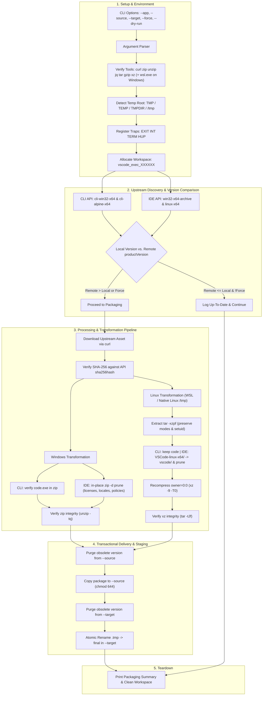

# Microsoft Visual Studio Code Packaging Utility (`vscode_package.sh`)

A cross-platform, automated release synchronization and packaging pipeline compatible with **Cygwin**, **MSYS2 / Git Bash**, **Windows Subsystem for Linux (WSL)**, and **Native Linux**. This utility continuously monitors Microsoft Visual Studio Code's stable update API, retrieves 64-bit Windows and Linux binary distributions with SHA-256 verification, strips packaging bloat (redundant licenses, non-English Chromium locales, and non-English Windows ADMX policy templates), recompresses Linux packages via WSL / native Linux ext4 to preserve POSIX permissions (including `chrome-sandbox` setuid `4755`) into high-ratio `.tar.xz` archives, and atomically synchronizes production software libraries.

---

## 1. Application Overview and Objectives

### 1.1 Executive Summary
The **Microsoft Visual Studio Code Packaging Utility** (`vscode_package.sh`) automates the release lifecycle for the two Visual Studio Code desktop/CLI distributions:
1. **VS Code CLI (`vscode_cli`)**: Standalone headless CLI / tunnel binary (`code` / `code.exe`), using Microsoft's statically linked musl Linux build (`cli-alpine-x64`) for broad Linux distribution compatibility.
2. **VS Code IDE (`vscode`)**: Full Visual Studio Code desktop application (`win32-x64-archive` and `linux-x64`).

Each component is packaged into two standardized multi-platform distributions:
- **Windows x64**: Standardized `.zip` archive (`-x64.zip`).
- **Linux x64**: High-compression `.tar.xz` tarball (compressed with `xz -9 -T0`, `-lnx.tar.xz`) with `root/root` (`0/0`) ownership and preserved executable/setuid permissions.

### 1.2 Core Packaging Objectives
- **Standardized Library Naming**: Unify Microsoft's upstream download filenames into consistent, predictable library filenames:
  - `vscode_cli-<version>-x64.zip` / `vscode_cli-<version>-lnx.tar.xz`
  - `vscode-<version>-x64.zip` / `vscode-<version>-lnx.tar.xz`
- **SHA-256 Verification**: Validates every downloaded asset against the `sha256hash` returned by Microsoft's official update API before any transformation or staging occurs.
- **Packaging Artifact De-Bloating**:
  - Prune root/commit-level `LICENSE`, `LICENSES.chromium.html`, `resources/app/LICENSE.rtf`, `resources/app/ThirdPartyNotices.txt`, and `resources/app/licenses/` (leaving extension and `node_modules` licenses untouched).
  - Prune unused Chromium internationalization packages from `locales/` down to `en-US.pak` only.
  - Prune non-English Windows ADMX policy directories under `policies/`, retaining `policies/VSCode.admx` and `policies/en-us/`.
  - On Windows (`vscode-<ver>-x64.zip`), prune entries in-place via `zip -q -d` to preserve original file attributes, timestamps, and CRC-32s.
- **Permission-Preserving Linux Transcoding**: Normalize the Linux IDE root folder from `VSCode-linux-x64/` to `vscode/` and recompress `.tar.gz` to `.tar.xz` (`xz -9 -T0`) inside a native Linux ext4 `/tmp` workspace (via `wsl.exe` when executed on Cygwin/MSYS2) so Linux symlinks and `chrome-sandbox` setuid (`-rwsr-xr-x`) permissions are preserved alongside `0/0` ownership.
- **Zero-Corruption Guarantee (Transactional Staging)**: All downloads, transformations, integrity checks (`unzip -tq`, `tar -tJf`), and repacking occur in an isolated temporary execution workspace. Files are moved to `--source` and staged to `--target` via atomic `.tmp` file renames.
- **Dual-Repository Synchronization**:
  1. **Primary Library (`--source`)**: Updates the persistent software library (e.g. `n:/softlib/software/public/devel/ide`) for both `vscode_cli` and `vscode`, purging obsolete builds upon new version discovery.
  2. **Staging Area (`--target`)**: Atomically deploys verified **VS Code IDE** packages (`vscode-<ver>-x64.zip` and `vscode-<ver>-lnx.tar.xz`) into the upload pending directory (e.g. `f:/stage/upload/pending`) via `.tmp` file renaming with `chmod 644`. (`vscode_cli` packages are maintained in `--source` only and are not staged to `--target`.)

---

## 2. Architecture and Data Flow

### 2.1 Architecture Diagram



---

## 3. Component Specifications & Transformation Rules

### 3.1 Component Matrix

| Component | Target Windows Package | Target Linux Package | Internal Windows Structure | Internal Linux Structure / Binary |
| :--- | :--- | :--- | :--- | :--- |
| **`vscode_cli`** | `vscode_cli-<ver>-x64.zip` | `vscode_cli-<ver>-lnx.tar.xz` | `code.exe` (flat) | `code` (musl static-pie, mode `775`, flat) |
| **`vscode`** | `vscode-<ver>-x64.zip` | `vscode-<ver>-lnx.tar.xz` | `Code.exe`, `<commit10>/`, `appx/`, `bin/`, `policies/en-us/`, `tools/` | `vscode/` (root folder, `chrome-sandbox` mode `4755`) |

*All Linux `.tar.xz` archives are recompressed inside a native Linux filesystem with `--owner=0 --group=0 --numeric-owner` to guarantee consistent `root/root` ownership while preserving POSIX executable and setuid bits.*

---

### 3.2 Upstream Discovery & Endpoints

Release metadata is queried from Microsoft's official Visual Studio Code stable update service:

`https://update.code.visualstudio.com/api/update/<target>/stable/latest`

- **Payload Schema**:
  ```json
  {
    "url": "https://vscode.download.prss.microsoft.com/dbazure/download/stable/<commit>/...",
    "name": "1.146.0",
    "version": "<commit>",
    "productVersion": "1.146.0",
    "sha256hash": "..."
  }
  ```

#### 1. `vscode_cli`
- **Windows Target**: `cli-win32-x64` (`vscode_cli_win32_x64_cli.zip`)
- **Linux Target**: `cli-alpine-x64` (`vscode_cli_alpine_x64_cli.tar.gz` — musl `static-pie` build)
- **Transformations**:
  - Windows: Verifies zip integrity and presence of `code.exe`, then stores as `vscode_cli-<ver>-x64.zip` in `--source` only (not staged to `--target`).
  - Linux: Extracts `code` inside WSL/Linux `/tmp` preserving permissions and recompresses with `xz -9 -T0` to `vscode_cli-<ver>-lnx.tar.xz` in `--source` only (not staged to `--target`).

#### 2. `vscode`
- **Windows Target**: `win32-x64-archive` (`VSCode-win32-x64-<ver>.zip`)
- **Linux Target**: `linux-x64` (`code-stable-x64-<timestamp>.tar.gz`)
- **Transformations**:
  - Windows: Prunes `<commit>/LICENSE`, `<commit>/LICENSES.chromium.html`, `<commit>/locales/*.pak` (except `en-US.pak`), `<commit>/resources/app/LICENSE.rtf`, `<commit>/resources/app/ThirdPartyNotices.txt`, `<commit>/resources/app/licenses/`, and non-English `policies/<lang>/` folders (retaining `policies/VSCode.admx` and `policies/en-us/`) in-place with `zip -q -d`.
  - Linux: Unpacks inside WSL/Linux `/tmp` (`tar -xzpf`), renames `VSCode-linux-x64/` $\rightarrow$ `vscode/`, removes root `LICENSE*`/`LICENSES*`, non-English `locales/*.pak` (except `en-US.pak`), `resources/app/LICENSE.rtf`, `resources/app/ThirdPartyNotices.txt`, and `resources/app/licenses/`, then recompresses with `xz -9 -T0` (`--owner=0 --group=0 --numeric-owner`).

---

## 4. Command Line Arguments

| Option Flag | Argument Type | Default Value | Description |
| :--- | :--- | :--- | :--- |
| `--app <name>`, `--name <name>` | String | `all` | Restricts execution to a single component: `cli`, `ide`, or `all`. |
| `--source <path>` | String (Path) | `n:/softlib/software/public/devel/ide` | Destination path for the organized persistent software library. |
| `--target <path>` | String (Path) | `f:/stage/upload/pending` | Upload staging pending directory where VS Code IDE packages are atomically staged. |
| `--force` | Boolean (Flag) | `false` | Forces download and repackaging even if the remote version equals the local version. |
| `--no-update-source` | Boolean (Flag) | `false` | Skips updating or deleting files in `--source` (only writes to `--target`). |
| `--dry-run` | Boolean (Flag) | `false` | Queries endpoints and simulates packaging without downloading or modifying files on disk. |
| `--log <file>` | String (Path) | *(None)* | Appends full execution output (stdout and stderr) to specified log file. |
| `--verbose` | Boolean (Flag) | `false` | Enables verbose diagnostic output (API version, SHA-256, and asset URLs). |
| `-h`, `--help` | Boolean (Flag) | `false` | Displays usage instructions and exits (`0`). |

---

## 5. Prerequisites and Dependencies

The utility relies on the shared foundation library [`client_package_common.sh`](file:///e:/data/devel/build/code/private/devops/client_tools/client_package_common.sh) for platform detection, path translation, archive manipulation, WSL permission-preserving recompression, dual-platform orchestration, and transactional staging. Standard POSIX tool requirements (`bash`, `curl`, `zip`, `unzip`, `tar`, `gzip`, `xz`) and platform compatibility matrices are documented in detail in [`client_package_common_README.md#6-prerequisites-and-platform-compatibility`](file:///e:/data/devel/build/code/private/devops/client_tools/client_package_common_README.md#6-prerequisites-and-platform-compatibility).

In addition to the foundation library requirements, `vscode_package.sh` requires:

| Tool | Purpose | Notes / Package Manager |
| :--- | :--- | :--- |
| **`jq`** | Upstream MS update API JSON parsing | `pacman -S jq` / `apt-get install jq` / Cygwin setup |
| **`wsl.exe`** *(Windows only)* | Linux archive extraction & `xz -9 -T0` repacking on ext4 `/tmp` to preserve POSIX permissions | Built-in Windows WSL (`tar` and `xz` installed inside default distro) |

Verify all tools are installed and present in `$PATH`:
```bash
which curl jq zip unzip tar gzip xz
```

---

## 6. Usage Examples and Output Samples

### Example 1: Dry-Run Assessment Across All Components
Simulates discovery across both components without writing files to disk:

```bash
$ ./vscode_package.sh --dry-run
```

**Output:**
```text
==============================================================================
 Microsoft Visual Studio Code Packaging Utility
==============================================================================
 Platform       : cygwin
 Channel        : stable
 Source Library : n:/softlib/software/public/devel/ide
 Target Pending : f:/stage/upload/pending
 Dry Run        : true
 Force Repack   : false
 Update Source  : true
 Temp Root Dir  : f:/TEMP
==============================================================================

==> Checking VS Code CLI (vscode_cli)...
[INFO] Remote latest version: 1.146.0
[INFO] Local Windows version: 1.145.1 (n:/softlib/software/public/devel/ide/vscode_cli-1.145.1-x64.zip)
[INFO] Local Linux version  : 1.145.1 (n:/softlib/software/public/devel/ide/vscode_cli-1.145.1-lnx.tar.xz)
[INFO] Processing Windows package: vscode_cli-1.146.0-x64.zip
[OK] [DRY-RUN] Would download: https://vscode.download.prss.microsoft.com/dbazure/download/stable/69047191fc427f2f92828279aae1d90d8eeda7ab/vscode_cli_win32_x64_cli.zip
[OK] [DRY-RUN] Would verify code.exe inside zip and store as vscode_cli-<ver>-x64.zip (--source only)
[OK] [DRY-RUN] Would remove obsolete source version: vscode_cli-1.145.1-x64.zip
[OK] [DRY-RUN] Would move vscode_cli-1.146.0-x64.zip to source: /cygdrive/n/softlib/software/public/devel/ide/vscode_cli-1.146.0-x64.zip
[INFO] Processing Linux package: vscode_cli-1.146.0-lnx.tar.xz
[OK] [DRY-RUN] Would download: https://vscode.download.prss.microsoft.com/dbazure/download/stable/69047191fc427f2f92828279aae1d90d8eeda7ab/vscode_cli_alpine_x64_cli.tar.gz
[OK] [DRY-RUN] Would transcode cli-alpine-x64 .tar.gz to .tar.xz via WSL/Linux preserving permissions (--source only)
[OK] [DRY-RUN] Would remove obsolete source version: vscode_cli-1.145.1-lnx.tar.xz
[OK] [DRY-RUN] Would move vscode_cli-1.146.0-lnx.tar.xz to source: /cygdrive/n/softlib/software/public/devel/ide/vscode_cli-1.146.0-lnx.tar.xz

==> Checking VS Code IDE (vscode)...
[INFO] Remote latest version: 1.146.0
[INFO] Local Windows version: 1.145.1 (n:/softlib/software/public/devel/ide/vscode-1.145.1-x64.zip)
[INFO] Local Linux version  : 1.145.1 (n:/softlib/software/public/devel/ide/vscode-1.145.1-lnx.tar.xz)
[INFO] Processing Windows package: vscode-1.146.0-x64.zip
[OK] [DRY-RUN] Would download: https://vscode.download.prss.microsoft.com/dbazure/download/stable/69047191fc427f2f92828279aae1d90d8eeda7ab/VSCode-win32-x64-1.146.0.zip
[OK] [DRY-RUN] Would prune root/app licenses, non-English locales/*.pak, and non-English policies/ in-place
[OK] [DRY-RUN] Would remove obsolete source version: vscode-1.145.1-x64.zip
[OK] [DRY-RUN] Would move vscode-1.146.0-x64.zip to source: /cygdrive/n/softlib/software/public/devel/ide/vscode-1.146.0-x64.zip
[OK] [DRY-RUN] Would stage vscode-1.146.0-x64.zip in target: /cygdrive/f/stage/upload/pending/vscode-1.146.0-x64.zip
[INFO] Processing Linux package: vscode-1.146.0-lnx.tar.xz
[OK] [DRY-RUN] Would download: https://vscode.download.prss.microsoft.com/dbazure/download/stable/69047191fc427f2f92828279aae1d90d8eeda7ab/code-stable-x64-1794340754.tar.gz
[OK] [DRY-RUN] Would rename VSCode-linux-x64/ -> vscode/, prune licenses and locales, and recompress via WSL/Linux (xz -9 -T0)
[OK] [DRY-RUN] Would remove obsolete source version: vscode-1.145.1-lnx.tar.xz
[OK] [DRY-RUN] Would move vscode-1.146.0-lnx.tar.xz to source: /cygdrive/n/softlib/software/public/devel/ide/vscode-1.146.0-lnx.tar.xz
[OK] [DRY-RUN] Would stage vscode-1.146.0-lnx.tar.xz in target: /cygdrive/f/stage/upload/pending/vscode-1.146.0-lnx.tar.xz

==============================================================================
 Packaging Summary
==============================================================================
 Total packages targeted: 4
 Updated & Packaged     : 4
 Up to date (Skipped)   : 0
 Errors / Warnings      : 0
==============================================================================
```

---

### Example 2: Component Filtering (`--app <cli|ide>`)
Process only the VS Code CLI:

```bash
$ ./vscode_package.sh --app cli
```

---

### Example 3: Forced Re-Packaging (`--force`)
Forces re-download, verification, pruning, and packaging even if local versions are current:

```bash
$ ./vscode_package.sh --app ide --force
```

---

### Example 4: Automated Scheduled Packaging via Cron or Windows Task Scheduler

**Using Cygwin Cron (`crontab -e`)**:
```cron
0 4 * * * /bin/bash /cygdrive/f/stage/upload/pending/vscode_package.sh --log /cygdrive/f/stage/upload/pending/vscode_package.log
```

**Using Windows Task Scheduler**:
- **Program/script**: `C:\tls\cygwin\bin\bash.exe`
- **Add arguments**: `--login -c "/cygdrive/e/data/devel/build/code/private/devops/client_tools/vscode_package.sh --log /cygdrive/f/stage/upload/pending/vscode_package.log"`
- **Start in**: `C:\tls\cygwin\bin`

