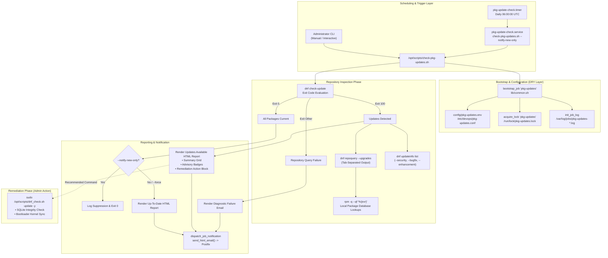
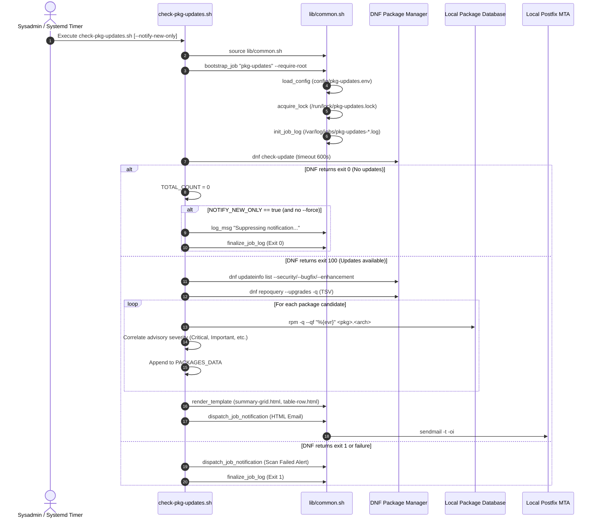

# `check-pkg-updates.sh` Documentation

Comprehensive operational and architecture guide for [`/opt/scripts/check-pkg-updates.sh`](../check-pkg-updates.sh).

---

## 1. Application Overview and Objectives

[`check-pkg-updates.sh`](../check-pkg-updates.sh) is an automated package lifecycle monitor, security advisory auditor, and notification engine for Enterprise Linux hosts (RHEL, AlmaLinux, Rocky Linux). It inspects upstream package repositories daily to detect pending operating system updates without mutating system state, correlates security errata (CVEs, severity levels, bugfixes), and generates rich HTML email alerts for systems administrators.

### Key Objectives
* **Non-Intrusive Repository Inspection:** Perform dry-run package checks via `dnf check-update` and `dnf repoquery --upgrades` without downloading or modifying installed packages.
* **Security Errata & Advisory Correlation:** Automatically cross-reference available package updates against `dnf updateinfo` to categorize updates into Critical, Important, Moderate, and Low security patches, bugfixes, and enhancements.
* **Controlled Human-in-the-Loop Advisory:** Assemble branded HTML email reports detailing update counts, current vs. candidate versions, target repositories, and severity badges with recommended remediation commands.
* **DRY Framework Integration:** Built upon [`/opt/scripts/lib/common.sh`](../lib/common.sh) and [`/opt/scripts/lib/system.sh`](../lib/system.sh), inheriting centralized logging, flock-based concurrency guards, configuration discovery, and Postfix MTA email delivery.
* **Execution Logging & Retention:** Maintain persistent, date-stamped execution logs in `/var/log/jobs/pkg-updates-<DATESTAMP>.log` with an automated 14-day retention pruning policy.
* **Native Systemd Scheduling:** Triggered daily at `06:00:00 UTC` via [`pkg-update-check.timer`](../../../etc/systemd/system/pkg-update-check.timer) with catch-up persistence and randomized jitter.

---

## 2. Architecture and Design Choices, Assumptions, Edge Cases, Performance

### Architecture and Design Choices
* **Strictly Advisory Operation:** Operates exclusively as a read-only detection and alerting system. Mutating transactions are delegated to [`/opt/scripts/dnf_check.sh`](../dnf_check.sh) to ensure SQLite database integrity and post-transaction bootloader kernel synchronization.
* **DRY Modular Architecture:** Follows the identical scaffolding and shared templates established by [`check-container-updates.sh`](../check-container-updates.sh).
* **Two-Stage Query Model:**
  1. `dnf check-update` fast exit-code verification (0 = no updates, 100 = updates available, 1 = fatal error).
  2. Tab-delimited `dnf repoquery --upgrades` parsing with `rpm -q --qf "%{evr}"` local database lookups for rock-solid version comparison without regex fragility.
* **Selective Alerting Policy:** Defaults to `--notify-new-only` in automated timer execution, remaining completely silent when all packages are current and delivering notifications only when action is required.

### Handled Edge Cases
* **DNF Exit Code 100:** Correctly handles standard DNF exit code 100 as "updates available" rather than a command failure.
* **Multi-Architecture and Obsoleted Packages:** Disambiguates packages sharing names across architectures (`.x86_64` vs. `.noarch`) using fully qualified package name lookups.
* **Network / Mirror Outages:** Traps non-0 and non-100 exit codes from DNF, logs standard error diagnostics, and generates a formatted diagnostic failure email to alert administrators of repository connectivity issues.
* **Missing Advisories:** Gracefully handles packages originating from repositories lacking errata metadata (e.g. EPEL or third-party repositories), classifying them as general package updates without breaking tabular reporting.

### Architecture Diagram



---

## 3. Data Flow and Control Logic

### Sequence Diagram



---

## 4. Failure Handling, Idempotency, and Concurrency

* **Concurrency Safety:** Non-blocking kernel file lock via `acquire_lock "pkg-updates"`. Overlapping timer or manual executions immediately terminate with status code 0.
* **LIFO Cleanup Traps:** Registers temporary scratch files with `register_cleanup`. When exiting or on receiving signals (`INT`, `TERM`, `HUP`), registered files in `/tmp/pkg-*.XXXXXX` are cleaned up.
* **Network & Mirror Failures:** DNF network timeouts and mirror unreachable errors are trapped by standard error redirection. If a scan fails, an alert email is sent with the full terminal diagnostic block.
* **Zero System Mutation:** The script never runs `install`, `upgrade`, or `clean` on packages. It is strictly read-only and idempotent.

---

## 5. Dependencies and Operating Environment

### Required CLI Executables
* `dnf` / `yum`: Core package manager.
* `rpm`: Local package query tool.
* `sed`, `awk`, `grep`: Output processing utilities.
* `mktemp`: Secure scratch file creation.
* `sendmail`: Local Postfix mail submission wrapper.

### System Configuration Requirements
* Root superuser privileges (`EUID == 0`).
* AlmaLinux, RHEL, or Rocky Linux 8/9/10.
* Standard configuration file at `/opt/scripts/config/pkg-updates.env`.
* Shared library at `/opt/scripts/lib/common.sh`.

---

## 6. File and Resource Inventory

| Path | Purpose | Permissions | Owner |
|---|---|---|---|
| [`/opt/scripts/check-pkg-updates.sh`](../check-pkg-updates.sh) | Main inspection executable | `0750` (`-rwxr-x---`) | `sysadmin:root` |
| [`/opt/scripts/config/pkg-updates.env`](../config/pkg-updates.env) | Runtime configuration | `0640` (`-rw-r-----`) | `sysadmin:root` |
| [`/opt/scripts/config/pkg-updates.env.example`](../config/pkg-updates.env.example) | Configuration template | `0640` (`-rw-r-----`) | `sysadmin:root` |
| [`/opt/scripts/templates/pkg-update/summary-grid.html`](../templates/pkg-update/summary-grid.html) | Summary card template | `0640` (`-rw-r-----`) | `sysadmin:root` |
| [`/opt/scripts/templates/pkg-update/table-row.html`](../templates/pkg-update/table-row.html) | Tabular package row | `0640` (`-rw-r-----`) | `sysadmin:root` |
| [`/opt/scripts/templates/pkg-update/instructions-pending.html`](../templates/pkg-update/instructions-pending.html) | Action guidance block | `0640` (`-rw-r-----`) | `sysadmin:root` |
| [`/opt/scripts/templates/pkg-update/instructions-uptodate.html`](../templates/pkg-update/instructions-uptodate.html) | Clean status block | `0640` (`-rw-r-----`) | `sysadmin:root` |
| [`/etc/systemd/system/pkg-update-check.service`](../../../etc/systemd/system/pkg-update-check.service) | Systemd oneshot unit | `0644` (`-rw-r--r--`) | `root:root` |
| [`/etc/systemd/system/pkg-update-check.timer`](../../../etc/systemd/system/pkg-update-check.timer) | Daily systemd timer | `0644` (`-rw-r--r--`) | `root:root` |
| `/var/log/jobs/pkg-updates-<DATESTAMP>.log` | Job execution logs | `0640` (`-rw-r-----`) | `sysadmin:root` |

---

## 7. Security Assessment

* **Superuser Enforcement:** Enforces UID 0 execution via `require_root`.
* **Zero Command Injection:** All parameters pass through strict Bash arrays and quoted expansions without `eval`.
* **Restrictive Umask:** Script executes under `umask 077` ensuring all generated scratch files and execution logs are private and secure.
* **HTML Sanitization:** Raw command output and error traces pass through `escape_html` before interpolation into email templates to prevent HTML injection.

---

## 8. Command Line Arguments

| Argument | Type | Default | Description |
|---|---|---|---|
| `--notify-new-only` | Flag | `false` (Config) | Suppresses email notification if all packages are up to date. (Default in systemd unit). |
| `--notify-all` | Flag | N/A | Overrides `--notify-new-only` to dispatch email reports regardless of update counts. |
| `--check-only`, `--dry-run` | Flag | `false` | Prints tabular results to standard output and exits without sending email. |
| `--security-only` | Flag | `false` | Filters inspection exclusively to packages with security advisories. |
| `--refresh` | Flag | `true` (Config) | Forces DNF to refresh repository metadata before inspection, preventing stale cache. |
| `--no-refresh` | Flag | N/A | Bypasses forced metadata refresh, inspecting against existing local cache. |
| `--simulate-updates`, `--mock-pending` | Flag | `false` | Injects mock pending updates (including security errata) to test the notification pipeline. |
| `--force`, `--test`, `--always-notify` | Flag | `false` | Forces email delivery and bypasses suppression filters. |
| `-h`, `--help` | Flag | N/A | Displays CLI usage syntax and options. |

---

## 9. Usage Examples

### 1. Interactive Terminal Check (Read-Only)
```bash
sudo /opt/scripts/check-pkg-updates.sh --check-only
```
**Sample Output:**
```text
[*] Starting package update inspection on server.example.com...
[*] Invocation options: --check-only
[*] Mode: Dry-Run Repository Inspection via 'dnf check-update'
[*] Scan complete: 0 updates available | 0 security | 0 bugfix | 0 enhancement | 0 general
====================================================================================================
PACKAGE NAME                   ARCH       CURRENT VERSION      AVAILABLE VERSION    ADVISORY    
====================================================================================================
====================================================================================================
Summary: 0 package updates available (0 security, 0 bugfix, 0 enhancement).
```

### 2. Manual Test Email Dispatch
```bash
# Force email delivery even when all packages are up to date:
sudo /opt/scripts/check-pkg-updates.sh --force

# Test delivery of a full advisory report with simulated pending security updates:
sudo /opt/scripts/check-pkg-updates.sh --notify-new-only --simulate-updates
```

### 3. Inspect Update Errata & Details
```bash
# Query detailed CVEs, severities, and descriptions for pending updates:
sudo /opt/scripts/dnf_check.sh --show-update-details
```

### 4. Check Systemd Timer and Service Status
```bash
# Check timer schedule:
systemctl list-timers pkg-update-check.timer

# View service journal:
sudo journalctl -u pkg-update-check.service --no-pager -n 25

# Trigger manual service run via systemd:
sudo systemctl start pkg-update-check.service
```

