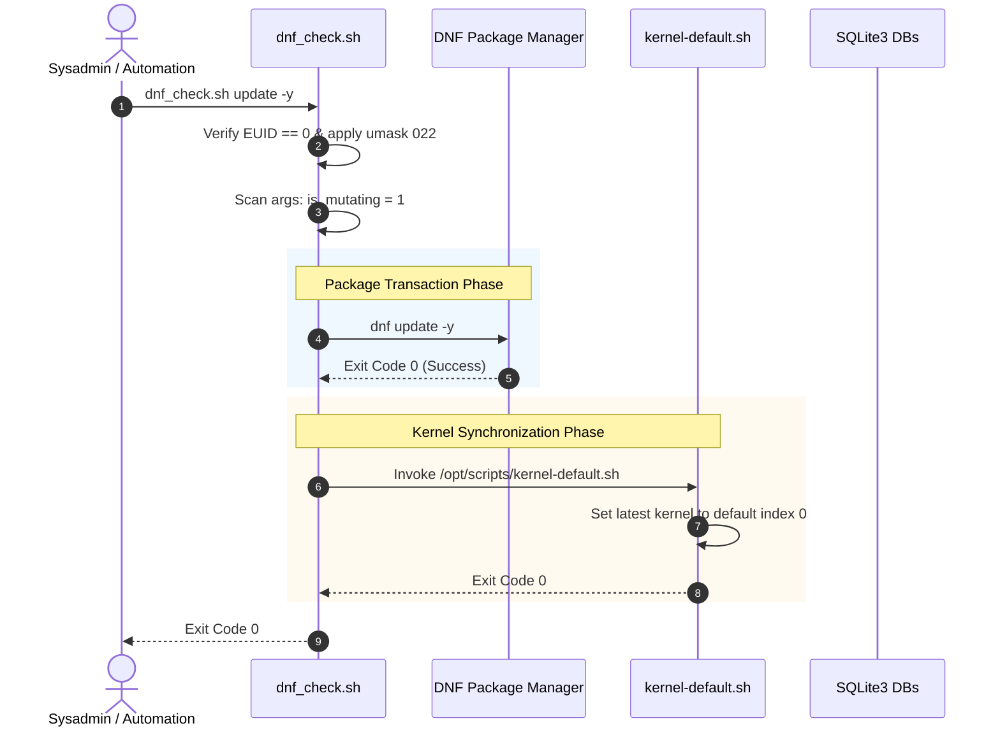
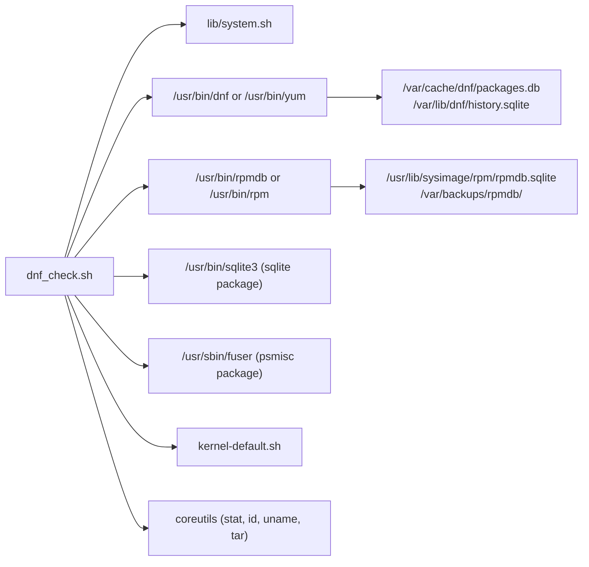
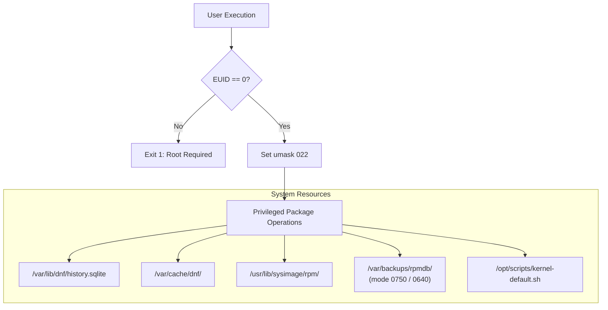

# `dnf_check.sh` Documentation

Comprehensive operational and architecture guide for [`/opt/scripts/dnf_check.sh`](../dnf_check.sh).

---

## 1. Application Overview and Objectives

[`dnf_check.sh`](../dnf_check.sh) is a system maintenance wrapper around the Enterprise Linux package manager (`dnf` / `yum`). It bridges routine package management tasks with automated bootloader kernel synchronization, database integrity validation, storage capacity safeguards, and service restart auditing.

### Key Objectives
* **Package Management Gateway:** Execute arbitrary DNF subcommands transparently, preserving options and exit statuses.
* **RPM Database Auditing & Safe Recovery:** Inspect RPM database health, SQLite engine integrity, active transaction locks, and queryable package inventory via `--verify-rpmdb`; and safely rebuild corrupted RPM databases via `--rebuild-rpmdb` with process concurrency checks, automated pre-rebuild safety backup snapshots in `/var/backups/rpmdb/`, stale lock cleanup, and post-rebuild inventory validation.
* **Database Integrity Auditing & Vacuuming:** Inspect the structural integrity of DNF's core SQLite databases (`packages.db` and `history.sqlite`), checkpoint active WAL journals, and vacuum databases to recover fragmented disk space.
* **Pre-Flight Storage Safeguards:** Proactively inspect `/boot` filesystem capacity (>= 100 MB free recommended) prior to mutating package transactions, preventing `dracut` initramfs generation failures.
* **Safe Cache Purging:** Execute clean, native cache invalidation via `dnf clean all` instead of risky direct filesystem deletions.
* **Automated Bootloader Synchronization:** Detect mutating package transactions (`update`, `install`, `upgrade`, etc.) and automatically trigger [`kernel-default.sh`](../kernel-default.sh) to ensure the bootloader default points to the newest valid kernel.
* **Execution Safety:** Never modify the bootloader on read-only queries (e.g. `check-update`, `search`, `info`, `list`) or failed package operations.
* **Service Restart & Core Library Auditing:** Integrate `dnf needs-restarting` checks to audit whether running services or core libraries require post-transaction reboots or restarts.

---

## 2. Architecture and Design Choices, Assumptions, Edge Cases, Performance and Efficiency

### Architecture and Design Choices
* **Dynamic Package Manager Binding:** Discovers `dnf` or `yum` at runtime, ensuring complete portability across EL8, EL9, and EL10 installations.
* **Transparent Pass-Through:** Preserves exact quoting, parameter boundaries, and subshell environments using `"$@"`.
* **Zero Overhead on Read Queries:** Skips bootloader synchronization when executing read-only commands.
* **Independent Operation:** Sibling scripts are dynamically resolved relative to `${SCRIPT_DIR}` with fallbacks to `/opt/scripts/`.

### Assumptions
* Target system is an RPM-based distribution running Enterprise Linux 8, 9, or 10.
* Package management commands require superuser privileges (`EUID == 0`).
* SQLite3 command-line client (`/usr/bin/sqlite3`) is available if `--sqlite-check`, `--sqlite-vacuum`, or `--verify-rpmdb` is invoked.

### Handled Edge Cases
* **Options Preceding Subcommands:** Flags with arguments (e.g. `--enablerepo crb install`) are correctly scanned across all arguments so mutating commands are never missed.
* **RPM Database Corruption and Stale Locks:** Concurrency checks detect whether active package managers (`dnf`, `dnf5`, `rpm`, `yum`) are running. If none are active, stale `.rpm.lock` files are safely pruned, a timestamped compressed backup snapshot is archived in `/var/backups/rpmdb/` (retaining the 5 most recent snapshots), and native `rpmdb --rebuilddb` is executed with post-rebuild integrity and inventory validation.
* **Multi-Flag Maintenance Chaining:** Supports executing multiple maintenance flags sequentially in a single invocation (e.g. `--verify-rpmdb --sqlite-check`). If any maintenance task encounters an error, the execution pipeline halts immediately with the failure exit code, preventing subsequent operations on an unhealthy state.
* **WSL Platform Awareness:** Detects execution under Windows Subsystem for Linux (WSL) and cleanly bypasses bootloader kernel synchronization post-transaction, since the host Windows hypervisor manages the kernel.
* **Uninitialized SQLite Databases:** If `/var/cache/dnf/packages.db` does not exist (e.g. after a clean wipe), the script warns and continues without throwing false-positive errors.
* **Active WAL Journaling & Truncation:** Checkpoints active WAL journals into SQLite databases and safely truncates `-wal` files without modifying SQLite journal modes.
* **Exit Code Integrity (`set -e`):** Safely captures non-zero DNF exit codes (such as exit code 100 for `check-update` when updates are available) without crashing under Bash strict mode.
* **Low `/boot` Partition Capacity:** Detects low disk space in `/boot` prior to mutating transactions and halts execution with remediation guidance unless `--force` is passed.

### Architecture Diagram

```mermaid
graph TD
    Caller["Administrator / Automated Task"] -->|"Arguments ($@)"| Script["/opt/scripts/dnf_check.sh"]

    subgraph "Initialization & Privilege Guard"
        Script --> HelpCheck{"Is -h or --help?"}
        HelpCheck -->|Yes| ShowHelp["Display Usage & Exit 0"]
        HelpCheck -->|No| RequireRoot["require_root (EUID == 0)"]
        RequireRoot --> DetectPkgMgr["Detect PKG_MGR (dnf / yum)"]
        DetectPkgMgr --> EnforceUmask["umask 022"]
    end

    subgraph "Internal Maintenance Handlers"
        EnforceUmask --> ActionSwitch{"Maintenance Flag?"}
        ActionSwitch -->|"--verify-rpmdb"| VerifyRpm["verify_rpmdb<br/>(Locks + SQLite + rpmdb verify)"]
        ActionSwitch -->|"--rebuild-rpmdb"| RebuildRpm["rebuild_rpmdb<br/>(Snapshot + rebuild + verify)"]
        ActionSwitch -->|"--sqlite-check"| SqliteCheck["sqliteWalCheck<br/>(PRAGMA integrity_check)"]
        ActionSwitch -->|"--sqlite-vacuum"| SqliteVac["sqliteWalVacuum<br/>(wal_checkpoint + vacuum)"]
        ActionSwitch -->|"--purge-cache"| CleanCache["${PKG_MGR} clean all"]
        ActionSwitch -->|"--show-update-details"| Details["${PKG_MGR} updateinfo info --updates"]
        ActionSwitch -->|"--needs-restarting"| NeedsRestart["inspect_needs_restarting<br/>(needs-restarting -r / -s)"]
    end

    subgraph "Pre-Flight & Execution"
        ActionSwitch -->|"DNF Command"| CheckMutate{"Mutating Subcommand?"}
        CheckMutate -->|Yes| BootGuard{"/boot Space >= 100MB?"}
        BootGuard -->|No (no --force)| AbortLow["Abort: Low /boot storage"]
        BootGuard -->|Yes / --force| ExecDNF["Execute: ${PKG_MGR} $@"]
        CheckMutate -->|No| ExecDNF
    end

    subgraph "Post-Transaction Logic"
        ExecDNF --> CheckStatus{"Status == 0?"}
        CheckStatus -->|No| ExitFail["Exit with DNF_STATUS"]
        CheckStatus -->|Yes| MutatePost{"Was Mutating?"}
        MutatePost -->|No (search, list)| ExitSuccess["Exit 0"]
        MutatePost -->|Yes (update, install)| TriggerKernel["Invoke kernel-default.sh"]
        TriggerKernel --> PostAudit["verify_kernel_upgrade<br/>(Kernel diff + core library checks)"]
        PostAudit --> ExitSuccess
    end
```

---

## 3. Data Flow and Control Logic

### Sequence Diagram



---

## 4. Performance and Scalability

### Concurrency Model
* **DNF Transaction Lock:** DNF internally handles global transaction locking (`/var/run/dnf.pid`). If another package manager instance is active, DNF queues or fails predictably without wrapper interference.
* **Transient Memory Footprint:** Executes in standard Bash context (< 12 MB overhead).
* **Non-Blocking SQLite Checks:** `PRAGMA integrity_check` is executed with shared read locks, allowing concurrent SQLite reads without table locking.
* **Pre-Rebuild Safety Snapshots:** Snapshotting `/usr/lib/sysimage/rpm` takes < 1 second using standard `tar -czf` and produces a compact archive (~18–27 MB), ensuring fast, non-blocking recovery points with minimal disk footprint.

---

## 5. Dependencies

### Component Chart



### Dependency Inventory
| Dependency | Type | Source Package | Minimum Version | Purpose |
| :--- | :--- | :--- | :--- | :--- |
| `bash` | Shell Runtime | `bash` | 4.4+ (EL8+) | Script interpreter |
| `dnf` / `yum` | Package Manager | `dnf` | 4.0+ | Package installations, updates, and repo queries |
| `rpmdb` / `rpm` | Package Engine | `rpm` | 4.14+ | Low-level RPM database verification and rebuild operations (`--verifydb`, `--rebuilddb`) |
| `fuser` | Lock Inspector | `psmisc` | 23.0+ | Process lock inspection for `/usr/lib/sysimage/rpm/.rpm.lock` |
| `tar` | Archive Utility | `tar` | 1.30+ | Compressed pre-rebuild safety snapshots in `/var/backups/rpmdb/` |
| `sqlite3` | SQLite Utility | `sqlite` | 3.26+ | Database integrity validation in `sqliteWalCheck` and `verify_rpmdb` |
| `kernel-default.sh` | Sibling Script | Repository Internal | 1.1.0+ | Post-transaction default boot kernel synchronization |
| `lib/system.sh` | Shared Library | Repository Internal | 1.4.0+ | Foundation library (`require_root`, `sqlite_integrity_check`, `log_audit`) |

---

## 6. Security Architecture



---

## 7. Security Assessment

* **Privileged Execution Context:** Requires `root` permissions for package manager commands and database operations. Non-root users can only run `-h` / `--help`.
* **Zero Shell Injection Surface:** Avoids `eval` and unquoted variable expansions (`$*`). All arguments pass directly through `"$@"`.
* **Umask Enforcement:** Explicitly declares `umask 022` to ensure packages and logs are created with standard system permissions rather than inheriting restrictive parent environments.
* **Non-Destructive Database Audits:** SQLite integrity checks run read-only PRAGMAs without altering journal modes or writing data.
* **Pre-Rebuild Snapshot Isolation:** Safety snapshots are created in `/var/backups/rpmdb/` with restricted directory permissions (`0750 csysadm:root`) and file permissions (`0640 csysadm:root`), ensuring sensitive package installation metadata is not accessible to unprivileged system users.
* **Process Concurrency Isolation:** Before rebuilding, the script scans active processes (`dnf`, `dnf5`, `rpm`, `yum`) and `.rpm.lock` ownership to eliminate race conditions or database corruption caused by concurrent writes.

---

## 8. Code Quality Assessment, Review, and Best Practices

* **Bash Strict Mode:** Runs under `set -euo pipefail`.
* **Clean Exit Code Propagation:** Never masks non-zero exit codes from DNF; failures are immediately bubbled up to callers and CI/CD pipelines.
* **Backward Compatibility:** Provides function aliases (`sqlite_wal_check`, `sqliteWalClean`) and flag aliases (`--sqlite-close`) for seamless legacy script support.
* **Modular Path Discovery:** Sibling scripts are dynamically resolved via `${SCRIPT_DIR}` to allow deployment in non-standard directories.

---

## 9. Command Line Arguments

| Argument | Type | Default | Description |
| :--- | :--- | :--- | :--- |
| `--verify-rpmdb`, `--rpmdb-verify` | Flag | N/A | Inspects RPM database structural integrity, active transaction locks, underlying SQLite engine health, and queryable package counts. |
| `--rebuild-rpmdb`, `--rpmdb-rebuild` | Flag | N/A | Safely rebuilds the RPM database with active process concurrency checks, automated pre-rebuild safety archive in `/var/backups/rpmdb/`, stale lock cleanup, and post-rebuild verification. |
| `--sqlite-check` | Flag | N/A | Validates the integrity of DNF's SQLite databases (`packages.db`, `history.sqlite`). |
| `--sqlite-vacuum` | Flag | N/A | Checkpoints active WAL journals and vacuums SQLite databases to reclaim disk space. |
| `--sqlite-close` | Flag | N/A | Legacy compatibility alias for `--sqlite-check`. |
| `--purge-cache` | Flag | N/A | Safely cleans all DNF metadata and package caches via native `dnf clean all`. |
| `--show-update-details`, `--update-details` | Flag | N/A | Queries detailed CVEs, severities, and errata descriptions for pending updates via `dnf updateinfo info --updates`. |
| `--needs-restarting` | Flag | N/A | Audits whether core system libraries or active services require a reboot or restart. |
| `--relax` | Flag | N/A | Permits non-best packages and skips broken dependencies (`--skip-broken --nobest`). |
| `--auto-reboot` | Flag | N/A | Automatically reboots the host if a new kernel is installed or upgraded during a mutating transaction. |
| `--force` | Flag | N/A | Bypasses pre-flight guards (e.g. low `/boot` partition capacity warnings). |
| `-h`, `--help` | Flag | N/A | Displays CLI usage documentation and exits `0`. |
| `[DNF_COMMAND...]` | Pass-through | N/A | Standard DNF arguments (e.g. `update`, `install nginx`, `clean all`, `search`). |

*Note: Maintenance flags can be chained together in a single command (e.g. `--verify-rpmdb --sqlite-check`). They execute sequentially in precedence order: RPM verification, RPM rebuild, SQLite check, SQLite vacuum, cache purge, update details, and restart audit. If any maintenance step fails, the script halts immediately with that step's exit code. When combined with DNF subcommands (e.g. `--purge-cache update -y`), maintenance tasks execute prior to the package transaction.*

---

## 10. Detailed Examples on How to Use and Deploy

### Manual Usage Examples

#### 1. Perform Package Update with Automated Kernel Sync
```bash
sudo /opt/scripts/dnf_check.sh update -y
```
**Sample Output:**
```text
Last metadata expiration check: 0:15:32 ago on Fri 02 Oct 2026 07:30:12 PM UTC.
Dependencies resolved.
Nothing to do.
Complete!
[*] Synchronizing default boot kernel post-transaction...
[*] Assigning index '0' to default kernel...
Available GRUB Kernel Entries:
index=0
kernel="/boot/vmlinuz-6.12.0-211.56.1.el10_2.x86_64"
title="AlmaLinux (6.12.0-211.56.1.el10_2.x86_64) 10.2 (Lavender Lion)"
index=1
kernel="/boot/vmlinuz-6.12.0-211.38.1.el10_2.x86_64"
title="AlmaLinux (6.12.0-211.38.1.el10_2.x86_64) 10.2 (Lavender Lion)"

Storage: /boot (193M free / 62% used)

The default is /boot/loader/entries/69f855f0bfb64c198867787acd8e4753-6.12.0-211.56.1.el10_2.x86_64.conf with index 0 and kernel /boot/vmlinuz-6.12.0-211.56.1.el10_2.x86_64
Current Default Boot Kernel:
  Title  : AlmaLinux (6.12.0-211.56.1.el10_2.x86_64) 10.2 (Lavender Lion)
  Kernel : /boot/vmlinuz-6.12.0-211.56.1.el10_2.x86_64
  Index  : 0
  Storage: /boot (193M free / 62% used)
```

#### 2. Inspect and Verify RPM Database Health
```bash
sudo /opt/scripts/dnf_check.sh --verify-rpmdb
```
**Sample Output:**
```text
==============================================================================
[*] RPM Database Integrity & Lock Inspection
==============================================================================
[*] RPM Database Path: /var/lib/rpm -> /usr/lib/sysimage/rpm
[*] Inspecting transaction lock: [/usr/lib/sysimage/rpm/.rpm.lock]...
[+] Transaction lock is idle (no active locks held).
[*] Inspecting SQLite engine integrity...
    Checking integrity of [/usr/lib/sysimage/rpm/rpmdb.sqlite]... OK
[*] Running native RPM verification... OK
[+] Package inventory query succeeded: 651 packages installed.
==============================================================================
[+] RPM database status: HEALTHY
```

#### 3. Safely Rebuild Corrupted RPM Database
```bash
sudo /opt/scripts/dnf_check.sh --rebuild-rpmdb
```
**Sample Output:**
```text
==============================================================================
[*] RPM Database Rebuild & Recovery
==============================================================================
[*] Pre-rebuild package count: 651
[*] Creating pre-rebuild safety backup archive: [/var/backups/rpmdb/rpmdb-pre-rebuild-20261106_013427.tar.gz]...
[+] Pre-rebuild safety snapshot created (18702165 bytes).
[*] Executing native RPM database rebuild...
[+] Database rebuild command executed successfully.
[*] Performing post-rebuild verification...
[+] Native RPM verification passed.
    Checking integrity of [/usr/lib/sysimage/rpm/rpmdb.sqlite]... OK
[*] Post-rebuild package count: 651
[+] Package count verified intact (651 packages).
==============================================================================
[+] RPM database rebuild completed successfully.
    Safety backup stored at: /var/backups/rpmdb/rpmdb-pre-rebuild-20261106_013427.tar.gz
==============================================================================
```

#### 4. Restore RPM Database from Pre-Rebuild Safety Snapshot
If a catastrophic crash or hardware power loss interrupts a rebuild, restore the database from the pre-rebuild snapshot archive:
```bash
# Locate the safety archive in /var/backups/rpmdb/
ls -lh /var/backups/rpmdb/

# Extract the archive into the parent directory (/usr/lib/sysimage)
sudo tar -xzf /var/backups/rpmdb/rpmdb-pre-rebuild-20261106_013427.tar.gz -C /usr/lib/sysimage

# Verify database integrity post-restoration
sudo /opt/scripts/dnf_check.sh --verify-rpmdb
```

#### 5. Verify DNF SQLite Database Integrity
```bash
sudo /opt/scripts/dnf_check.sh --sqlite-check
```
**Sample Output:**
```text
[*] Checking integrity of DNF SQLite databases...
    Checking integrity of [/var/cache/dnf/packages.db]... OK
    Checking integrity of [/var/lib/dnf/history.sqlite]... OK
[+] All DNF SQLite database integrity checks passed.
```

#### 6. Optimize and Vacuum DNF SQLite Databases
```bash
sudo /opt/scripts/dnf_check.sh --sqlite-vacuum
```
**Sample Output:**
```text
[*] Checkpointing and vacuuming DNF SQLite databases...
    Optimizing / vacuuming [/var/cache/dnf/packages.db]... OK
    Optimizing / vacuuming [/var/lib/dnf/history.sqlite]... OK
[+] All DNF SQLite databases vacuumed and checkpointed successfully.
```

#### 7. Audit Core Libraries and Services Needing Restart
```bash
sudo /opt/scripts/dnf_check.sh --needs-restarting
```
**Sample Output:**
```text
==============================================================================
[*] System Reboot & Service Restart Audit
==============================================================================
[*] Checking if core libraries or system reboot are required...
[+] Core libraries are current. No full system reboot is required.

[*] Checking active services that require restarting...
[+] No active systemd services require restarting.
==============================================================================
```

#### 8. Native DNF Cache Purge
```bash
sudo /opt/scripts/dnf_check.sh --purge-cache
```
**Sample Output:**
```text
[*] Purging DNF cache via native package manager (dnf)...
49 files removed
```

#### 9. Display Detailed Errata and Security Advisory Info
```bash
sudo /opt/scripts/dnf_check.sh --show-update-details
```
**Sample Output:**
```text
[*] Querying detailed advisory and errata update information via /bin/dnf...
===============================================================================
  Important: kernel security update
===============================================================================
  Update ID: ALSA-2026:95367
       Type: security
       CVEs: CVE-2026-64378, CVE-2026-72080, ...
   Severity: Important
```

#### 10. Read-Only Query (No Bootloader Interaction)
```bash
sudo /opt/scripts/dnf_check.sh repoquery --latest-limit=1 -q kernel-core
```
**Sample Output:**
```text
kernel-core-0:6.12.0-211.56.1.el10_2.x86_64
```
*(Notice that `kernel-default.sh` is not invoked.)*

#### 11. Relaxed Dependency Update (`--relax`)
```bash
sudo /opt/scripts/dnf_check.sh --relax update -y
```
**Behavior:**
Appends `--skip-broken --nobest` to DNF arguments, allowing transactions to proceed when upstream packages have non-critical dependency conflicts or non-best architecture candidates.

#### 12. Automated Reboot on Kernel Upgrades (`--auto-reboot`)
```bash
sudo /opt/scripts/dnf_check.sh --auto-reboot update -y
```
**Behavior:**
Executes the package update, synchronizes bootloader default kernel entries via `kernel-default.sh`, and if a new kernel version is deployed, logs an audit entry and automatically initiates a system reboot after a 5-second countdown.

#### 13. Multi-Option Maintenance Chaining
```bash
sudo /opt/scripts/dnf_check.sh --verify-rpmdb --sqlite-check
```
**Sample Output:**
```text
==============================================================================
[*] RPM Database Integrity & Lock Inspection
==============================================================================
[*] RPM Database Path: /var/lib/rpm -> /usr/lib/sysimage/rpm
[*] Inspecting transaction lock: [/usr/lib/sysimage/rpm/.rpm.lock]...
[+] Transaction lock is idle (no active locks held).
[*] Inspecting SQLite engine integrity...
    Checking integrity of [/usr/lib/sysimage/rpm/rpmdb.sqlite]... OK
[*] Running native RPM verification... OK
[+] Package inventory query succeeded: 651 packages installed.
==============================================================================
[+] RPM database status: HEALTHY
[*] Checking integrity of DNF SQLite databases...
    Checking integrity of [/var/cache/dnf/packages.db]... OK
    Checking integrity of [/var/lib/dnf/history.sqlite]... OK
[+] All DNF SQLite database integrity checks passed.
```

---

### Automated Deployment

Integrate `dnf_check.sh` into administrative aliases or automated cron jobs:

1. **System-wide Administrative Alias:** Add to `/etc/profile.d/dnf_check.sh`:
   ```bash
   alias dnf-safe='/opt/scripts/dnf_check.sh'
   ```

2. **Automated Weekly Maintenance Cron:** `/etc/cron.weekly/system-updates`
   ```bash
   #!/bin/bash
   /opt/scripts/dnf_check.sh --sqlite-check
   /opt/scripts/dnf_check.sh -y --refresh update
   ```
