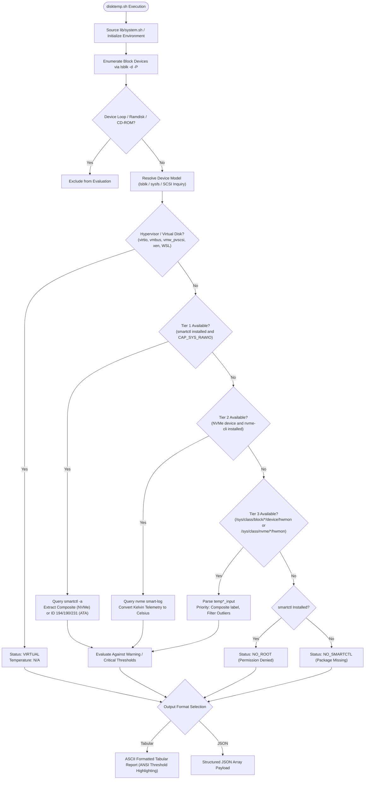

# Storage Device Temperature Audit Utility (`disktemp.sh`)

`disktemp.sh` is an enterprise-grade hardware inspection utility that enumerates physical and virtual block storage devices across Linux operating systems, evaluates thermal telemetry against configurable operational thresholds, and exports structured metrics in human-readable tabular and machine-parseable JSON formats.

Supported Operating Systems:
- Enterprise Linux 7, 8, and 9 (RHEL, AlmaLinux, Rocky Linux, CentOS, Fedora)
- Debian Family (Debian 10, 11, and 12, Ubuntu LTS 18.04 through 24.04, Linux Mint)
- Proxmox Virtual Environment (PVE 6.x, 7.x, and 8.x)

---

## 1. Architectural Scope and Design Objectives

In heterogeneous enterprise environments, accurate hardware temperature monitoring across diverse storage topologies (PCIe NVMe, SATA, SAS, and USB bridge enclosures) is frequently hindered by fragmented query interfaces, varying permission models, and inconsistencies in storage controller firmware.

`disktemp.sh` addresses these challenges through the following architectural principles:

1. **Deterministic Multi-Tier Data Acquisition**: Implements a prioritized query sequence (`smartctl` -> `nvme-cli` -> kernel `sysfs` hwmon) that automatically selects the most accurate available interface for each device type.
2. **Firmware Anomaly Mitigation**: Resolves standardized NVMe Composite Temperature metrics while discarding uncalibrated or floating junction sensor artifacts (such as persistent 96 C readings on Silicon Motion SM2263 and Phison controller implementations).
3. **Hypervisor Disambiguation**: Programmatically identifies hypervisor virtual disks (KVM virtio, VMware PVSCSI, Hyper-V vmbus, QEMU, VirtualBox, WSL) and assigns a dedicated `VIRTUAL` status without raising false operational alerts or executing unsupported ioctl calls.
4. **Zero-Dependency Fallback Execution**: Can execute without `smartmontools` or `nvme-cli` by querying the Linux kernel hardware monitoring subsystem (`/sys/class/hwmon`), ensuring base telemetry collection even on minimal container and hypervisor host images.
5. **Observability Integration**: Provides native JSON output formatted for direct pipeline ingestion into Prometheus `node_exporter`, Zabbix, and Telegraf monitoring agents.
6. **Console Compatibility**: Enforces strict 7-bit ASCII temperature formatting (`36 C`) to prevent byte corruption and rendering anomalies (`°C`) across legacy serial consoles, IPMI serial-over-LAN (SOL) sessions, and non-UTF-8 terminal configurations.

---

## 2. Technical Architecture and Data Ingestion Hierarchy



### 2.1 Device Enumeration and Filtering
The script enumerates block storage by querying the kernel block subsystem via `lsblk -d -P -o NAME,TYPE,TRAN,MODEL,VENDOR,SUBSYSTEMS`. Partitions, loop devices (`/dev/loop*`), RAM disks (`/dev/ram*`), and optical drives (`rom`) are automatically filtered out during initialization.

### 2.2 Storage Bus Classification
Devices are classified into specific transport topologies based on transport attribute (`TRAN`), device path, and subsystem metadata:
- `nvme`: Non-Volatile Memory Express devices (`/dev/nvme*n*`).
- `sata`: Serial ATA storage devices connected to AHCI or SATA controllers.
- `sas`: Serial Attached SCSI storage devices attached to SAS HBAs or RAID controllers in HBA/IT pass-through mode.
- `usb`: Mass storage devices attached via USB-to-SATA or USB-to-NVMe bridge controllers (e.g., ASMedia, Realtek, JMicron).
- `virtual`: Emulated and paravirtualized block storage devices.

### 2.3 Virtualization Detection Heuristics
Before executing hardware-level SMART queries, block devices are evaluated against hypervisor signatures to prevent kernel ioctl timeouts, spurious input/output errors, and redundant processing:
- Subsystem identifiers: `virtio`, `xen`, `vmbus`.
- Driver modules: `virtio_blk`, `hv_storvsc`, `vmw_pvscsi`, `xen-blkfront`.
- Hypervisor vendor strings: `QEMU`, `VBOX`, `VMware`, `Microsoft`.
- Container and WSL environment detection: Identifies `/dev/sd*` allocations managed by WSL2 virtual disk backend.

Devices matching these criteria are tagged as `VIRTUAL` with an assigned temperature of `null` (`N/A` in tabular reports).

### 2.4 Tiered Thermal Telemetry Acquisition

#### Tier 1: Authoritative Controller Telemetry (`smartctl`)
When `smartctl` (from `smartmontools`) is present and execution privileges permit raw block device access:
- **NVMe Devices**: Interrogates the device controller via the NVMe Admin Command Set. The parser specifically targets the standardized `Composite Temperature` attribute via regular expression pattern `^[[:space:]]*Temperature:[[:space:]]*[0-9]+`. This explicitly bypasses vendor-specific sub-sensors (`Temperature Sensor 1`, `Temperature Sensor 2`), preventing false critical threshold alarms caused by uncalibrated junction sensors (e.g., Crucial P1, Intel 660p).
- **ATA / SATA Devices**: Evaluates vendor SMART attribute tables in order of standardization precedence:
  1. Attribute ID `194`: `Temperature_Celsius`
  2. Attribute ID `190`: `Airflow_Temperature_Cel`
  3. Attribute ID `231`: `Temperature_Celsius` (SSD life remaining / temperature composite)
- **SCSI / SAS Devices**: Parses `Current Drive Temperature` from the SCSI Environmental Reporting log page.

#### Tier 2: NVMe Subsystem Management Interface (`nvme-cli`)
If `smartctl` is unavailable or fails on an NVMe device, the utility queries the controller using the native NVMe character device (`/dev/nvmeX`):
```bash
nvme smart-log /dev/nvmeX
```
The composite temperature is parsed from the binary SMART log page, converted from Kelvin to Celsius, and assigned to the corresponding block device namespace (`/dev/nvmeXnY`).

#### Tier 3: Kernel Hardware Monitoring Subsystem (`sysfs / hwmon`)
If neither userspace SMART utility is present, or if the script is executed by an unprivileged user without `CAP_SYS_RAWIO`:
- The engine searches `/sys/class/block/<dev>/device/hwmon/hwmon*` and `/sys/class/nvme/<dev>/hwmon/hwmon*`.
- Reads `temp*_input` integer millidegrees Celsius values and converts them to Celsius integers ($T = \lfloor V / 1000 \rfloor$).
- Evaluates `temp*_label` metadata, prioritizing sensors identified as `Composite` or `temp1`.
- Applies an outlier filter ($T \ge 90\text{ C}$ with secondary sensors present) to prevent floating hardware pins from skewing overall reporting.

#### Diagnostic Failure States
If hardware sensors cannot be interrogated, the engine classifies the root cause:
- `NO_ROOT`: Physical device detected, `smartctl` installed, but operation failed due to insufficient ioctl privileges (`EPERM`).
- `NO_SMARTCTL`: Physical device detected, but `smartmontools` is not installed and no `hwmon` node is exported by the driver.

### 2.5 Model Identification and Sanitization
Drive model strings are retrieved through a cascading inquiry:
1. `lsblk` model attribute.
2. `/sys/block/<dev>/device/model`.
3. SCSI inquiry vendor/model concatenation (`/sys/block/<dev>/device/vendor` + `/sys/block/<dev>/device/model`).

Non-printable characters, redundant whitespace, and underscores are normalized. If a storage enclosure or bridge controller returns an empty string or lacks alphabetic characters, the utility assigns the standardized fallback `Generic Disk`.

---

## 3. Security, Privilege Architecture, and System Requirements

### 3.1 Privilege Separation
The utility operates under two distinct security profiles:

| Profile | Execution Context | Query Capabilities | Limitations |
| :--- | :--- | :--- | :--- |
| **Privileged** | `root` or `sudo` (`CAP_SYS_RAWIO`, `CAP_SYS_ADMIN`) | Direct ATA/SCSI pass-through ioctl via `smartctl`, NVMe admin commands via `nvme-cli`, kernel `sysfs`. | None. Complete hardware interrogation. |
| **Unprivileged** | Standard user account | Kernel `sysfs` hwmon (`/sys/class/hwmon`), virtual disk classification, `lsblk` topology. | Physical disks lacking world-readable `sysfs` hwmon nodes report `NO_ROOT`. |

### 3.2 System Dependencies
The core script is written in POSIX-compliant Bash (tested on Bash 4.2 through 5.2).

- **Mandatory Utilities (standard system coreutils)**:
  `bash`, `lsblk`, `awk`, `sed`, `grep`, `tr`, `printf`, `cat`, `cut`.
- **Recommended Hardware Packages**:
  - `smartmontools` (`smartctl`): Primary hardware query engine for enterprise SATA, SAS, and NVMe controllers.
  - `nvme-cli` (`nvme`): Optional secondary query provider for PCIe NVMe controllers.

Package installation by distribution:
- **Enterprise Linux (RHEL / AlmaLinux / Rocky Linux)**:
  ```bash
  dnf install -y smartmontools nvme-cli
  ```
- **Debian / Ubuntu / Proxmox VE**:
  ```bash
  apt-get update && apt-get install -y smartmontools nvme-cli
  ```

---

## 4. Command Line Interface Specification

### 4.1 Invocation Syntax
```bash
disktemp.sh [OPTIONS]
```

### 4.2 Parameter Reference

| Flag | Long Option | Parameter | Default | Technical Description |
| :--- | :--- | :--- | :--- | :--- |
| `-h` | `--help` | None | N/A | Prints command syntax, argument descriptions, default thresholds, and operational examples. |
| `-j` | `--json` | None | N/A | Emits a structured JSON array payload and suppresses human-readable headers and tables. |
| `-w` | `--warn` | `<TEMP_C>` | `50` | Positive integer defining the thermal warning threshold in degrees Celsius for SATA, SAS, and HDD devices. |
| `-c` | `--crit` | `<TEMP_C>` | `65` | Positive integer defining the thermal critical threshold in degrees Celsius for SATA, SAS, and HDD devices. |
| | `--nvme-warn` | `<TEMP_C>` | `60` | Positive integer defining the thermal warning threshold in degrees Celsius for PCIe NVMe solid-state storage. |
| | `--nvme-crit` | `<TEMP_C>` | `75` | Positive integer defining the thermal critical threshold in degrees Celsius for PCIe NVMe solid-state storage. |
| | `--hide-virtual` | None | N/A | Suppresses virtual and hypervisor-managed block storage devices from the output. |
| | `--no-color` | None | N/A | Suppresses ANSI escape sequences, producing unformatted plain text suitable for logging pipelines. |

### 4.3 Exit Status Codes

| Exit Code | Meaning | Operational Guidance |
| :--- | :--- | :--- |
| `0` | Success | Command completed successfully. All storage devices were processed. Note: Individual disk threshold breaches do not alter the exit code; threshold states are reported within the payload data structure. |
| `1` | Command-Line Error | Invalid arguments supplied (e.g., non-numeric threshold values, unknown flags, or warning threshold $\ge$ critical threshold). |

---

## 5. Output Specifications and Schema Reference

### 5.1 Tabular Terminal Output
Interactive executions produce an aligned ASCII table. Hostname identification uses the fully qualified domain name (FQDN) whenever resolvable via `hostname -f`.

```text
================================================================================
 Storage Device Temperature Report: [storage-node01.corp.internal]
================================================================================
Device           Bus      Temp       Status       Model
--------------------------------------------------------------------------------
/dev/nvme0n1     nvme     38 C       NORMAL       Samsung SSD 980 PRO 1TB
/dev/nvme1n1     nvme     62 C       WARNING      WD_BLACK SN850X 2000GB
/dev/sda         sata     32 C       NORMAL       Crucial CT1000MX500SSD1
/dev/sdb         sata     66 C       CRITICAL     ST4000VN008-2DR166
/dev/sdc         usb      33 C       NORMAL       Generic Disk
/dev/sdd         virtual  N/A        VIRTUAL      Virtual Disk
================================================================================
```

#### Status Classification Definitions:
Storage hardware thermal envelopes vary fundamentally between bus topologies: high-performance PCIe NVMe controller ASICs operate within higher thermal specifications than legacy SATA/SAS controllers. The engine evaluates status dynamically according to device bus classification:

- **SATA / SAS / HDD Evaluation Profile**:
  - `NORMAL`: Drive temperature is below warning threshold ($T < 50^\circ\text{C}$).
  - `WARNING`: Drive temperature equals or exceeds warning threshold, but below critical ($50^\circ\text{C} \le T < 65^\circ\text{C}$).
  - `CRITICAL`: Drive temperature equals or exceeds critical threshold ($T \ge 65^\circ\text{C}$).

- **NVMe Evaluation Profile**:
  - `NORMAL`: Controller composite temperature is below NVMe warning threshold ($T < 60^\circ\text{C}$).
  - `WARNING`: Controller composite temperature equals or exceeds NVMe warning threshold, but below critical ($60^\circ\text{C} \le T < 75^\circ\text{C}$).
  - `CRITICAL`: Controller composite temperature equals or exceeds NVMe critical threshold ($T \ge 75^\circ\text{C}$).

- **System and Diagnostic States**:
  - `VIRTUAL`: Device is backed by an emulated or hypervisor-managed virtual volume.
  - `NO_ROOT`: Physical device detected, but query requires elevated permissions (`sudo`).
  - `NO_SMARTCTL`: Physical device detected, but `smartmontools` is not installed and no `sysfs` sensor is available.

### 5.2 JSON Telemetry Schema

When executed with `--json`, the utility outputs a single valid JSON array containing an object for each detected block device.

#### JSON Field Specifications

| Field | Type | Nullable | Description |
| :--- | :--- | :--- | :--- |
| `device` | String | No | Canonical filesystem path of the block device (e.g., `"/dev/nvme0n1"`). |
| `name` | String | No | Kernel block device identifier (e.g., `"nvme0n1"`). |
| `bus` | String | No | Storage transport bus type (`"nvme"`, `"sata"`, `"sas"`, `"usb"`, `"virtual"`, `"unknown"`). |
| `temperature_c` | Integer | Yes | Operating temperature as an integer in degrees Celsius. `null` if unavailable or virtual. |
| `status` | String | No | Health/threshold classification (`"NORMAL"`, `"WARNING"`, `"CRITICAL"`, `"VIRTUAL"`, `"NO_ROOT"`, `"NO_SMARTCTL"`). |
| `model` | String | No | Cleaned hardware model identifier string or `"Generic Disk"`. |
| `is_virtual` | Boolean | No | `true` if device is hosted on a hypervisor or container layer; otherwise `false`. |

#### Example JSON Output:
```json
[
  {
    "device": "/dev/nvme0n1",
    "name": "nvme0n1",
    "bus": "nvme",
    "temperature_c": 38,
    "status": "NORMAL",
    "model": "Samsung SSD 980 PRO 1TB",
    "is_virtual": false
  },
  {
    "device": "/dev/nvme1n1",
    "name": "nvme1n1",
    "bus": "nvme",
    "temperature_c": 47,
    "status": "WARNING",
    "model": "WD_BLACK SN850X 2000GB",
    "is_virtual": false
  },
  {
    "device": "/dev/sda",
    "name": "sda",
    "bus": "sata",
    "temperature_c": 32,
    "status": "NORMAL",
    "model": "Crucial CT1000MX500SSD1",
    "is_virtual": false
  },
  {
    "device": "/dev/sdb",
    "name": "sdb",
    "bus": "sata",
    "temperature_c": 56,
    "status": "CRITICAL",
    "model": "ST4000VN008-2DR166",
    "is_virtual": false
  },
  {
    "device": "/dev/sdc",
    "name": "sdc",
    "bus": "virtual",
    "temperature_c": null,
    "status": "VIRTUAL",
    "model": "Virtual Disk",
    "is_virtual": true
  }
]
```

---

## 6. Enterprise Monitoring and Telemetry Integration

### 6.1 Prometheus Node Exporter Integration
To export disk temperature metrics to Prometheus via the `node_exporter` textfile collector directory (`/var/lib/node_exporter/textfile_collector`):

#### 1. Integration Script (`/usr/local/bin/prom_disktemp.sh`)
```bash
#!/usr/bin/env bash
set -euo pipefail

PROM_FILE="/var/lib/node_exporter/textfile_collector/disktemp.prom"
TEMP_FILE="${PROM_FILE}.$$"

/opt/scripts/disktemp.sh --json --hide-virtual | jq -r '
  "# HELP node_disk_temperature_celsius Storage block device operational temperature in Celsius\n# TYPE node_disk_temperature_celsius gauge",
  (.[] | select(.temperature_c != null) | "node_disk_temperature_celsius{device=\"\(.device)\",bus=\"\(.bus)\",model=\"\(.model)\"} \(.temperature_c)")
' > "${TEMP_FILE}"

mv -f "${TEMP_FILE}" "${PROM_FILE}"
```

#### 2. Systemd Service Definition (`/etc/systemd/system/prom-disktemp.service`)
```ini
[Unit]
Description=Storage Device Temperature Prometheus Collector Exporter
After=network.target

[Service]
Type=oneshot
ExecStart=/usr/local/bin/prom_disktemp.sh
User=root
```

#### 3. Systemd Timer Definition (`/etc/systemd/system/prom-disktemp.timer`)
```ini
[Unit]
Description=Periodic Storage Device Temperature Collection
After=network.target

[Timer]
OnBootSec=1min
OnUnitActiveSec=2min
AccuracySec=10s

[Install]
WantedBy=timers.target
```

Enable and activate the timer:
```bash
systemctl daemon-reload
systemctl enable --now prom-disktemp.timer
```

### 6.2 Zabbix Agent Integration
Configure low-level discovery and item prototypes in Zabbix agent configuration (`/etc/zabbix/zabbix_agentd.d/disktemp.conf`):

```ini
# Storage discovery parameter
UserParameter=storage.disktemp.discovery,/opt/scripts/disktemp.sh --json --hide-virtual | jq -c '[.[] | {"{#DEVICE}": .device, "{#NAME}": .name, "{#BUS}": .bus, "{#MODEL}": .model}]'

# Temperature metric query parameter
UserParameter=storage.disktemp.get[*],/opt/scripts/disktemp.sh --json | jq -r '.[] | select(.device == "$1") | .temperature_c // -1'
```

### 6.3 Telegraf Exec Plugin Integration
To collect telemetry via InfluxData Telegraf agent (`/etc/telegraf/telegraf.d/disktemp.conf`):

```toml
[[inputs.exec]]
  commands = ["/opt/scripts/disktemp.sh --json --hide-virtual"]
  timeout = "10s"
  data_format = "json"
  name_suffix = "_disktemp"
  tag_keys = ["device", "name", "bus", "model", "status"]
```

---

## 7. Edge Cases and Operational Diagnostics

### 7.1 NVMe Floating Thermal Sensor Anomaly
Certain NVMe SSD controllers (notably Silicon Motion SM2263XT/ENG and Phison PS5012-E12 architectures utilized in Crucial P1, Sabrent Rocket, and Intel 660p drives) export an auxiliary sensor labeled `Temperature Sensor 1` that reports a static, uncalibrated, or junction reading between 95 C and 110 C under normal operating conditions.
- **Root Cause**: The uncalibrated value represents an unbonded internal ADC channel or raw silicon junction point rather than ambient or NAND flash package temperatures.
- **Resolution**: `disktemp.sh` isolates and parses the standardized `Composite Temperature` attribute via regular expression matching on `smartctl -a` output and prioritizes `Composite` labeled nodes in kernel sysfs.

### 7.2 Non-Responsive or Standby Drives
When spinning hard drives (HDDs) enter low-power sleep modes (ATA `STANDBY` or `SLEEP` states):
- Issuing raw SMART interrogation commands may spin up inactive drives, introducing I/O latency and increasing mechanical wear.
- `smartctl` execution within `disktemp.sh` targets passive attribute reading without forcing active drive wake-up where supported by the underlying storage controller.

### 7.3 USB-to-NVMe / USB-to-SATA Bridge Controllers
Storage enclosures attached via USB bridge chips (e.g., ASMedia ASM2362, Realtek RTL9210, JMicron JMS583) require SCSI-to-ATA Translation (SAT) or SCSI-to-NVMe Translation to expose SMART registers.
- When `smartctl` is installed, it automatically attempts SAT bridge negotiation (`-d sat` or `-d snt`).
- If bridge firmware refuses pass-through ioctl commands, the script falls back to `/sys/class/hwmon` if exported by the USB device driver, or tags the device as `NO_ROOT` / `Generic Disk` without crashing.
