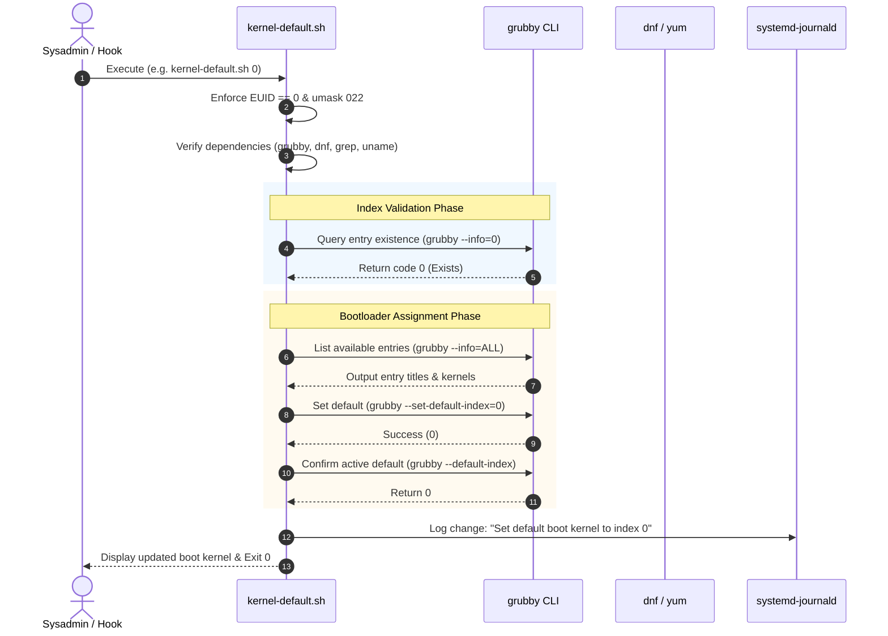
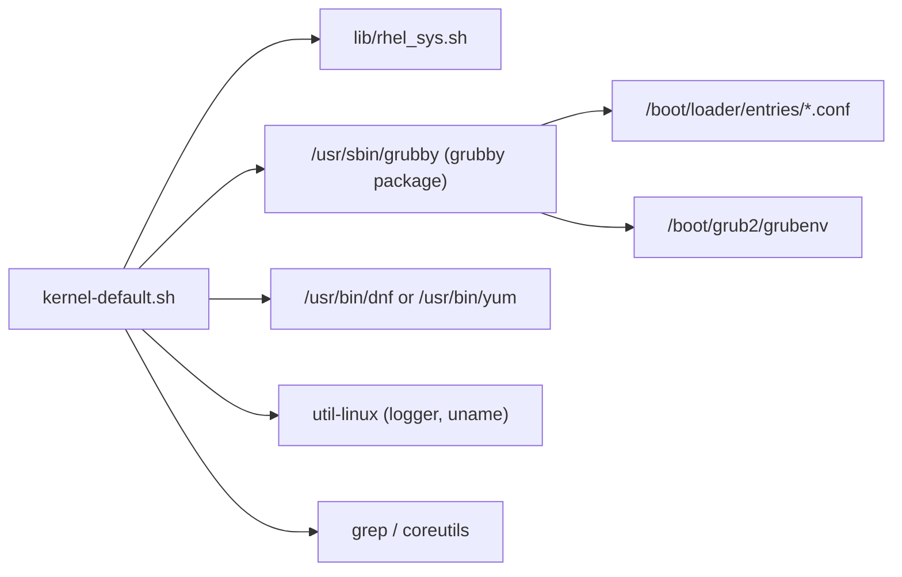
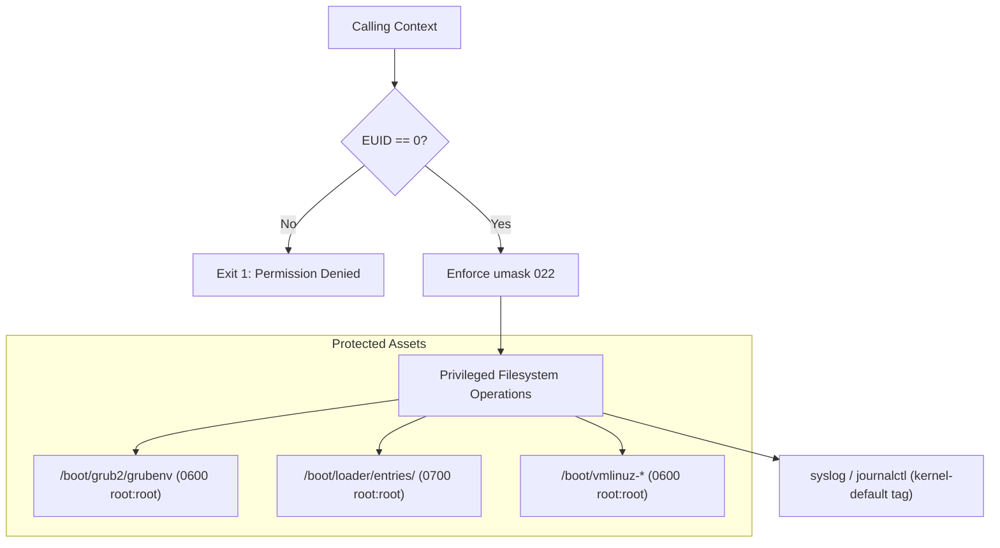

# `kernel-default.sh` Documentation

Comprehensive operational and architecture guide for [`/opt/scripts/kernel-default.sh`](kernel-default.sh).

---

## 1. Application Overview and Objectives

[`kernel-default.sh`](kernel-default.sh) is a system administration utility designed for Enterprise Linux 8, 9, and 10 (RHEL, AlmaLinux, Rocky Linux, CentOS Stream, Oracle Linux). Its primary mission is to provide safe, deterministic, and scriptable management of GRUB2 bootloader defaults following kernel installations, updates, or maintenance cycles.

### Key Objectives
* **Default Bootloader Management:** Inspect and configure default boot entries across modern Boot Loader Specification (BLS) configurations by index or version string.
* **Kernel Retention Floor & Safe Cleanup:** Purge obsolete, retired kernel packages via the native package manager while enforcing a configurable retention floor (`--keep <N>`, default: 2) and strictly safeguarding the active running kernel.
* **Pending Reboot Safety Guard:** Halt kernel cleanup if a newly installed kernel has not yet been booted, preventing accidental deletion of the only known-working fallback kernel unless overridden with `--force`.
* **Rescue Kernel Assignment Safeguard:** Proactively detect and prevent accidental assignment of rescue kernel images as the default boot entry unless `--allow-rescue` is explicitly specified.
* **Non-Destructive Fail-Safe Design:** Validate kernel indexes and version strings prior to applying configuration changes to prevent unbootable server states.
* **Storage Visibility:** Monitor and report `/boot` filesystem storage headroom in all status summaries to prevent `dracut` initramfs exhaustion.
* **Automated Package Manager Integration:** Serve as an idempotent post-transaction hook for [`dnf_check.sh`](dnf_check.sh).
* **System Audit Logging:** Record all kernel modifications and package removals to syslog via `logger` for traceability in `journalctl`.

---

## 2. Architecture and Design Choices, Assumptions, Edge Cases, Performance and Efficiency

### Architecture and Design Choices
* **Native Tooling Layer:** Built directly on top of `grubby` and `${PKG_MGR}` (`dnf`/`yum`), avoiding manual editing or parsing of `/boot/grub2/grub.cfg` or `/boot/loader/entries/`.
* **Universal EL8/9/10 Compatibility:** Operates seamlessly across UEFI and legacy BIOS firmware layouts.
* **Loose Coupling with Shared Infrastructure:** Sources [`/opt/scripts/lib/rhel_sys.sh`](lib/rhel_sys.sh) for DRY conventions, with complete standalone fallback definitions if executed in isolation.
* **Strict Shell Governance:** Enforces `set -euo pipefail` and `umask 022`.

### Assumptions
* The host operating system utilizes GRUB2 with the Boot Loader Specification (`BLS`) enabled (standard in EL8+).
* The running user possesses superuser privileges (`EUID == 0`) for configuration mutating commands.
* `/boot` and `/boot/loader/entries` are accessible and mounted read-write during updates.

### Handled Edge Cases
* **Missing or Non-Existent Index / Version:** Validates requested indexes and version strings with both `grubby --info="${INDEX}"` and `grubby --info=ALL` before attempting modification.
* **Accidental Rescue Assignment:** Inspects target entry metadata and rejects `rescue` kernel assignments unless explicitly authorized via `--allow-rescue`.
* **Unbooted Kernel Deletion Window:** Warns and halts if a newly deployed kernel has not been booted, preventing deletion of the active running fallback kernel.
* **Retention Floor Protection:** Retains at least 2 kernel versions by default (`--keep 2`), ensuring a recovery kernel is always present in GRUB. Requires positive integers ($\ge 1$) to prevent accidental complete purging.
* **Active Kernel Protection:** Automatically filters out package candidates matching `*$(uname -r)*` to prevent purging the booted kernel, even if older than other installed kernels.
* **Empty Package Sets:** Bypasses `${PKG_MGR} remove` when zero retired kernels exist, avoiding package manager syntax errors.
* **Pipefail Resilience:** Output pipelines append `|| true` to prevent `set -o pipefail` from terminating the script on empty filter results.
* **Conflicting Option Rejection:** Enforces mutual exclusivity across primary actions (e.g. `--report` and `--cleanup`), rejecting conflicting commands.
* **Standalone Dry-Run Safety:** Automatically scopes `--dry-run` and `--keep` to cleanup operations, preventing unintentional bootloader modifications.
* **WSL Platform Awareness:** Detects Windows Subsystem for Linux (where the kernel is host-managed) and exits cleanly without errors.

### Architecture Diagram

```mermaid
graph TD
    User["System Administrator / Automation"] -->|"CLI Args"| Entrypoint["/opt/scripts/kernel-default.sh"]
    
    subgraph "Initialization & Safety"
        Entrypoint --> ModeCheck{"Action Requested?"}
        ModeCheck -->|"-h / --help"| HelpHandler["Display Usage & Exit 0"]
        ModeCheck -->|"Execution"| RootGuard["require_root (EUID == 0)"]
        RootGuard --> DepCheck["verify_dependencies (grubby, dnf, grep, uname, awk)"]
        DepCheck --> UmaskCheck["Enforce umask 022"]
    end

    subgraph "Core Functionality"
        UmaskCheck --> ActionRouter{"Action Dispatch"}
        ActionRouter -->|"--default"| ReadDefault["grubby default & /boot usage"]
        ActionRouter -->|"--report"| ReadAll["grubby --info=ALL & /boot usage"]
        ActionRouter -->|"--cleanup"| CleanOld{"Reboot Pending?"}
        CleanOld -->|Yes (no --force)| HaltReboot["Halt: Reboot required first"]
        CleanOld -->|No / --force| PruneKernels["Filter Active & Latest N<br/>dnf remove / dry-run"]
        ActionRouter -->|"--set <VERSION>"| ResolveVer["find_index_by_version"]
        ActionRouter -->|"<INDEX>"| SetDefault["Validate Index"]
        ResolveVer --> SetDefault
    end

    subgraph "Rescue Guard & State Assignment"
        SetDefault --> RescueCheck{"Is Rescue Entry?"}
        RescueCheck -->|Yes (no --allow-rescue)| AbortRescue["Abort: Rescue entry blocked"]
        RescueCheck -->|No / --allow-rescue| ApplyGRUB["grubby --set-default-index"]
        ApplyGRUB --> AuditLog["logger -t kernel-default"]
        PruneKernels --> AuditLog
    end
```

---

## 3. Data Flow and Control Logic

### Sequence Diagram



---

## 4. Performance and Scalability

### Concurrency Model
* **Process Execution:** Operates as a lightweight, single-threaded Bash process.
* **Transient Memory Footprint:** Consumes less than 15 MB of resident memory (standard Bash subshell).
* **Execution Latency:** Typical query operations (`--default`, `--report`) complete in under 50 ms. Mutating index operations complete in under 150 ms.
* **Package Query Optimization:** When executing `--cleanup`, queries RPM metadata in memory via native repoquery without initiating remote repository downloads or metadata synchronization.

---

## 5. Dependencies

### Component Chart



### Dependency Inventory
| Dependency | Type | Source Package | Minimum Version | Purpose |
| :--- | :--- | :--- | :--- | :--- |
| `bash` | Shell Runtime | `bash` | 4.4+ (EL8+) | Script interpreter supporting strict mode & `mapfile` |
| `grubby` | Bootloader CLI | `grubby` | 8.40+ | Inspecting and modifying GRUB/BLS boot parameters |
| `dnf` / `yum` | Package Manager | `dnf` | 4.0+ | Querying and removing retired installonly kernel packages |
| `logger` | Syslog Utility | `util-linux` | 2.32+ | Recording operational audit events to systemd journal |
| `grep`, `uname`, `awk` | Core Utilities | `grep`, `coreutils`, `gawk` | Any | String filtering, metrics parsing, and active kernel detection |
| `lib/rhel_sys.sh` | Shared Library | Repository Internal | 1.4.0+ | Foundation library (`require_root`, `verify_dependencies`, `is_wsl`, `log_audit`) |

---

## 6. Security Architecture



---

## 7. Security Assessment

* **Privilege & Access Control (RBAC):** All modifying actions (`--cleanup`, index assignment) and GRUB environment reads require `root` (EUID 0). Unprivileged users cannot manipulate or view root-only GRUB environment files.
* **Secret Management:** The script processes zero credentials, tokens, or encryption keys.
* **Encryption in Transit:** N/A (all operations are local to the host).
* **Sanitized Argument Handling:** Argument parsing uses strict integer regex (`^[0-9]+$`) and case blocks, preventing command injection or directory traversal attacks.
* **Fail-Safe Integrity:** Verification guards guarantee that accidental execution without arguments defaults safely to index 0 rather than accepting arbitrary input.

---

## 8. Code Quality Assessment, Review, and Best Practices

* **POSIX & ShellCheck Adherence:** Complies with ShellCheck standards (e.g. no SC2112 deprecated function declarations, no SC2086 unquoted expansions).
* **Deterministic Error Handling:** Governed by `set -euo pipefail`. Any command error halts execution unless explicitly guarded.
* **Array-Safe Command Substitutions:** Uses `mapfile -t` to read multi-line package names safely into arrays without string splitting or glob expansion hazards.
* **Idempotency:** Re-executing `kernel-default.sh 0` when index 0 is already default safely validates and preserves state without generating redundant changes.

---

## 9. Command Line Arguments

| Argument | Type | Default | Description |
| :--- | :--- | :--- | :--- |
| `<INDEX>` | Integer (`^[0-9]+$`) | `0` | Sets the default boot kernel to the specified GRUB index (e.g. `0`, `1`). |
| `--default` | Flag | N/A | Displays currently active default boot kernel title, file path, index, and `/boot` capacity. |
| `--report` | Flag | N/A | Displays all available GRUB kernel entries with index, path, title, and `/boot` usage. |
| `--set <VERSION>` | String | N/A | Resolves and assigns default kernel by version substring (e.g. `6.12.0-211.74.1`). |
| `--allow-rescue` | Flag | N/A | Explicitly authorizes assigning a rescue kernel as the default boot entry. |
| `--cleanup` | Flag | N/A | Safely purges retired kernel packages beyond the retention floor while preserving the active kernel. |
| `--keep <N>` | Integer (`>= 1`) | `2` | Number of latest kernel versions to retain during cleanup. Requires positive integer ($\ge 1$); automatically implies `--cleanup` if no action is specified. |
| `--dry-run`, `-n` | Flag | N/A | Previews kernel packages that would be removed by cleanup without modifying the system; automatically implies `--cleanup` if no action is specified. |
| `--force` | Flag | N/A | Bypasses safety guards (e.g. forces cleanup when a reboot into a new kernel is pending). |
| `--latest` | Flag | N/A | Explicitly assigns index `0` as the default boot kernel. |
| `-h`, `--help` | Flag | N/A | Displays CLI usage documentation and exits `0`. |

*Note: Conflicting primary actions (e.g. `--report` and `--cleanup`, or `--cleanup` and `<INDEX>`) are strictly rejected. If no argument is provided, the script defaults to assigning index `0` (automated update hook behavior).*

---

## 10. Detailed Examples on How to Use and Deploy

### Manual Usage Examples

#### 1. Display Current Default Boot Kernel & /boot Capacity
```bash
sudo /opt/scripts/kernel-default.sh --default
```
**Sample Output:**
```text
Current Default Boot Kernel:
  Title  : AlmaLinux (6.12.0-211.74.1.el10_2.x86_64) 10.2 (Lavender Lion)
  Kernel : /boot/vmlinuz-6.12.0-211.74.1.el10_2.x86_64
  Index  : 0
  Storage: /boot (193M free / 62% used)
```

#### 2. Inspect Available Kernel Entries
```bash
sudo /opt/scripts/kernel-default.sh --report
```
**Sample Output:**
```text
Available GRUB Kernel Entries:
index=0
kernel="/boot/vmlinuz-6.12.0-211.74.1.el10_2.x86_64"
title="AlmaLinux (6.12.0-211.74.1.el10_2.x86_64) 10.2 (Lavender Lion)"
index=1
kernel="/boot/vmlinuz-6.12.0-211.73.1.el10_2.x86_64"
title="AlmaLinux (6.12.0-211.73.1.el10_2.x86_64) 10.2 (Lavender Lion)"
index=2
kernel="/boot/vmlinuz-0-rescue-69f855f0bfb64c198867787acd8e4753"
title="AlmaLinux (0-rescue-69f855f0bfb64c198867787acd8e4753) 10.1 (Heliotrope Lion)"

Storage: /boot (193M free / 62% used)
```

#### 3. Assign Default Kernel by Version String
```bash
sudo /opt/scripts/kernel-default.sh --set 6.12.0-211.74.1
```
**Sample Output:**
```text
[*] Resolving GRUB index for kernel version '6.12.0-211.74.1'...
[+] Found entry index '0' matching '6.12.0-211.74.1'.
[*] Assigning index '0' to default kernel...
Available GRUB Kernel Entries:
...
```

#### 4. Rescue Kernel Safeguard in Action
```bash
sudo /opt/scripts/kernel-default.sh 2
```
**Sample Output:**
```text
[-] SECURITY GUARD: Entry index '2' appears to be a RESCUE kernel!
    Setting a rescue kernel as default may boot into emergency single-user recovery mode.
    If you intentionally wish to boot the rescue kernel, pass '--allow-rescue'.
```

#### 5. Preview Kernel Cleanup with Dry-Run
```bash
sudo /opt/scripts/kernel-default.sh --cleanup --dry-run
```
**Sample Output:**
```text
[*] Inspecting installed kernel packages (retention floor: keep latest 2)...
[+] No retired kernels found beyond the retention floor (2 kernels preserved).
```

#### 6. Purge Retired Kernel Packages (Post-Reboot)
```bash
sudo /opt/scripts/kernel-default.sh --cleanup --keep 2
```
**Sample Output:**
```text
[*] Inspecting installed kernel packages (retention floor: keep latest 2)...
[*] Removing retired kernel packages:
  - kernel-core-0:6.12.0-211.38.1.el10_2.x86_64
  - kernel-modules-0:6.12.0-211.38.1.el10_2.x86_64
Dependencies resolved.
Transaction completed.
[+] Kernel cleanup completed successfully.
    Storage: /boot (285M free / 44% used)
```

---

### Automated Deployment

To automate monthly kernel cleanup via systemd:

1. **Create Service Unit:** `/etc/systemd/system/kernel-cleanup.service`
   ```ini
   [Unit]
   Description=Retired Kernel Cleanup Service
   After=network.target

   [Service]
   Type=oneshot
   ExecStart=/opt/scripts/kernel-default.sh --cleanup
   StandardOutput=journal
   StandardError=journal
   ```

2. **Create Timer Unit:** `/etc/systemd/system/kernel-cleanup.timer`
   ```ini
   [Unit]
   Description=Monthly Retired Kernel Cleanup Timer

   [Timer]
   OnCalendar=monthly
   Persistent=true

   [Install]
   WantedBy=timers.target
   ```

3. **Enable and Start Timer:**
   ```bash
   sudo systemctl daemon-reload
   sudo systemctl enable --now kernel-cleanup.timer
   ```
