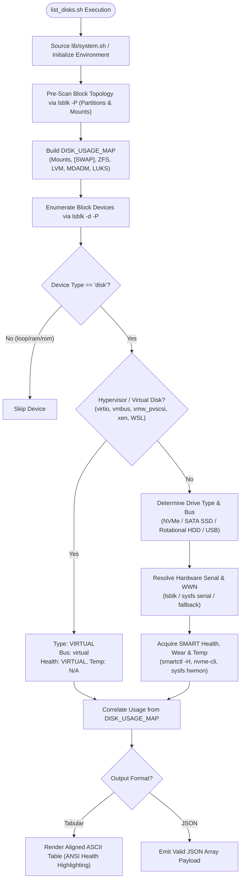

# Storage Device Topology and Hardware Asset Inventory Utility (`list_disks.sh`)

`list_disks.sh` is an enterprise-grade hardware inspection and topology mapping utility designed for Linux environments. It programmatically enumerates physical and virtual block storage devices, classifies hardware bus types and media form factors, aggregates filesystem and volume group dependencies, and reports hardware asset metadata (serial numbers, firmware revisions, WWNs) alongside real-time SMART health, SSD endurance wear metrics, and operating temperatures.

Supported Operating Systems:
- Enterprise Linux 7, 8, and 9 (RHEL, AlmaLinux, Rocky Linux, CentOS, Fedora)
- Debian Family (Debian 10, 11, and 12, Ubuntu LTS 18.04 through 24.04, Linux Mint)
- Proxmox Virtual Environment (PVE 6.x, 7.x, and 8.x)

---

## 1. Architectural Motivation and Failure Mode Analysis of Legacy Implementation

### 1.1 The Failure Mode of Positional Whitespace Parsing (`v1.0.0xg`)
Legacy storage scripts frequently rely on positional text processing using utilities such as `awk` or `cut` across raw `lsblk` output:

```bash
# LEGACY VULNERABLE PATTERN:
lsblk -dnp -o NAME,TRAN,SIZE,VENDOR,MODEL,REV | while read -r line; do
    NAME=$(echo $line | awk '{print $1}')
    SIZE=$(echo $line | awk '{print $3}')
    VENDOR=$(echo $line | awk '{print $4}')
    MODEL=$(echo $line | awk '{print $5}')
    REV=$(echo $line | awk '{print $6}')
done
```

This pattern exhibits critical failure modes in heterogeneous server environments:

1. **Catastrophic Column Shifting via Empty Fields**: Many kernel storage drivers (including native PCIe NVMe, SATA on AHCI controllers, virtio-blk, and Hyper-V vmbus) leave the transport (`TRAN`) column empty. Because `awk` delimits by consecutive whitespace rather than column position, the absence of `TRAN` causes all subsequent fields to shift left by one column. The hardware vendor is assigned to `SIZE`, the drive model is assigned to `VENDOR`, and the firmware revision is assigned to `MODEL`.
2. **Whitespace Fragmentation in Hardware Descriptors**: Physical drive inquiry strings regularly incorporate spaces (e.g., `Samsung SSD 980 PRO 1TB`, `Crucial CT1000MX500SSD1`, `Virtual Disk`, `SSK Storage`). `awk` splits each space-delimited word into a distinct positional variable. For a Samsung drive, `VENDOR` receives `Samsung`, `MODEL` receives `SSD`, and `REV` receives `980`, permanently corrupting asset reporting.
3. **Subshell Process Multiplication**: Invoking `echo $line | awk` multiple times per line within a `while read` loop generates 5 to 6 subshell fork operations per device. In dense storage chassis (such as 24- to 64-bay JBOD shelves), this causes hundreds of redundant process forks and severe execution latency.
4. **False Media Classification**: Blindly evaluating rotational state (`ROTA=0` $\to$ `SSD`, `ROTA=1` $\to$ `HDD`) fails on virtualized infrastructure. Hypervisors (KVM, Hyper-V, VMware) frequently present virtual SCSI or IDE volumes with `ROTA=1` regardless of the underlying physical storage media, falsely classifying virtual volumes as spinning hard disks.

### 1.2 Structural Mitigations in `v2.0.0xg`
`list_disks.sh` resolves these vulnerabilities through:
- **Strict Key-Value Serialization**: Uses `lsblk -d -P` (pairs mode) and controlled evaluation to isolate variables into discrete key-value pairs (`NAME="..."`, `MODEL="..."`), completely eliminating positional whitespace bugs.
- **Single-Pass Subshell Elimination**: Eliminates iterative `awk` subshell pipelines by evaluating block metadata in a single stream.
- **Deterministic Virtualization Probing**: Disambiguates hypervisor virtual block devices before inspecting physical media attributes.
- **Topology Pre-Aggregation**: Pre-scans partition trees to correlate parent block storage devices with their active consumers (ZFS pools, LVM volume groups, MDADM arrays, swap partitions, and filesystem mount points).

---

## 2. Technical Architecture and Data Ingestion Pipeline



### 2.1 Storage Topology Pre-Aggregation
Before enumerating top-level disks, the utility scans all partitions, logical volumes, and mount points across the system via `lsblk -P -o PKNAME,NAME,MOUNTPOINT,FSTYPE`:
- Correlates child partitions (e.g., `/dev/nvme0n1p1`, `/dev/sda2`) back to their parent physical block device (`nvme0n1`, `sda`).
- Flags filesystem mount points (e.g., `/`, `/boot`, `/data`).
- Identifies storage subsystem members:
  - `ZFS`: Partitions tagged with filesystem type `zfs_member`.
  - `LVM`: Partitions managed by LVM Physical Volumes (`LVM2_member`).
  - `MDADM`: Linux Software RAID members (`linux_raid_member`).
  - `LUKS`: Encrypted dm-crypt volumes (`crypto_LUKS`).
  - `[SWAP]`: Active swap partitions and swap files.
- The aggregated usages are indexed into an associative map (`DISK_USAGE_MAP`) keyed by parent disk name.

### 2.2 Drive Type and Media Classification
Drives are classified into mutually exclusive media categories:
- `VIRTUAL`: Devices matching hypervisor subsystem signatures (Hyper-V `vmbus`, KVM `virtio_blk`, VMware `vmw_pvscsi`, Xen `xen-blkfront`, QEMU, VirtualBox, and WSL virtual disks).
- `NVMe`: Non-Volatile Memory Express solid-state drives attached via PCIe bus (`/dev/nvme*n*`).
- `SSD`: Solid-State Drives attached via SATA or SAS controllers (`ROTA=0`).
- `HDD`: Traditional rotational magnetic hard disk drives (`ROTA=1`).
- `UNKNOWN`: Unidentified block devices where rotational attributes cannot be probed.

### 2.3 Hardware Identity and Serial Resolution
Hardware asset tracking requires reliable serial number extraction:
1. `lsblk` query parameter `SERIAL`.
2. Direct kernel sysfs attribute query: `/sys/block/<dev>/device/serial`.
3. If unavailable or empty (common on hypervisor virtual disks), the serial field safely defaults to `N/A`.
4. To prevent table alignment degradation on controllers that return long 32-character SCSI World Wide Identifiers (WWID), standard tabular output automatically bounds serial strings to 18 characters, while verbose mode (`-v`) or JSON mode (`--json`) retains the complete unclipped string.

### 2.4 SMART Health and Endurance (Wear Level) Telemetry
When executed with administrative privileges (`CAP_SYS_RAWIO` / `root`):
- **Health Self-Assessment**: Interrogates the drive controller via `smartctl -H`.
  - `PASSED`: Controller self-assessment reports clean operating status.
  - `FAILED`: Critical SMART threshold exceeded (predictive failure indicator).
  - `WARNING`: Pre-fail or uncorrectable error logged.
- **SSD Endurance & Wear Level**:
  - **NVMe Storage**: Parses the `Percentage Used` parameter from the NVMe SMART log page, reporting total life consumption (e.g., `2% Used`).
  - **SATA / SAS SSD**: Evaluates vendor wear indicators in order of precedence: Attribute `231` (`SSD_Life_Left`), Attribute `233` (`Media_Wearout_Indicator`), Attribute `177` (`Wear_Leveling_Count`), and Attribute `169` (`Remaining_Lifetime_Perc`).
- **Temperature Integration**:
  - Direct non-blocking extraction prioritizing kernel sysfs hardware monitoring nodes (`/sys/class/hwmon`) and controller composite telemetry.

---

## 3. Security, Privilege Architecture, and System Requirements

### 3.1 Privilege Separation
The utility operates under two execution profiles:

| Profile | Execution Context | Accessible Metadata | Limitations |
| :--- | :--- | :--- | :--- |
| **Privileged** | `root` or `sudo` (`CAP_SYS_RAWIO`) | Full hardware discovery, serials, topology mapping, SMART health self-assessment, SSD endurance/wear percentages, controller temperatures. | None. Complete hardware and health audit. |
| **Unprivileged** | Standard user account | Topology mapping, partition usage, drive types, bus types, model strings, serial numbers, and unprivileged sysfs temperatures. | SMART health self-assessment and SSD wear levels report `NO_ROOT`. |

### 3.2 System Dependencies
The script is written in POSIX-compliant Bash (compatible with Bash 4.2 through 5.2):
- **Mandatory Utilities (standard system coreutils)**:
  `bash`, `lsblk`, `awk`, `sed`, `grep`, `tr`, `printf`, `cat`, `cut`, `xargs`.
- **Recommended Hardware Packages**:
  - `smartmontools` (`smartctl`): Required for controller SMART self-assessment health checks and SSD wear level calculations.

Package installation by distribution:
- **Enterprise Linux (RHEL / AlmaLinux / Rocky Linux)**:
  ```bash
  dnf install -y smartmontools util-linux
  ```
- **Debian / Ubuntu / Proxmox VE**:
  ```bash
  apt-get update && apt-get install -y smartmontools util-linux
  ```

---

## 4. Command Line Interface Specification

### 4.1 Invocation Syntax
```bash
list_disks.sh [OPTIONS]
```

### 4.2 Parameter Reference

| Flag | Long Option | Parameter | Default | Technical Description |
| :--- | :--- | :--- | :--- | :--- |
| `-h` | `--help` | None | N/A | Displays command syntax, argument descriptions, default thresholds, and operational examples. |
| `-j` | `--json` | None | N/A | Emits a structured JSON array payload and suppresses human-readable headers and tables. |
| `-v` | `--verbose` | None | N/A | Displays extended attributes including Firmware Revision (`Rev`), World Wide Name (`WWN`), and Partition Scheme (`PTTYPE`). |
| `-w` | `--warn` | `<TEMP_C>` | `50` | Warning threshold in degrees Celsius for SATA, SAS, and HDD devices. |
| `-c` | `--crit` | `<TEMP_C>` | `65` | Critical threshold in degrees Celsius for SATA, SAS, and HDD devices. |
| | `--nvme-warn` | `<TEMP_C>` | `60` | Warning threshold in degrees Celsius for PCIe NVMe solid-state storage. |
| | `--nvme-crit` | `<TEMP_C>` | `75` | Critical threshold in degrees Celsius for PCIe NVMe solid-state storage. |
| | `--hide-virtual` | None | N/A | Suppresses hypervisor-managed and virtual block devices from output. |
| | `--no-color` | None | N/A | Suppresses ANSI escape sequences, producing unformatted plain text suitable for logging pipelines. |

### 4.3 Exit Status Codes

| Exit Code | Meaning | Operational Guidance |
| :--- | :--- | :--- |
| `0` | Success | Command completed successfully. All storage devices were processed. |
| `1` | Command-Line Error | Invalid arguments supplied (e.g., non-numeric threshold values, unknown flags, or warning threshold $\ge$ critical threshold). |

---

## 5. Output Specifications and Schema Reference

### 5.1 Standard Tabular Terminal Output
Interactive executions produce an aligned ASCII table framed within a 160-character border to accommodate comprehensive multi-partition mount paths without line wrapping. Hostname identification uses the fully qualified domain name (FQDN) whenever resolvable via `hostname -f`.

```text
================================================================================================================================================================
 Storage Device Inventory & Topology Report: [storage-node01.corp.internal]
================================================================================================================================================================
Device         Type     Bus      Size      Temp     Health     Wear        Serial               Model                        Usage / Mount
----------------------------------------------------------------------------------------------------------------------------------------------------------------
/dev/nvme0n1   NVMe     nvme     1000.2G   38 C     PASSED     2% Used     S676NF0W123456K      Samsung SSD 980 PRO 1TB      /boot/efi, /
/dev/sda       SSD      sata     500.1G    32 C     PASSED     1% Left     20422B800171         Crucial CT500MX500SSD1       ZFS
/dev/sdb       HDD      sata     4.0T      36 C     PASSED     N/A         WD-WCC4N0123456      WDC WD40EFRX-68N32N0         /mnt/storage
/dev/sdc       USB      usb      128.0G    33 C     PASSED     N/A         070728987654         SSK Storage                  /media/backup
/dev/sdd       VIRTUAL  virtual  1.0T      N/A      VIRTUAL    N/A         N/A                  Msft Virtual Disk            [SWAP]
================================================================================================================================================================
```

#### Terminal Colorization Semantics:
- **Device Type**: `NVMe` (Cyan), `SSD` (Green), `HDD` (Yellow), `VIRTUAL` (Gray).
- **Health Assessment**: `PASSED` (Green), `FAILED` (Red), `WARNING` / `NO_ROOT` / `NO_SMARTCTL` (Yellow), `VIRTUAL` (Gray).
- **Thermal Status (Bus-Aware Profiles)**:
  - **SATA / SAS / HDD**: Normal $< 50^\circ\text{C}$ (Green), Warning $50-64^\circ\text{C}$ (Yellow), Critical $\ge 65^\circ\text{C}$ (Red).
  - **NVMe SSD**: Normal $< 60^\circ\text{C}$ (Green), Warning $60-74^\circ\text{C}$ (Yellow), Critical $\ge 75^\circ\text{C}$ (Red).

### 5.2 Extended Tabular Terminal Output (`-v / --verbose`)
Displays low-level firmware revision codes and hardware asset identifiers:

```text
================================================================================================================================================================
 Storage Device Inventory & Topology Report: [storage-node01.corp.internal]
================================================================================================================================================================
Device         Type     Bus      Size      Temp     Health     Wear        Serial               Model                        Rev      WWN                    Usage / Mount
----------------------------------------------------------------------------------------------------------------------------------------------------------------
/dev/nvme0n1   NVMe     nvme     1000.2G   38 C     PASSED     2% Used     S676NF0W123456K      Samsung SSD 980 PRO 1TB      5B2QGXA7 eui.002538b911c01234   /boot/efi, /
/dev/sda       SSD      sata     500.1G    32 C     PASSED     1% Left     20422B800171         Crucial CT500MX500SSD1       M3CR046  0x500a0751e28b1234     ZFS
/dev/sdb       HDD      sata     4.0T      36 C     PASSED     N/A         WD-WCC4N0123456      WDC WD40EFRX-68N32N0         82.00A82 0x50014ee2b5c12345     /mnt/storage
================================================================================================================================================================
```

### 5.3 JSON Telemetry Schema Specification

When invoked with `--json`, the utility outputs a single valid JSON array containing structured metadata for each detected device.

#### JSON Field Specifications

| Field | Type | Nullable | Description |
| :--- | :--- | :--- | :--- |
| `device` | String | No | Canonical filesystem path of the block device (e.g., `"/dev/nvme0n1"`). |
| `name` | String | No | Kernel block device identifier (e.g., `"nvme0n1"`). |
| `type` | String | No | Media classification (`"NVMe"`, `"SSD"`, `"HDD"`, `"VIRTUAL"`, `"UNKNOWN"`). |
| `bus` | String | No | Storage transport bus type (`"nvme"`, `"sata"`, `"sas"`, `"usb"`, `"virtual"`). |
| `size` | String | No | Human-readable capacity string as reported by kernel (e.g., `"1000.2G"`, `"4.0T"`). |
| `temperature_c` | Integer | Yes | Operating temperature in degrees Celsius as an integer. `null` if unavailable or virtual. |
| `health` | String | No | SMART health assessment status (`"PASSED"`, `"FAILED"`, `"WARNING"`, `"VIRTUAL"`, `"NO_ROOT"`, `"NO_SMARTCTL"`). |
| `wear` | String | Yes | SSD endurance metric string (e.g., `"2% Used"`, `"99% Left"`). `null` for HDDs or virtual disks. |
| `serial` | String | No | Hardware serial number string or `"N/A"`. |
| `model` | String | No | Sanitized vendor and model string or `"Generic Disk"`. |
| `usage` | String | No | Comma-separated list of active mount points, swap allocations, or storage subsystem markers (`"ZFS"`, `"LVM"`, `"MDADM"`). |
| `revision` | String | No | Firmware revision identifier string or `"N/A"`. |
| `wwn` | String | No | Storage World Wide Name identifier or empty string. |
| `pttype` | String | No | Partition table scheme (`"gpt"`, `"dos"`, or empty string). |
| `is_virtual` | Boolean | No | `true` if device is hosted on a hypervisor or container layer; otherwise `false`. |

#### Example JSON Payload:
```json
[
  {
    "device": "/dev/nvme0n1",
    "name": "nvme0n1",
    "type": "NVMe",
    "bus": "nvme",
    "size": "1000.2G",
    "temperature_c": 38,
    "health": "PASSED",
    "wear": "2% Used",
    "serial": "S676NF0W123456K",
    "model": "Samsung SSD 980 PRO 1TB",
    "usage": "/boot/efi, /",
    "revision": "5B2QGXA7",
    "wwn": "eui.002538b911c01234",
    "pttype": "gpt",
    "is_virtual": false
  },
  {
    "device": "/dev/sda",
    "name": "sda",
    "type": "SSD",
    "bus": "sata",
    "size": "500.1G",
    "temperature_c": 32,
    "health": "PASSED",
    "wear": "1% Left",
    "serial": "20422B800171",
    "model": "Crucial CT500MX500SSD1",
    "usage": "ZFS",
    "revision": "M3CR046",
    "wwn": "0x500a0751e28b1234",
    "pttype": "gpt",
    "is_virtual": false
  }
]
```

---

## 6. Enterprise Integration and Automation Use Cases

### 6.1 Ansible Custom Local Facts Collector
To expose comprehensive storage topology and health data directly into Ansible execution playbooks (`ansible_local.storage.disks`):

#### 1. Setup Fact Script (`/etc/ansible/facts.d/storage.fact`)
```bash
#!/usr/bin/env bash
set -euo pipefail
/opt/scripts/list_disks.sh --json
```

#### 2. Ensure Permissions
```bash
chmod 755 /etc/ansible/facts.d/storage.fact
```

#### 3. Sample Ansible Playbook Task
```yaml
- name: Audit failed or degrading storage devices
  hosts: all
  tasks:
    - name: Fail if any physical drive has failed SMART self-assessment
      ansible.builtin.fail:
        msg: "CRITICAL: Drive {{ item.device }} (Serial: {{ item.serial }}) reported health status: {{ item.health }}"
      loop: "{{ ansible_local.storage }}"
      when:
        - item.health is defined
        - item.health == "FAILED"
```

### 6.2 CMDB Hardware Asset Synchronization Script
To synchronize physical drive serial numbers, models, and firmware revisions into an IT asset management database or NetBox device inventory:

```bash
#!/usr/bin/env bash
set -euo pipefail

PAYLOAD="$(/opt/scripts/list_disks.sh --json --hide-virtual)"

# Post inventory payload to internal CMDB endpoint
curl -s -X POST \
  -H "Content-Type: application/json" \
  -H "Authorization: Bearer ${CMDB_API_TOKEN}" \
  -d "{\"hostname\": \"$(hostname -f)\", \"disks\": ${PAYLOAD}}" \
  https://cmdb.internal.net/api/v1/hardware/storage/sync
```

