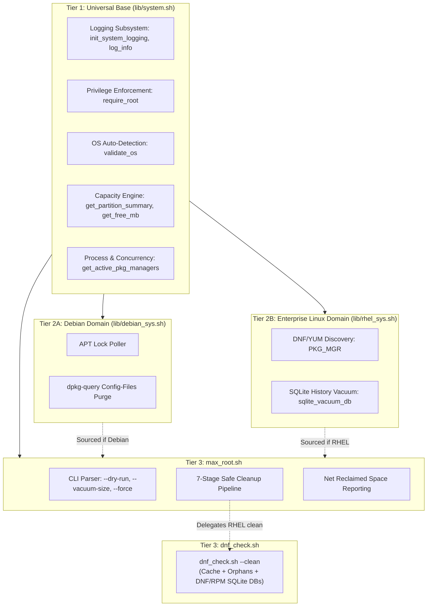

# Pre-Upgrade Root Filesystem (/) Space Maximization Utility (`max_root.sh`)

## 1. Executive Overview

`max_root.sh` is an enterprise-grade disk headroom maximization utility designed to run immediately prior to major OS package upgrades, distribution releases, or kernel installations.

Running out of disk space on the root (`/`) filesystem during a transaction can lead to package database corruption, broken post-install triggers, or truncated `initramfs` images that leave systems unbootable. `max_root.sh` safely reclaims hundreds of megabytes to several gigabytes of disk space across both Enterprise Linux (RHEL, AlmaLinux, Rocky Linux, CentOS, Fedora) and Debian-family systems (Debian, Ubuntu, Linux Mint, Proxmox VE).

---

## 2. DRY Architecture & Multi-Platform Topology

`max_root.sh` adheres strictly to the repository's 3-tier DRY Architecture Framework:



---

## 3. Seven-Stage Safe Cleanup Pipeline

| Stage | Target Module | Cross-Platform Implementation | Critical Safety Guarantees |
| :--- | :--- | :--- | :--- |
| **1** | **Systemd Journals** | `journalctl --vacuum-size=<SIZE>` | Vacuums old binary journal segments to user-specified size (default: `100M`). Preserves active journal integrity. |
| **2** | **Rotated / Old Logs** | `/var/log` (`*.gz`, `*.[0-9]`, `*.old`, `*.1`) | **Strictly excludes `/var/log/journal`** (protects active journal index integrity) and **excludes `/var/log/audit`** (maintains mandatory `auditd` compliance trails). |
| **3** | **Crash & Core Dumps** | `/var/crash/*` & `/var/lib/systemd/coredump/*` | Safely purges accumulated crash dumps that frequently consume multi-GB footprints. |
| **4** | **Stale Temp Files** | `/tmp` and `/var/tmp` (`-mtime +2`) | Excludes active lock files (`*.lock`, `*.pid`) and systemd sockets (`systemd-private-*`). Detects if `/tmp` is RAM-backed (`tmpfs`). |
| **5** | **Package Managers** | **Debian/Ubuntu**: `dpkg-query` `config-files` purge, `apt-get clean`, `autoremove`<br>**RHEL**: Delegates to `dnf_check.sh --clean` (`dnf clean all`, `autoremove`, SQLite checkpoint/vacuum on DNF and RPM DBs) | **Guards against concurrency** via `get_active_pkg_managers`. Prevents `dpkg -l` column truncation bugs by using `dpkg-query -f '${db:Status-Status}'`. |
| **6** | **User Cache** | `/root/.cache/*` | Reclaims pip wheels, build caches, and download artifacts. |
| **7** | **Hypervisor Temp** | `/var/lib/vz/dump/*.tmp` | Cleans interrupted or orphaned backup snapshots on Proxmox VE hosts. |

---

## 4. Command Line Usage & Options

```bash
sudo ./os_sys/max_root.sh [OPTIONS]
```

### Options

| Flag | Parameter | Description |
| :--- | :--- | :--- |
| `-h, --help` | None | Displays detailed usage matrix and module descriptions. |
| `-n, --dry-run`, `--detect` | None | Non-destructive dry run. Scans system, counts eligible files, and previews space without modifying files. |
| `-f, --force` | None | Bypasses active process concurrency warnings for package cache cleanup. |
| `--vacuum-size` | `<SIZE>` | Specifies target systemd journal size (default: `100M`; e.g. `50M`, `200M`). |
| `--tmp-days` | `<DAYS>` | Pruning threshold age in days for stale `/tmp` and `/var/tmp` files (default: `2`). |
| `--skip-pkg-clean` | None | Skips package manager cache cleaning and dependency autoremovals. |

---

## 5. Usage Examples

### A. Preview Reclamation (Dry Run / Safe Audit)
```bash
sudo /opt/scripts/max_root.sh --dry-run
```

### B. Standard Execution Before OS Upgrade
```bash
sudo /opt/scripts/max_root.sh
```

### C. Aggressive Journal Vacuuming for Space-Constrained VPS / Root Disks
```bash
sudo /opt/scripts/max_root.sh --vacuum-size 50M
```

### D. Clean Disks While Preserving Package Manager Caches
```bash
sudo /opt/scripts/max_root.sh --skip-pkg-clean
```

---

## 6. Verification and Testing

Verified natively across WSL instances:
- **Enterprise Linux**: AlmaLinux 9.8 (RHEL 9) - verified exit code 0, DNF discovery, SQLite optimization.
- **Debian / Ubuntu**: Ubuntu 24.04.5 LTS (Noble) - verified exit code 0, APT cache and dpkg-query verification.

