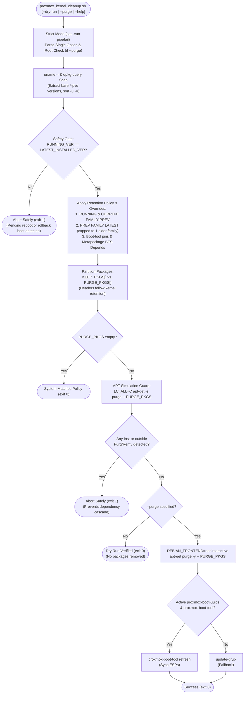

# Proxmox VE Kernel & Header Lifecycle Cleanup Utility (`proxmox_kernel_cleanup.sh`)

Standalone, safety-gated kernel and header pruning utility designed specifically for **Proxmox Virtual Environment (PVE)** nodes running on Debian GNU/Linux to reclaim disk space in `/boot` and EFI System Partitions (ESPs) without compromising rollback capability or package integrity.

---

## 1. Architectural Motivation & Vulnerability Analysis

### Failure Modes of Naive Kernel Cleanup on Proxmox VE
On Proxmox VE hypervisors—especially ZFS-on-root installations using small mirrored EFI System Partitions synced by `proxmox-boot-tool`—accumulating `proxmox-kernel-*`, `pve-kernel-*`, and matching header packages can exhaust `/boot` or ESP capacity and break subsequent `apt-get dist-upgrade` or `update-initramfs` runs. Conversely, naive cleanup scripts introduce severe operational hazards:

```text
[Naive Cleanup Script]
       │
       ├──► 1. Sorts package names alphabetically ('pve-kernel-*' > 'proxmox-kernel-*')
       │         └─► Misidentifies legacy kernel as "newest" and deletes modern kernels
       ├──► 2. Ignores running vs. latest installed kernel mismatch
       │         └─► Deletes newly installed unbooted kernel OR strips fallback during rollback
       ├──► 3. Ignores /etc/kernel/proxmox-boot-* pins & metapackage Depends
       │         └─► Breaks pinned boot targets or triggers proxmox-ve cascade removal
       └──► 4. Runs `apt-get purge -y` directly without simulation guard
                 └─► Unattended reverse-dependency purge removes hypervisor stack
```

### Why Generic Cleanup Tools / Unbounded `apt` Purges Fail on Proxmox VE

| Hazard Category | Naive / Generic Cleanup Behavior | Safeguard in `proxmox_kernel_cleanup.sh` |
| :--- | :--- | :--- |
| **Package Name Sorting Bug** | Sorts full package names alphabetically, placing legacy `pve-kernel-*` after newer `proxmox-kernel-*` because `'v' > 'r'`. | Extracts bare `*-pve` versions via `extract_pkg_ver()` and sorts versions with `sort -u -V`. |
| **Pending Reboot / Rollback Trap** | Prunes kernels regardless of what kernel is currently booted. | Enforces a **Safety Gate** (`RUNNING_VER == LATEST_INSTALLED_VER`); aborts if a newer kernel awaits reboot or an older rollback kernel is active. |
| **Unbounded ESP Exhaustion** | Retains an arbitrary fixed count across all branches or fails to prune orphaned `*-headers-*` packages. | Retains at most 3 kernels under normal policy (running + previous in current `major.minor` family + latest in immediately previous family) and pairs headers to their kernel's retention status. |
| **Boot-Tool Pin Desynchronization** | Ignores `proxmox-boot-tool` pin files, leaving stale or broken entries on ESPs. | Parses `/etc/kernel/proxmox-boot-pin`, `/etc/kernel/next-boot-pin`, and `/etc/kernel/proxmox-boot-manual-kernels` and protects matching versions (`PINNED/MANUAL`). |
| **Metapackage Cascade Removal** | Triggers `apt` to remove `proxmox-ve`, `proxmox-default-kernel`, or DKMS/third-party packages via `Depends` chains. | Runs a BFS traversal from `proxmox-ve`, `proxmox-default-kernel`, and `proxmox-default-headers`, plus an `LC_ALL=C apt-get -s purge` simulation guard verifying zero `Inst` or outside `Purg`/`Remv` actions. |
| **Truncated Package Discovery** | Parses `dpkg -l` human-formatted tables, which can truncate long package names. | Queries `dpkg-query -W -f='${Status}\t${Package}\n'` and strictly filters for `install ok installed`. |

---

## 2. Hardened Architecture & Safeguards in `proxmox_kernel_cleanup.sh`

`proxmox_kernel_cleanup.sh` (v2.2.1) defaults to a safe read-only `--dry-run` mode and combines deterministic version discovery, a pending-reboot safety gate, family-bounded retention rules with pin and metapackage overrides, an `apt-get -s` reverse-dependency guard, and automated bootloader synchronization.



### 2.1 Technical Specifications and Safety Controls

1. **Strict Execution Mode, Hardened `PATH` & Safe Default (`--dry-run`)**:
   - Executes under `set -euo pipefail` and prepends `/usr/local/sbin:/usr/local/bin:/usr/sbin:/usr/bin:/sbin:/bin` to `PATH` so unattended `cron` or `systemd` runs always locate `proxmox-boot-tool`, `update-grub`, `dpkg-query`, and `apt-get`.
   - Enforces at most one long option (`--dry-run`, `--purge`, or `--help`); short options and multiple flags are rejected.
   - Defaults to `DRY_RUN=true`. Unprivileged users can run `--dry-run` audits safely, whereas `--purge` requires `EUID == 0`.
2. **Machine-Readable Discovery & Bare-Version Sorting**:
   - Reads installed packages with `dpkg-query -W -f='${Status}\t${Package}\n'`, ignoring `rc` (residual-config) or half-installed entries and stripping optional `:arch` qualifiers.
   - Tracks concrete kernel image versions (`KERNEL_VER_SET`) separately from header-inclusive versions (`ALL_VER_SET`) so orphaned header packages never masquerade as bootable kernels.
   - Extracts bare `*-pve` versions and sorts them with `sort -u -V`, avoiding the lexicographical bug where `pve-kernel-*` sorts after `proxmox-kernel-*`.
3. **Pending Reboot / Rollback Safety Gate**:
   - Compares `RUNNING_VER` (`uname -r`) against `LATEST_INSTALLED_VER`.
   - Aborts immediately (`exit 1`) if they differ, preventing cleanup either before rebooting into a newly upgraded kernel or while an operator has intentionally booted an older kernel to troubleshoot.
4. **Bounded Family Retention Policy & Header Inheritance**:
   - **Current `major.minor` family**: Always preserves the active kernel (`RUNNING`) and, if present, the immediately preceding version in the same family (`CURRENT FAMILY PREV`), identified via `dpkg --compare-versions`.
   - **Immediately previous `major.minor` family**: Identifies all installed families strictly older than `RUNNING_FAMILY`, caps retention to the single most recent older family, and keeps only its highest version (`PREV FAMILY (<fam>) LATEST`), keeping normal retention bounded to $\le 3$ kernels.
   - **Matching headers**: `proxmox-headers-*` and `pve-headers-*` packages automatically inherit their kernel version's `KEEP_REASONS` entry; orphaned headers without a retained kernel version are added to `PURGE_PKGS`.
5. **Boot-Tool Pin & Metapackage Dependency Overrides**:
   - **Safety Override A (`PINNED/MANUAL`)**: Inspects `/etc/kernel/proxmox-boot-pin`, `/etc/kernel/next-boot-pin`, and `/etc/kernel/proxmox-boot-manual-kernels` (stripping `#` comments and whitespace) to protect pinned or one-time next-boot kernels. Emits a warning if a pin file exists but is unreadable in non-root dry-run mode.
   - **Safety Override B (`DEFAULT-META DEP`)**: Performs a breadth-first search (BFS) starting from `proxmox-ve`, `proxmox-default-kernel`, and `proxmox-default-headers`, expanding `Depends` through intermediate series metapackages (`proxmox-kernel-X.Y`, `pve-kernel-X.Y`, and headers equivalents) to protect concrete `-pve` package versions required by the default Proxmox metapackage chain.
6. **APT Simulation Guard (`LC_ALL=C apt-get -s purge`)**:
   - Executed in **both** `--dry-run` and `--purge` modes before any destructive operation.
   - Parses `Inst`, `Purg`, and `Remv` lines under `LC_ALL=C` and aborts (`exit 1`) if `apt-get` reports any `Inst` action or any `Purg`/`Remv` targeting a package outside `PURGE_PKG_SET`.
7. **Non-Interactive Purge & Bootloader Synchronization**:
   - Runs `DEBIAN_FRONTEND=noninteractive apt-get purge -y -- "${PURGE_PKGS[@]}"` (skipping bootloader sync if the purge fails).
   - Auto-detects bootloader tooling: runs `proxmox-boot-tool refresh` when `/etc/kernel/proxmox-boot-uuids` is non-empty (`-s`), contains at least one active non-comment entry, and `proxmox-boot-tool` is installed; otherwise falls back to `update-grub`.

---

## 3. Command Line Interface & Usage

```bash
./proxmox_kernel_cleanup.sh [--dry-run | --purge | --help]
```

### Options

Options are **mutually exclusive** (at most one long option may be supplied; defaults to `--dry-run`):

| Flag | Parameter | Privilege | Description |
| :--- | :--- | :--- | :--- |
| `--dry-run` | None | Any user (`root` recommended to read all pin files) | Previews retained and purge-candidate packages, executes the `apt-get -s purge` simulation guard, and exits without modifying packages. |
| `--purge` | None | `root` (`sudo`) required | Executes the `apt-get -s purge` simulation guard, commits permanent non-interactive removal via `apt-get purge -y`, and refreshes the bootloader. |
| `--help` | None | Any user | Displays CLI usage instructions and retention summary, then exits `0`. |

---

## 4. Operational Examples

### 1. Default Safe Audit (Dry-Run)
Inspects installed kernels, evaluates retention rules and overrides, and runs the `apt-get -s purge` simulation without removing any packages:
```bash
sudo /opt/scripts/proxmox_kernel_cleanup.sh
```

### 2. Explicit Dry-Run Preview
Identical to the default behavior; useful for explicit audit invocations or CI/documentation clarity:
```bash
sudo /opt/scripts/proxmox_kernel_cleanup.sh --dry-run
```

### 3. Live Non-Interactive Kernel Purge
Verifies the pending-reboot safety gate and `apt-get -s` simulation guard, purges obsolete kernels and headers, and synchronizes ESPs via `proxmox-boot-tool refresh` (or `update-grub`):
```bash
sudo /opt/scripts/proxmox_kernel_cleanup.sh --purge
```

### 4. Unattended Scheduled Maintenance (`cron`)
Because the script hardens `PATH`, runs `apt-get` non-interactively, and aborts cleanly if a reboot is pending (`RUNNING_VER != LATEST_INSTALLED_VER`), it can be scheduled safely after maintenance windows:
```cron
0 4 * * 0 root /opt/scripts/proxmox_kernel_cleanup.sh --purge >/var/log/proxmox_kernel_cleanup.log 2>&1
```

---

## 5. File Structure & Dependencies

`proxmox_kernel_cleanup.sh` is completely **standalone** (it does not source `os_sys/lib/system.sh` or external helper libraries):

```text
os_sys/
├── proxmox_kernel_cleanup.sh         # Standalone Proxmox kernel & header cleanup utility
├── proxmox_kernel_cleanup_README.md  # This guide
├── proxmox_update.sh                 # Hardened Proxmox maintenance orchestrator
├── proxmox_update_README.md          # proxmox_update.sh documentation
└── proxmox_tune.sh                   # Proxmox UI patch and tuning script
```

### External Tools & System State Files
- **Package & Version Tooling**: `dpkg-query`, `dpkg`, `apt-get`, GNU `sort` (`-u -V`), `awk`, `grep`
- **Bootloader Tooling**: `proxmox-boot-tool` (UEFI / ZFS ESPs) or `update-grub` (fallback)
- **Inspected Proxmox State Files**:
  - `/etc/kernel/proxmox-boot-pin`
  - `/etc/kernel/next-boot-pin`
  - `/etc/kernel/proxmox-boot-manual-kernels`
  - `/etc/kernel/proxmox-boot-uuids`

### Output & Exit Codes
All audit reports, retention tags (`[KEEP]`), simulation results, and errors are written to **Standard Output / Standard Error** (no built-in log file is created unless redirected by the caller):
- **`0`**: Success (help displayed, system already matches retention policy, dry-run completed safely, or live `--purge` and bootloader sync succeeded).
- **`1`**: Aborted safely (invalid arguments, `--purge` invoked without root, kernel discovery/parsing error, pending reboot or non-latest running kernel detected, `apt-get -s` simulation failure or unexpected dependency change, `apt-get purge` failure, or missing bootloader tool).
