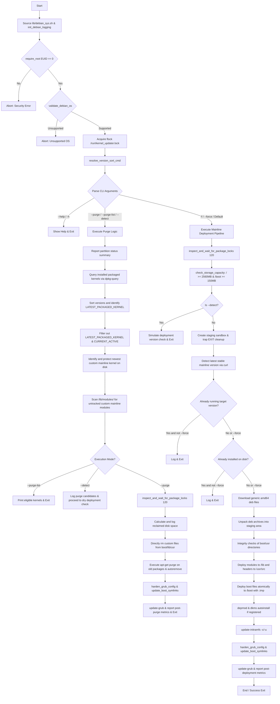

# ubuntu_kernel_updater.sh - Technical Specification and Architecture Document

This document provides a comprehensive overview of the design, architecture, security model, dependencies, and operational characteristics of the `ubuntu_kernel_updater.sh` utility. It is written for senior IT architects and systems administrators.

---

## 1. Application Overview and Objectives

The `ubuntu_kernel_updater.sh` script is a hardened system utility designed to automate three core tasks on Debian, Ubuntu, and Linux Mint distributions:
1. **Upstream Mainline Kernel Deployment:** Auto-detects, downloads, extracts, and atomically deploys the latest stable mainline Linux kernel from the official Ubuntu kernel archives.
2. **Hardened Kernel Purging:** Identifies and purges obsolete mainline (custom/untracked) and official (packaged/tracked) kernel installations to prevent `/boot` and `/usr/src` exhaustion, while strictly enforcing safety checks to keep the active booted kernel and the newest packaged kernel.
3. **Atomic Boot Symlink Management:** Automatically maps and updates `/boot/vmlinuz`, `/boot/initrd.img`, and optionally `.old` versions (as well as `/` equivalents if present) to point to the newest and second-newest kernels, ensuring no dangling links exist.

### Objectives
- **System Stability:** Implement atomic filesystem moves and dependency validation to guarantee that a partially downloaded or corrupted kernel installation never breaks the bootloader.
- **Space Optimization:** Maintain a healthy `/boot` partition size by cleaning obsolete modules, headers, and binary images.
- **Zero Lock-in:** Operate outside the native APT database for mainline deployments, ensuring that the official package manager database remains completely untouched and compatible.
- **Modular DRY Architecture:** Sources shared system services from [`lib/debian_sys.sh`](lib/debian_sys.sh) for unified logging, root validation, OS checks, storage capacity safeguards, 4-point APT/dpkg transaction lock auditing, GRUB recovery hardening, and symlink maintenance.

---

## 2. Architecture and Design Choices

### Core Design Principles
- **Decoupled Mainline Deployment:** Mainline kernels downloaded from the PPA repository are manually extracted and deployed to system directories (`/boot`, `/lib/modules`, and `/usr/src`) instead of being registered via `dpkg -i`. This protects the system package manager database from unresolved dependencies.
- **Shared Foundation Library ([`lib/debian_sys.sh`](lib/debian_sys.sh)):** Core infrastructure is modularized in `lib/debian_sys.sh`. Functions such as `require_root`, `validate_debian_os`, `resolve_version_sort_cmd`, `check_storage_capacity`, `inspect_and_wait_for_package_locks`, `harden_grub_config`, and `update_boot_symlinks` are shared across Debian DevOps utilities.
- **Atomic File Operations:** When files are copied to the critical `/boot` directory, they are first copied with a `.tmp` suffix (e.g. `vmlinuz-xxx.tmp`) and then atomically renamed via `mv`. This prevents a partial copy from being parsed by the bootloader in the event of power loss or disk exhaustion.
- **Atomic Symlink Management:** Updates system symlinks by creating a temporary link (`mktemp -u`) on the same filesystem and atomically renaming it (`mv -f`). This guarantees that a system crash or power failure never leaves a symlink in a half-written or corrupted state.
- **GRUB Recovery Hardening:** Checks and hardens `/etc/default/grub` during deployment, purge, and detect modes via `harden_grub_config`: ensures the bootloader menu style is visible (`menu`), has a valid timeout (`5` seconds), prevents indefinite menu hangs on failure recovery (`GRUB_RECORDFAIL_TIMEOUT=5`), and optimizes default kernel command-line parameters (`GRUB_CMDLINE_LINUX_DEFAULT`) by removing `quiet` (to display verbose boot diagnostics), ensuring `nomodeset` (for broad video display compatibility), and ensuring `panic=30` (to trigger auto-reboot on kernel panic). Creates timestamped backups (`/etc/default/grub.YYYYMMDD-HHMMSS`) on modification.
- **Pre-Flight Storage Capacity Guards:** Enforces dual-volume storage validation via `check_storage_capacity`: verifies `/` has at least 2,560 MB (2.5 GB) of staging/header overhead and `/boot` has at least 150 MB free space before downloading or staging. Prevents `ENOSPC` errors during `update-initramfs`.
- **4-Point APT Lock & Concurrency Management:** Uses `inspect_and_wait_for_package_locks` to audit `/var/lib/dpkg/lock-frontend`, `/var/lib/dpkg/lock`, `/var/cache/apt/archives/lock`, and `/var/lib/apt/lists/lock`. Dynamically identifies locker PIDs using `fuser`/`lsof` with `ps -fp` diagnostics and waits up to 120s for concurrent processes (`apt`, `unattended-upgrades`, `packagekitd`) to release.
- **Visible System Diagnostics:** Executes RAM disk creation (`update-initramfs`) without stderr suppression (`2>/dev/null`) so that compilation warnings, missing device driver warnings, or firmware alerts are immediately visible to administrators.
- **Script-Wide Mutual Exclusion (Locking):** Enforces a strict script-wide locking mechanism via `flock` on file descriptor 9 (`/run/kernel_updater.lock`). This prevents concurrent updates or purging instances from executing simultaneously, eliminating file-system write-collisions or race conditions.
- **Conditional DKMS Autoinstallation:** Checks if DKMS is installed on the host and queries `dkms status`. If registered out-of-tree modules (e.g. ZFS, Nvidia) are detected, it automatically executes `dkms autoinstall` to compile modules for the new mainline kernel before compiling the initramfs.
- **Dry-Run System Auditing (`--detect`):** Provides a complete non-destructive audit mode that scans for redundant kernels, tests remote mainline availability, and prints all actions that would be performed without modifying disk states.

### Assumptions
- **Architecture:** The target system must be running on `amd64` (x86_64) CPU architectures.
- **OS Compatibility:** The system must be a Debian-like distribution (`ubuntu`, `debian`, or `linuxmint` defined in `/etc/os-release`).
- **Network Access:** Sourcing remote mainline payloads requires outbound HTTPS connections to `kernel.ubuntu.com`.

### Edge Cases Handled
- **Missing Sourcing Utility:** If the standard `linux-version` tool is absent, `resolve_version_sort_cmd` automatically falls back to GNU standard `sort -V` for version resolution.
- **Lock Contention:** Prevents installation failures due to background `apt` or `unattended-upgrades` processes by auditing all 4 lockfiles and process tables, waiting up to 120s.
- **Shared Base Headers:** Shared base headers (e.g. `linux-headers-6.8.0-120`) are only deleted if no other flavored kernel (like `lowlatency`) is still installed on the system.
- **Disk Exhaustion on / and /boot:** Verifies `/` contains at least 2,560 MB and `/boot` contains at least 150 MB before downloading or extracting files; reports partition status summaries at start and completion.
- **Single Kernel Environments:** When only one kernel remains on the system, the script automatically removes the `.old` symlinks from both `/boot` and `/` to prevent dangling references.
- **Pre-Reboot Re-installation Prevention:** Checks if the target kernel version is already present on the filesystem in `/boot`. If it exists but is not yet the active booted kernel (pending reboot), the script aborts safely rather than repeating download and compilation phases.
- **Pre-Reboot Custom Kernel Protection:** During purging, the script automatically identifies the newest custom mainline kernel installed on disk (even if not booted yet) and protects it from being swept away as redundant.

---

## 3. Data Flow and Control Logic

### Operational Flow Diagram



### Data Sequencing (Mainline Pipeline)
1. **Scraping Phase:** Slices the HTML payload of `kernel.ubuntu.com/mainline/` -> Parses tags into version strings (`vX.Y.Z`) -> Sorts to locate the highest stable tag.
2. **Download Phase:** Queries the specific architecture folder -> Selects 4 essential files (`linux-image-*`, `linux-modules-*`, `linux-headers-*_all`, `linux-headers-*-generic`) -> Saves to staging sandbox.
3. **Extraction & Move Phase:** Unpacks archives in temporary sandbox -> Validates the directory structures -> Syncs files into system production pathways -> Runs `depmod` and `update-initramfs` -> Updates GRUB configuration.

---

## 4. Dependencies

The script relies on standard utilities found on modern Ubuntu/Debian server environments along with the shared foundation library.

### Shared Foundation Library
- **[`lib/debian_sys.sh`](lib/debian_sys.sh):** Enterprise Debian/Ubuntu common library providing unified logging, root privilege enforcement, OS validation, version sort detection, storage capacity auditing, 4-point APT/dpkg transaction lock inspection, GRUB recovery hardening, and boot symlink updates. (Searches local `./lib/debian_sys.sh` with fallback to `/opt/scripts/lib/debian_sys.sh`).

### System Utilities
- **`bash` (>= 4.0):** Execution shell.
- **`curl`:** HTTPS requests for version querying and binary downloads.
- **`dpkg-deb`:** Tool used to unpack package archives without installing them via `dpkg`.
- **`dpkg-query`:** Used to verify package ownership and sizes.
- **`awk` / `sed` / `grep`:** Text processing and metadata matching.
- **`df`:** Filesystem capacity verification for `/` and `/boot`.
- **`uname`:** Booted kernel version query (`uname -r`).
- **`fuser` / `lsof` (Optional, from `psmisc` / `lsof`):** Package manager lock holder PID auditing.
- **`linux-version` (Optional, from `linux-base`):** Standard kernel version sorting (falls back to `sort -V`).
- **`dkms` (Optional):** Dynamic Kernel Module Support auto-installer.
- **`depmod` / `update-initramfs` / `update-grub`:** Bootloader and kernel mapping integration.

---

## 5. Security Assessment

### Encryption in Transit
All outgoing HTTP connections made by the script to scrape metadata or retrieve Debian archives (`.deb` files) are strictly routed over **HTTPS** (TLS 1.2/1.3) using `curl -sSf`. This prevents man-in-the-middle (MITM) attacks and payload tampering during download.

### Secret Management
The script does not store, request, or handle any secrets, api keys, or system credentials.

### Authentication & Privilege Model
- **Root Context requirement:** Since it manages kernel deployments and configures system boot sequences (GRUB), the script runs strictly under a root context (`EUID == 0`). 
- **Non-Privileged Restriction:** If executed by a standard unprivileged user, the script immediately prints a Security Error and exits with status code `1`, preventing unauthorized system configuration tampering.

### RBAC (Role-Based Access Control)
System administrators should manage execution privileges of this script using standard Linux permissions and file ownership:
```bash
sudo chown root:root /opt/scripts/ubuntu_kernel_updater.sh
sudo chmod 700 /opt/scripts/ubuntu_kernel_updater.sh
```
This ensures that only the root user can read or execute the tool.

### Kernel Preservation and Anti-Accidental Deletion Guarantees
To ensure that the script never leaves a system in an unbootable state, multiple defensive preservation policies are mathematically and logically enforced during purge sweeps:
1. **Active Kernel Safeguard**: The script queries `uname -r` at startup and strictly validates that it resolves to a non-empty string. If this verification fails, execution is aborted immediately. The active booted kernel (`CURRENT_ACTIVE`) is explicitly skipped and protected during both custom file removals and package purging.
2. **Packaged Fallback Safeguard**: The package purge routine dynamically identifies the latest official packaged distribution kernel (`LATEST_PACKAGED_KERNEL`) and protects it from purging. This guarantees that at least one official distribution kernel remains on disk as a failsafe boot option.
3. **Mainline Preservation Safeguard**: During custom kernel sweeps, the script identifies the newest custom mainline kernel version (`latest_custom_kernel`) and protects it from purging, preserving newly installed kernels that are pending reboot.
4. **Single-Kernel Fail-Safe**: If there is only one kernel installed on the system, the logic will match it against the active kernel and latest package/mainline rules, setting `FOUND_ANY=false`. The script will output a safe status log and exit cleanly without executing any file removals or package purges. It is logically impossible to leave the system with zero kernels.

---

## 6. Code Quality Assessment and Review

### Linting
The script is fully compliant with POSIX/Bash coding standards and passes **ShellCheck** with zero errors or warnings:
```bash
shellcheck /opt/scripts/ubuntu_kernel_updater.sh
```

### Key Coding Safeguards Implemented
- **`set -euo pipefail`:**
  - `-e` (Exit immediately if a command exits with a non-zero status).
  - `-u` (Treat unset variables as an error when expanding).
  - `-o pipefail` (Pipeline returns the exit status of the last command to exit with a non-zero status).
- **Directory Traps:** Staging sandboxes are allocated using `mktemp -d`. An `EXIT` signal trap is registered early to guarantee that directory cleanups (`rm -rf`) are always executed upon script termination, regardless of whether it exits normally, crashes, or is terminated by the user (`Ctrl+C`).
- **Strict Version Pattern Validation (Regex)**: During purging operations, the script validates custom version strings using a strict regular expression pattern (`[[ "$kver" =~ ^[0-9][0-9a-zA-Z.-]+$ ]]`). This enforces that only well-formed kernel version names (starting with a digit and containing only alphanumeric characters, dots, and hyphens) can be processed, completely preventing directory traversal (`..`), spaces, or wildcard (`*`) expansions from triggering accidental deletions in `/boot`, `/lib/modules`, and `/usr/src`.

---

## 7. Command Line Arguments

| Option | Long Option | Description | Type | Default |
| :--- | :--- | :--- | :--- | :--- |
| `-h` | `--help` | Renders the usage matrix and exits. | Boolean | `false` |
| `-f` | `--force` | Force re-download and re-verification of the latest upstream kernel even if it matches the active runtime version, and bypass pre-flight storage capacity warnings on `/` and `/boot`. | Boolean | `false` |
| N/A | `--purge-list` | Scans the system and securely displays older custom mainline kernels and older packaged distribution kernels eligible for removal. | Boolean | `false` |
| N/A | `--purge` | Safely purges redundant older custom mainline kernels and older packaged distribution kernels while preserving the currently active kernel and the newest packaged distribution fallback. | Boolean | `false` |
| N/A | `--detect` | Dry-run audit mode: Scans system and prints all actions (purges, lock inspections, storage audits, and deployment steps) that would be performed without executing writes or deletions. | Boolean | `false` |

---

## 8. Detailed Operational Examples

### Example 1: Querying Eligible Kernels for Purging (`--purge-list`)
Use this command to safely check what kernels will be removed before executing the actual purge.

#### Command
```bash
sudo /opt/scripts/ubuntu_kernel_updater.sh --purge-list
```

#### Sample Output
```
[+] 2026-06-17 21:52:36 : Scanning system for custom mainline and packaged distribution kernel instances...
[!] 2026-06-17 21:52:36 : ELIGIBLE FOR PURGE: Custom Kernel [ 6.5.0-27-generic ]
[!] 2026-06-17 21:52:36 : ELIGIBLE FOR PURGE: Packaged Kernel [ 6.8.0-120-generic ]
```

---

### Example 2: Performing Kernel Purge Execution (`--purge`)
Executes the deletion of custom files and package purges non-interactively.

#### Command
```bash
sudo /opt/scripts/ubuntu_kernel_updater.sh --purge
```

#### Sample Output
```
[+] 2026-06-17 21:53:10 : Scanning system for custom mainline and packaged distribution kernel instances...
[+] 2026-06-17 21:53:10 : This purge will reclaim approximately 412 MB of disk space.
[!] 2026-06-17 21:53:10 : Crucial Step: Purging packaged kernel packages: linux-headers-6.8.0-120-generic linux-image-6.8.0-120-generic linux-modules-6.8.0-120-generic linux-modules-extra-6.8.0-120-generic linux-headers-6.8.0-120
(Reading database ... 281940 files and directories currently installed.)
Removing linux-headers-6.8.0-120-generic (6.8.0-120.120) ...
Removing linux-image-6.8.0-120-generic (6.8.0-120.120) ...
Purging configuration files for linux-image-6.8.0-120-generic (6.8.0-120.120) ...
...
[+] 2026-06-17 21:53:45 : Running autoremove to clean up unused dependencies...
[+] 2026-06-17 21:53:50 : Rebuilding system bootloader layout configuration maps...
Generating grub configuration file ...
Found linux image: /boot/vmlinuz-7.1.0-070100-generic
Found initrd image: /boot/initrd.img-7.1.0-070100-generic
Found linux image: /boot/vmlinuz-6.8.0-124-generic
Found initrd image: /boot/initrd.img-6.8.0-124-generic
done
==========================================================================
[+] 2026-06-17 21:54:02 : Selected custom and packaged kernel configurations successfully purged!
==========================================================================
```

---

### Example 3: Upstream Stable Kernel Check and Deployment (Default)
Queries the remote repository and installs the newest stable kernel if it is newer than the booted kernel.

#### Command
```bash
sudo /opt/scripts/ubuntu_kernel_updater.sh
```

#### Sample Output (Up-to-Date System)
```
[+] 2026-06-17 21:55:01 : Initializing hardened kernel deployment pipeline...
[+] 2026-06-17 21:55:01 : Auto-detecting latest stable upstream kernel...
[+] 2026-06-17 21:55:02 : Latest stable version detected: v7.1.0
[!] 2026-06-17 21:55:02 : System is already running 7.1.0-070100-generic. Aborting safely.
```

---

### Example 4: Dry-Run Mode Option (`--detect`)
Scans the system and lists all actions (purges and/or deployments) that would be performed, without executing any writes or deletions.

#### Command
```bash
sudo /opt/scripts/ubuntu_kernel_updater.sh --detect
```

#### Sample Output
```
[+] 2026-06-22 14:37:40 : [DETECT] Scanning system for custom mainline and packaged distribution kernel instances...
[+] 2026-06-22 14:37:40 : [DETECT] No redundant custom or packaged kernels detected for purging.
[+] 2026-06-22 14:37:40 : [DETECT] Initializing dry mainline kernel deployment pipeline...
[+] 2026-06-22 14:37:40 : Auto-detecting latest stable upstream kernel...
[+] 2026-06-22 14:37:42 : Latest stable version detected: v7.1.1
[+] 2026-06-22 14:37:42 : [DETECT] System is already running 7.1.1-070101-generic. No deployment would be performed.
```
