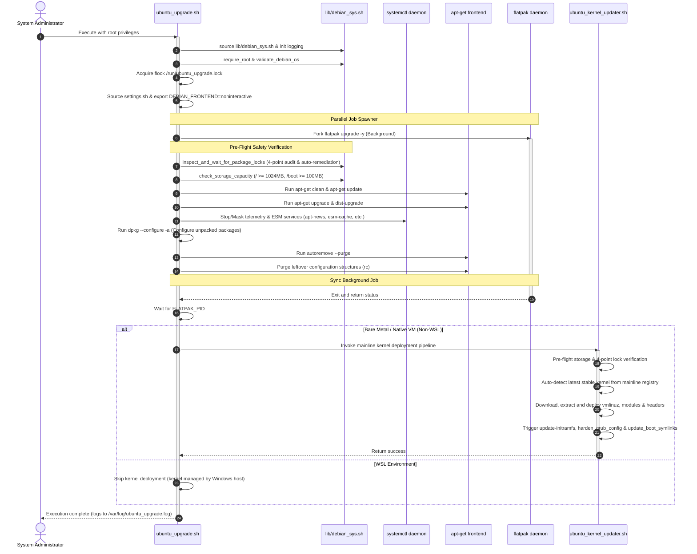

# Ubuntu Upgrade & Hardening Utility Suite Documentation

This documentation provides an architectural and functional overview of the automated upgrade and system hardening suite, which consists of the orchestrator script [ubuntu_upgrade.sh](ubuntu_upgrade.sh), the standalone deployment engine [ubuntu_kernel_updater.sh](ubuntu_kernel_updater.sh), and the shared foundation library [`lib/debian_sys.sh`](lib/debian_sys.sh).

---

## 1. Application Overview and Objectives

The objective of the upgrade suite is to automate system-level updates, strip tracking/telemetry mechanisms, optimize performance through parallel execution, and manage mainline kernel lifecycles.

### Primary Objectives:
1. **Automated Package lifecycle management:** Fully non-interactive execution of system package upgrades and kernel distribution upgrades.
2. **System Hardening:** Disabling and masking of telemetry services, ESM caching layers, and MOTD ads.
3. **Execution Optimization:** Concurrently running Flatpak upgrades in the background to avoid blocking native APT processes.
4. **Custom Upstream Kernel Deployment:** Checking, staging, verifying, and deploying mainline Linux kernels while keeping the native APT package manager clean of dependency issues.
5. **System Sanitation:** Safe recovery of unconfigured packages and clean removal of removed package configuration structures.
6. **Pre-Flight Safety Architecture:** Enforcing strict filesystem storage thresholds on `/` and `/boot`, and comprehensive 4-point APT/dpkg transaction lock auditing via [`lib/debian_sys.sh`](lib/debian_sys.sh).

---

## 2. Architecture and Design Choices, Assumptions, and Edge Cases

### Architectural Design Choices
* **Shared Foundation Library ([`lib/debian_sys.sh`](lib/debian_sys.sh)):** Core infrastructure is decoupled into `lib/debian_sys.sh`, providing common logging (`init_debian_logging`), administrative privilege validation (`require_root`), platform checks (`validate_debian_os`, `is_wsl`), 4-point transaction lock management, dual-volume storage validation, and automatic upgrade remediation across the toolchain.
* **Bypassing APT for Mainline Kernels:** Mainline kernels from upstream distributions are unpacked manually via `dpkg-deb -x` rather than installed via `dpkg -i`. This design choice protects the host APT database from dependency mismatches (e.g., when a new kernel requires a newer glibc than the host distribution provides). 
* **Process Parallelism:** By spawning Flatpak updates in a background process, the native package manager (`apt-get`) can update concurrently. Since Flatpak uses sandboxed user/system space libraries, it does not lock `/var/lib/dpkg/lock-frontend`, preventing write conflicts.
* **Environment Sourcing:** The application sources `sysenv.sh` to explicitly define and export `PATH` variable hierarchies, ensuring that execution path resolution remains identical whether run interactively, via crontab, or under systemd timers.
* **Pre-Flight Filesystem Capacity Safeguards:** Before initiating repository updates or package upgrades, the script executes `check_storage_capacity` from `lib/debian_sys.sh`, verifying that `/` contains at least 1,024 MB (1.0 GB) and `/boot` contains at least 100 MB of free storage. If capacity is critically low, it aborts execution with a hint to run the kernel purge routine or pass `-f/--force`.
* **4-Point APT Lock Resilience & Self-Healing Contention Detection:** Applies `-o DPkg::Lock::Timeout=120` across all APT operations to prevent immediate failure upon lock conflicts. Before executing transactions, the script calls `inspect_and_wait_for_package_locks`, inspecting `/var/lib/dpkg/lock-frontend`, `/var/lib/dpkg/lock`, `/var/cache/apt/archives/lock`, and `/var/lib/apt/lists/lock`. If a background automatic upgrade service (`unattended-upgrades`, `apt-daily.service`, `packagekitd`) is detected holding the lock, it passes `disable_autoupgrades` as an automatic remediation hook to permanently mask background timers and configure periodic directives to `0`, self-healing the host while waiting for the active job to release.
* **Robust Status Parsing & Safe Purging:** Package states are checked using `dpkg-query` formatting strings rather than scraping standard `dpkg -l`, and package purges pipe into `xargs -r` to eliminate word-splitting bugs and command line length limits (`ARG_MAX`).
* **Script-Wide Mutual Exclusion (Mutex):** Enforces exclusive single-instance execution via `flock` on file descriptor 8 (`/run/ubuntu_upgrade.lock`), preventing race conditions, dual Flatpak updates, or overlapping package operations if executed concurrently.
* **Process Lifecycle Trapping:** Implements signal and exit traps (`EXIT`, `INT`, `TERM`) to cleanly terminate asynchronous Flatpak background tasks (`FLATPAK_PID`) if the main process is interrupted, preventing orphaned background updates.

### Key Assumptions
* **Execution Context:** The calling user has root context (`EUID = 0`), validated via `require_root`.
* **Active Networking:** An online route exists to communicate with Debian/Ubuntu package mirrors and the Ubuntu Mainline Kernel Index (`https://kernel.ubuntu.com/mainline/`).
* **Systemd Availability:** The host relies on systemd for process control (fallback wrappers handle exceptions).

### Edge Cases Handled
* **Interrupted Packages:** Runs `dpkg --configure -a` before cleanups to configure any `unpacked` packages that failed in a previous run.
* **Pre-Flight Storage Protection on / and /boot:** Verifies `/` contains $\ge$ 1,024 MB and `/boot` contains $\ge$ 100 MB free space during system upgrades (and the chainloaded kernel updater verifies `/` $\ge$ 2,560 MB and `/boot` $\ge$ 150 MB), preventing initramfs `ENOSPC` generation crashes.
* **Unsafe Delete Guard:** When purging custom kernels, the script validates that the kernel version string contains more than 6 characters to prevent execution of destructive `rm -rf` operations on truncated directories.
* **WSL Subsystem Adaptation:** Uses `is_wsl` from `lib/debian_sys.sh` to detect Windows Subsystem for Linux environments and automatically bypasses the mainline kernel deployment stage, as WSL kernels are virtualized and maintained via the Windows host hypervisor.
* **Resilient Environment Loading:** Sourcing of `settings.sh` searches `/opt/scripts/settings.sh` and user script directories before gracefully falling back to default script pointers, preventing execution failures on systems where `settings.sh` has not been placed.
* **Contention with Unattended Upgrades:** Automatically detects when background upgrade timers hold the APT frontend lock and remedies the collision by disabling/masking them. Also supports the `--disable-autoupgrades` CLI parameter to explicitly stop, disable, and mask systemd timers (`apt-daily.timer`, `apt-daily-upgrade.timer`) and set APT periodic configurations to `0`.

> [!NOTE]
> When operating in Windows Subsystem for Linux (WSL), the session must be run with Bash in **login mode** (e.g., `bash -l` or `wsl.exe -d <distro>`) so that user and system profiles (`/etc/profile`, `~/.bash_profile`, `~/.profile`) are loaded, ensuring environment variables, user script paths, and Windows drive mounts (such as `/mnt/e`) are initialized.

---

## 3. Data Flow and Control Logic

### Operational Flow Sequence


---

## 4. Dependencies

The utility suite relies on the following standard utilities and libraries:

| Dependency | Required Version / Range | Context of Usage |
| :--- | :--- | :--- |
| **[`lib/debian_sys.sh`](lib/debian_sys.sh)** | Sourced (`local` or `/opt/scripts/lib`) | Common Debian/Ubuntu foundation library providing unified logging, root validation, OS checks, 4-point APT/dpkg lock auditing, auto-upgrade remediation, and dual-volume storage validation. |
| **Bash** | `>= 4.0` | Interpreting shell control structures. |
| **apt-get** | Standard APT suite | Syncing repository indexes and applying system patches. |
| **dpkg-query** | Standard dpkg utility | Inspecting package statuses securely. |
| **df** | POSIX / GNU coreutils | Filesystem capacity verification for `/` and `/boot`. |
| **curl** | Standard binary | Fetching remote HTML indexes and downloading mainline kernel assets. |
| **fuser** / **lsof** | Optional (`psmisc` / `lsof`) | Detecting locker PIDs holding APT/dpkg lock files. |
| **flatpak** | Optional | Updating sandboxed application runtimes in parallel. |
| **systemctl** | Optional (Systemd environment) | Disabling and masking telemetry and background upgrade services. |
| **depmod** | Standard module-init-tools | Rebuilding hardware module maps for newly deployed kernels. |
| **update-initramfs** | Standard initramfs-tools | Compiling the initial RAM disk boot environment. |
| **update-grub** | Standard grub2 utility | Updating GRUB boot options to integrate the new kernel. |

---

## 5. Security Assessment

### Encryption in Transit
* **HTTPS Enforcement:** Communication with the mainline kernel index is forced over HTTPS (`https://kernel.ubuntu.com/mainline/`). If redirection to HTTP is attempted, `curl -sSf` rejects the transaction.
* **APT Validation:** Repository indexes and archive packages are validated by APT using native GPG verification keys before unpacking.

### Secret Management
* **Credentials:** The application does not store, process, or require system tokens, passwords, or configuration keys.
* **Log Scrubbing:** Output verification logs written to `/var/log/ubuntu_upgrade.log` and `/var/log/flatpak_upgrade.log` contain no sensitive configuration details.

### Authentication & Authorization (RBAC)
* **Access Control:** The script verifies the execution context (`EUID = 0`) via `require_root`. Non-root executions fail immediately, preventing unprivileged users from accessing package databases or service managers.
* **Execution Context:** As a system-level upgrade tool, the script operates within a highly privileged administrative container/context. It does not run in user space.

---

## 6. Code Quality Assessment and Linting

### Linting Compliance
The upgrade suite was analyzed using **ShellCheck** to verify syntax compatibility and security controls.
* **Diagnostic Command:** `shellcheck /opt/scripts/ubuntu_upgrade.sh`
* **Result:** `Passed with zero warnings, errors, or stylistic exceptions.`

### Hardened Parameters in Scripting
1. **Shell Security Flags:** Sourced with `set -euo pipefail`. The script will terminate immediately if any component command returns a non-zero exit code, or if an uninitialized variable is referenced.
2. **Safe Array Handling:** Options like `APT_OPTS` are stored as Bash arrays (`"${APT_OPTS[@]}"`) to preserve double-quoting and prevent word-splitting vulnerabilities.
3. **dpkg-query Safe Parsing:** Package removals extract package names by matching against specific db status strings, completely avoiding terminal-width dependent truncation bugs.

---

## 7. Command Line Arguments

### Orchestrator: `ubuntu_upgrade.sh`
* **`-h, --help`**: Display CLI usage matrix and exit.
* **`-f, --force`**: Bypass pre-flight checks (e.g., `/` and `/boot` disk capacity warnings).
* **`--max-root`**: Explicitly execute `max_root.sh` before running upgrades to optimize root (`/`) filesystem free space. (Note: this is also activated automatically if free space is below the recommended threshold).
* **`--disable-autoupgrades`**: Permanently stop, disable, and mask automatic background APT timers/services (`apt-daily`, `apt-daily-upgrade`, `unattended-upgrades`) and set `/etc/apt/apt.conf.d/20auto-upgrades` directives to `0` prior to running system upgrades. (Note: this is also activated automatically if background lock contention is detected).
* **`--disable-autoupgrades-only`**: Stop, disable, and mask background APT update services and timers, then exit immediately without executing system package upgrades.

---

## 8. Detailed Use and Deployment Examples

### Example 1: Executing a System Upgrade and Mainline Deployment
To execute the complete system upgrade process, run:
```bash
sudo /opt/scripts/ubuntu_upgrade.sh
```

> [!NOTE]
> When running under Windows Subsystem for Linux (WSL), ensure the distribution session is opened with Bash in **login mode** (e.g., `wsl.exe -d Ubuntu-24` or `wsl.exe -d <distro> bash -l`) so that all profile scripts, environment variables, and filesystem mount configurations are fully loaded prior to execution.

#### Expected Log Output `/var/log/ubuntu_upgrade.log`:
```
[+] 2026-06-18 03:20:00 : Starting background Flatpak updates (logging to /var/log/flatpak_upgrade.log)...
_____LOCK-INSPECTION->PRD|prd|wks|localhost_________________________________
[+] 2026-06-18 03:20:00 : Inspecting APT/dpkg transaction locks and active package managers...
[+] 2026-06-18 03:20:00 : No active package manager locks detected. Safe to proceed.
_____DISK-CAPACITY-CHECK->PRD|prd|wks|localhost_____________________________
[+] 2026-06-18 03:20:01 : Filesystem capacity metrics:
[+] 2026-06-18 03:20:01 :   -> Root (/) : / (45G free / 15% used) (free: 46080 MB, recommended >= 1024 MB)
[+] 2026-06-18 03:20:01 :   -> Boot     : /boot (850M free / 22% used) (free: 850 MB, recommended >= 100 MB)
[+] 2026-06-18 03:20:01 : Storage capacity check passed. Filesystems have sufficient headroom.
_____APT-CACHE-SYNC->PRD|prd|wks|localhost__________________________________
Hit:1 http://archive.ubuntu.com/ubuntu noble InRelease
Hit:2 http://archive.ubuntu.com/ubuntu noble-updates InRelease
Reading package lists...
_____APT-PATCH-OS->PRD|prd|wks|localhost_____________________________________
Reading package lists...
Building dependency tree...
Calculating upgrade...
0 upgraded, 0 newly installed, 0 to remove and 0 not upgraded.
_____APT-PATCH-KERNEL->PRD|prd|wks|localhost_________________________________
Reading package lists...
Building dependency tree...
Calculating upgrade...
0 upgraded, 0 newly installed, 0 to remove and 0 not upgraded.
_____APT-PATCH-CLEANUP->PRD|prd|wks|localhost________________________________
[+] 2026-06-18 03:20:05 : Attempting to configure any unpacked packages...
[+] 2026-06-18 03:20:06 : Autoremove and clean orphan packages
[+] 2026-06-18 03:20:08 : Waiting for background Flatpak updates to complete...
[+] 2026-06-18 03:20:10 : Initializing hardened kernel deployment pipeline...
[+] 2026-06-18 03:20:10 : Auto-detecting latest stable upstream kernel...
[+] 2026-06-18 03:20:12 : Latest stable version detected: v6.8.1
[!] 2026-06-18 03:20:12 : System is already running 6.8.1-060801-generic. Aborting safely.

Execute after reboot to purge obsolete kernels:
   [1] sudo /opt/scripts/ubuntu_kernel_updater.sh --purge
```

### Example 2: Purging Obsolete System Kernels
To check and remove older, redundant kernel installations and reclaim space:
```bash
sudo /opt/scripts/ubuntu_kernel_updater.sh --purge
```

#### Expected Log Output `/var/log/kernel_updater.log`:
```
[+] 2026-06-18 03:21:00 : Current filesystem metrics:
[+] 2026-06-18 03:21:00 :   -> Root (/) : / (45G free / 15% used)
[+] 2026-06-18 03:21:00 :   -> Boot     : /boot (850M free / 22% used)
[+] 2026-06-18 03:21:00 : Scanning system for custom mainline and deletion/packaged distribution kernel instances...
[!] 2026-06-18 03:21:02 : ELIGIBLE FOR PURGE: Packaged Kernel [ 6.5.0-18-generic ]
[+] 2026-06-18 03:21:02 : This purge will reclaim approximately 412 MB of disk space.
[!] 2026-06-18 03:21:02 : Crucial Step: Purging packaged kernel packages: linux-image-6.5.0-18-generic linux-headers-6.5.0-18-generic
[+] 2026-06-18 03:21:05 : Running autoremove to clean up unused dependencies...
[+] 2026-06-18 03:21:08 : Rebuilding system bootloader layout configuration maps...
Generating grub configuration file ...
Found linux image: /boot/vmlinuz-6.8.1-060801-generic
Found initrd image: /boot/initrd.img-6.8.1-060801-generic
done
==========================================================================
[+] 2026-06-18 03:21:12 : Selected custom and packaged kernel configurations successfully purged!
==========================================================================
[+] 2026-06-18 03:21:12 : Post-purge filesystem metrics:
[+] 2026-06-18 03:21:12 :   -> Root (/) : / (46G free / 14% used)
[+] 2026-06-18 03:21:12 :   -> Boot     : /boot (950M free / 12% used)
```

### Example 3: Disabling Background Automatic Upgrades on Dedicated Nodes
To permanently stop and mask automatic background APT timers and services prior to executing system upgrades:
```bash
sudo /opt/scripts/ubuntu_upgrade.sh --disable-autoupgrades
```

Or to disable automatic background upgrades without performing a system package upgrade:
```bash
sudo /opt/scripts/ubuntu_upgrade.sh --disable-autoupgrades-only
```
